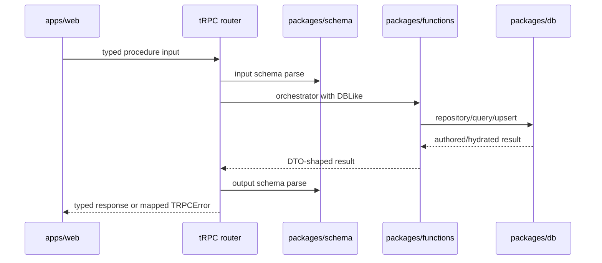

# Transport and tRPC

> Status: canonical (current working-tree baseline)
>
> Scope: web → tRPC → schema → application services
>
> Update when: a procedure, DTO, auth rule, or error mapping changes
>
> Verification: `apps/apis/src/trpc/router.ts`, `apps/apis/src/trpc/dbContext.ts`, `apps/apis/src/trpc/handler.ts`, and `apps/web/src/lib/api.ts`

`apps/apis` is the product-data boundary for the web app. The router is deliberately thin: it selects a schema, requires authentication where appropriate, opens a user-scoped DB context, calls a function/query/repository service, and parses the output schema.

## Router shape

Authenticated `rolls.execute` accepts a restricted expression, optional single-d20 advantage/disadvantage mode, and character/source context, resolves the character-owned ruleset, and returns server-generated ordered evidence including both d20 faces and the kept face. Manual expressions may attach one numeric modifier to each dice term; evidence retains those term modifiers and their aggregate for compatible total verification. Except for manual rolls, the expression, mode, and source must match a roll surface derived from the current Sheet projection. `rolls.history` returns the caller's latest 20 private records; `rolls.discard` removes only the caller's specified unconsumed roll when its presentation is canceled before settlement.

`appRouter` groups public application configuration, account profile data, route identity, systems, authored content, characters, and `nodeRuntime`. `account.profile` and `account.updateProfile` are authenticated, user-scoped procedures over the private profile row. Username is optional profile data; the update procedure validates non-null values, while PostgreSQL remains authoritative for concurrent claims and maps username uniqueness races to `CONFLICT`. `application.featureFlags` is an unauthenticated typed response containing browser-safe, server-parsed booleans. It supports web and future native presentation decisions but is not an authorization boundary. Authored domains use a shared `authoredDomainRouter` for list/get/draft/activate/delete/duplicate operations. `activate` is the single direct-input activation path; there is no duplicate authored-content `upsert` alias. Character procedures are explicit because Builder and Sheet have different contracts: `draft`, `getDraft`, `saveDraft`, `resolve`, `previewSave`, `upsert`, `sheet`, `panel`, `history`, and `command`. The authenticated `panel` query accepts a closed target union and returns a schema-validated semantic panel variant; adjustment commands return affected panel variants alongside the updated Sheet.

Every authenticated procedure uses `authenticatedProcedure`, then `withAuthenticatedDb`. The latter:

1. rejects a missing `ctx.userId`;
2. obtains a shared Kysely instance for the connection string;
3. wraps the callback in `withUserContext`, setting the Supabase JWT subject inside a transaction;
4. maps known domain/schema errors to stable tRPC error codes.

Inputs and outputs come from `packages/schema/src/api/**` and subject/grant contracts. Do not create route-local DTOs when a reusable schema is missing; add it to schema and reuse it.

Authored detail responses may include structured draft validation issues (`code`, `message`, and nested `path`) when a saved JSON draft cannot be parsed. The web may use those paths for repair navigation while preserving the existing invalid-draft discard fallback. Detail lifecycle metadata uses active and draft timestamps rather than immutable revision IDs. These diagnostics describe boundary parsing; they do not replace node-runtime progress or compiler validation.

Authored `saveDraft`, `activateDraft`, and `activate` input failures also expose those structured issues through the tRPC error shape. The formatter is intentionally restricted to the eight authored-domain mutation paths and known validation error codes; unrelated and internal errors remain opaque. The web retains the issues on `ApiError`, routes each path to the deepest owning authoring target, and clears only issues related to a field the author changes.

## Error and security boundary

Zod errors become `UNPROCESSABLE_CONTENT`; ownership, not-found, dependency, concurrency, node-runtime input, and Sheet command failures map to `FORBIDDEN`, `NOT_FOUND`, `CONFLICT`, or `BAD_REQUEST` as appropriate. An exhausted authored-root creation window maps to `TOO_MANY_REQUESTS`/HTTP 429. tRPC POST bodies over 1 MiB are rejected from their actual streamed bytes with HTTP 413 before authentication and JSON parsing; authored mutation schemas independently enforce the same total limit after domain parsing. Unknown errors remain internal.

The browser may know route names and DTOs, but it must not bypass the router to read/write product rows. Supabase client/server helpers in web are authentication infrastructure; product mutations belong in API procedures. Public sign-up, credential changes, appearance metadata, and account deletion are auth-lifecycle exceptions. Account deletion runs through a same-origin server function, requires the exact account email and current password, globally revokes refresh sessions, and uses a server-only admin client for the hard delete. A client-visible flag or user-metadata value is never an authorization decision.

## Authored-domain orchestration

The eight authored-domain procedures share functions-owned list/detail/draft/activate/duplicate use cases. The tRPC router supplies authentication, schemas, and the domain configuration only. Active detail hydrates the canonical domain aggregate; draft detail reads and validates the separate JSON payload. Active detail responses expose `hasDraft` without loading the draft payload; the full draft is returned only for an explicit draft view or its invalid-draft recovery response. Nested features, options, grants, and effects are saved through their owning root payload; they do not have competing product endpoints.

Duplicating authored content is a deep fork of that owned aggregate. The root and every nested entity identity are regenerated, references to identities owned by the copied graph are remapped to the corresponding replacements, and references to external canonical records remain unchanged. A copied draft must therefore have no mutable object or owned UUID identity in common with its source, and later edits to either aggregate cannot affect the other.

## Import and portable export

Authenticated `/api/imports/preview` and `/api/imports/commit` handlers accept the versioned import contracts from `packages/schema`. They sit outside the 1 MiB tRPC JSON limit because a batch may contain up to 25 MiB of source files, but they retain the same-origin, authentication, size, schema, ownership, and error boundaries. Preview is stateless and performs no writes; commit reparses the original batch and applies only the selected entries plus their explicit collision resolutions transactionally. Deselected entries are reported as skipped.

D&D Beyond inputs are ordinary character-sheet URLs. The server extracts the numeric ID and fetches only the allowlisted public character endpoint without forwarding browser credentials. Foundry and Artificer inputs are JSON text. Portable export is limited to an owned active item or its draft and omits ownership, timestamps, and internal lifecycle metadata.

The client interface is manually created in `apps/web/src/lib/api.ts`, so procedure renames require updating both router and client usage until generated inference replaces that mirror.

## Local development build boundary

The web server imports the published package entrypoints, so `apps/apis` resolves through its compiled `dist` output during local development. The root `yarn dev` command runs `yarn dev:prepare` first to rebuild that output before starting Vite. If Vite is started directly from `apps/web`, run the root `yarn dev:prepare` command first; otherwise a changed API router or procedure can appear broken while the browser is still executing an older build artifact.
