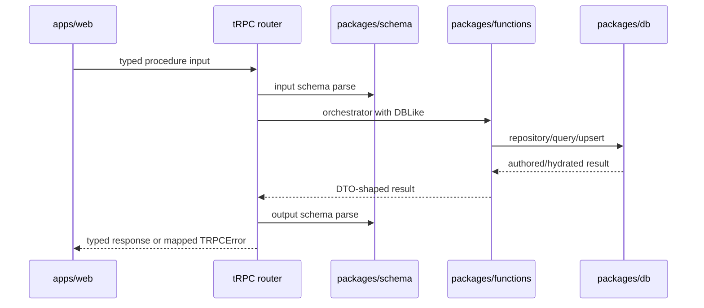
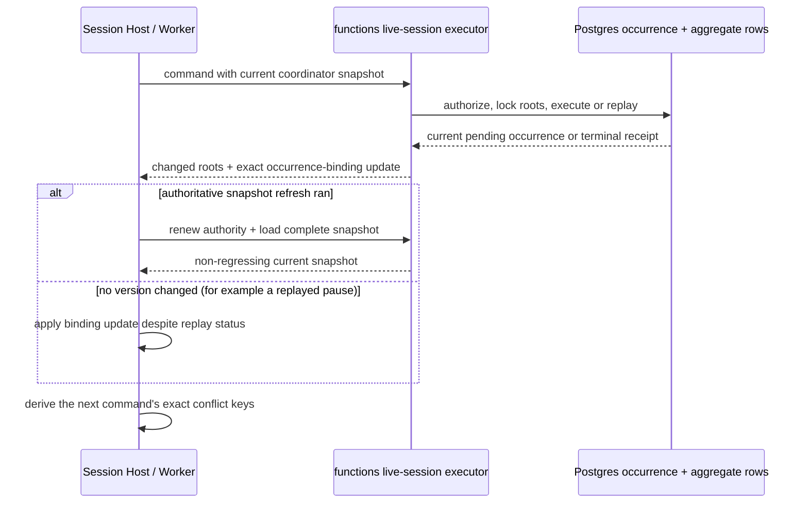

# Transport and tRPC

> Status: canonical (current working-tree baseline)
>
> Scope: web → tRPC → schema → application services
>
> Update when: a procedure, DTO, auth rule, or error mapping changes
>
> Verification: `apps/apis/src/trpc/router.ts`, `apps/apis/src/trpc/procedures.ts`, the owning `apps/apis/src/trpc/*Router.ts`, `apps/apis/src/trpc/dbContext.ts`, `apps/apis/src/trpc/handler.ts`, `apps/web/src/lib/api.ts`, and the owning `apps/web/src/lib/api/*.ts` modules

`apps/apis` is the product-data boundary for the web app. Its domain routers are deliberately thin: each selects a schema, requires authentication where appropriate, opens a user-scoped DB context, and calls a function/query/repository service. Declared tRPC output schemas validate the completed callback result before the response leaves the boundary.

## Router shape

`procedures.ts` owns the shared tRPC setup, error formatter, authentication middleware, and base procedures. Each domain router owns only its procedure wiring, and `router.ts` directly composes those routers without a compatibility or merge layer.

Authenticated `rolls.execute` accepts a restricted expression, optional single-d20 advantage/disadvantage mode, and character/source context, resolves the character-owned ruleset, and returns server-generated ordered evidence including both d20 faces and the kept face. Manual expressions may attach one numeric modifier to each dice term; evidence retains those term modifiers and their aggregate for compatible total verification. Except for manual rolls, the expression, mode, and source must match a roll surface derived from the current Sheet projection. `rolls.history` returns the caller's latest 20 private records; `rolls.discard` removes only the caller's specified unconsumed roll when its presentation is canceled before settlement.

`appRouter` groups public application configuration, account identity/profile data, route identity, systems, authored content, characters, Campaigns, and `nodeRuntime`. `account.usernameStatus` exposes only username availability. `account.signInWithUsername` resolves the private auth email server-side, delegates password verification to Supabase Auth, and returns session credentials without returning the email; credential failures use one generic error while rate limits remain distinguishable. The trusted proxy client IP is forwarded to Supabase Auth with the secret-key client so its per-IP limits do not collapse onto one server bucket. `account.completeInvitation` claims the required username before marking invitation setup complete. `account.profile` and `account.updateProfile` are authenticated, user-scoped procedures over the private profile row. A user may rename immediately after validation; PostgreSQL remains authoritative for concurrent username claims and maps uniqueness races to `CONFLICT`. `application.featureFlags` is an unauthenticated typed response containing browser-safe, server-parsed booleans. It supports web and future native presentation decisions but is not an authorization boundary. Authored domains use a shared `authoredDomainRouter` for list/get/draft/activate/delete/duplicate operations. `activate` is the single direct-input activation path; there is no duplicate authored-content `upsert` alias. Character procedures are explicit because Builder and Sheet have different contracts: `draft`, `getDraft`, `saveDraft`, `resolve`, `previewSave`, `upsert`, `sheet`, `panel`, `history`, and `command`. The authenticated `panel` query accepts a closed target union and returns a schema-validated semantic panel variant; adjustment commands return affected panel variants alongside the updated Sheet.

`campaigns` exposes lifecycle, owner-only settings and copying, tokenless username invitation inbox operations, assignment, chat and Campaign rolls, notebook collaboration, Session scheduling/RSVP/attendance/sections/reference pins, Campaign play settings, Vehicle custody, private attachments, immutable announcements, the manual Campaign clock, inventory and currency custody, direct authored-content share/list operations, and GM adjustment/condition/spell/audit procedures. Direct shares are root-scoped Campaign authorization with no submission/review or approval-version contract; destructive share/member/source loss is reconciled by the owning transactional service. `getSettings` is the separately authorized owner-edit projection and returns original Campaign metadata; ordinary shared Campaign reads apply the Campaign maturity presentation policy. `copy` creates a fresh Campaign aggregate from reusable preparation without copying its cohort, run state, or third-party share authority. Invitation UUIDs are identifiers rather than bearer grants, and acceptance always binds the record to the authenticated recipient. RSVP commands may update only the caller's response. Session scheduling, attendance, GM-private preparation/reference pins, finish, clock commands, Vehicle changes, and announcement publication remain owner-authorized; finished sessions cannot reopen or be deleted, while shared notes remain editable.

`socialHub` is one thin authenticated router for Social profile initialization, the private Social content preference, public profile projection, discovery, listing lifecycle, applications, blocks, reports, and superadmin moderation. It never returns a Campaign identifier or route. `eligibility.initialize` creates the authenticated user's private Social profile on first use without collecting age or location data. `preferences.update` may receive a birth date only when Mature viewing needs adult self-attestation; the functions service calculates 18+ and discards the date before persistence. The owner-only `listings.getOwned` edit projection returns original listing text. Standard ordinary Social responses remain masked; Mature responses are original only for the Campaign owner or an adult-attested viewer with the Mature preference. Application text is returned only to the applicant, the sole Campaign owner, or a superadmin after the report-evidence view has been audited, and the owner's view is masked for a Standard Campaign. Moderator queue reads contain metadata only; `openReport` is intentionally a mutation because it appends the `VIEWED` action before returning original evidence.

`notifications.feed`, `markAllSeen`, `markRead`, `preferences`, and `updatePreferences` are authenticated procedures that resolve the caller server-side. They expose at most the latest 25 schema-validated safe items and SOCIAL/CAMPAIGN channel choices. The browser cannot select another recipient or read notification tables directly.

Notification payloads and links carry public source IDs only. One safe event payload drives the durable feed projection and direct Resend email in the Supabase Edge dispatcher. Rendered email HTML, text, subjects, email addresses, and provider URLs never enter an intent, log, or feed response. The web maps fixed data kinds to known internal routes rather than rendering provider URLs or HTML. Every destination performs its ordinary Social or Campaign API read, so current ownership, membership, moderation, and symmetric-block rules still apply. Missing or newly unauthorized sources return the same generic unavailable behavior; notification presence never grants access.

`encounters.blueprints` exposes creator-only, Game-System-scoped Blueprint list/create/update procedures. Create retries use owner-scoped command IDs; versioned updates use durable owner-and-command receipts and return the closed stored result on matching replay. `encounters.create` accepts a Campaign, open Session, and Blueprint ID; the Campaign supplies the System and current automation policy, while the service pins the Blueprint version/checksum and effective `automationMode` plus GM-only `manualReminderMode` before copying actors. Player Encounter projections expose `automationMode` only. The transitional `rule_pack_revision_id` remains mechanics authority in Gate 1. GM commands, role-projected reads, and filtered timeline behavior remain unchanged.

Campaign Realtime is a private invalidation channel, not a second mutation or history transport. Services commit Postgres first and then attempt a best-effort Broadcast containing only the Campaign scope, entity/event identity, cursor, and version. A Campaign metadata hint invalidates both Campaign and Social query roots so maturity and indexed projections refetch immediately. The web falls back to polling/cursor recovery after disconnect.

## Authoritative live-session coordination

The local Session Host and managed Session Worker use the same server-only coordinator snapshot and executor-result contracts. The snapshot carries the Session-presented Campaign Scene, current aggregate versions, Character vision facts, optional Encounter-to-Scene and actor-to-token bindings, and the exact binding for each pending Encounter rule occurrence. That occurrence binding is derived from the occurrence's sealed pending snapshot rather than inferred from the Encounter or Scene catalogue:

- `SPATIAL` binds one occurrence to its exact Campaign Scene through the Encounter binding;
- `NON_SPATIAL` explicitly carries no Scene binding.

`RESOLVE_RULE_OCCURRENCE` fails closed unless exactly one binding matches its Encounter and occurrence. A spatial resolution claims the Encounter, the exact bound Scene, and the Encounter's bound Characters; a non-spatial resolution does not claim a Scene merely because the Encounter has one. A command result adds, replaces, or clears the cached binding immediately. A persisted replay whose pause changed no aggregate version must still reconcile that binding; when a full authoritative refresh ran, the refreshed snapshot wins. Any replay refresh must cover both the replay's changed roots and every root already represented in the coordinator, so recovery cannot drop or regress unrelated state.

Every mechanics-bearing movement result carries a canonical, sorted list of the aggregate transitions committed by that exact command. Each transition includes its before and after version. The Host and Worker apply those transitions atomically and refresh only the roots named by the fresh command. A later occurrence resume may advance the same Character, Encounter, or Scene again, but replaying the original movement command returns the original command's transition list—not transitions reconstructed from the occurrence's final result. Current coordinator snapshots retain only the latest final version for each root.

Fresh command responses are visible to the GM and the currently authorized requester. Cached or reconnect delivery does not reuse the requester's privileged response projection. Local and managed hosts must apply the same response and redaction rules.

Every authenticated procedure uses `authenticatedProcedure`, then either the general RLS-scoped `withAuthenticatedDb` or the explicit-authority Campaign wrapper described above. `withAuthenticatedDb`:

1. rejects a missing `ctx.userId`;
2. obtains a shared Kysely instance for the connection string;
3. wraps the callback in `withUserContext`, setting the Supabase JWT subject inside a transaction;
4. maps known domain/schema errors to stable tRPC error codes.

Inputs and outputs come from `packages/schema/src/api/**` and subject/grant contracts. Do not create route-local DTOs when a reusable schema is missing; add it to schema and reuse it.

Authored detail responses may include structured draft validation issues (`code`, `message`, and nested `path`) when a saved JSON draft cannot be parsed. The web may use those paths for repair navigation while preserving the existing invalid-draft discard fallback. Detail lifecycle metadata uses active and draft timestamps rather than immutable revision IDs. These diagnostics describe boundary parsing; they do not replace node-runtime progress or compiler validation.

Authored `saveDraft`, `activateDraft`, and `activate` input failures also expose those structured issues through the tRPC error shape. The formatter is intentionally restricted to the eight authored-domain mutation paths and known validation error codes; unrelated and internal errors remain opaque. The web retains the issues on `ApiError`, routes each path to the deepest owning authoring target, and clears only issues related to a field the author changes.

## Error and security boundary

Zod input errors become `UNPROCESSABLE_CONTENT`; ownership, Campaign access/validation, not-found, dependency, entitlement, concurrency, node-runtime input, and Sheet command failures map to `FORBIDDEN`, `NOT_FOUND`, `CONFLICT`, or `BAD_REQUEST` as appropriate. An exhausted authored-root creation window maps to `TOO_MANY_REQUESTS`/HTTP 429. tRPC POST bodies over 1 MiB are rejected from their actual streamed bytes with HTTP 413 before authentication and JSON parsing; authored mutation schemas independently enforce the same total limit after domain parsing. Node-runtime inputs are also schema-parsed at the functions service seam with bounded encoded size, nesting depth, and array fanout, so a direct service caller cannot bypass the API parser. Declared output parsing runs after the procedure callback, so invalid server output remains an internal failure rather than a client validation error. Unknown failures return a generic internal error and never expose provider, database, configuration, credential, or token details.

The browser may know route names and DTOs, but it must not bypass the router to read/write product rows. Supabase client/server helpers in web are authentication infrastructure; product mutations belong in API procedures. Public sign-up, credential changes, appearance metadata, and account deletion are auth-lifecycle exceptions. Account deletion runs through a same-origin server function, requires the exact account email and current password, rejects users who still own Campaigns, then uses the server-only admin client for hard deletion and global refresh-session revocation; notification feed/preferences cascade with the account. A client-visible flag or user-metadata value is never an authorization decision.

## Authored-domain orchestration

The eight authored-domain procedures share functions-owned list/detail/draft/activate/duplicate use cases. The tRPC router supplies authentication, schemas, and the domain configuration only. Active detail hydrates the canonical domain aggregate; draft detail reads and validates the separate JSON payload. Active detail responses expose `hasDraft` without loading the draft payload; the full draft is returned only for an explicit draft view or its invalid-draft recovery response. Nested features, options, grants, and effects are saved through their owning root payload; they do not have competing product endpoints.

Duplicating authored content is a deep fork of that owned aggregate. The root and every nested entity identity are regenerated, references to identities owned by the copied graph are remapped to the corresponding replacements, and references to external canonical records remain unchanged. A copied draft must therefore have no mutable object or owned UUID identity in common with its source, and later edits to either aggregate cannot affect the other.

## Import and portable export

Authenticated `/api/imports/preview`, `/api/imports/commit`, and `/api/imports/export` are the product-data REST handlers. `preview` and `commit` are mutation handlers; `export` is read-only. Preview and commit accept the versioned import contracts from `packages/schema` and sit outside the 1 MiB tRPC JSON limit because a batch may contain up to 25 MiB of source files, while retaining the same-origin, authentication, size, schema, ownership, and error boundaries. Shared import limits also bound Foundry item fanout and portable reference count, array fanout, nesting depth, and total nodes before database preparation or recursive normalization. Preview is stateless and performs no writes; commit reparses the original batch, schema-validates each normalized authored payload before persistence, and applies only the selected entries plus their explicit collision resolutions transactionally. Expected D&D Beyond failures use approved import messages; unexpected provider, parser, configuration, and database failures remain generic internal errors. Invalid normalized content returns the generic authored-content error and writes nothing. Deselected entries are reported as skipped.

D&D Beyond inputs are ordinary character-sheet URLs. The server extracts the numeric ID and fetches only the allowlisted public character endpoint without forwarding browser credentials. Foundry and Artificer inputs are JSON text. Portable export is limited to an owned active item or its draft and omits ownership, timestamps, and internal lifecycle metadata.

The client interface is manually composed in `apps/web/src/lib/api.ts`. Shared transport lives in `apps/web/src/lib/api/transport.ts`, while account, Campaign, character, authored-content, and platform modules own their procedure adapters. Procedure renames therefore require updating both the router and the owning client module until generated inference replaces that mirror.

## Local development build boundary

The web server imports the published package entrypoints, so `apps/apis` resolves through its compiled `dist` output during local development. The root `yarn dev` command runs `yarn dev:prepare` first to rebuild that output before starting Vite. If Vite is started directly from `apps/web`, run the root `yarn dev:prepare` command first; otherwise a changed API router or procedure can appear broken while the browser is still executing an older build artifact.
