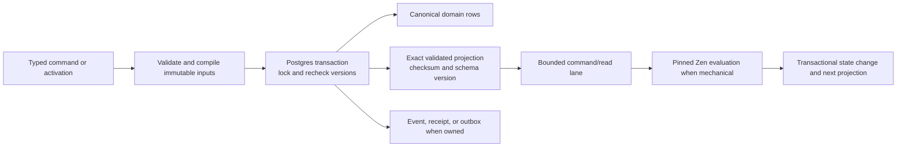

# Versioned documents and correctness projections

> Status: implementation cutover and staging release validation in progress; production reset and managed/hardware release gates remain pending
>
> Scope: authored content, System vocabulary, Character mechanics, Campaign correctness projections, Encounter/Scene replay, and live-command reads
>
> Update when: projection inputs, checksum/schema versions, transaction publication, or a command/read boundary changes
>
> Verification: deterministic compiler/rebuild tests, transaction rollback tests, fail-closed read tests, pin-stability tests, replay tests, and the focused performance gates

## Goal

Replace command-time reconstruction of normalized content aggregates and broad catalogs with exact, validated, versioned projections. Postgres remains durable truth. A projection that can affect a game result is published in the same transaction as the change it represents; it is never repaired lazily on a production command path.

## Target flow

The flow keeps canonical data, correctness projections, and delivery evidence distinct. A read may reject a missing, stale, ambiguous, or checksum-mismatched projection; it must not rehydrate a full catalog or perform a multi-second rebuild to hide that condition.

## Domain inventory and cutover map

| Domain                                                                             | Current behavior                                                                                                                              | Target behavior                                                                                                                                                                                                                             | Classification | Cutover action                                                                                                                               |
| ---------------------------------------------------------------------------------- | --------------------------------------------------------------------------------------------------------------------------------------------- | ------------------------------------------------------------------------------------------------------------------------------------------------------------------------------------------------------------------------------------------- | -------------- | -------------------------------------------------------------------------------------------------------------------------------------------- |
| Authored roots: Background, Class, Creature, Equipment, Feat, Race, Spell, Vehicle | Normalized active root and owned child rows are hydrated for reads; JSON drafts activate by replacement.                                      | Each root has immutable, validated complete-document versions, an active pointer, and an immutable compiled operational projection. The relational envelope retains ownership, routing, search, and constrained cross-root references only. | migrate        | Replace normalized aggregate hydration as an operational read path; compile/publish the selected root version in the activation transaction. |
| System vocabulary                                                                  | Relational system dictionaries serve both catalog and compiler/rules consumers.                                                               | Catalogs remain bounded relational reads; each System has a versioned validated vocabulary snapshot for compilation and rules.                                                                                                              | migrate        | Add a System snapshot compiler and publish it with dictionary changes.                                                                       |
| Character Builder and Sheet                                                        | Structural/play rows are canonical, but Builder/Sheet/live-session reads assemble selected content and broad catalogs before rule evaluation. | Structural and targeted mutable Sheet rows remain canonical. A structural or mechanics-bearing change publishes a Character mechanics projection keyed by the exact input vector.                                                           | migrate        | Replace command-lane assembly with a fail-closed projection read; preserve Builder/Sheet ownership and explicit upgrade semantics.           |
| Campaign, membership, Sessions, inventory, knowledge, collaboration                | Independently queryable relational truth with service-owned transactions.                                                                     | Keep relational truth. Maintain only owning transactional correctness projections, including approved content bindings and Social listing fields.                                                                                           | deepen         | Consolidate mutation ownership; do not introduce a Campaign JSON aggregate or Atlas materialization.                                         |
| Social and notifications                                                           | Social is a Campaign projection; notification delivery uses a narrow outbox/feed.                                                             | Keep the current relational projection and asynchronous delivery model.                                                                                                                                                                     | retain         | Preserve privacy predicates and transactional outbox; remove only proven pass-through code.                                                  |
| Media                                                                              | Relational asset lifecycle and private object storage references.                                                                             | Keep the current lifecycle and domain-owned references.                                                                                                                                                                                     | retain         | Do not fold media into authored document storage or create a generic attachment model.                                                       |
| Rule packs                                                                         | Immutable activated revisions and exact Character/Encounter pinning.                                                                          | Keep immutable revisions. Cache compiled evaluators only in process by revision checksum.                                                                                                                                                   | retain         | Make projections record the exact rule revision/checksum and evaluator/model-contract versions.                                              |
| Encounter and Scene                                                                | Immutable Encounter/scene events plus current projections; replay is implied by tests and services.                                           | Replay is explicit and must reconstruct the synchronous projection byte-equivalently.                                                                                                                                                       | deepen         | Define one authoritative command result interface and rebuild/verify commands.                                                               |
| Live sessions and VTT                                                              | Durable Object/local Node coordinate, while Node services reconstruct needed Character rule state.                                            | Durable Object journal remains delivery recovery only. Node adapters read persisted mechanics/scene projections through the same authoritative command module.                                                                              | migrate        | Retain transport, geometry, private projection, map pipeline, and renderer; remove lazy Character recomputation from room hydration.         |
| API and web                                                                        | tRPC returns authored/hydrated and Sheet DTOs; web preserves optimistic play interaction.                                                     | Strict schemas expose bounded document/projection-backed reads without storage topology.                                                                                                                                                    | migrate        | Cleanly replace affected interfaces while preserving product workflow; no dual support.                                                      |
| Future Campaign Workspace/Atlas                                                    | Campaign carries semantic relation/layout viability only.                                                                                     | Atlas remains distinct from Campaign Map and VTT and is not implemented in this reset.                                                                                                                                                      | retain         | Preserve typed Campaign records and relation/layout viability only.                                                                          |

## Exact projection contracts

Every persisted projection has a Zod document contract, a positive projection schema version, a deterministic canonical serialization/checksum, and a complete dependency vector. The writer rechecks the vector under the same transaction lock used for the canonical change.

System dictionary writes follow the same rule: `SystemRepository.upsert` updates the relational dictionary and publishes or reuses the matching vocabulary snapshot in one transaction. An unchanged document checksum keeps the existing active snapshot.

`yarn workspace @artificer-toolkit/functions projections:verify:authored:local` recompiles every immutable authored version from its stored document and exact authored dependency vector, then fails if its operational-projection checksum differs. Matching `:staging` and `:production` commands are read-only operator gates; they never lazily repair a request-path projection.

`yarn workspace @artificer-toolkit/functions projections:verify:characters:local` validates every active Character's current stream/rule pin and exact pinned authored documents/vocabulary snapshot. Its current-projection read also verifies the persisted schema/checksum. Matching `:staging` and `:production` commands are likewise read-only gates.

Projection readers apply the same checksum checks as writers. A valid JSON shape alone is insufficient: authored documents, authored operational-projection envelopes, vocabulary snapshots, and Character mechanics projections reject a checksum mismatch before a caller can consume them.

Active authored-version reads also apply the relational System and owner-or-master envelope before returning a validated document. This preserves catalog/content authorization without returning to child-table hydration for mechanics.

Subject authoring pipelines are write/activation-only. They do not expose normalized aggregate read adapters; active detail reads use immutable version documents, and catalog lists use bounded relational envelopes.

Character structural commits rebuild the candidate Builder resolution and rule-policy evaluation after taking the Character transaction lock, then persist the canonical Character row, exact mechanics projection, route identity, and draft deletion together. This prevents a pre-transaction rules evaluation from being committed after the Character has changed.

A projection-preserving Sheet command advances that same projection in its `patchSheetState` transaction. It retains the existing immutable authored-version vector and verifies each pinned version's identity/checksum without requiring the version to remain active; structural commits still recheck active candidate versions before publication.

For the current authored roots, base races and base equipment have no authored-root dependency. A subrace pins exactly one immutable parent-race version, and an equipment variant pins exactly one immutable parent-equipment version. Their operational projections are compiled from those pinned parent documents, never from whichever parent is active during a later read or rebuild.

- An authored operational projection records its authored root version ID and number, System vocabulary snapshot version, compiler version, schema version, and checksum. The publication transaction allocates that immutable version before finalizing the checksum, so equal documents published as distinct versions remain distinct operational inputs.
- A vocabulary snapshot records System ID, dictionary stream/version, schema version, and checksum. Its publication transaction allocates the immutable snapshot identity/version before finalizing that checksum.
- A Character mechanics projection records Character stream version; the complete transitive authored-version vector (including an authored root’s immutable dependencies, such as a subrace’s parent race); vocabulary snapshot; rule revision/checksum; evaluator version; model-contract version; projection schema version; the exact validated Character command state; a bounded rule snapshot (Character/class/feature/equipment identities); normalized facts; bounded registry; and rule result. It is strictly Character-owned and campaign-neutral; it does not store a Sheet response, presentation cache, or Campaign context. The command state has its own checksum, while `commandLaneChecksum` binds every compact-read identity field. A live room receives the exact payload only after a full checksum-verified projection read; each subsequent trusted host command verifies the durable stream, rule revision, whole-projection checksum, and command-lane checksum through a bounded metadata read, otherwise falls back to the full verified read. An assigned Character instead requires a separate assignment-bound Campaign overlay whose checksum binds the base projection checksum, Character stream, mechanical Campaign context, and schema version. A mechanically empty context is `BASE_REFERENCE` and resolves its policy from that exact loaded base projection; `MATERIALIZED` overlays retain exact policy input/output. Missing, stale, or mismatched overlays fail closed.
- Encounter and Scene events retain exact input/result identity and synchronously update a validated current projection. The Encounter envelope includes the exact actor-rule facts/result required by its command lane; Scene holds its full current state. Replay verifies the same serialized projection/checksum.

These are explicit domain modules and tables, not a universal entity/projection framework. JSON is a complete validated domain document at the persistence boundary; it is not an unvalidated cache or a presentation-only Sheet response.

Runtime consumers import the owning projection contract leaf (`authoredContent`, `systemVocabulary`, `characterMechanics`, `encounter`, or `scene`) rather than evaluating the aggregate projection barrel. This keeps Character command initialization independent from Encounter and Scene contracts while retaining one public contract index for tools and tests.

## Current, target, and historical behavior

**Current.** Interactive authored activation validates and compiles the complete document without writing normalized child aggregates, then publishes the immutable document/projection and updates only the domain root envelope used for ownership, routing, and catalog indexes. Source batch seeding now follows the same root-envelope/document publication path and does not write normalized child aggregates; its exact contracts include parent-version vectors for subraces and Equipment variants. The SRD source audit and local rollback gate read active immutable versions directly; they compare stored authored documents to source, compiled projections to deterministic rebuilds, and subrace/variant dependency vectors to their active source parent version, rather than exercising normalized child-table hydration. Product Library table/card routes now use strict domain cursor requests (maximum 48 root envelopes per response), database keyset filtering/sorting, and a five-page client window; the existing virtualizer still unmounts off-screen rows and cards. These reads never return an authored document or mechanics projection. `spell_catalog_classes` and its exact-version marker are synchronously published relational projections: the marker exists even for Spells with no Class, and every Spell catalogue read rejects a missing or stale marker instead of presenting it as an empty Class list. Authoring/reference pickers issue the same capped page requests when they deliberately need their compact option sets; gameplay and rules commands never use that path. Interactive Builder resolve/drafting retains its eager chooser context; preview, structural commit, reconciliation, and rules evaluation instead use a bounded structural context with exact selected sources and grant targets, the active vocabulary snapshot, selected-base subclasses, and selected-class spell candidates. Standalone unmodified Character Sheet and panel reads, mutable-overlay presentation, and rest previews use the matching mechanics projection, its exact authored-version vector, and its exact vocabulary snapshot; they do not rehydrate selected normalized authored roots or load the system spell catalog. Overlays receive a bounded fresh rules evaluation from those exact inputs rather than reusing a stale base result. Every direct Sheet command that preserves Character structural sources—including resources, spell slots/casts/customizations, inspiration, hit points, currency, notes, movement display, rest/state changes, inventory interaction, typed Sheet adjustments, and rule-pack upgrades—reads those exact inputs and publishes the next mechanics projection in its owning transaction. Contract-v5 action-state changes use the bounded Zen lane; older revisions perform a full exact-input evaluation before that transaction. Adding a Creature or Vehicle Sheet extra explicitly extends the vector with its active immutable root and dependencies in that transaction; a conflict with an existing pin fails closed and requires a Character content upgrade. Removing the last reference to a Creature or Vehicle root with no authored dependencies prunes that root from the next vector in the same transaction. Removing a root with authored dependencies fails closed until explicit dependency-pruning semantics are defined. An active Character preview returns a deterministic checksum and exact vector delta whenever current authored content would change its pins; the review modal presents that delta and a commit must echo the reviewed checksum. The transaction recalculates it under the Character lock, so a stale or changed preview fails closed. The retained Phase 08 foundation is present in the working tree. Scene-vision recovery uses the matching committed Character mechanics projection; a changed Campaign context takes the exact pinned-input path before deriving vision. The obsolete `character_committed_rule_snapshots` table and repository are removed; retained live-session snapshot types are in-process DTOs derived from the committed mechanics projection.

**Command-lane integrity.** Room hydration and each newly published snapshot validate the complete persisted mechanics projection, including command-state and command-lane checksums. A subsequent server-only room command performs a bounded metadata read and requires matching Character/System identity, stream, rule revision, whole-projection checksum, and command-lane checksum before it can reuse that exact private payload; otherwise it uses the full verified projection read. The attended-live `ADJUST_HIT_POINTS` lane is narrower: it reads the verified current projection, locks the canonical HP row and requires exact parity, then advances only that command state and rebuilds both deterministic checksums. The attended-live `HIT_POINTS/MAXIMUM_MODIFIER` adjustment lane instead replaces the exact committed manual fact, evaluates the pinned Zen revision, clamps canonical HP from the effective result, and republishes the resulting mechanics projection; it never reconstructs a Sheet or catalog. Its checksum-bound Campaign overlay records whether the effective manual modifier is Character- or Campaign-owned. A Campaign-owned modifier shadows the Character value and carries its exact materialized policy forward; otherwise the changed overlay facts are evaluated in the same command. Admission and mutable context lock in `Campaign → Session/lease → assignment → Character → HP` order across the executor and repository. One owning transaction then uses a dependent compare-and-swap CTE to write the adjustment, HP row, Character stream, Character projection, assignment-bound Campaign overlay, and command receipt; no stage can commit independently. A missing or stale projection, overlay, lease, nested checksum, provenance, or canonical fact parity check fails closed. Campaign context stays relational; a matching `BASE_REFERENCE` overlay may reuse the exact base policy after its own checksum/currentness validation.

**Campaign alignment.** Campaign, membership, Session, inventory, knowledge, collaboration, and attachment mutations remain relational and take their owning Campaign lock inside their transaction. A Campaign edit synchronizes its Social listing fields and expires affected admission records in that same transaction; Social admission locks the listing, Campaign, source, and entitlement row before publishing membership and notification-outbox intents. Notification delivery remains asynchronous and reauthorizes its feed reads. Media remains a relational lifecycle plus private object storage: it records each replacement/deletion key before Storage work and completes the ledger only after Storage confirms success. No generic Campaign JSON aggregate, Atlas materialization, or cross-domain mutation wrapper is introduced; the existing domain services are retained because they own materially distinct authorization and constraints.

**Target.** Immutable authored versions and compiled projections, System vocabulary snapshots, and Character mechanics projections are synchronously committed correctness read models. Finalized Characters resolve exact authored versions and rule revisions; drafts use active versions. Upgrades preview, reconcile, and commit explicitly. Encounter/Scene replay is authoritative. Campaign, Social, media, and notification truth remains relational by domain ownership.

**Transitional.** Campaign-content submission now resolves the owned active authored version inside the Campaign transaction. The approval row pins its authored version ID/version/checksum and compiled-projection checksum; it no longer stores client JSON. A Campaign subrace or equipment variant resolves its parent through that compiled version's exact dependency vector, never through the parent's current active root. Builder-selected Race, Class, Background, Equipment, and Feat sources resolve through active immutable versions; the remaining structure query is a bounded relational index for cross-root feature planning, while the separate direct-Feature lookup serves only standalone `FEATURE` acquisitions. Draft Builder previews resolve active authored versions; only a reviewed active-Character preview can explicitly repin finalized content. The Sheet's add-extra selector is an independent capped cursor query over relational Creature/Vehicle catalogs; mechanics-bearing extra selection resolves active immutable versions, while committed Sheets load exact pinned extras. Sheet payloads carry only selected extras. Staging has been reset and reseeded from canonical migrations and TypeScript source after the source-seed and rebuild contracts passed. Final staging audit, managed release evidence, hardware gates, and the production reset/reseed remain required before release. This is a clean-break release: every environment resets and reseeds before this catalogue endpoint receives traffic, so legacy active roots without version pointers are never served. API and web interfaces cut over once per domain; no compatibility adapters, aliases, or dual writes are introduced.

The finalized Character Sheet, rest-preview, Campaign-overlay read lanes, Campaign adjustment/condition validation, Campaign clock recovery, and direct source-preserving Sheet mutations build from the exact version-vector documents and pinned vocabulary snapshot. Selected spells, features, equipment, creatures, vehicles, effects, and action labels no longer use normalized read-time hydration. Add-extra catalog discovery is a separate bounded relational read and does not load a mechanics projection. Structural Sheet mutations remain on the existing command lane until each owning mutation publishes its own next projection.

`loadCharacterBuilderContext` is now limited to interactive Builder drafting/chooser presentation and Campaign-content removal reconciliation. Structural previews and commits use `loadCharacterStructuralRuleContext`; it never calls the user-facing catalogue/list readers. Neither context is used for standalone finalized Sheet or panel reads.

Scene mutations append their event and replace the schema-versioned, checksum-verified current projection in one transaction. The shared scene replay helper validates canonical serialized replay against that projection in focused tests and supplies the exact reducer used by undo. Encounter templates pin each active Creature document's version ID, number, checksum, and validated payload before creation. Encounter create/command transactions publish a checksum-verified current GM mechanics projection with its exact actor-rule snapshot. The Encounter event stream carries that complete validated envelope for byte-equivalent rebuild and comparison. Room hydration reads bounded Encounter version metadata and those persisted envelopes rather than reconstructing normalized Encounter aggregates or running Zen. Owner reads fail closed on a missing, stale, or checksum-mismatched Encounter projection; player reads derive their strict redacted contract from that same validated current projection and never rehydrate Encounter actor or reminder rows.

**Historical after cutover.** Active normalized authored hydration as the mechanical operational store; unpinned active-content Character resolution after finalization; lazy live-session Character mechanics/vision reconstruction; and room-memory mechanics snapshots as a correctness source.

## Migration and deletion map

| Current surface                                                                                                                                                                                                | Disposition                                                                | Replacement or reason                                                                                                                                                                                                                                            |
| -------------------------------------------------------------------------------------------------------------------------------------------------------------------------------------------------------------- | -------------------------------------------------------------------------- | ---------------------------------------------------------------------------------------------------------------------------------------------------------------------------------------------------------------------------------------------------------------- |
| `packages/db/src/domains/subjects/tables/{backgrounds,classes,creatures,equipment,feats,races,spells,vehicles}.sql` and owned child-table upsert/hydrator families                                             | remove as active operational aggregate storage after source/reader cutover | Domain-specific immutable root-version tables plus compiled-projection tables; keep only required envelopes/indexes/references.                                                                                                                                  |
| `packages/db/src/domains/subjects/repositories/*` authored aggregate hydrators and `packages/functions/src/services/subjects/*Authoring.ts` read-time compilation                                              | replace                                                                    | Version/document repositories return validated authored or compiled shapes without table topology.                                                                                                                                                               |
| `packages/db/src/domains/subjects/tables/systems.sql` and vocabulary repository/query consumers                                                                                                                | deepen                                                                     | Relational catalog authority remains; add one snapshot/projection publication path per System.                                                                                                                                                                   |
| `campaign_content_versions` JSON snapshot column and client snapshot submission                                                                                                                                | remove                                                                     | Campaign approval rows pin exact immutable authored-version and compiled-projection metadata. The application resolves the document through the authored-version repository; existing Character bindings do not silently move when another approval is accepted. |
| `packages/functions/src/services/character/{builderService.ts,characterAssemblyOrchestrator.ts,characterSheetBundleAssembly.ts,characterLiveSessionSnapshot.ts,sheetService.ts}`                               | replace bounded command-read portions                                      | Character mechanics repository/compiler supplies version-matched facts/registry/result; Builder and Sheet ownership stay unchanged.                                                                                                                              |
| `packages/db/src/domains/subjects/queries/getCharacterSheetMechanicsQuery.ts` and its database query test                                                                                                      | removed                                                                    | Persisted Zen mechanics remains authoritative; Sheet action labels and hidden flags now derive from the already loaded authored documents and pinned System vocabulary.                                                                                          |
| `packages/db/src/domains/subjects/queries/getCharacterSheetExtraCatalogQuery.ts` and `extras.{creatureOptions,vehicleOptions}` in the Sheet contract                                                           | removed                                                                    | `getCharacterSheetExtraOptionsQuery` is a capped, cursor-paged relational selector; the Sheet response carries only selected extras.                                                                                                                             |
| `packages/db/src/domains/subjects/repositories/characterCommittedRuleSnapshot.ts`, `supabase/migrations/20260817020000_character_committed_rule_snapshots.sql`, and matching unfinished table/bootstrap wiring | remove, then replace                                                       | The unfinished snapshot is opaque, lacks a complete dependency vector/checksum/publication invariant, and has no service consumer. It must not become a second model.                                                                                            |
| `character_scene_vision_*` columns, migration, and `characterSceneVision.ts`                                                                                                                                   | removed                                                                    | Darkvision is derived from the exact Character mechanics projection; it is not a separate lazy cache.                                                                                                                                                            |
| `packages/functions/src/services/liveSession/liveSessionService.ts` and retained host/worker adapters                                                                                                          | retain and adapt                                                           | Preserve protocol, DO journal, local host, geometry, private projection, and renderer; make them call the shared authoritative command/module seam.                                                                                                              |
| `packages/db/src/repositories/{campaign*,social*,notifications*,media*,encounter*,vttScenes*}`                                                                                                                 | retain/deepen by owner                                                     | Keep relational truth and existing outbox/media patterns. Add only synchronous correctness projections/replay verification in the owning transaction.                                                                                                            |
| Generated bootstrap SQL and Supabase database types                                                                                                                                                            | regenerate                                                                 | Never hand-edit as a migration substitute; regenerate after canonical SQL/migrations change.                                                                                                                                                                     |

The checked-in database type file no longer contains `character_scene_vision_*` columns and includes the committed-mechanics command state. Canonical migrations remain authoritative; regenerate the type file whenever they change, never as a substitute for a migration or reset.

## Tranche gates

1. Contracts and migrations compile deterministic projections and fail closed on mismatch.
2. Authored and vocabulary source seeding activates complete documents and verifies rebuild equality.
3. Character commits, explicit upgrades, and targeted Sheet commands publish/read matching mechanics projections without broad catalog hydration.
4. Campaign/Social/notification/media paths retain their current authorization and delivery invariants.
5. Encounter/Scene replay reconstructs byte-equivalent projections; live transport uses the shared command seam.
6. API/web contracts cleanly cut over without compatibility paths.
7. `yarn validate:pre-staging:local` has passed from a reset local Supabase instance before any staging deploy/reset. It is the complete local release candidate lifecycle: migration reset, generated bootstrap/type parity, forced serial builds/typechecks/tests, canonical source seed/audit, every real Postgres integration lane, projection verification before and after VTT fixture provisioning, and the authenticated local host/browser VTT gates. It writes fail-fast logs and a manifest to `.codex/validation/pre-staging-lifecycle/<timestamp>/`; set `PRE_STAGING_VALIDATION_DIR` to redirect it. It requires `CONFIRM_PRE_STAGING_LOCAL_RESET=validate-pre-staging-local`; `--list` is non-destructive. The existing hardware gate is included only when `PRE_STAGING_INCLUDE_VTT_HARDWARE=1`.
8. Staging begins only after that local lifecycle passes unchanged. Its purpose is external deployment, managed credentials/network, and cloud-provider parity—not first execution of application behavior. Production remains gated on the final staging audit, managed release, and hardware evidence; it must be reset and reseeded only with fresh explicit approval immediately before that destructive operation.

## Concerns and expansions

Process-local compiled evaluator caches are allowed only by immutable checksum and never replace durable projection validation. Campaign Workspace/Atlas, generic projection infrastructure, GraphQL, a rules microservice, and asynchronous correctness projection are out of scope.
