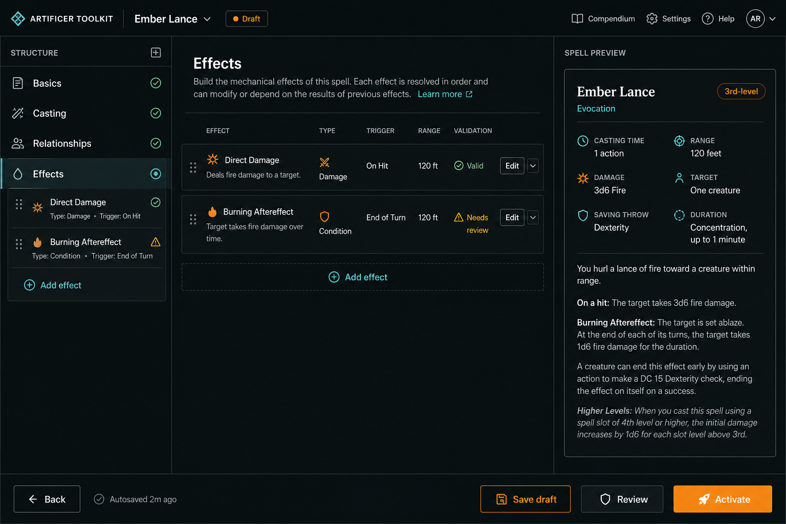
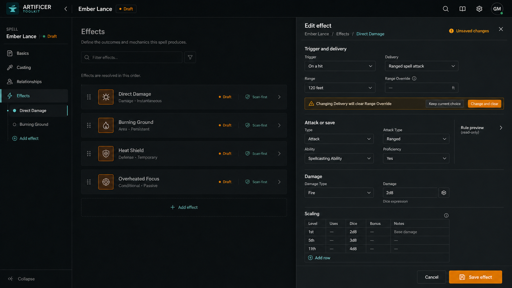
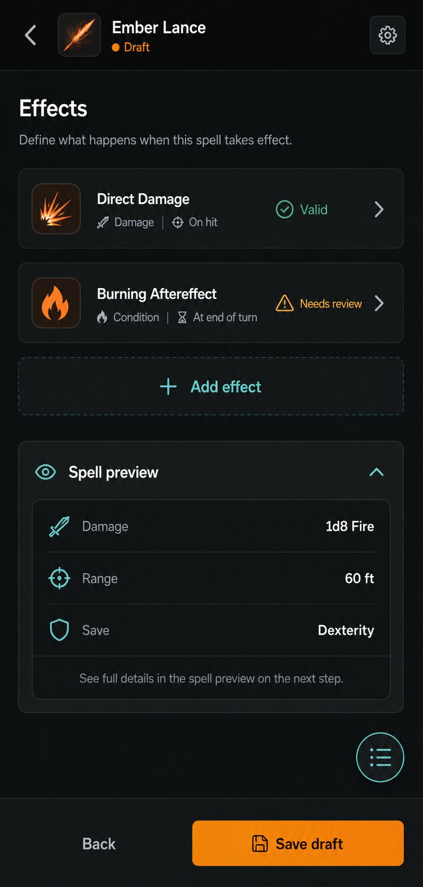
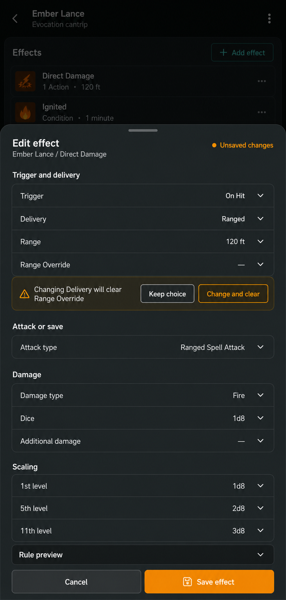

# Authoring Workspace audit and redesign

> Status: superseded audit; retained as historical evidence
>
> Scope: node-map authored content, shared form platform, authored DTOs, draft/activation flow, and persistence
>
> Audited: 2026-07-12
>
> Superseded by: `docs/audits/mvp-acceptance-ledger-2026-07-13.md` and the corrected `output/design/authoring-workspace/mvp/` lock candidates
>
> Do not use the visual references or unresolved findings below as current implementation authority without checking the release ledger.

## Executive decision

Keep the current authoring architecture and replace schema-shaped recursive editing with a focused, staged authoring experience.

The existing platform has the correct high-level seams: shared node maps describe structure, the backend resolves conditional state and options, one TanStack Form owns the authored aggregate, the structure rail provides orientation, and repositories persist complete authored aggregates. The redesign should not replace those seams or introduce domain-local form stacks.

The main product problem appears when a complex group is added. The current spell Effects flow immediately inserts an item into the committed form and exposes the complete Effect child graph inline. A single effect can reveal trigger, saving throw, activation, range, scaling, shape, targeting, outcome paths, results, duration, lifecycle, outcomes, options, and rows at once. The rail remains useful, but the editor becomes a schema inspector instead of a focused creative workspace.

## Architecture findings

### Node maps and runtime

- The shared DSL supports input and object/array group nodes, conditional visibility and requiredness, local/parent/ancestor scopes, inline or relationship-backed options, and `KEEP`/`CLEAR` hidden behavior.
- Child maps are resolved independently. Nested editors must retain exact parent and ancestor snapshots when requesting runtime state.
- Runtime requiredness is authoring guidance, not final validity. Zod schemas and compilers remain authoritative at activation.
- A hidden `CLEAR` node can remove a complete populated branch. This behavior is technically deterministic but needs user confirmation when a controlling choice would discard meaningful work.
- Runtime option loading, resolution failure, zero available options, and a valid empty result are distinct states and must not be collapsed into one empty select.
- Group shape alone is insufficient to choose a usable editor. Presentation intent should be explicit for `inline`, `table`, `summary`, and `focused` groups.

### Form state and UI

- One top-level TanStack Form correctly owns values, field metadata, dirty state, and submission.
- The authoring provider owns domain lifecycle, navigation, progress, and mutations; the layout provider owns rail, preview, and reset overlays.
- Conditional re-resolution is debounced and the previous model remains visible while a new one resolves.
- Complex groups currently add and remove values immediately. Adds can create blank committed rows; removal has no confirmation at the generic renderer layer.
- Dirty state enables save/reset affordances but does not currently prevent browser or route exits.
- The desktop topology is sound: structure rail, editor, optional preview, persistent actions. Mobile also has reachable rail and preview drawers.
- The current header emphasizes the active step but not the authored record identity. Critical actions are mostly icon-only, which is weak on touch surfaces.

### DTOs, drafts, activation, and persistence

- Drafts store the complete authored input as JSONB. Draft saves do not compile or write relational domain records.
- Activation applies server identity, parses the authored schema, normalizes node-runtime values, parses again, compiles, persists the complete aggregate, and discards the draft after success.
- Aggregate upserts use replacement semantics. Omitted owned children are deleted, so every activation must submit a complete aggregate rather than a patch.
- Invalid stored drafts currently expose only generic recovery. Structured parse issues are needed to guide users to repairable fields.
- Creature `logisticsNotes` currently differs between its node-map row shape and canonical `string[]` authored contract. This is a blocking contract mismatch.
- Authored drafts carry `baseActiveUpdatedAt`, but stale-active conflict enforcement is not implemented. That remains a separate platform-hardening concern.

## Impeccable technical audit

| Dimension         |     Score | Key finding                                                                                                                                  |
| ----------------- | --------: | -------------------------------------------------------------------------------------------------------------------------------------------- |
| Accessibility     |       2/4 | Useful labels and focus primitives exist, but rail expansion semantics, touch targets, icon-only actions, and dirty-exit recovery need work. |
| Performance       |       2/4 | Root value subscription and recursively mounted child maps may scale poorly for large classes, features, and effects.                        |
| Responsive design |       3/4 | The structure and preview drawers are deliberate; complex inline groups and crowded header actions remain risky on narrow screens.           |
| Theming           |       4/4 | Authoring surfaces consistently use the shared Forge tokens and preserve light/dark hierarchy.                                               |
| Anti-patterns     |       3/4 | The UI does not look AI-generated, but deep nested panels can feel like a capable schema inspector instead of a creative tool.               |
| **Total**         | **14/20** | **Good foundation; address mutation safety and complex-group focus before release.**                                                         |

### Prioritized findings

- **P1 — Immediate nested mutation:** add/edit must run inside an explicit form transaction; global persistence is suspended while it is open, commit keeps the transaction, and cancel restores the aggregate exactly.
- **P1 — Unsaved exit:** dirty browser and application navigation must require confirmation.
- **P1 — Recursive cognitive load:** complex groups need scan-first summaries and a focused editor instead of a fully expanded child graph.
- **P1 — Destructive conditional clearing:** populated `CLEAR` branches require an explicit change-and-clear confirmation.
- **P1 — Invalid draft recovery:** return structured issues and map them to authoring navigation where possible.
- **P1 — Creature logistics contract:** align the node map with the canonical authored shape.
- **P2 — Action clarity:** preserve icons, but pair high-value touch actions with persistent text.
- **P2 — Rail accessibility:** expose expansion state/relationships and maintain at least 44px interactive targets.
- **P2 — Large-form rendering:** do not keep closed focused editors mounted; measure a representative deep Spell Effect fixture.

## Current versus proposed

| Concern           | Current implementation                                 | Proposed behavior                                                                                                    |
| ----------------- | ------------------------------------------------------ | -------------------------------------------------------------------------------------------------------------------- |
| Effects overview  | Empty collection or recursively expanded rows          | Scan-first summaries with type, trigger, range, status, and one clear edit action                                    |
| Add effect        | Pushes a default row immediately                       | Opens a form transaction in a staged editor; the provisional row cannot be globally saved until `Add effect` commits |
| Edit effect       | Navigates into the live aggregate                      | Opens a reversible subtree transaction in a side drawer or mobile bottom drawer                                      |
| Cancel            | Leaves already-mutated values to reset/remove manually | Discards staged changes and restores focus to the originating row                                                    |
| Remove            | Immediate generic removal                              | Confirmation for populated focused/summary objects                                                                   |
| Conditional clear | Hidden `CLEAR` paths apply without explanation         | Warn before the controlling choice changes; allow keep or change-and-clear                                           |
| Orientation       | Active step title plus structural rail                 | Persistent record identity, active module title, save state, structural rail, short focused context                  |
| Preview           | Useful but often generic                               | Domain output: rendered spell rule text, damage, save, range, and scaling                                            |
| Mobile            | Long form with icon actions                            | Summary-first view and reach-friendly bottom drawer with one sticky staged footer                                    |
| Validation        | Progress plus final backend failure                    | Incomplete guidance, activation blockers, and backend errors remain visibly distinct                                 |

## Superseded visual references

These images record the July 12 direction only. Later review rejected portions of this topology, and the corrected individual MVP mockups under `output/design/authoring-workspace/mvp/` are the pending desktop lock candidates.

### Desktop Effects overview

### Desktop staged Effect editor

### Mobile Effects overview

### Mobile staged Effect editor

These images lock topology and interaction hierarchy, not exact generated copy or icons. Production implementation must use existing Mantine behavior, Forge tokens, shared icons, and resolved node data.

Optional authoring surfaces are overlays, not layout columns. The structure rail may remain a stable desktop column because it is primary navigation. Focused editors, preview/context panels, inspectors, and other toggleable surfaces must use portal-backed side or bottom drawers and must not compress or reflow the editor canvas when opened.

## Acceptance criteria

- Complex `focused` and `summary` groups run as isolated root-form transactions; global save/activate remain unavailable until the staged editor commits.
- Cancel and close restore the exact pre-transaction subtree (or remove a provisional add); focus returns to the originating control.
- Populated destructive removal and conditional `CLEAR` changes require confirmation.
- The structure rail remains the canonical location model and exposes accessible expansion state.
- Record identity, active module, dirty/save state, and primary actions remain clear at desktop and mobile widths.
- Runtime resolution continues to receive correct local, parent, and ancestor values.
- Zod/compiler errors remain authoritative and can be mapped to nested navigation targets when issue paths are available.
- No horizontal overflow occurs at desktop, tablet portrait/landscape, or 430px mobile widths.
- Closed focused editors are unmounted and do not continue resolving nested child maps.

## Deferred platform hardening

- Active-record stale-edit conflict enforcement for authored drafts
- Complete schema-to-node-map parity tooling
- Removing duplicated schema/shared authored type definitions
- Broad transaction/savepoint modernization
- Persisted draft progress summaries
