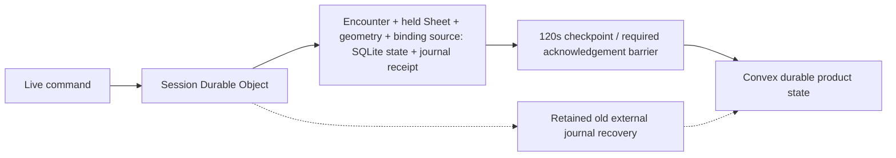

# Phase 8.2 Claude handoff — source-first continuation

**Updated:** 2026-09-30. **Owner:** Codex; primary owns architecture, integration and acceptance.
**Status:** Claude continuation handoff; current source is unvalidated. Prepared before the user's
**3% usage remaining** deadline. The last usage observation during this update was 96% used,
4% remaining. Source identity and inspection logs are retained in
[`local-validation/claude-handoff/`](../../local-validation/claude-handoff/); they are not release evidence.

## Active direction and workspace

The user explicitly directed **CODE-FIRST**: finish known implementation before another long
execution run, keep canonical docs current, and prepare this Claude handoff. Remaining work includes
implementation, not only tests. No commit or push is authorized for this source batch.

Use the regular `D:/dev/artificer-toolkit` checkout, branch `codex/phase-08-2-convex-cutover`, base HEAD
`33b34e19019726bbf1cacf234499050e4172546b`. The working tree has extensive uncommitted source and
fixture changes, including user-owned `.agents` deletions. Preserve every unrelated change; do not
reset, clean, restore or stage broad paths. Retain the existing local Docker installation, backend
and volume. Docker Desktop startup is user-owned. The older detached Codex worktree retains
historical evidence and is a read-only backup, not the working checkout.

Read repository instructions and the [approved cutover handoff](phase-08-2-convex-cutover.md),
[decision ledger](phase-08-2-open-questions.md), [ADR 0029](../adr/0029-convex-backend-cutover.md),
[ADR 0035](../adr/0035-room-authoritative-live-encounters.md),
[ADR 0036](../adr/0036-versioned-content-snapshots-and-browser-builder.md),
[persistence guide](../architecture/persistence.md), [Character guide](../architecture/character.md),
[live-session guide](../architecture/live-sessions.md) and
[release runbook](../runbooks/phase-8-2-release.md). Current status authority is the
[acceptance JSON](../roadmap/08-2-convex-cutover-acceptance.json): **51/75 cases and 190/276 criteria
accepted**. This batch advances no acceptance case or criterion.

ADR 0035's status now reflects implemented groundwork with authority-switch/final proof pending.
The [implementation plan](adr-0035-implementation-plan.md) labels its old "not started"/"Room today"
mapping as historical; use this handoff and the current source batch for present implementation status.

## Approved boundaries

Convex remains the product-data, authentication/current-membership and recovery boundary.
Cloudflare supplies web hosting, room execution and R2. The approved target runs live mechanics and
their native atomic writes in the room, with zero steady-state Convex command calls and periodic
checkpoint publication. Public API and persistence contracts belong in `packages/schema`; shared
algorithms use real persistence transactions and owning ports. Backend comparators and still-open
Convex-first paths are transitional, not evidence that the target is complete.

Keep the **120-second checkpoint deadline** and **240-second authorization lease**. Prefix
checkpoint acknowledgement, snapshot compaction and journal acknowledgement share one SQLite
transaction, preserving a concurrent unpublished suffix. Replay, receipt integrity, current-member
privacy and source/version fences remain mandatory. Do not loosen frozen gates or budgets.

The user approved packed immutable payloads with indexed receipt headers (D70), separate private
owner ledgers, atomic logical private cleanup with bounded deferred physical purge (D71), and the
compact virtualized Spell preparation picker. These recommendations are attributed to Codex in the
decision ledger. Their earlier focused evidence does not certify this newer source state.

## Current source and transitional paths

The room store/journal/checkpoint source commits standalone move/door/undo and deterministic
Encounter tools atomically before acknowledgement. Character removal, COMPLETE and actual round
changes require checkpoint acknowledgement before the socket success. Initiative and PRIVATE enemy
rolls retain initiator-only evidence and exact replay. Native turn/basic-action/action,
Concentration/Cleaving/Disarm and retained-evidence routing bind existing planners to shared
transaction bodies. Character Builder refresh preserves local play/effects, reconciles hit dice and
usage, and clamps only a reduced Character-only maximum inside the caller's transaction. Storage
corruption/loss requests an idempotent new epoch; failed recovery retains old evidence.

S7 backend/room source now accepts nineteen typed Character play commands through `CHARACTER_SHEET`
with Character/active Run IDs. `roomCharacterSheetCommands` uses the canonical reducer/resource helpers,
real current active-effect projection and typed play writer inside the caller's transaction. Shared
`characterSheetReceipts` preserves the original private replay/history algorithm with real indexed
room callbacks and Convex packed-ledger callbacks. Current owner/GM/assignment and active unfrozen
Run guards precede replay/version refusal; the private Character receipt and journal commit before
ACK. Socket retry also rereads the checksummed ACTIVE native Run/unfrozen Character actor and current
Campaign/System/play ownership before presenting current native play stream/current maturity.
Only the initiator receives private history; all other admitted recipients advance the same sequence
with required `delta: null`. A pending Sheet command settles only with its own `CHARACTER_SHEET`
delta, matching the Encounter scope rule.
Party visibility applies immediately and restores from unpublished SQLite play; current vision is
composed before commit. `liveSessionClient` advances native Encounter/Sheet sequences while leaving
Scene state to its own deltas; a same-sequence legacy ACK only settles the pending command.

Sheet journal replay now delegates to shared `readCharacterCommandReplay` against actual indexed
native `characterCommandReceipts`, after current ACTIVE Run/unfrozen actor/Campaign/System/owner
guards. It verifies raw history checksum/receipt identity/fingerprint and matches journal/private
event IDs, then presents with current maturity/native stream. This retains original evidence for
current privacy presentation instead of re-presenting already redacted journal history. The replay
correction is source-only and unvalidated.

`liveCharacterHolds` records one Character/active Run pair, Campaign and epoch. Activation/recovery
reconciles current unfrozen actors; changed Run/actor checkpoints update holds and final acknowledged
release removes that epoch's holds. Main play/preferences/rest guards reject held direct Convex
writes. Outside structural edits preserve the complete checkpoint play row, stream/clock and stats;
Builder commit returns actual persisted play/version. The room compares newly evaluated
Character-only max HP with the previous native maximum on changed Builder inputs and clamps only
a decrease. The new hold schema still needs guarded local reset/seed/codegen. Campaign deletion
includes hold rows, but membership/controller/account-deletion integration and lifecycle correctness
are unfinished. Frontend Sheet commands still go to Convex; wire live routing and projection
subscriptions next. Maximum overrides, rests, notes, structural/customization commands remain outside
the nineteen-command lane. S7/S8 are not complete or accepted.

The focused `sheetSlices.liveAuthority` query now provides owner/GM routing metadata from head,
matching holds and validated typed play, returning null for party readers without loading mechanics
or collections. Direct `encounters/commands.execute` fences ALL command types under live authority;
separate epoch-fenced transitional `liveSessions` endpoints remain. The client sequence fix is
authored for native Encounter/Sheet receipts and legacy same-sequence ACK settling. Optional authority
`checkpointedAt` now records only actual acknowledged delta-checkpoint or retained per-command
publication; exact retry/drain preserve it. Activation/new recovery omits it, and the focused routing
DTO returns null before the epoch's first acknowledgement. Precise freshness provenance is authored
but unverified; finish web freshness presentation without treating general authority updates as publication.

Complete paged `DEFINITIONS` replaces the cold per-ID room-input path. Hydration loads all System
PLATFORM and Campaign-owner USER roots, including unpublished roots. SYSTEM/CAMPAIGN pins fence the
whole inventory; PLAY is independent. Per-root records and a complete marker survive SQLite eviction.
First-use and missing IDs resolve locally while current; stale pins replace the complete inventory
atomically. The protected rules comparator has its separate `DEFINITION` capture contract.

Authorization preferences and their digest now include the canonical username
(`displayUsername ?? username ?? null`). BetterAuth user updates schedule PREFERENCES invalidation
when that name changes. Warm commands use the leased author name without a per-command auth lookup.
Chat metadata hydration retains conversation access and nonce headers without historical bodies.
Shared `tableRollPersistence` and `conversationPresentation` preserve the existing API algorithms;
general native chat/public/TABLE/evidence-roll routing is still pending the rate-scope decision.

Shared movement source includes `liveMovementAdmission`, `spatialSceneGeometry`,
`spatialPendingPublication`, `spatialTerminalPublication`, `movementResolutionDocuments`,
`movementResolutionPublication`, `movementResolutionReads`, `liveMovementSpatialPersistence`,
`liveMovementReactionPersistence`, `liveMovementConcentrationPersistence`, `liveMovementTargetState`
and `movementSettlementPersistence`. Backend adapters retain exact signatures and real owning
readers/writers. Native geometry dispatch now lands in source: `NativeLiveSessionRoom.#commitRoomGeometry`
calls `executeRoomSceneGeometry` for planned moves/doors and MOVEMENT responses inside the actual
`RoomEncounterStore.transact`; the durable callback calls `journal.commitInTransaction` before fanout.
This branch no longer uses `#commitExternal` or a per-command Scene commit route. Room geometry
reads/staging/capture and shared publication supply the native Scene/Run/Character/fog writes.
Movement replay is fixed in source. `roomSceneVision.ts` is authored and wired before geometry,
native Encounter command and binding journal commits, composing current Character vision without
persisting it as a raw native override. Native binding now uses `executeRoomSceneBinding` and shared
`sceneBindingPersistence` inside the actual SQLite transaction, joining controls/composition and the
journal receipt before acknowledgement; it no longer calls external binding publication.
Shared `sceneUndoPublication` now binds through `publishRoomSceneUndo` for planned/fog/settled movement.
The room intercepts UNDO, admits the GM, and uses persisted command/token/fog/save rows to commit
restored token/fog/state, current Character vision and the journal receipt in one transaction before acknowledgement/fanout. Previous
fog layers restore or delete completely; shared `parseSceneReferencedFogChunk` verifies restored
save/chunk references. Raw/composed cache and recipient fog sync update after commit. The asynchronous
`roomSceneCommandPersistence` writer delegates undo to the same helper and keeps supplied parent
save/command/checksum guards. `roomSceneRecords` extraction is finished, avoiding the module cycle.
Retained Scene history selection scans O(N) rows, sorts moves and finds unmatched history. Its
`ponytail` comment defers indexing until frozen workload budgets require it; no V15/Q16 proof exists.
Old fast-only undo journal fields/planner remain for retirement.
These are unverified source changes. Root owns remaining integration and acceptance. General
chat/public/TABLE/evidence, S7 held Sheet frontend/rest/lifecycle, S8 web surfaces and deletion/recovery/budgets
remain open. Old external journal recovery and protected comparator code remain until final retirement.

Shared extraction supplies the transaction algorithms. Native geometry dispatch is present in
source but has no execution proof. Replay, vision and staged undo are wired;
atomicity/privacy/lifecycle and workload ceilings need validation. Binding is local; old external recovery is retained
transition code, not the current binding or geometry dispatch.

## Unapproved proposals

Two local proposals are pending architectural approval and must not be treated as adopted:

- [Character head checksum proposal](../../local-validation/character-head-checksum-proposal.md):
  Codex proposed removing persisted aggregate structure hashes while retaining typed record checks
  and assembled capture hashes. Automatic approval review rejected that integrity-boundary change;
  the partial source change was restored. Existing aggregate validation remains, and the narrow
  note writer is frozen pending approval. Do not silently remove checks to reduce reads.
- [Live rate-scope proposal](../../local-validation/live-rate-scope-proposal.md): Codex recommends
  shared per-account counters within each room, retaining chat/roll 30/min with burst 30 and Scene
  240/min with burst 80. Exact account-global counters across Campaign rooms conflict with zero warm
  Convex calls without separately approved coordination. This cross-Campaign aggregation change is
  not applied. Native general chat/public/TABLE/evidence-roll dispatch remains dependent on it.

## Remaining implementation and sequence

The equipped/attuned source-loss trace is resolved in source. Canonical
`characterSourceLoss.removeEquipment` removes vanished inventory IDs from both lists, but held
structural writes preserve native play. `prepareRoomLiveCharacterSheet` now filters existing equipped
and attuned IDs against the current prepared inventory in the same reconciliation transaction as
HP/hit dice/usage. Retained IDs preserve order; only removed IDs disappear. The existing real SQLite
rollback/commit/eviction/warm reconciliation source check includes this cleanup; rules preparation
in that check remains mocked. Compilation and full preparation/command execution are still unverified.

The held lifecycle gaps are concrete. [characterDeparture](../../apps/apis/convex/campaigns/characterDeparture.ts)
still freezes PREPARED/ACTIVE Convex actors, and
[actorControllerRemoval](../../apps/apis/convex/encounters/actorControllerRemoval.ts) rewrites their
controller lists. [accountDeparture](../../apps/apis/convex/campaigns/accountDeparture.ts)
removes account actors before departing membership. Worker `EVICT_USER` currently closes sockets
and updates room cache/admission state; it does not perform native actor freeze/removal.
[checkpointRecords](../../apps/apis/convex/liveSessions/checkpointRecords.ts) validates actor rows
but does not filter departed controllers. Move held mutations into native eviction/notification,
freeze/delete and checkpoint filtering together. Do not partially skip the Convex writes without
a real room consumer, which would leave stale native actors or grants.

1. Start with remaining known S7/S8 source: connect held Sheet commands to the native room and
   subscribe to actual room-owned play/projections. Current frontend dispatch remains Convex and its
   common version is a checkpoint version; do not silently substitute receipt versions without a
   current room projection. Preserve Convex-owned drafts/private notes, reuse localized Sheet hooks
   and components, and retain excluded rest/structural commands. Complete the coupled held lifecycle
   changes described above. Long verification runs are not the first continuation step.
2. After the rate-scope decision, wire native general chat/public/TABLE/evidence-roll paths through
   the landed shared writers and actual author/authorization ports. Preserve nonce retries, privacy
   and paired body/header persistence without warm per-command reads.
3. Use nullable `checkpointedAt` for outside-view freshness and finish recovery/clock/DAILY cleanup.
   Narrow HP/Common reads remain incomplete; the checksum-dependent note writer is frozen.
   Finish remaining Scene source/retirement work and author the missing actual movement/Sheet input
   fixtures. Preserve original pending/terminal order, source pins, replay, fog-only Scene advancement
   and recipient privacy. Retained external recovery/comparators retire at their approved boundary,
   after replacement proof. The hold schema needs local reset/seed/codegen after known source is complete.
4. Complete remaining packed Scene history/checkpoint integration, S5 parity and authority-switch
   retirement requirements. Measure Q16/V15 and all frozen budgets without relaxing scope.
5. Once known code is complete, run the required final-source local lifecycle and repair failures
   locally. Promotion remains separately gated; this handoff is not permission to deploy.

## Evidence and execution status

No test, typecheck/compiler, build, codegen, backend or Wrangler runtime gate ran for this source
batch. Only source inspection, mechanical extraction comparisons, formatting and scoped whitespace
checks ran. Newly authored tests are runnable source, not passing evidence. Earlier green runs apply
to earlier states. See the [source batch record](../validation/phase-08-2/room-command-source-batch-2026-09-30.md)
for the broader source changes and retained evidence.

Native D27 commit and late-receipt rollback checks exist in source and have not run. Four older
Scene/binding regressions are adapted and root-reviewed as plausible source. Three D26/D52 pending
movement cases remain unaltered; they need real native occurrences, pending snapshots and geometry
captures. Five hold/query regressions, checkpoint-fence freshness and direct nested UPDATE_ACTOR
fencing checks are also authored. [liveSessionClient.test](../../apps/web/src/domains/campaigns/vtt/liveSessionClient.test.ts)
adds contiguous native Encounter sequence, same-sequence replay, gap RESUME and private Sheet null
ACK/wrong-scope waiting source coverage. All source ownership is released; no test was executed.

The shared [Character receipt regression](../../packages/encounter-persistence/src/__tests__/characterSheetReceipts.test.ts)
uses the real receipt writer/reader to preserve raw history across STANDARD-to-MATURE replay, return
the current play stream and reject checksum/fingerprint corruption. It is authored and source-reviewed,
without execution. The final equipment cleanup changes
[roomCharacterRules](../../apps/session-worker/src/roomCharacterRules.ts) and its existing reconciliation
test; no public or persisted contract changed.

Full native Sheet socket proof is still missing. The current native fixture supplies Creature inputs;
nearby Character rules preparation is mocked. A real proof needs retained Class/Race/Background and
equipment snapshots/pins, System inputs, an unfrozen Character Run actor, current assignment/revision
and input routes. No fabricated successful Sheet test was added. Retire old fast-only undo
journal/planner and external recovery/comparators only after their replacement is proven.

Recent ignored evidence directories beneath `local-validation/` are
`shared-live-movement-admission`, `shared-spatial-scene-geometry`, `shared-live-movement-persistence`,
`shared-live-movement-concentration`, `shared-movement-settlement`, `shared-movement-response`,
`shared-spatial-pending-publication`, `shared-spatial-terminal-publication`,
`shared-table-roll-persistence`, `shared-conversation-presentation`, `room-definition-inputs`,
`room-definitions-inventory`, `room-definition-response-fixtures`, `shared-scene-binding` and
`shared-scene-undo` and `native-character-sheet-core`. Saved originals and mechanical
comparison logs establish extraction intent; they do not establish type correctness or runtime parity.

## Local validation and promotion boundary

Follow the [final-source release runbook](../runbooks/phase-8-2-release.md#final-local-source).
Build freshly added shared runtime subpaths before consumers resolve `dist`. Serialize compiler,
tests, codegen and Wrangler using `local-validation/.validation.lock`; keep complete output and
native exit codes in ignored artifacts. On Windows, run TypeScript alone with `GOMAXPROCS=2` and
Turbo `--concurrency=1 --env-mode=loose`; do not run it alongside Vitest.

All required local gates must pass together on one final working-tree state: generated artifacts,
fresh builds, every current package typecheck/test, local persistence reset/seed/audit, real transaction,
replay/rollback/privacy proofs and full affected end-to-end journeys. Preserve/back up the existing
Docker data through the documented local lifecycle rather than replacing the volume ad hoc.
Subsequent source/fixture/schema/configuration changes invalidate affected evidence. Cloud database
execution is prohibited for development checks; any managed staging smoke requires explicit approval.
Do not discover or repair application correctness in staging. Record ordered commands, source identity,
results and retained logs as the release manifest before separately approved promotion.
