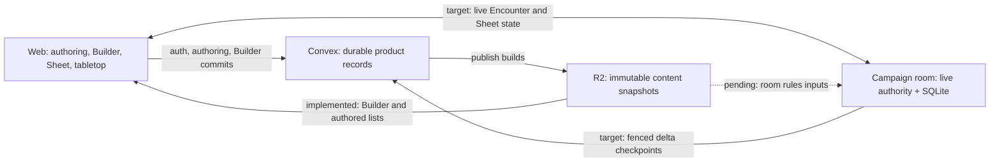

**Repository state review — September 29, 2026**

Status: assessment snapshot, not release acceptance. Source: `codex/phase-08-2-convex-cutover` at `33b34e19019726bbf1cacf234499050e4172546b`. The checkout already had 191 status entries: 188 under `.agents`, two deleted diagnostic files and an untracked `.claudeignore`. This review preserved them.

**Finding.** The direction is understandable, and the repository has substantial implemented product behavior. Phase 8.2 remains open because the live-authority change is incomplete and the final integrated source has no complete local release proof. The browser Builder and authored-list snapshot work are considerably further along than the ADR status headers suggest.

This assessment reviewed product/design intent, the glossary and architecture overview, ADRs 0023–0025, 0029 and 0033–0037, the two new implementation plans, the phase/resume/remaining documents, the decision/open-question log, acceptance and validation records, release runbooks, recent Git history and Claude worktrees. Focused source inspection checked the actual Encounter command path, room hydration, Builder evaluation, list loading and local lifecycle configuration. The shared [Claude artifact](https://claude.ai/artifact/Qcho6LKSBVJtVg2PKv36jv) was accessible in the browser and matched the live acceptance counts. This is a status assessment, not an exhaustive source audit or fresh application test pass.

**Product direction.** Artificer is a connected web product for creators and players: structured homebrew authoring → Character Builder → Sheet → Campaign/table formation → Encounter/VTT play. Web viability precedes native clients, and native delivery precedes the creator Marketplace. The current phase should close the play and persistence boundaries before billing, paid tables or native implementation.

The important invariants are established: Builder owns structural intent; Sheet owns play interaction; Campaign owns the live table, Scene presentation and Encounter Runs; Sessions are optional scheduling/history records. Assisted mode resolves rules but people make choices, with logged warnings and GM intervention; Manual mode is a tracker. Shared rules remain portable and System-owned, with D&D 2014 first. Sources have one current published document, while issued occurrences retain frozen facts. Immutable delivery snapshots do not reintroduce user-visible authored version selection. The product is pre-launch, so retired compatibility code should be removed.

The latest architecture changes answer an explicit cost requirement: free hosting must carry 100 Free users, 20 tables playing four four-hour sessions a month, 50 Character builds and 50% headroom ([Q16](phase-08-2-open-questions.md)). Convex database I/O drove ADR 0035 and ADR 0036.

**Netlify → Cloudflare is an approved migration.** D65/ADR 0037 moves the TanStack Start web app to its own Cloudflare Worker and Workers Static Assets, alongside the separate session Worker and R2. The local runtime migration, auth proxy, security/Sentry changes and manual deploy workflow are implemented and locally validated. Managed DNS/hostnames, secrets/origins, deployment and staging CPU, Sentry and client-IP proof remain. The existing hosted Netlify site is retained for initial DNS rollback until approved retirement.

Convex retains ordinary product authority and server commit validation. During an active Run, the target room owns combat state and acknowledges only after SQLite persistence. Browser Builder evaluation is a structural preview; the server still revalidates activation. The web Worker and session Worker remain separate deployments.

**Acceptance state.** `node scripts/acceptanceProgress.mjs` exited 0 against the current JSON ledger:

| Gate                          | Accepted cases | Accepted criteria |
| ----------------------------- | -------------: | ----------------: |
| Foundation, auth, operations  |          14/15 |             46/51 |
| Content and rules             |          16/16 |             50/50 |
| Characters, Campaigns, Social |          16/19 |             64/71 |
| Scene, Encounter, VTT         |           4/15 |             27/81 |
| Cutover and release           |           1/10 |              3/23 |
| Total                         |      **51/75** |       **190/276** |

There are 24 open cases: 7 READY_FOR_ACCEPTANCE, 14 IN_PROGRESS and 3 NOT_STARTED. Of the criteria, 57 are ready, 17 in progress and 12 not started. Ready cases are P06, V03, V08, V09, V10, V11 and V12. The ledger has no BLOCKED entries, although implementation dependencies, local backend availability and promotion approvals gate progress. Counts are retained feature acceptance, not evidence that today's complete system passes. ADRs 0033–0036 reopened earlier proof without changing the 75-case denominator.

**Implemented on the branch.**

| Surface                       | Current evidence                                                                                                                                                                                                                                                           |
| ----------------------------- | -------------------------------------------------------------------------------------------------------------------------------------------------------------------------------------------------------------------------------------------------------------------------- |
| Authoring/content foundation  | All Gate 2 cases accepted; eight authored domains, publication, drafts, duplication, access and Rules Kernel behavior exist.                                                                                                                                               |
| Characters, Campaigns, Social | Most Gate 3 behavior accepted, including Sheet commands, inventory, Campaign lifecycle/collaboration, Social, notifications and capacity enforcement. Billing is future work.                                                                                              |
| Campaign-owned play           | ADR 0033 implemented: one Campaign room; Sessions no longer gate play; Runs survive Session finish. ADR 0034 player agency and privacy have extensive local implementation.                                                                                                |
| ADR 0035 groundwork           | S0 measurements, S1 Encounter persistence extraction, smaller Encounter records, S1c Character play-state split, S2 SQLite hydrate/rehydrate and S4 authorization cache are landed.                                                                                        |
| ADR 0036 browser/content path | S1–S9 and S11 are landed: build/delivery/manifest, browser evaluation, referenced server commit, debounced saves, old server Builder removal and snapshot-backed authored lists. Local SRD list heads were rebuilt on September 29. S10 room snapshot consumption remains. |
| Web hosting                   | ADR 0037 Netlify → Cloudflare runtime migration is implemented and validated locally. Managed hosting and browser/network proof remain.                                                                                                                                    |
| Other cost work               | Bounded chat reads, media reuse/de-duplication, revised tier limits, memory-only previews and pings are implemented. Live chat checkpoint batching remains.                                                                                                                |

The measured improvements explain why this work matters: referenced Fighter/Wizard commits read 145–257 KB rather than roughly 1.1 MB; the Builder worker is about 162 KB gzipped; measured draft saves use 7.8 KB for create and 14.4 KB for edit; a Sheet HP change writes about 1.1 KB rather than 8.2 KB. These are fixture/local measurements recorded in the plans, not new measurements by this review.

The actual room command path still calls Convex capture/commit routes (`nativeRoomEncounterCommand.ts`), and `NativeLiveSessionRoom.#executeEncounterCommand` sends the result to its initiating socket. The SQLite store hydrates but is not the command authority. This directly confirms that S6 and the recipient fan-out are unfinished; moving rules evaluation into the room earlier did not finish ADR 0035.

**Work marked in progress.** The artifact identifies A35-S3 checkpoints, A36 Builder follow-ups and a pre-beta rules audit as in progress. It still labels the Character play-state split and list snapshots as integrating, but both merged into this branch on September 29. No inference about a currently running person or agent follows from those labels.

All 48 registered `.claude` worktrees had no uncommitted product/docs changes at the inspection snapshot, excluding `.agents` noise. S2 and the main Builder implementation tips were merged or patch-equivalent. No S3/checkpoint branch tip or dirty checkpoint implementation was found. Several historical branches retain patch-unique documentation or older spike commits; that is insufficient evidence of missing integration and is not a reason to import them wholesale. Refresh worktree status before later implementation.

**Remaining implementation and proof, in dependency order.**

1. Finish the local snapshot path and regenerate/deploy the current backend contracts. The release runner's Worker secret list lacks `CONTENT_SNAPSHOT_TOKEN_SECRET`, and the Worker's Miniflare snapshot bucket is not connected to the R2 fixture used by Convex. The implementation plan explicitly says the browser snapshot path has no local end-to-end proof. The Character play-state slice also records that its required local codegen push was not run.
2. Complete ADR 0035 S3: idempotent epoch/sequence/checksum-fenced delta checkpoints, packed ledgers, atomic oversized staging, alarms, final drain/release and compaction. The amended provisional cadence is 120 seconds plus round/lifecycle boundaries; the authorization lease is 240 seconds. Older 30-second/60-second prose is superseded.
3. Run S5 shadow parity, then S6's whole-Run switch. The same Run and held Character play state must have one writer. Activate SQLite command persistence, privacy-filtered room views and replay; fence overlapping Convex writes; cover corruption/new epochs, revocation and release; remove the per-command Convex path.
4. Complete S7/S8 and ADR 0036 S10: held Sheet play through the room, pages outside the room displaying checkpoint freshness, roll cards and live chat persisted in batches with stable IDs, and room content loaded from R2 snapshots. Add the SYSTEM snapshot format when its reader needs it, as D67 specifies.
5. Finish S9 budgets/cleanup and the bounded follow-ups: Builder conflict/recommended-step UX, orphaned catalogue projections/indexes, fog-save retention, remaining useful pure/Worker tests and documentation reconciliation. Do not continue optimizing the superseded per-command Convex path.
6. Prove one final source through R01–R08 and V15. Rebuild/regenerate, complete all package checks, local reset/seed/audit, real transaction/replay/rollback/privacy proofs and browser journeys. Run the frozen workload with one GM, five players, eleven actors, eight rounds and actions/reactions; the final six-browser proof and cost gates remain.
7. Only after that evidence, conduct the separately authorized R09 managed checks and R10 production smoke/retirement. D65 also needs hostnames/origins/secrets, signed-in SSR CPU evidence, Sentry capture and client-IP spoofing proof. Q20's signed-in SSR/refocus decisions are intentionally pending that measurement.

Pre-beta/Phase 8.3 work remains beyond the authority switch: spellcasting and area targeting, death saves, Sheet/tabletop targeting integration, non-movement reactions, target-owned grapple relationships and size rules, condition/grant mechanics, remaining monster riders and class mechanics. These requirements are distributed across ADR 0034, the decision log and the artifact; they need a current bounded tranche before execution. Test-speed work is secondary to this acceptance path.

**Validation limits.** The recorded R08 attempt failed at Storybook after stages 1–34 and never reached reset/seed/deploy or database/browser proof. That is historical failure evidence, not proof that those exact failures remain today. Old-path browserless measurements improved substantially (one D64 run passed with command p95 780 ms and durable p95 106 ms), but they do not accept the new room authority, zero-call budget or six-browser workload. Recent S1b/S1c evidence also explicitly excludes full backend/release acceptance.

During this review, Docker CLI could not connect and `127.0.0.1:3210` had no reachable listener. Docker Desktop startup is user-owned. Source work and pure checks can proceed, but full local backend validation requires the existing stack to be available. No cloud deployment was used.

**Documentation findings.** The docs preserve the decisions, but their status surfaces are unreliable in isolation:

- ADR 0035/0036 and the ADR index said implementation had not started despite extensive landed work. Their headers and current/target wording were corrected on 2026-09-29, along with stale ADR 0029 execution placement and ADR 0037 migration/rollback wording.
- The living handoff quotes 53/75; the remaining-work plan quotes 65/75; live JSON and the artifact say 51/75. Acceptance Markdown says 23 open cases while the script finds 24 because P02 was reopened.
- Several gate records retain accepted/ready statuses or Convex ownership wording superseded by ADR 0035. R07 remains accepted in the ledger even though the final architecture/status prose needs another reconciliation.
- The artifact's integration labels lag September 29 merges. The paused transport handoff likewise predates the merged implementations.
- PRODUCT.md still describes Notifications/Encounter/VTT as roadmap capabilities while other docs describe implemented local baselines. Phase 09 has old tier values, and future phase references contain numbering errors. Distinguish implemented locally, accepted, and publicly released.

Use current source for behavior, the latest ADR amendments for target semantics, detailed implementation-plan sections for slice status, the JSON ledger for acceptance and manifests for proof. The old resume document is explicitly historical. Preserve those histories, but give the current execution path one coherent status entry point.

**Continuation recommendation.** There is enough settled direction to continue without redesigning the product. The first bounded task is the local snapshot bridge and browser journey proof, which resolves an existing integration gap independently of most room checkpoint work. Then complete S3 → S5 → S6, treating the whole-Run switch, persistence fencing, privacy and replay as the main integration seam. Phase 8.2 can only close on the final local and managed evidence, rather than by accumulating focused green tests.

Later work is Phase 09 subscriptions → Phase 10 paid tables → web launch/viability → Phase 11 native → Phase 12 store release → Phase 13 free creator Marketplace → Phase 14 paid Marketplace. Import/export remains disabled until its authorization, provenance and policy gates pass.

**Review evidence.** The acceptance script exited 0. Complete output is retained in ignored `local-validation/repo-state-review/acceptance.log`; the inspected Git status and recent history are in `git-status.log` and `git-history.log` beside it. No application source changed, no tests/builds/reset were run, and no deployment occurred. This report is the only tracked file added by the review.
