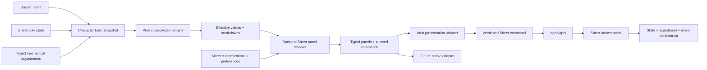
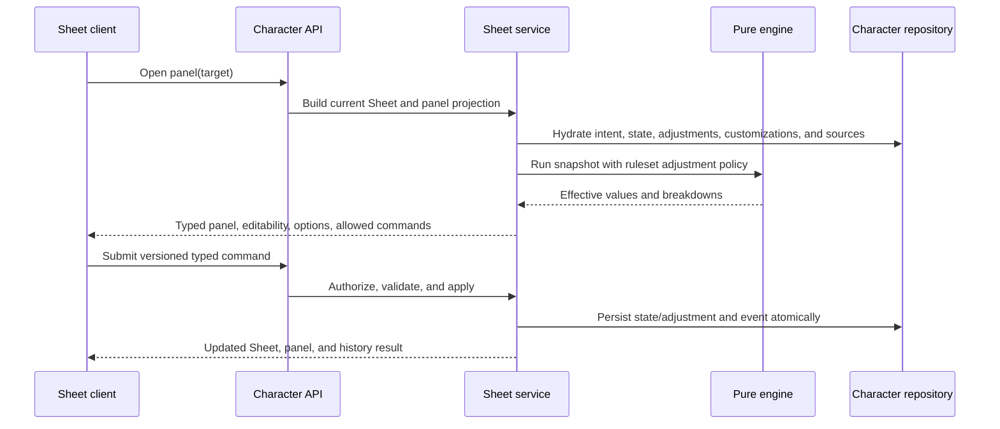

# Phase 00 — Character Sheet play depth and overrides

> **Status:** complete — final-validated in the [Phase 00 implementation ledger](00-character-sheet-play-depth-and-overrides-implementation.md)
> **Depends on:** current authenticated Character Builder, Sheet, engine, and web baseline
> **Unlocks:** transparent Character inspection, complete web play controls, portable Sheet panels, native Sheet parity, and future Campaign GM inspection
> **Primary ADRs:** [0001 package boundaries](../adr/0001-package-boundaries.md), [0005 pure rules-system engine](../adr/0005-pure-rules-system-engine.md), [0006 Builder/Sheet boundary](../adr/0006-character-builder-sheet-boundary.md), [0010 portable semantics](../adr/0010-platform-neutral-design-system.md)

## Goal

Complete the Character Sheet as a trustworthy play surface before native and Campaign work expands it. The phase adds mechanically authoritative per-character adjustments, transparent calculation breakdowns, backend-resolved semantic panels, focused management flows, and the missing play interactions represented by the reference drawer inventory.

The reference captures are a capability baseline only. Artificer Toolkit keeps the locked Character Sheet direction, product vocabulary, Forge visual system, and platform-owned responsive presentation. This phase does not reproduce another product's drawer styling or data model.

## Assumptions

- D&D 5e 2014 is the first supported adjustment policy. The adjustment contract is ruleset-aware so later systems do not accumulate D&D-specific conditionals in the shared kernel.
- Mechanical adjustments are Sheet-owned, per-character, and authoritative inputs to rules calculation. They do not mutate reusable authored content or silently rewrite Builder intent.
- Non-mechanical names, notes, and display choices are separate typed Sheet customizations or preferences. They may affect panel projection, but never enter rules calculation.
- Character owners are the only adjustment, customization, and preference editors in this phase.
- Future authorized Campaign GMs may inspect effective values, adjustment indicators, source notes, and calculation breakdowns. Campaign authority does not grant adjustment-edit permission unless a later phase explicitly adds it.
- The web client ships the first panel adapter. Phase 03 consumes the same contracts through a native adapter.
- Backend contracts own semantic panel facts, family-specific content ordering, editability, valid options, commands, validation, and concurrency metadata. Clients own overlay geometry, focus management, component choice, responsive composition, and transient pending/error state.
- Movement display supports `AUTO` or an explicit available movement type. `AUTO` selects walking when available and otherwise uses the first backend-ordered available movement.
- There is no Sheet Save action. Text and numeric fields commit on blur or Enter; selects, toggles, clears, additions, removals, HP/resource use, and condition changes commit immediately. Rest selections remain a preview until the player takes the rest.

## Current starting point

- The Sheet already has typed DTOs and versioned, retry-idempotent commands for inspiration, HP, temporary HP, conditions, exhaustion, resources, spell slots, spell casting, prepared spells, runtime inventory, currency, notes, and rest. The provisional max-HP field is being migrated into typed adjustment storage in the first implementation tranche.
- HP damage/healing, conditions, exhaustion, spell preparation, resources, inventory placement, equipment, attunement, and notes persist through Sheet-owned state patches.
- Abilities, saving throws, skills, passive checks, senses, defenses, proficiencies, spells, features, item details, and resource usage are projected into the current Sheet response with uneven detail.
- Current hit-die use consumes a die but does not roll or apply healing. Rest does not expose a backend preview of recoveries, hit-die results, or rest-cleared adjustments.
- The web surface mixes inline expansion, direct controls, and manually composed panels. There is no shared semantic inspector contract.
- Movement is not a first-class Sheet DTO despite the UI reserving a speed location.
- There is no general per-character adjustment model, calculation breakdown, primary-movement preference, item-instance charge state, companion Sheet projection, custom skill model, or full background detail panel.
- Owned creature and vehicle state exists in the character domain and persistence seams, but the Sheet does not expose companion/familiar commands or panels.

Verify this starting point against the phase branch before selecting migrations or implementation slices.

## Requirements

### Authoritative character adjustments

Define a closed, discriminated `CharacterSheetAdjustment` domain family for mechanical intent only. It must use typed targets and payloads rather than arbitrary object paths, generic key/value records, or an unvalidated JSON blob.

The initial family covers:

- ability score additive adjustments and absolute score overrides;
- saving-throw additive adjustments, proficiency changes, and absolute total overrides;
- skill additive adjustments, governing-ability changes, proficiency changes, and absolute total overrides;
- passive-check additive adjustments and absolute total overrides;
- sense range additions, changes, and suppression;
- movement-mode additions, distance changes, and suppression;
- defense additions or suppression for resistance, immunity, and vulnerability;
- custom and adjusted proficiencies;
- max-HP additive adjustments and absolute max-HP overrides;
- spell-source attack, save-DC, and bonus-only damage adjustments, with contextual mutually exclusive `TO_HIT` or `SAVE_DC` targets; and separately authored `SPELL_CAST_LEVEL` scaling intersected with the source's owned slot levels;
- owned item-instance attack, damage, weight, and mechanically meaningful property adjustments;
- owned companion-instance ability, defense, movement, sense, HP, type, size, and alignment adjustments.

Persist non-mechanical Sheet intent through separate closed, typed customization and preference families. They cover custom item, spell, and companion names or notes; per-instance item cost; display-as-attack choices; the primary-movement display preference; and other presentation-only values named by this phase. These values remain backend-persisted against the character or owned runtime instance through Sheet-owned repositories; “Sheet-owned” describes their lifecycle and authority, not one catch-all state record. Only `CharacterSheetAdjustment` values enter the character snapshot and rules engine. Customizations and preferences may alter Sheet copy, grouping, or presentation but must not alter mechanical output.

Adjustment resolution follows one explainable order:

1. resolve authored intent, grants, effects, equipment, and ruleset policy;
2. apply manual additive adjustments through the normal rules-system calculation;
3. apply an explicit absolute override last for its target;
4. propagate the effective upstream value to downstream calculations unless that downstream target has its own absolute override.

For example, an ability-score adjustment changes its modifier and dependent saves, skills, and passives; a target-specific skill override still wins for that skill. Clearing an adjustment returns to current authored and engine-derived behavior without copying an old computed value into state.

Persist adjustment intent only. Never persist effective ability scores, skill totals, AC, spell DC, speed, or other derived output as a second source of truth.

Every adjustment records a stable identity, typed target, optional `sourceNote`, creator, and timestamps. `sourceNote` is the only manual metadata across adjustment families; authored provenance remains in the calculation breakdown. Sheet history records creation, replacement, and removal through the existing command/event boundary.

Before schemas or migrations are accepted, the phase subplan must define stable target and resource-owner identities. Repeated feature grants and spell sources use an acquisition or grant-instance identity; items and companions use their owned-instance identity. A reusable definition ID is never sufficient when multiple runtime instances may exist.

This adjustment layer changes load-bearing engine inputs and the Builder/Sheet ownership seam. Implementation must update [ADR 0005](../adr/0005-pure-rules-system-engine.md), [ADR 0006](../adr/0006-character-builder-sheet-boundary.md), and their canonical architecture guides before the first adjustment contract or migration is merged.

### Calculation transparency

Engine output and Sheet projections expose ordered contribution breakdowns for adjusted values. A breakdown distinguishes:

- base or authored value;
- class, race, background, feat, feature, equipment, spell, and system contributions;
- proficiency and governing-ability contribution where applicable;
- active manual additive adjustments with their `sourceNote` when present;
- suppressed contributions;
- absolute override;
- final effective value.

The same effective result must drive displayed values, rolls, passive checks, command validation, rest behavior, spell attacks/DCs, resource limits, and future Campaign inspection. Clients do not recompute or reinterpret the breakdown.

### Semantic Sheet panel contract

Add a typed, backend-resolved `CharacterSheetPanelDto` discriminated union whose members are explicit panel-family DTOs. An ability panel, item panel, rest panel, and companion panel each expose their own typed facts, editable payloads, options, and commands. Shared primitives are limited to stable identities, source and breakdown rows, command availability, validation and conflict metadata, and the smallest closed semantic vocabulary needed across clients.

This is a Character Sheet contract, not another Authoring Schema node map, a generic section/field renderer protocol, or a full layout DSL. Family DTOs may define ordered family-specific groups, but the contract must not transport arbitrary component trees or generic editable-field nodes.

Each panel kind provides:

- stable panel and target identity;
- family-specific title, summary, descriptions, authored source labels, and ordered facts;
- authoritative values and calculation breakdowns;
- typed editable payloads and valid options for that family;
- allowed commands, target identities, and owner authorization;
- read-only, editable, invalid, unavailable, expected-version, and conflict-recovery semantics;
- whether a command commits immediately or represents a rest preview/apply boundary;
- closed action, text, surface, density, and emphasis semantics from the platform-neutral design system when shared product intent requires them.

The contract never includes raw CSS, Mantine or React Native props, component names, device names, arbitrary style IDs, token paths, executable callbacks, or client route logic.

The backend does not model `pending` or `inFlight` UI state. Clients own that transient state while treating every accepted Sheet command response as authoritative.

The backend declares what the character may inspect or change. Web and future native adapters decide whether the active panel is a wide side inspector, regular drawer, compact bottom sheet, or compact full-screen flow.

### Core statistic and reference panels

- Ability panels show base, modifiers, set values, stacking contributions, effective score/modifier, authored description, and supported adjustment controls.
- Saving-throw panels show governing ability, proficiency, bonuses, override, source notes, and rule description.
- Skill panels show governing ability, proficiency/expertise state, bonuses, override, source notes, rule description, and a roll action when available.
- All Skills lists canonical skills with search/filter support and opens the same individual skill panel. Its ID-based contracts leave room for a separately reviewed custom-skill tranche without treating labels as target identity.
- Passive and Senses panels show passive Perception, Investigation, and Insight when defined by the ruleset plus all resolved special senses, ranges, notes, and supported adjustments.
- Movement panels show every resolved movement mode, its source/breakdown, supported adjustments, and the validated `AUTO` or explicit primary-display preference.
- Defenses panels show resistance, immunity, and vulnerability grouped by type, including source/provenance and supported additions or suppression.
- Proficiencies panels group armor, weapons, tools, languages, and ruleset-defined targets while retaining source and adjustment information.

### HP, conditions, exhaustion, and rest

- HP management supports current, temporary, healing, damage, additive max-HP adjustment, absolute max-HP override, clear/reset behavior, and an effective-max breakdown.
- Damage continues to consume temporary HP first and every HP command clamps against the same authoritative effective maximum shown in the panel.
- Conditions and exhaustion retain backend-owned definitions, descriptions, active state, source notes, and ruleset-specific limits.
- Short- and long-rest panels load a backend preview of recoverable resources, spell slots, hit dice, exhaustion effects, and eligible companion recovery. Manual adjustments never clear during a rest.
- Hit-die recovery rolls and healing occur through a typed, versioned Sheet command and return the applied roll/result for history and UI feedback.
- Rest completion is atomic for the selected recovery choices. Duplicate or conflicting submissions cannot spend a hit die or restore a resource twice.

### Spells, features, resources, and items

- Spell detail panels expose authored descriptions, source, level, school, casting facts, tags, projected mechanics, legal cast modes, attacks/DCs/damage, linked resources, and supported per-character adjustments. Backend spell groups include active sources only; each upcast value is available only for the intersection of the spell's legal cast levels and the source's available slot levels.
- Spell management exposes only backend-authorized transitions for each source. Preparing or unpreparing Sheet-owned state is allowed where rules permit; structural acquisition remains read-only or routes to Builder.
- Feature panels expose authored details, source, mechanics, granted choices, and resource trackers without inventing placeholder charges for features that do not own a resource.
- Resource trackers use a stable owner identity. Feature grants, spell-source uses, item-instance charges, and companion resources must not collide when two owned instances share one authored definition.
- Item panels expose authored description and mechanics plus per-owned-instance name, notes, quantity, placement, equipped/attuned state, charges, and supported mechanical adjustments.
- Item charges persist independently per owned item instance and use the same command, recovery, history, and panel semantics as other resources where their authored behavior matches.
- Background panels expose the selected background's authored description, details, feature, characteristics, grants, and source metadata without turning the reader surface into a Builder form.

### Companions and familiars

- Add an explicit Sheet projection for owned creatures used as familiars, companions, mounts, summons, or other ruleset-defined relationships.
- Companion panels expose the effective stat block, description/source, active state, HP, resources, senses, movement, defenses, equipment assignment, custom identity/notes, and supported typed instance adjustments.
- Companion commands operate on the owned creature instance, not on the reusable creature definition and not through inventory-only compatibility plumbing.
- Instance state and adjustment targets remain stable when two companions reference the same authored creature.

### Focused interaction model

- Any supported statistic, status row, spell, feature, item, background, or companion can open its semantic panel from the Sheet.
- Only one Sheet inspector is active at a time. Clients return focus to the invoking control when it closes.
- Text and numeric edits commit on blur or Enter. Selects, toggles, clears, additions, removals, HP changes, resource use, and condition changes commit immediately.
- Only one panel mutation is active at a time. Other mutable controls are briefly disabled until the authoritative response or error arrives.
- The web client applies safe, command-specific optimistic projections to the TanStack Query Sheet and panel cache. It snapshots cache state before mutation, restores that snapshot on failure, and replaces the projection with the authoritative response on success.
- Optimistic projections may update direct play-state intent, but never reproduce rules-engine calculations. Values that require mechanical resolution reconcile from the backend response.
- Failed commands restore server truth and expose a field-level error. Optimistic state never becomes authoritative.
- Rest configuration is the sole staged interaction: preview is read-only until **Take Short Rest** or **Take Long Rest** submits the atomic command.
- Long descriptions remain readable and independently scrollable without trapping keyboard or touch navigation.
- Web interaction is keyboard reachable, uses accessible labels and focus management, preserves `prefers-reduced-motion`, and maintains the same information hierarchy in both Forge themes.

### Existing Sheet surface preservation

- Inspiration and existing action mechanics remain available and continue to use authoritative Sheet commands.
- Inventory placement, containers, currency, equipment, attunement, and quantity behavior remain supported while item detail moves into the focused panel pattern.
- Character notes and other existing Sheet-owned text remain available without being recast as mechanical adjustments.
- Focused regression coverage must prove these existing surfaces still project, mutate, hydrate, and reconcile correctly after the new panel adapter is introduced.

## Reference capability inventory

| Capability family                   | Phase result                                                                         |
| ----------------------------------- | ------------------------------------------------------------------------------------ |
| Ability detail                      | Effective score/modifier breakdown and typed score adjustments                       |
| Saving throw detail                 | Proficiency, bonus, override, notes, description, and roll context                   |
| Individual and all skills           | Searchable canonical list, typed adjustments, and detail; custom-skill CRUD deferred |
| Passive checks and senses           | Authoritative passives, special-sense ranges, notes, and adjustments                 |
| Movement                            | All movement modes plus `AUTO` or explicit primary display                           |
| Defenses                            | Resistance, immunity, vulnerability, sources, additions, and suppression             |
| Proficiencies                       | Grouped armor, weapons, tools, languages, sources, and custom entries                |
| HP management                       | Current/temp HP, damage/healing, additive max adjustment, and override               |
| Short and long rest                 | Recovery preview, hit-die healing, selected recovery, and results                    |
| Conditions and exhaustion           | Definitions, descriptions, active state, notes, and ruleset limits                   |
| Spell management                    | Slots, legal cast modes, preparation state, source restrictions, and detail          |
| Feature detail                      | Authored description, mechanics, source, choices, and owning charges                 |
| Item detail                         | Authored mechanics plus instance customization, state, adjustments, and charges      |
| Companion/familiar detail           | Effective stat block, play state, equipment, identity, and adjustments               |
| Background detail                   | Authored description, feature, characteristics, grants, and source                   |
| Inspiration and actions             | Existing authoritative play controls preserved alongside focused panels              |
| Inventory, containers, and currency | Existing placement, state, quantity, and currency behavior preserved                 |
| Notes                               | Existing Sheet-owned notes remain available and non-mechanical                       |

## Design

The pure engine remains the authority for mechanical results. Panel resolution is a projection step after engine resolution: it composes effective output, authored descriptions, vocabulary, valid Sheet actions, and portable semantics into transport-safe panel DTOs.

The API never trusts a client-supplied total, breakdown, editable flag, or authored source label. Commands submit typed adjustment intent or play-state intent; the service rebuilds authoritative output before and after persistence.

## Package and client seams

- `packages/shared` owns mechanical-adjustment domain unions, ruleset adjustment policy, snapshot inputs, resource-owner identities, and pure calculation breakdowns.
- `packages/schema` owns Zod DTOs for mechanical adjustments, non-mechanical customizations and preferences, calculation breakdowns, explicit panel-family kinds, companions, rest previews/results, and command variants.
- `packages/functions` owns authorization, engine orchestration, panel resolution, rest resolution, command validation, and history summaries.
- `packages/db` owns structured adjustment, preference, resource-instance, companion, and history persistence with character ownership and stream-version concurrency.
- `apps/apis` exposes schema-validated thin procedures and maps known command/concurrency failures.
- `apps/web` owns the exhaustive panel adapter, responsive inspector shell, transient pending/error state, focus behavior, and Sheet entry points.
- `packages/design-system` adds only portable semantic vocabulary that represents stable product intent and requires exhaustive active-client adapters.

The phase subplan must choose an explicit relational or constrained typed-payload persistence design for each closed adjustment family. It must not use an unconstrained `target_path + value`, unvalidated JSON, or persisted final-value cache.

## Ordered workstreams

1. **Lock the architecture, target identity, and adjustment policy.** Update ADRs 0005 and 0006 plus the owning architecture guides; define stable grant/source/item/companion identities; then define typed mechanical targets, separate customization/preferences, additive/absolute/suppression operations, D&D 5e 2014 precedence, downstream propagation, clearing, source categories, and calculation examples.
2. **Add adjustment and preference persistence.** Specify migrations, RLS, Kysely types, repository hydration/patches, stream-version behavior, event summaries, and owner-only mutation authorization.
3. **Integrate adjustments into engine assembly.** Extend snapshot/ruleset inputs and engine output breakdowns without persisting derived totals or weakening purity.
4. **Define the semantic panel contracts.** Add explicit DTOs for each panel family, constrained shared primitives, typed action availability, editability, options, immediate command behavior, rest preview/apply semantics, conflict metadata, and exhaustive adapter tests. Do not add a generic section/field renderer protocol.
5. **Build core statistic panels.** Cover abilities, saves, canonical skills, passives, senses, movement/display preference, defenses, and proficiencies.
6. **Complete HP, conditions, exhaustion, and rest.** Add rest preview/result contracts, hit-die healing, recoverable resources, eligible reset behavior, and atomic/idempotent commands.
7. **Complete spell, feature, resource, item, and background panels.** Reuse existing mechanics and state while adding source-rich details, legal actions, instance charges, and typed adjustments.
8. **Add companion/familiar projection and commands.** Hydrate owned creature instances, effective stat blocks, HP/resources, equipment, identity, and supported adjustments.
9. **Build the web panel adapter.** Replace inconsistent inline management with one focused responsive inspector pattern while preserving the locked desktop, tablet, and mobile Sheet hierarchy.
10. **Validate the full interaction matrix.** Cover engine precedence, persistence/hydration, idempotency, concurrency, owner authorization, schema parsing, panel exhaustiveness, accessibility, responsive behavior, and regression of inspiration, actions, HP, conditions, resources, spells, containers, inventory, currency, and notes.

Each workstream becomes one or more independently reviewable branches. Do not implement the entire phase as one repository-wide diff.

## Acceptance gates

- Every reference capability family is represented by a typed panel, or by a retained typed action/control when focused inspection adds no value, and has either a working owner action or an explicit read-only/Builder handoff.
- An ability adjustment updates its modifier and all dependent saves, skills, and passives; a target-specific downstream override wins and the breakdown explains why.
- Additive adjustments participate in normal rules calculation, absolute overrides resolve last for their target, and clearing either restores current authored behavior.
- Displayed values, rolls, passive checks, spell attacks/DCs, HP limits, rest, resource validation, and history use the same effective engine result.
- No final derived total is stored as adjustment or Sheet truth.
- Names, notes, display choices, and other non-mechanical customizations do not change engine output unless a separate typed mechanical adjustment exists.
- Every manual change exposes source/notes and a visible override indicator; owner-visible history records actor, time, target, and change.
- A future authorized non-owner reader can receive the same read-only breakdown without receiving edit actions.
- Movement lists every resolved mode, rejects unavailable explicit display choices, and applies the deterministic `AUTO` fallback.
- Short-rest hit-die healing and selected recoveries are applied once under duplicate requests, and stale versions fail without partial recovery.
- Two owned items or companions referencing the same authored definition retain independent charges, state, and adjustments.
- Repeated feature grants and spell sources also retain stable acquisition identities; no repeated runtime target or resource is keyed only by reusable definition ID.
- Spell actions respect source and preparation rules; structural spell acquisition cannot bypass Builder.
- Web panel entry points, immediate edits, rest previews, errors, and focus return work with keyboard, touch, compact, regular, and wide layouts in both themes.
- Existing inspiration, actions, HP, conditions, resources, spells, inventory placement, containers, equipment, attunement, quantity, currency, notes, command idempotency, and Builder/Sheet boundary tests remain green.
- Schema fixtures for every panel kind are transport-safe and can be consumed without importing web components or CSS.

## Out of scope

- Reusing the Authoring Schema node-map renderer for Character Sheet workflows.
- A general UI-layout DSL, arbitrary remote components, raw style transport, or shared rendered web/native components.
- A single adjustment record that mixes rules-engine inputs with labels, notes, or display preferences.
- Mutating reusable authored spell, feature, item, background, or creature definitions from the Sheet.
- Campaign membership, GM authorization, GM adjustment editing, Campaign rules, Realtime, Encounter state, or VTT automation.
- Native application implementation; Phase 03 consumes the portable contract.
- General dice chat/history infrastructure. This phase adds only the smallest Sheet-owned hit-die result needed for rest.
- Custom-skill CRUD; Phase 00 preserves ID-based seams but does not create, edit, or remove custom skills.
- Non-5e adjustment policy implementation.

## Concerns and expansions

- Adjustment persistence spans heterogeneous targets. The implementation subplan must preserve SQL integrity and queryability without creating one unconstrained polymorphic row or a table per individual field.
- Mobile clients eventually update less frequently than the API. Phase 03 must define additive contract evolution and minimum-client behavior before native mutation ships.
- Item and companion resources need instance-scoped identities. Definition-scoped charge keys would couple duplicate owned instances and are not acceptable.
- Long prose and large source breakdowns may require progressive disclosure, but clients must not hide the final value, override indicator, or source notes needed for trust.
- Compact spell and action rows may need backend-projected, closed effect categories such as damage, healing, control, defense, movement, summoning, and utility. Clients must not infer them from authored prose, display labels, or free-form primary-effect text. The implementation subplan must settle one primary category versus ordered tags before adding transport fields.
- Spell inclusion in Actions, action economy, and resolution method are separate concepts. The implementation subplan must not keep conflating the user-owned “Display in Actions” preference with `ATTACK`, `ACTION`, `BONUS_ACTION`, or `REACTION` classification.
- Additional rulesets may expose different ability, proficiency, rest, exhaustion, movement, or resource concepts. They should register compatible policies and panel kinds rather than adding conditionals to D&D contracts.
- Campaign inspection requires capability-aware reads and audit correlation. Phase 04 owns that authorization expansion.

## Phase implementation decisions

- Closed adjustment families use constrained relational subtype tables; arbitrary path/value rows and unvalidated payloads are prohibited.
- Owned items and companions use their persisted instance UUIDs. Repeated definition-owned sources use a canonical source-kind plus persisted acquisition/source-record identity.
- Backend dice operations accept an injected CSPRNG adapter and return canonical roll evidence.
- Manual adjustments require explicit removal and are never cleared by rest.
- Custom-skill CRUD is deferred beyond Phase 00.
- Sheet commands may create `COMPANION`, `MOUNT`, and `OWNED` relationships from authorized creatures. `SUMMONED` remains source-owned.

## New-session instruction

Phase 00 is complete. Later phases consume its Sheet commands, semantic panels, adjustment provenance, and calculation breakdowns without reopening the Builder/Sheet ownership decision.
