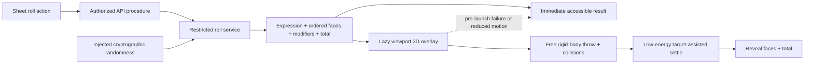
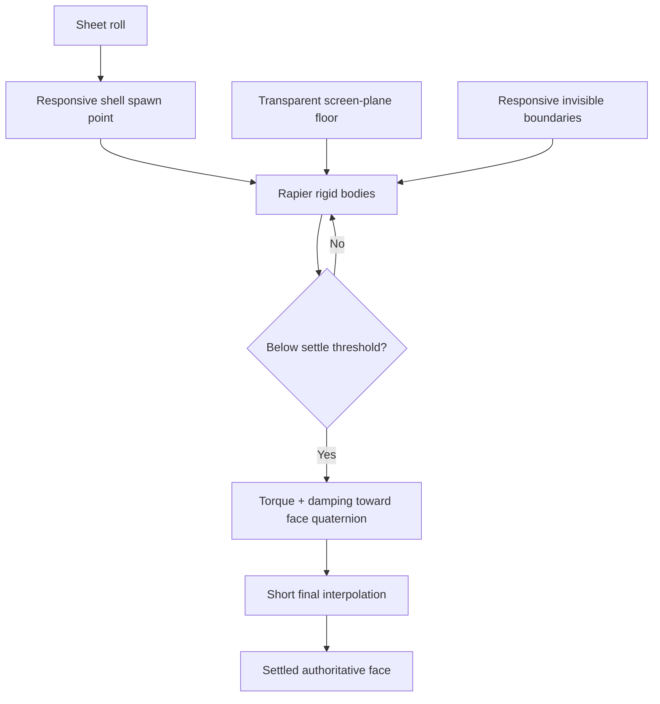

# Phase 01 — Dice and roll infrastructure

> **Status:** complete
> **Depends on:** [Phase 00](00-character-sheet-play-depth-and-overrides.md)
> **Consumed by:** [Phase 05](05-live-campaign-play.md) for Campaign visibility and persisted history, [Phase 06](06-encounters.md) for Encounter-scoped rolls, and [Phase 07](07-vtt.md) for web VTT presentation
> **Primary ADRs:** [0001 package boundaries](../adr/0001-package-boundaries.md), [0005 pure rules-system engine](../adr/0005-pure-rules-system-engine.md), [0006 Builder/Sheet boundary](../adr/0006-character-builder-sheet-boundary.md), [0010 platform-neutral design system](../adr/0010-platform-neutral-design-system.md)

## Goal

Provide one restricted, server-authoritative roll service and a convincing but non-authoritative web presentation. The backend returns the exact semantic evidence for every die. The web animates that known result as dice rolling directly across the character-sheet shell, with an immediate static result whenever animation is inappropriate or unavailable.

## Assumptions

- Phase 01 supports only explicitly approved roll expressions and limits. It does not expose every feature supported by the underlying parser.
- The existing dice models are starting assets, not locked production artifacts. They may be optimized and corrected, but Phase 00 Branch 07 does not restore their renderer or modify their GLB files.
- A backend result is authoritative. Browser physics is transient presentation and is not required to reproduce an identical trajectory.
- Phase 01 keeps the latest 20 private rolls per user for Sheet review. Phase 05 owns Campaign visibility and Phase 06 owns Encounter-scoped history.
- Web ships the first animated adapter. Native clients consume the same semantic evidence with platform-specific presentation in a later phase.

## Requirements

### Authoritative roller

- Expose one application service behind `apps/apis`. Clients never evaluate an expression or choose final faces.
- Validate a deliberately restricted grammar, dice count, die sizes, modifiers, expression length, and total work before evaluating.
- Inject cryptographically secure randomness at the service boundary so the evaluator is deterministic under tests without weakening production randomness.
- Return a normalized expression, exact ordered per-die evidence, modifiers, subtotals, and final total. Include the rules-system and ruleset identity required by the owning action.
- For advantage and disadvantage, roll two d20s, retain both faces in evidence, mark the kept face, and apply numeric modifiers once after keeping the higher or lower face. Engine-resolved advantage and disadvantage cancel before Sheet projection; the manual roller exposes an explicit d20 mode for situational rolls.
- Preserve enough per-die evidence for clients to display a static result without re-evaluation.
- Persist the latest 20 private Sheet rolls per user. Campaign and Encounter domains may persist the same evidence later with their own actor, scope, visibility, authorization, and retention metadata.
- Reject abusive or unsupported expressions before evaluation and apply ordinary API authorization and rate controls at the owning procedure.

### Web presentation

- Dynamically load Three.js, React Three Fiber, Rapier, and optimized dice assets only when an animated roll begins. The normal Sheet route must not pay their initial download or initialization cost.
- When the renderer ships, add device-local Settings controls for animated 3D dice, post-processing, and `HIGH | MEDIUM | LOW` shadow quality. Default animation and post-processing to enabled and shadow quality to `MEDIUM`.
- Operating-system reduced-motion always disables animated dice regardless of the saved device preference.
- Render one absolute, transparent, shell-sized orthographic canvas. The character sheet remains the visible tabletop beneath it.
- Use a screen-aligned floor and responsive invisible boundaries so dice contact the character-sheet shell, collide with one another, and remain on screen.
- Spawn dice within the shell with safe responsive positioning. Apply real linear impulse, angular velocity, gravity toward the screen plane, convex-hull collision shapes, friction, and restitution.
- Map every authoritative face to a validated model face normal and target resting quaternion. Treat the percentile model as the tens die paired with a d10.
- Leave the energetic portion of the throw unconstrained. Only after a die reaches a low-energy state may subtle torque and damping guide it toward its assigned face.
- Use a short final interpolation to guarantee the target rest orientation without a visible snap. Physics must never change the authoritative result.
- Reveal the result when all dice settle. A bounded settle deadline uses a short final 3D interpolation; a renderer or model-load timeout before the throw starts reveals the static result.
- Keep animation state local to the roll surface. Do not restore the previous global provider, persisted Zustand dice store, or a controller object passed through the application.

### Accessibility and failure behavior

- Reduced-motion users receive the authoritative static result immediately, without initializing the 3D renderer.
- WebGL detection failure, model-load failure before launch, renderer error, and physics error reveal the static result immediately.
- The overlay must not trap pointer or keyboard input, steal focus, or obscure the accessible live announcement of the final result.
- The triggering control retains or regains focus after the result is revealed.
- Color, sound, and motion are supplemental. Text and per-die evidence remain sufficient to understand the result.

## Design

The service owns result authority. The overlay receives immutable evidence and only answers how that known result is presented.

The character-sheet shell is the table. Perspective tricks must not make the dice appear to fall behind the interface or into a separate scene.

## Build plan

1. Inventory and optimize the existing dice assets. Losslessly prune unused embedded resources, then validate scale, origin, collision hull, face normals, and target quaternions for every supported model, including the percentile/d10 pair.
2. Define the restricted schema and pure evaluator adapter with injected randomness and exact per-die evidence.
3. Add the application service and thin API procedures for the first approved Sheet roll actions.
4. Add the accessible static result path and owning interaction tests before the 3D adapter.
5. Add the lazy sheet overlay, real throw, collisions, target-assisted settle, timeout, cleanup, and error boundary.
6. Add the three device-local presentation controls to Settings, then prove reduced-motion override, WebGL failure, renderer failure, focus return, resize, route change, and repeated-roll cleanup.
7. Measure initial route weight, lazy chunk weight, model transfer size, frame time, and memory on representative desktop and mobile hardware.
8. Publish the semantic contract for Phase 05 Campaign persistence and Phase 06 Encounter persistence without implementing either history model here.

## Acceptance gates

- Repeating a seeded service test produces identical ordered faces, kept advantage/disadvantage face, modifiers, subtotals, and total.
- Production evaluation uses injected cryptographic randomness and clients cannot supply final faces.
- Unsupported grammar, excessive dice, invalid sides, and oversized modifiers fail before evaluation.
- Every supported model has a tested orientation map; the visible settled face matches every authoritative test face.
- The main throw remains visibly unconstrained, while the low-energy assist settles without a perceptible snap.
- The normal Sheet route excludes the renderer, physics runtime, and dice models until the first animated roll.
- Animated dice, post-processing, and shadow quality persist on the current device; reduced motion still guarantees the static path.
- Reduced motion and every renderer or pre-launch model-load failure reveal the authoritative static result immediately.
- The overlay introduces no pointer trap, keyboard trap, focus loss, horizontal overflow, or persistent state after dismissal.
- Desktop and representative mobile measurements meet limits chosen by the implementation subplan.
- Campaign and Encounter consumers can persist the same semantic evidence without importing web presentation code or creating another roller.

## Out of scope

- Campaign or Encounter roll history, shared chat visibility, replayable browser trajectories, animation seeds, global dice state, native 3D presentation, dice skins/materials/colors, sound controls, particle controls, and shared-versus-private roll visibility.
- Client-side expression evaluation, physics-derived outcomes, or a general parser surface matching every capability of the underlying library.
- Reintroducing the removed renderer, provider, Zustand store, or GLB changes during Phase 00 completion.

## Concerns and expansions

- Lossless pruning reduced the seven current models from roughly 7.2 MB to 5.7 MB without changing geometry or the referenced textures. The models remain high-poly, especially the d20, so measured mobile performance and a visually reviewed lower-poly export remain release gates.
- Target assistance can look artificial if it starts too early or applies too much torque. The implementation subplan must define measurable energy and timeout thresholds and verify them visually.
- Future grammar, model, and presentation changes require measured need and must preserve the delivered authoritative evidence and accessible fallback.
- Persisted animation seeds or trajectories should be considered only if replay becomes a real product requirement.

## New-session instruction

Phase 01 is complete. Campaign, Encounter, and VTT work must consume its authoritative semantic evidence rather than create another roller or derive outcomes from presentation physics.
