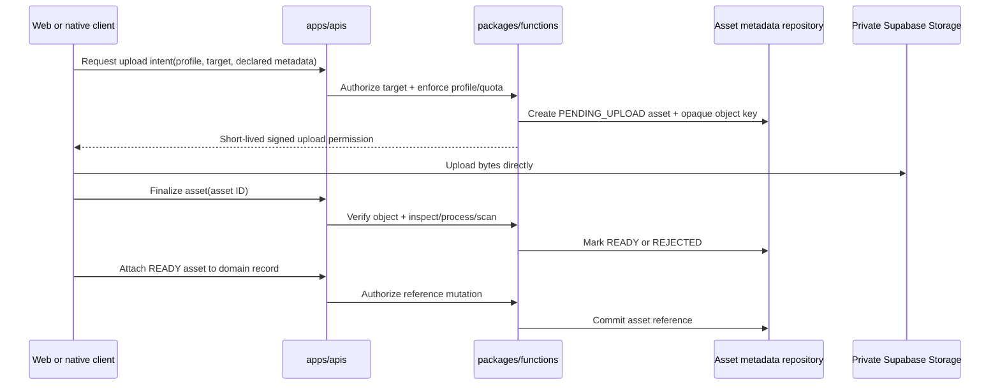
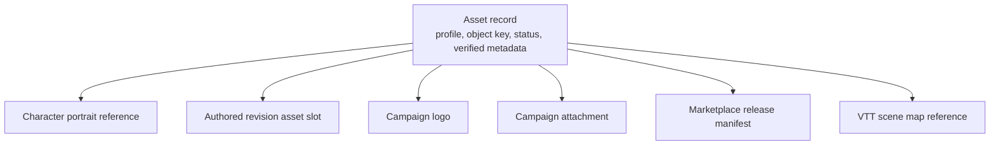

# Phase 01 — Media and supporting-file pipeline

> **Status:** planned
> **Depends on:** the current authenticated API baseline
> **Consumed by:** [Phase 02](02-cross-platform-foundation.md) for native upload and display surfaces
> **Unlocks:** Character portraits, authored-content artwork, Campaign branding and files, Marketplace release assets, and VTT maps
> **Primary ADRs:** [0001 package boundaries](../adr/0001-package-boundaries.md), [0006 Builder/Sheet boundary](../adr/0006-character-builder-sheet-boundary.md), [0007 authored revisions](../adr/0007-authored-revisions-and-active-projections.md)

## Goal

Create one authorized upload, processing, association, delivery, and deletion pipeline for user-provided images and supporting files. The first consumers are Character portraits, authored domain-item thumbnails and larger display images, Campaign logos, and size-limited Campaign attachments. Marketplace assets and larger VTT maps reuse the same foundation through purpose-specific profiles rather than building separate upload systems.

This phase establishes the pipeline, portable contracts, and first web surfaces. [Phase 02](02-cross-platform-foundation.md) displays the same assets in native and adds native upload controls only for editing experiences included in the mobile release; complex authored-content administration remains web-first.

## Assumptions

- “Domain item thumbnails plus larger” means each authored content revision may reference a small thumbnail and an optional larger display/hero image. This can be narrowed in the phase subplan.
- Exact byte limits, image dimensions, attachment quotas, retention periods, and allowed supporting-file types remain product decisions. They are centrally configured per asset profile rather than scattered across clients.
- Original uploads are private by default. Public visibility is an explicit property of a published resource or listing, not a property inferred from its Storage path.
- Campaign supporting files initially serve downloadable handouts and references. VTT maps use a separate larger-file profile and are completed in [Phase 10](10-vtt.md).
- Supporting files do not include executables, archives, scripts, or other active content in the first release. Initial allowed types should be a small allowlist such as safe images, PDF, and plain text after the phase subplan confirms product need and scanning support.
- The existing local `50MiB` Supabase Storage setting is an infrastructure ceiling, not an accepted product limit for every upload type.

## Current starting point

- Supabase Storage is enabled with a local global `50MiB` ceiling, but no product-level asset profiles or quotas are defined.
- The database bootstrap creates an `avatars` bucket and stores an account-level `profiles.avatar_url`; this is not a Character portrait or general product-asset model.
- No current app/API flow owns upload intent, finalization, verified metadata, processing state, domain attachment, signed delivery, or orphan cleanup.
- No Storage policies for Character, authored revision, Campaign, Marketplace, or VTT asset access are present in the current owning database sources.

Verify these statements against the phase branch before selecting migrations, buckets, or libraries.

## Requirements

### Asset purposes and ownership

Define centrally validated profiles for at least:

| Profile | Owner/reference | Initial purpose |
| --- | --- | --- |
| `CHARACTER_PORTRAIT` | Character | Sheet, Builder summary, Campaign roster, and Encounter actor portrait |
| `AUTHORED_THUMBNAIL` | Exact authored revision | Compact cards, lists, search results, and selection surfaces |
| `AUTHORED_DISPLAY_IMAGE` | Exact authored revision | Detail/reader surface and optional larger artwork |
| `CAMPAIGN_LOGO` | Campaign | Compact Campaign identity and roster/list surfaces |
| `CAMPAIGN_ATTACHMENT` | Campaign, optionally linked to a session or note | Size-limited supporting file or handout |
| `CAMPAIGN_HANDOUT_MAP` | Campaign | Downloadable/viewable map reference that is not a VTT scene map |
| `MARKETPLACE_PREVIEW` | Package draft or immutable release | Catalog and release preview media |
| `MARKETPLACE_SUPPLEMENT` | Package draft or immutable release | Licensed supplemental downloads |
| `VTT_MAP` | Encounter scene | Larger map input with separate size, dimension, quota, transfer, and optimization rules |

- A profile defines allowed verified media types, maximum bytes, image pixel/dimension limits, transfer method, required processing, generated variants, quota accounting, and delivery behavior.
- Clients submit the intended profile and domain target. They never choose an arbitrary bucket, object path, public visibility, or authorization policy.
- Account avatars remain separate from Character portraits. A user may own many characters with different portraits.
- Character portraits are mutable Character presentation metadata outside structural `CharacterAuthored` intent. Builder replacement writes must not delete them.
- Authored thumbnails and display images bind to exact authored revisions. Updating draft artwork creates new immutable asset objects and the published revision retains its exact asset references.
- Campaign logos, handouts, and attachments are Campaign-owned and remain outside `CharacterAuthored`.
- Marketplace releases and VTT scenes reference existing ready assets by ID; they do not duplicate bytes or invent another asset lifecycle.

### Upload, processing, and delivery

- Web requests a short-lived upload intent through `apps/apis`; Phase 02 native uses the same contract. Authorization and quota checks run before the API returns an opaque object key and signed upload permission.
- The client transfers bytes directly to a private Supabase Storage bucket, then calls a finalize procedure. Product bytes do not proxy through the tRPC server.
- The API owns asset metadata and lifecycle. Store stable asset IDs and object keys, never temporary signed URLs, as domain truth.
- Finalization verifies that the object exists and matches the approved intent before it becomes available.
- Do not trust the extension or client-declared MIME type. Verify actual file type, byte size, image dimensions/pixel count, and profile-specific constraints server-side.
- Normalize accepted images, remove embedded metadata including EXIF/GPS, reject decompression bombs, and produce only the variants required by the profile.
- Keep supporting files unavailable while required malware scanning or safety validation is incomplete. Unsafe or unverifiable files are rejected without becoming downloadable to Campaign members.
- Return authorized downloads or short-lived signed URLs through the API. Signed URLs are delivery credentials, not durable application data.
- Use immutable object keys for replacements. Do not overwrite an existing path and depend on CDN invalidation.
- Standard uploads are sufficient for small profiles. Use Supabase resumable uploads for profiles whose permitted sizes make interruption likely, especially `VTT_MAP`.

### Lifecycle, references, and deletion

Use an explicit lifecycle equivalent to:

`PENDING_UPLOAD → PROCESSING → READY | REJECTED → DELETED`

- Only `READY` assets may be attached to a visible product resource.
- A finalize retry is idempotent, and concurrent replacements cannot attach a half-processed object.
- Domain tables own references to assets through real foreign keys or explicit join records. Do not create an unenforced polymorphic `owner_type + owner_id` as the only integrity boundary.
- Replacing or removing an image detaches the old reference; physical deletion occurs only after the asset is unreferenced and a configured recovery grace period has elapsed.
- Assets referenced by immutable authored revisions, Marketplace releases, licenses, or replayable Encounter records cannot be silently mutated or deleted.
- Account deletion, moderation takedown, legal removal, Campaign deletion, and abandoned upload cleanup each have explicit reference and retention behavior.

### Authorization and visibility

- Product authorization is enforced in `packages/functions` and mirrored by least-privilege Storage RLS. A signed intent never grants access outside one approved object key and purpose.
- The service role remains server-only. Web and native never receive it.
- Character portrait access follows Character/Sheet visibility and any authorized Campaign or Encounter projection that exposes the portrait.
- Campaign asset mutation requires an explicit Campaign capability. Removed members immediately lose private attachment and handout access.
- An authored or Campaign image becomes publicly readable only when a separately authorized public resource requires it. Private originals remain private even when a safe derivative is public.
- Original filenames are display metadata only. Object keys are generated, opaque, and safe for Storage.
- Download responses use safe content disposition. Unsupported or active content is never rendered inline.

## Design

The signed transfer keeps large bytes out of the application server while preserving the existing product boundary: the API decides who may upload, where the object belongs, when it is safe, and which domain record may reference it.

The asset record owns storage and processing facts. Each product domain owns the relationship and visibility semantics. This prevents a generic upload table from becoming the authorization source for every feature.

## Package and client seams

- `packages/schema` owns asset-profile identifiers, upload-intent/finalize DTOs, ready-asset metadata, and domain-specific attachment DTOs.
- `packages/functions` authorizes upload targets, resolves profiles and quotas, orchestrates finalization, and attaches ready assets.
- `packages/db` persists asset metadata, lifecycle, references, and cleanup queries. Storage objects are manipulated through the Storage API, not by editing `storage.objects` rows directly.
- `apps/apis` exposes thin intent, finalize, attach, detach, download, and listing procedures.
- `packages/shared` contains only pure profile-independent value types or image-placement semantics genuinely shared by rules/scene code; it does not own file I/O.
- `apps/web` owns browser selection, progress, crop/preview, replacement, validation messages, and attachment management.
- Phase 02 `apps/mobile` uses native pickers and native progress/error states for the upload surfaces included in its release. Native authored-content administration remains deferred.

The phase subplan should evaluate the smallest suitable tools rather than locking dependencies now: browser file APIs for web, Expo image/document pickers for native, Supabase signed/resumable uploads, server-side byte-type inspection, and either Supabase image transformations or server-side image normalization after verifying metadata, cost, deployment, and privacy behavior.

## Ordered workstreams

1. **Lock profile policy.** Decide allowed types, product byte/dimension limits, variants, per-user/Campaign quotas, filenames, visibility, retention, and which first-release surfaces accept uploads.
2. **Define asset contracts and lifecycle.** Add profile-discriminated DTOs, statuses, verified metadata, idempotency, and domain-specific reference rules.
3. **Add private Storage configuration and RLS.** Create least-privilege bucket policies and generated object-key conventions; keep service credentials server-only.
4. **Add persistence and upload orchestration.** Implement asset records, signed intent, direct upload, finalize, ready/rejected transitions, authorized download, and abandoned-upload cleanup.
5. **Add image safety and variants.** Verify content bytes and dimensions, normalize orientation, remove metadata, reject unsafe images, and produce the exact portrait/thumbnail/display/logo variants selected by the profile policy.
6. **Add supporting-file safety.** Implement the smallest viable scanning/finalization path for the initial allowlist, quarantine until completion, and force downloads for formats not approved for inline viewing.
7. **Add the first domain references and web surfaces.** Ship Character portrait, authored thumbnail/display image, and Campaign logo upload/replacement/removal using shared pipeline procedures.
8. **Add Campaign attachments in Phase 04.** Reuse the ready-asset and download flow for size-limited handouts and supporting files rather than extending Phase 01 with Campaign collaboration behavior.
9. **Prepare native consumption.** Keep DTOs and delivery platform-neutral, provide contract fixtures, and leave native rendering and pickers to Phase 02.
10. **Validate security, integrity, and cost controls.** Test RLS/API matrices, forged targets, oversized and spoofed files, image bombs, metadata removal, scanning failure, stale signed URLs, concurrent replacement, orphan cleanup, quota enforcement, and egress-sensitive delivery.

## Acceptance gates

- A user can upload, replace, view, and remove a Character portrait without changing the account avatar or structural character intent.
- An owned authored draft can bind a thumbnail and larger display image; a published revision retains immutable asset references when later draft artwork changes.
- An authorized Campaign editor can add or replace its logo, while a removed member cannot fetch private Campaign assets.
- The API rejects arbitrary object keys, unsupported purposes, spoofed content types, oversized files, unsafe dimensions, and unauthorized target IDs.
- A direct Storage upload is not visible in the product until idempotent finalization reaches `READY`.
- Image delivery does not expose original EXIF/GPS metadata, and private originals do not become public through a domain reference.
- Supporting files remain quarantined until required checks pass and are served with safe content-disposition behavior.
- Replacing an asset uses a new immutable object path; immutable revisions/releases continue resolving the old referenced asset.
- Abandoned, rejected, detached, and account-deletion assets follow tested retention and cleanup rules without deleting still-referenced bytes.
- Web parses the asset DTOs and portable contract fixtures prove the same responses are safe for Phase 02 native consumption.
- `VTT_MAP` limits and transfer behavior are independently configurable from ordinary Campaign attachments.

## Out of scope

- General-purpose cloud drives, arbitrary file types, executable/archive uploads, collaborative document editing, OCR, video/audio hosting, public user galleries, image generation, copyright detection, and a reusable background-job platform.
- Native rendering, pickers, and upload controls; those begin in [Phase 02](02-cross-platform-foundation.md).
- VTT map calibration, tiling, token placement, fog, scene state, and map-renderer performance; those belong to [Phase 10](10-vtt.md).
- Marketplace rights, release publication, licenses, and paid delivery; those belong to [Phase 08](08-free-marketplace.md) and [Phase 09](09-paid-marketplace-and-tables.md).

## Concerns and expansions

- Malware scanning may require an external provider or isolated worker if synchronous finalization cannot meet reliability and timeout budgets. Add that only from measured phase evidence; do not introduce a general queue preemptively.
- Image transformation cost and egress can exceed storage cost. The subplan must compare on-demand transforms with a small set of pre-generated variants before choosing.
- Public release assets may benefit from a public derivative bucket later, but private-by-default signed delivery is the safer initial model.
- VTT maps may eventually require pyramids/tiles, regional delivery, or separate storage quotas. Phase 10 owns those additions behind the same asset identity and authorization model.

## Questions for the phase subplan

- Which authored domains display thumbnails and larger artwork in the first release, and are both slots optional?
- What exact byte, dimension, pixel-count, and quota limits apply to each asset profile and subscription tier?
- Which Campaign supporting-file types are allowed initially, and must attachments link only to a Campaign or also to sessions and notes?
- Which Campaign roles may upload, replace, delete, and download each Campaign asset type?
- Which scanner and image-normalization approach fits the existing deployment and budget without exposing private originals?
- When may a derivative become public, and how do unpublishing, member removal, account deletion, moderation, and legal takedown affect access and retention?

## New-session instruction

Start with the profile policy and authorization matrix, then trace one Character portrait from upload intent through finalization, attachment, delivery, replacement, and deletion. The implementation subplan must name exact migrations, Storage policies, contracts, processing tools, domain references, web/native surfaces, and focused tests before adding a bucket or dependency.
