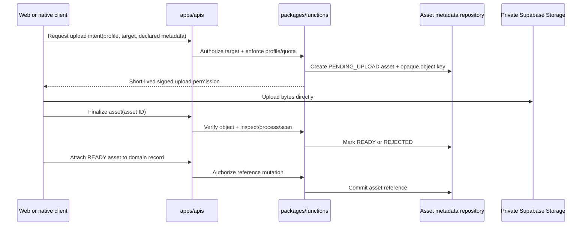
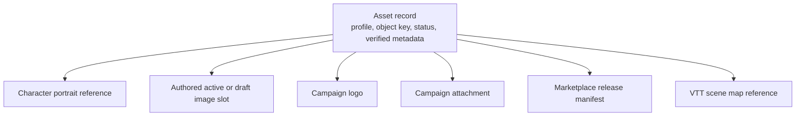

# Phase 02 — Media and supporting-file pipeline

> **Status:** complete — Phase 02 image scope delivered; supporting-file profiles remain deferred to their owning phases
> **Completed:** 2026-08-06
> **Depends on:** the current authenticated API baseline
> **Consumed by:** [Phase 03](03-cross-platform-foundation.md) for native upload and display surfaces
> **Unlocks:** Account avatars, Character portraits, authored-content artwork, and a stable asset identity for later Campaign, Marketplace, and VTT profiles
> **Primary ADRs:** [0001 package boundaries](../adr/0001-package-boundaries.md), [0006 Builder/Sheet boundary](../adr/0006-character-builder-sheet-boundary.md), [0011 active content and JSON drafts](../adr/0011-active-authored-content-and-json-drafts.md), [0012 private media assets](../adr/0012-private-media-assets-and-domain-owned-references.md)

## Goal

Create one authorized upload, processing, association, delivery, and deletion pipeline for the user-provided images needed now: account avatars, Character portraits, and authored-content artwork. Each image uses one normalized source asset plus user-selected square thumbnail framing; authored artwork keeps its uncropped display variant for detail pages. Marketplace assets, Campaign files, and larger VTT maps reuse the same asset identity through purpose-specific profiles added by their owning phases rather than building separate upload systems.

This phase establishes the pipeline, portable contracts, and first web surfaces. [Phase 03](03-cross-platform-foundation.md) displays the same assets in native and adds native upload controls only for editing experiences included in the mobile release; complex authored-content administration remains web-first.

## Assumptions

- An account, Character, authored draft, or active authored record references at most one image asset. Square thumbnail crops are normalized rectangles within the source, not second uploads.
- Phase 02 accepts JPEG, PNG, and WebP images up to 6 MiB, 8,192 pixels per dimension, and 25 million decoded pixels. Per-account media usage is limited to 250 MiB.
- Normalized source, display, and thumbnail variants are WebP. A domain item's main artwork keeps an uncropped display variant, uses user-selected square thumbnail framing, and is decorative by intent. Future mechanical diagrams, maps, and other informative image purposes require a description by profile instead of asking creators to classify the image.
- Original uploads are private by default. Public visibility is an explicit property of a published resource or listing, not a property inferred from its Storage path.
- Campaign supporting files are added in [Phase 05](05-live-campaign-play.md) only after that phase selects quarantine, malware scanning, download disposition, quotas, and its file allowlist. VTT maps use a separate larger-file profile added in [Phase 11](11-vtt.md).

## Delivered state

- The private `media` bucket accepts only the three enabled image media types and has no browser-readable Storage policy.
- `media_assets` and `media_variants` own lifecycle and immutable object identity. Domain foreign keys own account and Character references; `authored_image_slots` owns draft/active artwork.
- `apps/apis` exposes signed upload intent, finalize, attach, remove, and signed delivery procedures backed by the media application service.
- Finalization verifies decoded type, size, dimensions, pixel count, and animation state, then normalizes orientation and metadata through Sharp before an asset reaches `READY`.
- Daily cleanup claims stale, rejected, deleted, and assets unreferenced for 24 hours. A durable object-deletion queue retries Storage removals that outlive database work.
- Web ships upload, replacement, square crop, removal, intent-owned authored-image accessibility metadata, Character Sheet portrait and authored-reference rendering, Guided and Advanced artwork controls for every authored domain, and active authored detail rendering.

## Requirements

### Asset purposes and ownership

Phase 02 enables only the profiles with current product consumers:

| Profile              | Owner/reference                                 | Initial purpose                                                                          |
| -------------------- | ----------------------------------------------- | ---------------------------------------------------------------------------------------- |
| `ACCOUNT_AVATAR`     | Account profile                                 | One private normalized image with a crop-derived thumbnail                               |
| `CHARACTER_PORTRAIT` | Character                                       | One private normalized image with a crop-derived Sheet-header thumbnail                  |
| `AUTHORED_IMAGE`     | Authored route identity, staged as draft/active | One private normalized decorative image with thumbnail framing and active/draft metadata |

- The server validates profile, type, byte, dimension, pixel, quota, processing, variant, and delivery policy. Future domains add a profile only when their authorization and safety requirements are known.
- Clients submit the intended profile and domain target. They never choose an arbitrary bucket, object path, public visibility, or authorization policy.
- Phase 02 adds the account-avatar control to Profile Settings. Account avatars remain separate from Character portraits, and account deletion removes their owned source and variants through the asset lifecycle.
- Character portraits are mutable Character presentation metadata outside structural `CharacterAuthored` intent. Builder replacement writes must not delete the source asset or its crop metadata.
- Authored images stage beside the JSON draft. Updating draft artwork does not change active artwork; activation promotes the draft slot in the same transaction as the active aggregate replacement.
- Thumbnail crop metadata uses normalized source-image coordinates so server and platform adapters derive the same framing at any output size. The crop must remain inside the source bounds after image orientation is normalized.
- Thumbnail, display, and other approved server variants derive from the one source image. Clients never upload an independently edited thumbnail as a second source of truth.
- Future Campaign logos, handouts, Marketplace releases, and VTT scenes remain domain-owned, reference ready assets by ID, and do not duplicate bytes or invent another asset lifecycle.

### Upload, processing, and delivery

- Web requests a short-lived upload intent through `apps/apis`; Phase 03 native uses the same contract. Authorization and quota checks run before the API returns an opaque object key and signed upload permission.
- The client transfers bytes directly to a private Supabase Storage bucket, then calls a finalize procedure. Product bytes do not proxy through the tRPC server.
- The API owns asset metadata and lifecycle. Store stable asset IDs and object keys, never temporary signed URLs, as domain truth.
- Finalization verifies that the object exists and matches the approved intent before it becomes available.
- Do not trust the extension or client-declared MIME type. Verify actual file type, byte size, image dimensions/pixel count, and profile-specific constraints server-side.
- Normalize accepted images, remove embedded metadata including EXIF/GPS, reject decompression bombs, and produce only the variants required by the profile.
- Do not enable supporting-file profiles until their owning phase supplies malware scanning, quarantine, and safe download behavior.
- Return authorized downloads or short-lived signed URLs through the API. Signed URLs are delivery credentials, not durable application data.
- Use immutable object keys for replacements. Do not overwrite an existing path and depend on CDN invalidation.
- Standard uploads are sufficient for small profiles. Use Supabase resumable uploads for profiles whose permitted sizes make interruption likely, especially `VTT_MAP`.

### Lifecycle, references, and deletion

Use an explicit lifecycle equivalent to:

`PENDING_UPLOAD → PROCESSING → READY | REJECTED → DELETED`

- Only `READY` assets may be attached to a visible product resource.
- A finalize retry is idempotent, and concurrent replacements cannot attach a half-processed object.
- Domain tables own references to assets through real foreign keys or explicit join records. Do not create an unenforced polymorphic `owner_type + owner_id` as the only integrity boundary.
- Replacing or removing an image detaches the old reference; the final detach starts a 24-hour recovery grace period before physical deletion.
- Assets referenced by active authored records, Marketplace releases, licenses, or replayable Encounter records cannot be silently mutated or deleted.
- Account deletion and abandoned-upload cleanup have explicit reference and retention behavior. Moderation, legal removal, and Campaign deletion add their behavior with those domains.

### Authorization and visibility

- Product authorization is enforced in `packages/functions`; browser roles have no direct table or bucket policies. A signed intent never grants access outside one approved object key and purpose.
- The service role remains server-only. Web and native never receive it.
- Character portrait access currently follows Character ownership. Later Campaign or Encounter projections must add explicit authorized delivery without exposing the private original.
- Future Campaign asset mutation requires an explicit Campaign capability. Removed members must immediately lose private attachment and handout access.
- An authored or Campaign image becomes publicly readable only when a separately authorized public resource requires it. Private originals remain private even when a safe derivative is public.
- Original filenames are display metadata only. Object keys are generated, opaque, and safe for Storage.
- Download responses use safe content disposition. Unsupported or active content is never rendered inline.

## Design

The signed transfer keeps large bytes out of the application server while preserving the existing product boundary: the API decides who may upload, where the object belongs, when it is safe, and which domain record may reference it.

The asset record owns storage and processing facts. Each product domain owns the relationship and visibility semantics. This prevents a generic upload table from becoming the authorization source for every feature.

## Package and client seams

- `packages/schema` owns asset-profile identifiers, upload-intent/finalize DTOs, ready-asset metadata, normalized crop metadata, and domain-specific attachment DTOs.
- `packages/functions` authorizes upload targets, resolves profiles and quotas, orchestrates finalization, and attaches ready assets.
- `packages/db` persists asset metadata, lifecycle, references, and cleanup queries. Storage objects are manipulated through the Storage API, not by editing `storage.objects` rows directly.
- `apps/apis` exposes thin intent, finalize, attach, detach, and signed-delivery procedures.
- `packages/shared` contains only pure profile-independent value types or image-placement semantics genuinely shared by rules/scene code; it does not own file I/O.
- `apps/web` owns browser selection, crop/preview, replacement, validation messages, and attachment management. Profile Settings consumes avatars, the Character Sheet header consumes portrait thumbnails, and authoring/detail surfaces consume authored artwork.
- Phase 03 `apps/mobile` uses native pickers and native progress/error states for the upload surfaces included in its release. Native authored-content administration remains deferred.

The implemented image path uses browser file APIs, Supabase signed uploads, and synchronous Sharp normalization. Later large-file profiles decide whether resumable transfer or asynchronous scanning is necessary from their own limits.

## Ordered workstreams

1. **Lock profile policy.** Decide allowed types, product byte/dimension limits, variants, per-user/Campaign quotas, filenames, visibility, retention, and which first-release surfaces accept uploads.
2. **Define asset contracts and lifecycle.** Add profile-discriminated DTOs, statuses, verified metadata, idempotency, and domain-specific reference rules.
3. **Add private Storage configuration and RLS.** Create least-privilege bucket policies and generated object-key conventions; keep service credentials server-only.
4. **Add persistence and upload orchestration.** Implement asset records, signed intent, direct upload, finalize, ready/rejected transitions, authorized download, and abandoned-upload cleanup.
5. **Add image safety, crop metadata, and variants.** Verify content bytes and dimensions, normalize orientation, remove metadata, validate the normalized user-selected thumbnail crop, reject unsafe images, and derive the exact approved variants from the one source asset.
6. **Add the first domain references and web surfaces.** Ship account-avatar, Character portrait, and authored-content upload/replacement/removal. Render Character portraits in the Sheet header and authored artwork in the authoring workspace and active detail layout.
7. **Add supporting files in Phase 05.** Reuse the ready-asset and download flow for Campaign handouts only after malware scanning, quarantine, and safe download behavior are selected.
8. **Add Marketplace and VTT profiles in their owning phases.** Extend the current identity and signed-delivery model rather than exposing unused profile values now.
9. **Prepare native consumption.** Keep DTOs and delivery platform-neutral, provide contract fixtures, and leave native rendering and pickers to Phase 03.
10. **Validate security, integrity, and cost controls.** Test RLS/API matrices, forged targets, oversized and spoofed files, image bombs, metadata removal, scanning failure, stale signed URLs, concurrent replacement, orphan cleanup, quota enforcement, and egress-sensitive delivery.

## Acceptance gates

- A user can upload, crop, replace, view, and remove a Character portrait without changing the account avatar or structural character intent.
- A Character or owned authored draft stores one source image plus valid normalized crop metadata where required; server variants reproduce the selected framing without a separately uploaded thumbnail.
- Active authored artwork remains unchanged when later draft artwork changes and updates only when that draft activates.
- The Character Sheet header renders the portrait; Character Sheet authored-reference inspectors and shared authored detail surfaces render active artwork.
- The API rejects arbitrary object keys, unsupported purposes, spoofed content types, oversized files, unsafe dimensions, and unauthorized target IDs.
- A direct Storage upload is not visible in the product until idempotent finalization reaches `READY`.
- Image delivery does not expose original EXIF/GPS metadata, and private originals do not become public through a domain reference.
- Supporting files are not accepted until their owning phase supplies quarantine, scanning, and safe content-disposition behavior.
- Replacing an asset uses a new immutable object path; retained domain references continue resolving their existing asset.
- Abandoned, rejected, detached, and account-deletion assets follow tested retention and cleanup rules without deleting still-referenced bytes.
- Web parses the asset DTOs and portable contract fixtures prove the same responses are safe for Phase 03 native consumption.
- Phase 11 can add `VTT_MAP` limits and resumable transfer without replacing the asset identity or signed-delivery model.

## Out of scope

- General-purpose cloud drives, arbitrary file types, executable/archive uploads, collaborative document editing, OCR, video/audio hosting, public user galleries, image generation, copyright detection, and a reusable background-job platform.
- Catalogue/list thumbnails; current authored-image presentation is limited to authoring controls and detail/reference surfaces.
- Native rendering, pickers, and upload controls; those begin in [Phase 03](03-cross-platform-foundation.md).
- VTT map calibration, tiling, token placement, fog, scene state, and map-renderer performance; those belong to [Phase 11](11-vtt.md).
- Marketplace rights, release publication, licenses, and paid delivery; those belong to [Phase 09](09-free-marketplace.md) and [Phase 10](10-paid-marketplace-and-tables.md).

## Concerns and expansions

- Phase 05 must select malware scanning and quarantine behavior before enabling supporting files; do not introduce a general queue before that profile requires it.
- The current image profiles pre-generate only source, display, and thumbnail variants. Revisit transformation and egress strategy only from measured production cost.
- Public release assets may benefit from a public derivative bucket later, but private-by-default signed delivery is the safer initial model.
- VTT maps may eventually require pyramids/tiles, regional delivery, or separate storage quotas. Phase 11 owns those additions behind the same asset identity and authorization model.

## Deferred decisions by owning phase

- Phase 04 defines Campaign-logo permissions and adds `CAMPAIGN_LOGO` only with its Campaign reference.
- Phase 05 selects supporting-file types, quarantine/scanning, safe download disposition, roles, quotas, and session/note association before adding Campaign attachment profiles.
- Phase 09 defines public Marketplace derivatives, supplemental-file rights, immutable release references, and takedown behavior.
- Phase 11 defines `VTT_MAP` limits, resumable transfer, optimization/tiling, and Encounter-scoped delivery.
- Subscription-specific media quotas are added only when Phase 07 entitlements require tiers beyond the current 250 MiB account limit.
