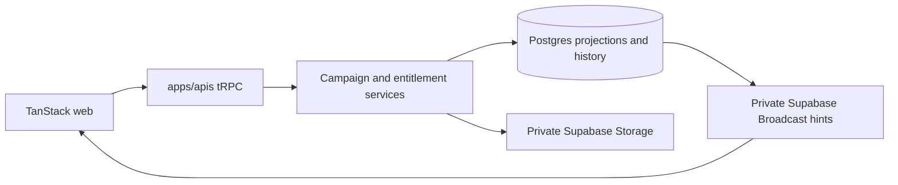
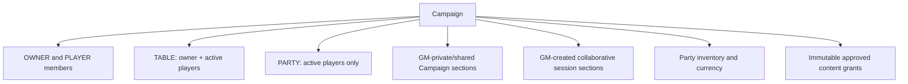

# Phase 03 — Campaign Core

> **Historical:** This phase record predates the Phase 8.2 Convex cutover ([ADR 0029](../adr/0029-convex-backend-cutover.md)). Its Supabase/Postgres, Kysely/SQL, tRPC, `packages/functions`, `packages/db`, `apps/session-host`, GoRules/Zen, Rule Studio, and Netlify-function references, commands, and paths describe retired implementation. Current behavior is in the [architecture guides](../architecture/overview.md).

> **Status:** implemented baseline; approved Campaign-management extension planned
> **Depends on:** [Phase 00](00-character-sheet-play-depth-and-overrides.md), [Phase 01](01-dice-and-roll-infrastructure.md), and [Phase 02](02-media-and-file-pipeline.md)
> **Unlocks:** [Phase 04 Social Hub](04-social-hub.md), [Phase 05 notifications](05-notifications-and-delivery.md), [Phase 06 live play](06-live-campaign-play.md), [Phase 07 Encounters](07-encounters.md), and Campaign-scoped content
> **Primary ADRs:** [0001](../adr/0001-package-boundaries.md), [0006](../adr/0006-character-builder-sheet-boundary.md), [0008](../adr/0008-ruleset-identity-and-content-binding.md), [0011](../adr/0011-active-authored-content-and-json-drafts.md), and [0013](../adr/0013-campaign-authority-and-collaboration.md)

## Goal

Deliver the usable Campaign web core and its approved management extension: account entitlements, role-aware Campaign management, party custody, GM-authorized Sheet state, durable conversations and Campaign rolls, collaborative sessions, and private Realtime reconciliation. Campaign management is the GM workspace and entry point for live session workflows.

## Assumptions

- Campaign roles are `OWNER | PLAYER`; the sole owner is displayed as the GM. Accepted players consume seats; the owner does not.
- Accounts start Free. Tier changes are manually assigned until Phase 09 billing. Existing over-limit records remain usable; limits block new creation or activation.
- A Character has at most one active Campaign assignment. Archived Campaigns are read-only; permanent deletion runs the defined reconciliation.
- Campaign routes use a public base-36 identifier plus slug: `/campaigns/<public-id>/<slug>`. Session routes stay nested and do not expose UUIDs.
- Conversation retention is the newest 500 entries per `TABLE`, `PARTY`, or `DIRECT` conversation. Structured conversations and notes do not consume media storage.
- Campaign notes include GM-private and GM-shared sections; sessions remain collaborative with version-conflict reporting, not CRDT merging.
- Supabase Storage remains the object store. A provider abstraction or R2 migration is deferred to [Phase 08](08-vtt.md).

## Requirements

The implemented baseline remains the current behavior. Bullets explicitly marked **Target extension** describe the approved follow-on work and are not implementation claims.

### Account and entitlement enforcement

- Allow immediate username changes after debounced availability validation; preserve display casing, enforce case-insensitive uniqueness in the database, and make old names reusable immediately.
- Keep `profiles` canonical for usernames. User metadata is never used for username resolution or authorization.
- Add a protected entitlement projection with explicit finite or `UNLIMITED` limits for characters, owned homebrew, media storage, active hosted Campaigns, and accepted seats. Expose later listing, Encounter, and paid-table capabilities without implementing those domains.
- Enforce each limit transactionally in its owning service. Account settings expose plan and usage read-only.

### Campaign lifecycle, content, and reconciliation

- Implement Campaign creation, update, archive, permanent deletion, safe member projections, reusable expiring share links, email/username invitations, acceptance, Character assignment, and owner-transfer acceptance.
- Transfer removes the new owner's player-only access immediately. The former owner may see player-only messages only after transfer. Leave, removal, and rejoin establish fresh history cutoffs.
- Active members may submit owned homebrew. The owner approves immutable versions usable by active members without ownership transfer. Owner finalization or approval atomically propagates valid bindings; an invalid affected Character, item, or spell blocks the whole update.
- Departure or unassignment stops Campaign effects/grants, removes non-owned Campaign references, records reconciliation history, and moves a Character losing a granted race/class/subclass to Builder Draft with repair conflicts. Creators always retain their roots.
- **Target extension:** Campaign management is the GM workspace and is the authoritative point for session setup, roster actions, and encounter attachment; player-only surfaces stay accessible through Sheet quick drawers for Notes/Chat/Party Inventory and non-GM flows.

### Party inventory, currency, and GM Sheet authority

- Cut over to canonical `inventory_*` custody tables with `InventoryOwnerRef = CHARACTER | CAMPAIGN`, backfill Character inventories, and support full/partial stack and currency transfers with expected versions, deterministic locks, idempotency, and correlated custody audit records.
- Clear equipped, attuned, and container-placement state on custody change; reject non-empty container transfers.
- Start with immutable ruleset currencies. Campaigns may add systems of at most five denominations, with a reference system and exact integer base-unit ratios. Publish changes only when every affected balance converts exactly; never round or create fractions.
- Campaign Settings may override the ruleset's attunement-slot limit for assigned Characters. The nullable Campaign value falls back to the active ruleset default and is enforced by the authoritative Sheet command rather than accepted from clients.
- The owner may manage party and assigned-Character inventory. Players may manage transfers to/from their assigned Character. Unassignment/departure moves Campaign-only currency to party inventory with visible owner audit.
- Owners may command assigned Sheet mechanics—HP, resources, rests, conditions, equipment, currency, extras, adjustments, defenses, and statistics—and validated spell-list changes to active caster lists (prepared/known/selected); structural race/class/subclass features remain player-owned.
- GM adjustments/conditions may be hidden: player DTOs retain true totals and concrete current state but omit hidden sources, indicators, conditions, and revealing breakdowns. Campaign GM adjustments override the same player slot and removal restores the player value. GM Character history is hidden by default; Campaign-wide inventory, currency, and rules history remains visible.
- **Target extension:** GM-only inventory auditing retains the latest 180 days of party `inventory_*` custody history. It is an audit projection, not a replacement for current custody truth or Character Sheet history.

### Conversations, rolls, notes, and Realtime

- **Target extension:** persist `TABLE` conversations for GM and active players, `PARTY` conversations for active players only, and `DIRECT` conversations only for their two active participants, with unread state. The GM cannot fetch, subscribe to, count, receive notifications for, or infer party traffic unless they are a direct participant. Members see only messages after their relevant acceptance/player-eligibility cutoff.
- **Target extension:** persist public Campaign rolls in the `TABLE` timeline. Reuse Phase 01 validation/evidence. Sheet-private rolls remain private, and party/direct conversations do not become roll destinations.
- Chat supports 2,000-character plain text, 30 sends per user per Campaign per minute, idempotency, edit for 15 minutes, and unsend for five minutes with a retained tombstone. Rolls/system entries are immutable.
- `OOC` messages display `@username`; `ROLEPLAY` messages display the assigned Character with account attribution. Remember the last composer mode per member and retain immutable author/Character IDs plus message-time display snapshots
- **Target extension:** Campaign notebooks contain owner-authored titled rich-text sections, `GM_PRIVATE` by default and explicitly publishable as `SHARED`. The GM creates sessions; active members may create/edit collaborative rich-text session sections, and an author or GM may delete one.
- Reuse TipTap and its existing 20,000 visible/100,000 serialized character limits. Autosave changed sections after roughly one second with expected versions. Broadcast committed invalidations only; clean clients refetch and dirty clients retain their draft with a conflict state.
- Durable writes commit in Postgres before private Supabase Broadcast hints containing only scope, entity ID, event ID, and cursor. Reconnect uses cursor recovery and deduplication; Broadcast is never history.

## Design

All durable writes cross the API boundary and commit before a private Broadcast hint. RLS, services, reads, subscriptions, counts, and future notification sources must share the same role and history-cutoff rules.

### Conversation and roll privacy matrix

| Scope         | Read / unread / subscription                         | Send                        | Public roll destination                 |
| ------------- | ---------------------------------------------------- | --------------------------- | --------------------------------------- |
| `TABLE`       | GM and active players                                | GM and active players       | GM and active players                   |
| `PARTY`       | Active players only                                  | Active players only         | Not a roll destination                  |
| `DIRECT`      | Its two active participants                          | Its two active participants | Not a roll destination                  |
| Sheet private | Character owner and authorized Sheet projection only | n/a                         | Never routed to a Campaign conversation |

Unread state follows the same predicate as reads and subscriptions. Counts, delivery hints, and list ordering must not reveal inaccessible conversation activity.

## Ordered workstreams

1. **Document the boundary.** Update the relevant authorization/content and Builder/Sheet guidance; define entitlement, lifecycle, room, note, and Realtime matrices.
2. **Enable usernames and entitlements.** Add protected projections, Free defaults/manual tier assignment, account DTOs, usage, and transactional limit checks.
3. **Add lifecycle and immutable grants.** Implement Campaigns, invitations, owner transfer, assignments, archive/delete cleanup, approvals, propagation, and Draft reconciliation.
4. **Extract party custody.** Backfill inventories; implement transfers, audit, exact currency systems/conversions, and departure cleanup.
5. **Extend owner Sheet authority.** Add Campaign-aware command authorization, hidden projection, precedence, spell exception, and history visibility.
6. **Extend role-aware management and custody.** Implement card-only catalogues, Campaign-page and Sheet quick-drawer controls, direct party edits, the canonical `inventory_*` cutover, and the GM-only 180-day inventory audit.
7. **Add conversations and Campaign rolls.** Implement `TABLE`/`PARTY`/`DIRECT` scopes, unread state, history cutoffs, timeline retention, identity modes, edit/unsend, rate limit, and privacy-safe public-roll routing.
8. **Add notes and Realtime.** Implement collaborative session sections, versioned autosave/conflicts, sanitized rendering, private topics, and cache reconciliation.
9. **Ship and validate responsive web.** Cover Campaign overview, membership, grants, custody, conversations, unread state, notes, authority controls, usage, and reconciliation prompts.

## Acceptance gates

- Username races, entitlement limits, seat consumption, one active Character assignment, transfer, archive/delete, and content propagation are transactionally correct.
- GMs cannot read, subscribe to, count, receive notifications for, or infer inaccessible party or direct traffic.
- Conversation retention, unread isolation, edit/unsend timing, roll evidence/routing, identity snapshots, and reconnect deduplication hold under concurrency.
- Currency conversion rejects every non-exact update; transfers never duplicate, lose, or partially move custody.
- Player projections reveal neither secret GM causes nor hidden conditions while retaining correct final values and concrete state.
- Private-note publish/unpublish, collaborative-session permissions, version conflicts, direct party edits, 180-day GM audit access, and archive read-only behavior are enforced through API and RLS.

## Out of scope

- Vehicles, Campaign files/handouts, Campaign clock, VTT, chat attachments/reactions/threads/search/typing, CRDTs/cursors/revision history, semantic note links/hover cards, payment, and a notification domain.
- Phase 05 establishes the Supabase-backed web inbox, Resend email delivery, and notification preferences; Phase 06 adds Campaign announcements; Phase 10 adds paid-table notification sources; Phase 11 adds native push.

## New-session instruction

Begin with the authorization and entitlement matrices, then implement one independently reviewable slice at a time. Do not build notification, storage-provider, CRDT, or semantic-link scaffolding in this phase.
