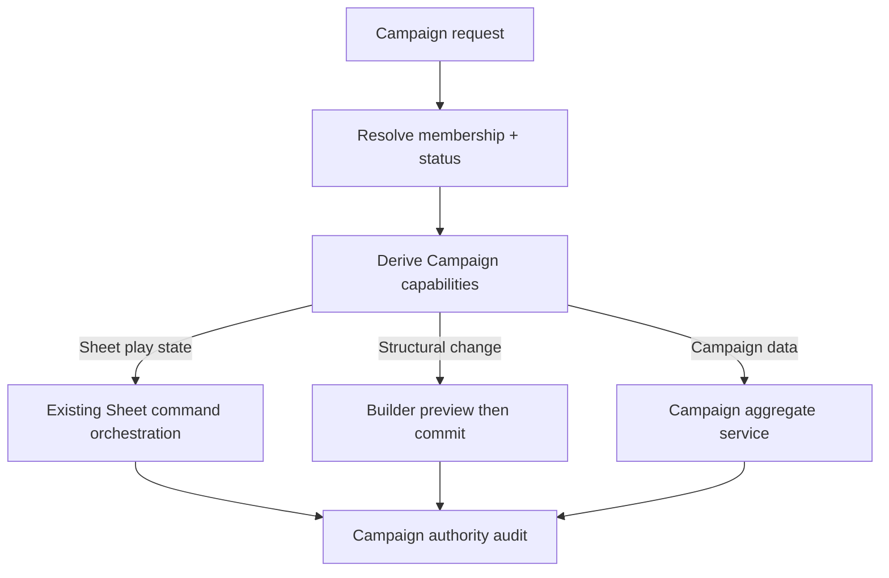

# Phase 03 — Campaign Core

> **Status:** planned
> **Depends on:** [Phase 00](00-character-sheet-play-depth-and-overrides.md), [Phase 01](01-dice-and-roll-infrastructure.md), and [Phase 02](02-media-and-file-pipeline.md)
> **Unlocks:** live Campaign play, Campaign Encounters, Social Hub conversion, and Campaign-scoped content
> **Primary ADRs:** [0001](../adr/0001-package-boundaries.md), [0006](../adr/0006-character-builder-sheet-boundary.md), [0008](../adr/0008-ruleset-identity-and-content-binding.md), [0011](../adr/0011-active-authored-content-and-json-drafts.md)

## Goal

Introduce the minimum Campaign aggregate and authorization model: invitations, membership, OWNER/GM/PLAYER roles, character assignment, version-bound content access, typed Campaign rules, GM Sheet access, and audited GM commands. Ship the responsive web Campaign overview, member, content, and Sheet-access journeys without adding live-play collaboration yet.

## Current starting point

- Characters and authored definitions are directly user-owned, and authorization is largely owner-or-super-admin.
- No Campaign, membership, invitation, delegated actor control, or GM capability model exists.
- Character Builder structural writes and Sheet play-state commands are already separate seams.
- Current structural selections resolve stable authored root IDs against canonical active content. General authored revision history is intentionally not retained, so Campaign-stable content requires a new explicit immutable snapshot/version contract.
- Character and authored-data RLS policies assume direct ownership and will not become Campaign-aware by adding one membership table alone.

## Requirements

- Campaigns record explicit system and ruleset identity, status, owner, and stable public identity.
- Membership uses `OWNER | GM | PLAYER`; the owner is a member and ownership transfer is deferred unless explicitly added to the subplan.
- Invitations have explicit lifecycle, expiry, intended role, inviter, recipient/token identity, acceptance, revocation, and audit data.
- A character may have one active Campaign. Assignment requires character-owner consent and compatible system/ruleset identity.
- Contributing content creates or reuses an immutable Campaign content snapshot/version for selection and play without copying the root into a player's Library or restoring general authored revision history.
- Authorized members may contribute owned homebrew to the Campaign. Personal creation limits remain attached to the contributing account.
- Campaign access grants read/use permission while the revision remains relevant to the Campaign; it does not transfer ownership, editing, personal export, or Marketplace sale rights.
- Removing a grant prevents future selection but does not invalidate already pinned character content.
- Typed Campaign rules initially support attunement-slot limit and `EXPERIENCE | MILESTONE` progression, with a GM-approved milestone level per character.
- Campaign currency policy may define a closed set of denominations, a base denomination, exact exchange ratios, and rounding behavior. Policy revisions are versioned so existing balances remain explainable and are never silently rewritten.
- Switching to milestone never deletes stored experience; switching back restores experience-based behavior from retained data.
- GM Sheet changes use existing typed Sheet commands. Structural changes use Builder preview/commit and must surface the proposed diff before persistence.
- Authorized GMs may inspect effective Character values, adjustment indicators, source notes, and calculation breakdowns from Phase 00 without receiving adjustment-edit commands.
- Every GM action records actor, authority source, Campaign, character, command or preview/commit identity, timestamp, result, and human-readable summary.
- A Campaign may reference a logo through a ready asset from Phase 02. Campaign capability controls replacement/removal; member access does not make the private original public.

## Design

Define an `AuthorityContext` consumed by Campaign, Builder, and Sheet orchestration. Capabilities—not UI role labels—decide whether an actor may view a Sheet, assign a character, grant content, change rules, issue a Sheet command, or preview/commit a structural edit.

Keep Campaign data outside `CharacterAuthored`. Builder replacement writes must never delete Campaign membership, grants, audit records, or later shared play data.

## Data and contract seams

The subplan should define shared DTOs and persistence for these conceptual records without assuming these exact table names:

- Campaign and stable public route identity.
- Campaign membership and role/status history.
- Invitation and acceptance/revocation lifecycle.
- Character assignment and active-Campaign constraint.
- Immutable Campaign content snapshot/version, access reference, and revocation.
- Ruleset-discriminated Campaign rule overrides.
- Typed Campaign currency definitions and versioned exchange policy.
- Per-character milestone approval while retaining experience truth.
- Campaign authority audit entries correlated to Sheet or Builder operations.
- Campaign logo asset reference outside `CharacterAuthored`.

RLS and service authorization must agree. Direct database access, tRPC procedures, Realtime authorization added later, and administrative tooling must all fail closed for removed members and incompatible roles.

## Ordered workstreams

1. **Specify the authorization matrix.** Define OWNER, GM, PLAYER, removed member, invitee, character owner, and non-member capabilities for every Phase 03 action, including read-only inspection of Phase 00 adjustments and breakdowns.
2. **Add the minimum Campaign content version contract.** Snapshot contributed active content behind an immutable Campaign version identity, preserve it through character selection, hydration, engine assembly, and history, and record the decision in an ADR. Do not reintroduce general authored revision history.
3. **Add Campaign persistence and RLS.** Create migrations and Kysely repositories for Campaigns, members, invitations, assignments, grants, rules, and audit records.
4. **Add application orchestration.** Implement lifecycle and capability resolution in `packages/functions`; keep `apps/apis` thin and schema-parsed.
5. **Extend Builder and Sheet authority.** Add `AuthorityContext`, reuse Sheet commands, add GM Builder preview/commit, and correlate every delegated operation with an audit entry.
6. **Apply Campaign rules during engine assembly.** Do not rewrite Builder intent or erase experience. Return enough source information for web and future native clients to explain effective values.
7. **Build responsive web Campaign Core surfaces.** Cover Campaign list/create/invite/member/character assignment/content/rules, Sheet access, and logo management.
8. **Validate lifecycle, authorization, and concurrency.** Test RLS and API matrices, invite races, assignment conflicts, reference removal, progression switching, delegated commands, and responsive web projections.

## Acceptance gates

- Every role and lifecycle state passes explicit API and RLS authorization tables.
- Removed members immediately lose Campaign, content-grant, and delegated Sheet access.
- A character cannot be actively assigned to two Campaigns under concurrent requests.
- Campaign system/ruleset incompatibility fails before assignment or grant use.
- Access removal blocks new selection while characters and party items already bound to an immutable Campaign content version remain explainable and valid under the approved retention policy.
- Experience survives any number of milestone/experience switches.
- A GM structural change cannot bypass Builder preview/commit.
- A GM with Sheet-view capability can inspect Phase 00 adjustment provenance and effective-value breakdowns but receives no adjustment-edit action.
- Duplicate or retried GM commands remain idempotent and create one effective audit trail.
- Campaign overview, member, content, and Sheet projections remain consistent across responsive web surfaces.
- Campaign logo replacement uses ready assets, preserves private-original access rules, and cannot be performed by an unauthorized member.

## Out of scope

- Chat, notes, sessions, Campaign supporting files/handouts, Campaign clock, shared inventory, item transfer, vehicles, dice, roll history, Realtime, push, Encounters, and VTT.
- Native Campaign surfaces; Phase 10 consumes the proven web contracts after the viability gate.
- GM creation, editing, or removal of character-owner adjustments.
- Automated progression, encounter combat automation, ownership transfer, multiple active Campaigns per character, and arbitrary custom rule scripting.

## Questions for the phase subplan

- Can a Campaign have multiple GMs with identical capabilities, or are some owner-only actions required?
- Does a player assign a character during invitation acceptance, or may assignment happen later?
- What happens to assignment and delegated access when a member leaves or is removed mid-session?
- Which structural Builder fields may a GM change in alpha, and does every change require contemporaneous player approval or only audit visibility?
- Are Campaign content grants Campaign-wide, role-scoped, or individually assigned in the first release?
- May a Campaign define currency denominations and exchange rates, or only select from its system vocabulary? The subplan must settle the base denomination, ratio and rounding model, policy versioning, and existing-balance behavior.

## New-session instruction

Begin with the authorization matrix and the minimal Campaign content-version design. The subplan must name every affected owner-only RLS policy and service check, reconcile the design with ADR 0011, and add an ADR for the new snapshot contract; “add membership” is not a sufficient authorization design.
