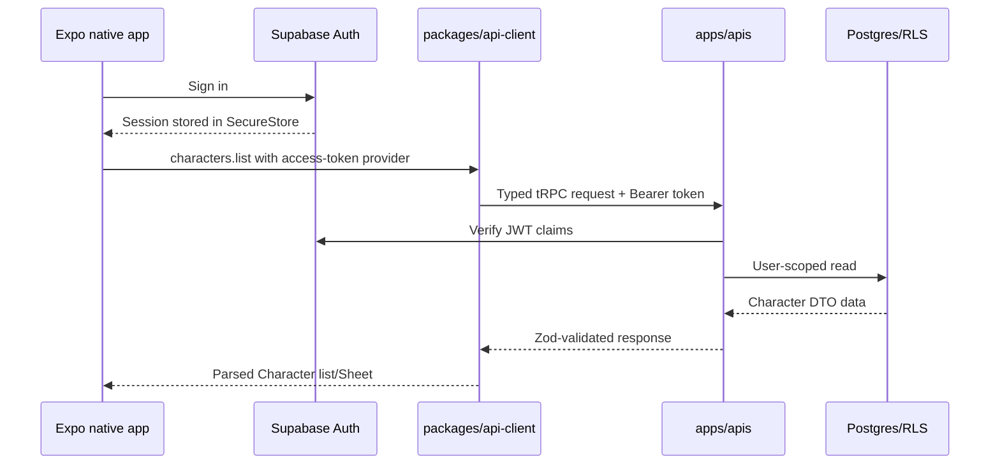

# Phase 03 — Cross-platform foundation

> **Status:** planned
> **Depends on:** [Phase 00](00-character-sheet-play-depth-and-overrides.md), [Phase 02](02-media-and-file-pipeline.md), and the current authenticated web/API baseline
> **Unlocks:** every native surface and all later cross-platform API work
> **Primary ADRs:** [0001 package boundaries](../adr/0001-package-boundaries.md), [0010 platform-neutral design system](../adr/0010-platform-neutral-design-system.md)

## Goal

Prove that the existing modular monolith can support a real native client before Campaign contracts expand. The exit result is an Expo iOS/Android shell that signs into the same Supabase account, crosses the same tRPC product-data boundary, and renders one read-only Character list → Sheet journey from the Phase 00 semantic panel contract with native navigation and components.

## Current starting point

- `apps/web` is the only product client.
- `apps/apis` is reached through the web server's `/api/trpc` handler and currently derives authentication from browser session cookies.
- `apps/web/src/lib/api.ts` manually mirrors tRPC procedures and parses shared Zod DTOs.
- `packages/design-system` already owns platform-neutral foundations and semantics; only a web adapter exists.
- Phase 00 is expected to provide typed, backend-resolved Character Sheet panels and calculation breakdowns with a complete web adapter.
- Phase 02 is expected to provide portable asset DTOs, authorized delivery, and Character portrait support.
- There is no Expo workspace, native release configuration, native cache, push registration, or mobile test harness.

Verify all of these statements on the phase branch before planning implementation.

## Requirements

- Add `apps/mobile` as an Expo/React Native TypeScript workspace using Expo Router.
- Add a small `packages/api-client` for typed tRPC construction, shared API errors, query-key factories, and bearer-token injection.
- Keep product data behind `apps/apis`. Mobile may use Supabase directly only for Auth and later authorized Realtime/Storage operations.
- Persist Supabase session secrets with `expo-secure-store`, refresh only while the app is active, and clear secrets and query state on sign-out or revocation.
- Add a native semantic adapter for all existing portable design-system semantics. Do not import Mantine, Vanilla Extract, CSS, or web components.
- Build native sign-in, Character list, and read-only Character Sheet screens from the Phase 00 panel contract with native stacks, lists, scrolling, loading, empty, stale, error, and access-denied states.
- Render authorized Character portrait variants through the Phase 02 asset contract without reading Storage paths directly.
- Configure the custom URL scheme and the production-origin hook needed for future universal links/App Links.
- Add EAS development, internal preview, and production profiles without publishing a store build.
- Start with Expo Go. Add a development client only when a required native module or push-notification work makes it necessary.

## Design

The API handler must distinguish browser-cookie requests from explicit bearer-token requests without weakening same-origin protection for browser mutations. Invalid, expired, missing, and revoked tokens fail as unauthenticated; a client-supplied user ID is never trusted.

## Ordered workstreams

1. **Lock native identifiers and support targets.** Decide the public production origin, app scheme, bundle/package identifiers, minimum OS versions, current and oldest-supported test devices, and initial EAS ownership.
2. **Create the workspace foundation.** Scaffold `apps/mobile`, prove Yarn/Metro workspace resolution, add root build/run commands, and document environment variables without committing secrets.
3. **Create the shared client seam.** Extract only the transport behavior needed by both clients. Parse responses with the existing Zod contracts and normalize authentication, network, authorization, and contract errors.
4. **Add mobile authentication.** Implement secure storage, foreground refresh, auth-state subscriptions, sign-in/sign-out, revocation handling, and cache clearing. Do not add direct product-table reads.
5. **Add the native design adapter and Sheet journey.** Map shared semantics exhaustively, then implement native routes and components for Character list and a useful read-only Sheet summary from the Phase 00 panel DTOs.
6. **Configure links and builds.** Add scheme/deep-link routing, environment-driven universal-link/App-Link host configuration, and EAS development/preview/production profiles.
7. **Add focused validation.** Cover the API client's token/header and schema parsing, the server's bearer verification and browser CSRF behavior, auth lifecycle, navigation guards, and native Character states.
8. **Prove both platforms.** Run Expo diagnostics and workspace typechecks; open the journey in Expo Go on iOS and Android; produce internal binaries only after the Expo Go proof passes and signing access is available.

## Acceptance gates

- A web session and native session for the same Supabase user resolve to the same user ID and Character data.
- Web and native parse the same Character list, Sheet, semantic panel, calculation-breakdown, and asset DTO schemas.
- Browser mutation CSRF tests still pass after bearer support is added.
- Invalid or revoked mobile tokens cannot reach an authenticated procedure.
- Mobile has no direct product-table reads or writes.
- A cold start restores the secure session, loads the Character list, opens a Sheet, and signs out cleanly.
- Character list and Sheet states cover loading, empty, unavailable draft, missing, forbidden, network error, and retry.
- Yarn/Metro resolves workspace packages without duplicate React or hidden local build prerequisites.
- The journey runs on one iOS and one Android target; any unavailable physical-device or signing check is recorded as a named follow-up gate.

## Out of scope

- Campaigns, Realtime, push notifications, SQLite projection caching, offline behavior, native authoring, store submission, payments, and VTT.
- Creating the image upload, processing, Storage policy, Character portrait, and authored-artwork pipeline; that is completed in [Phase 02](02-media-and-file-pipeline.md). Campaign supporting-file profiles remain in Phase 05.
- Native adjustment editing or other full Sheet mutation parity. This phase proves the read-only panel adapter before expanding commands.
- Migrating every existing web API call into `packages/api-client` in the same branch. Move only the shared seam needed to prove the boundary, then migrate incrementally.
- Building a general cross-platform component library. Share semantic intent, contracts, and rules—not rendered components.

## Questions for the phase subplan

- What are the final public origin, URL scheme, iOS bundle ID, Android application ID, and EAS owner?
- Which iOS and Android versions and physical devices define “oldest supported” for beta?
- Which existing sign-in methods must native alpha support: password only, magic link, Apple, Google, or a subset?
- Should the initial shared client expose only Character reads, or should the branch also migrate the matching web calls to prove dual consumption?
- Which Phase 00 panel kinds constitute the minimum useful read-only native proof beyond identity, HP, defenses, abilities, resources, and spell slots?

## New-session instruction

Create a subplan before coding. Name the exact workspace manifests, API/auth files, DTOs, native routes, tests, and build checks; include a safe strategy for the existing dirty worktree; and do not begin Campaign contracts in this phase.
