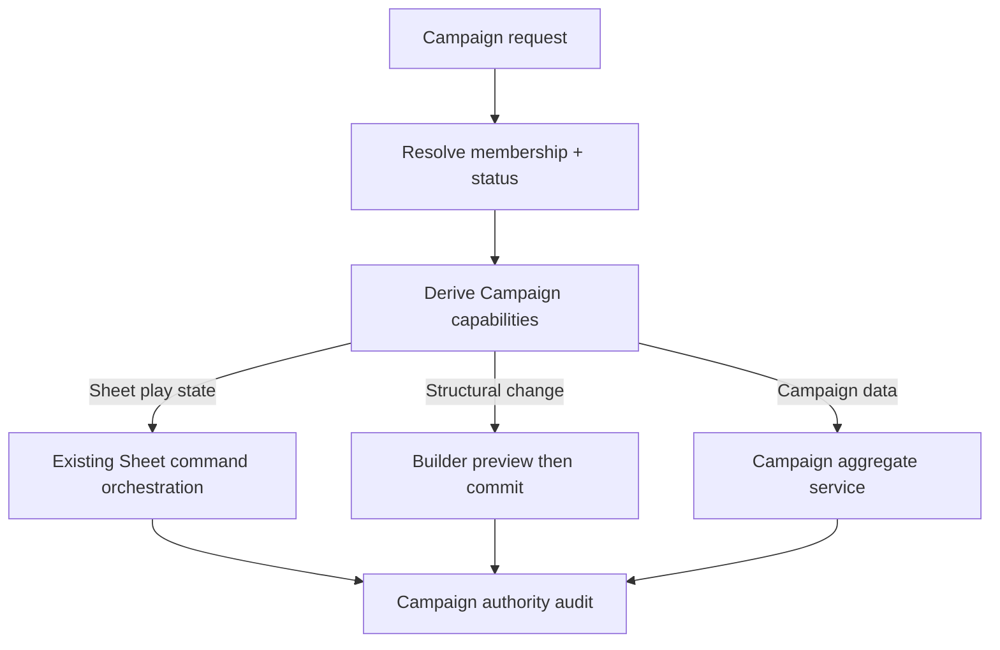

# Phase 04 — Campaign Core

> **Status:** planned
> **Depends on:** [Phase 00](00-character-sheet-play-depth-and-overrides.md), [Phase 02](02-media-and-file-pipeline.md), and [Phase 03](03-cross-platform-foundation.md)
> **Unlocks:** live Campaign play, Campaign Encounters, Social Hub conversion, and Campaign-scoped content
> **Primary ADRs:** [0001](../adr/0001-package-boundaries.md), [0006](../adr/0006-character-builder-sheet-boundary.md), [0007](../adr/0007-authored-revisions-and-active-projections.md), [0008](../adr/0008-ruleset-identity-and-content-binding.md)

## Goal

Introduce the minimum Campaign aggregate and authorization model: invitations, membership, OWNER/GM/PLAYER roles, character assignment, revision-aware content grants, typed Campaign rules, GM Sheet access, and audited GM commands. Ship matching responsive web and native overview/member/Sheet access without adding live-play collaboration yet.

## Current starting point

- Characters and authored definitions are directly user-owned, and authorization is largely owner-or-super-admin.
- No Campaign, membership, invitation, delegated actor control, or GM capability model exists.
- Character Builder structural writes and Sheet play-state commands are already separate seams.
- `ContentRef` can represent active or exact-revision identity, but persistent revision binding is not complete across all character selections.
- Character and authored-data RLS policies assume direct ownership and will not become Campaign-aware by adding one membership table alone.

## Requirements

- Campaigns record explicit system and ruleset identity, status, owner, and stable public identity.
- Membership uses `OWNER | GM | PLAYER`; the owner is a member and ownership transfer is deferred unless explicitly added to the subplan.
- Invitations have explicit lifecycle, expiry, intended role, inviter, recipient/token identity, acceptance, revocation, and audit data.
- A character may have one active Campaign. Assignment requires character-owner consent and compatible system/ruleset identity.
- Campaign content grants expose exact authored revisions for selection without copying them into a player's Library.
- Removing a grant prevents future selection but does not invalidate already pinned character content.
- Typed Campaign rules initially support attunement-slot limit and `EXPERIENCE | MILESTONE` progression, with a GM-approved milestone level per character.
- Campaign currency policy may define a closed set of denominations, a base denomination, exact exchange ratios, and rounding behavior. Policy revisions are versioned so existing balances remain explainable and are never silently rewritten.
- Switching to milestone never deletes stored experience; switching back restores experience-based behavior from retained data.
- GM Sheet changes use existing typed Sheet commands. Structural changes use Builder preview/commit and must surface the proposed diff before persistence.
- Authorized GMs may inspect effective Character values, adjustment indicators, source notes, and calculation breakdowns from Phase 00 without receiving adjustment-edit commands.
- Every GM action records actor, authority source, Campaign, character, command or preview/commit identity, timestamp, result, and human-readable summary.
- A Campaign may reference a logo through a ready asset from Phase 02. Campaign capability controls replacement/removal; member access does not make the private original public.

## Design

Define an `AuthorityContext` consumed by Campaign, Builder, and Sheet orchestration. Capabilities—not UI role labels—decide whether an actor may view a Sheet, assign a character, grant content, change rules, issue a Sheet command, or preview/commit a structural edit.

Keep Campaign data outside `CharacterAuthored`. Builder replacement writes must never delete Campaign membership, grants, audit records, or later shared play data.

## Data and contract seams

The subplan should define shared DTOs and persistence for these conceptual records without assuming these exact table names:

- Campaign and stable public route identity.
- Campaign membership and role/status history.
- Invitation and acceptance/revocation lifecycle.
- Character assignment and active-Campaign constraint.
- Exact-revision content grant and revocation.
- Ruleset-discriminated Campaign rule overrides.
- Typed Campaign currency definitions and versioned exchange policy.
- Per-character milestone approval while retaining experience truth.
- Campaign authority audit entries correlated to Sheet or Builder operations.
- Campaign logo asset reference outside `CharacterAuthored`.

RLS and service authorization must agree. Direct database access, tRPC procedures, Realtime authorization added later, and administrative tooling must all fail closed for removed members and incompatible roles.

## Ordered workstreams

1. **Specify the authorization matrix.** Define OWNER, GM, PLAYER, removed member, invitee, character owner, and non-member capabilities for every Phase 04 action, including read-only inspection of Phase 00 adjustments and breakdowns.
2. **Complete revision binding required by grants.** Persist exact `ContentRef` revision identity through character selection, hydration, engine assembly, and history before Campaign content is selectable.
3. **Add Campaign persistence and RLS.** Create migrations and Kysely repositories for Campaigns, members, invitations, assignments, grants, rules, and audit records.
4. **Add application orchestration.** Implement lifecycle and capability resolution in `packages/functions`; keep `apps/apis` thin and schema-parsed.
5. **Extend Builder and Sheet authority.** Add `AuthorityContext`, reuse Sheet commands, add GM Builder preview/commit, and correlate every delegated operation with an audit entry.
6. **Apply Campaign rules during engine assembly.** Do not rewrite Builder intent or erase experience. Return enough source information for both clients to explain effective values.
7. **Build web and native Campaign Core surfaces.** Cover Campaign list/create/invite/member/character assignment/content/rules and logo management on web, plus play-oriented overview/member/Sheet access and authorized image display on native.
8. **Validate lifecycle, authorization, concurrency, and parity.** Test RLS and API matrices, invite races, assignment conflicts, grant removal, progression switching, delegated commands, and identical web/native projections.

## Acceptance gates

- Every role and lifecycle state passes explicit API and RLS authorization tables.
- Removed members immediately lose Campaign, content-grant, and delegated Sheet access.
- A character cannot be actively assigned to two Campaigns under concurrent requests.
- Campaign system/ruleset incompatibility fails before assignment or grant use.
- Grant removal blocks new use while an existing exact-revision character remains valid.
- Experience survives any number of milestone/experience switches.
- A GM structural change cannot bypass Builder preview/commit.
- A GM with Sheet-view capability can inspect Phase 00 adjustment provenance and effective-value breakdowns but receives no adjustment-edit action.
- Duplicate or retried GM commands remain idempotent and create one effective audit trail.
- Web and native Campaign overview/member/Sheet projections match.
- Campaign logo replacement uses ready assets, preserves private-original access rules, and cannot be performed by an unauthorized member.

## Out of scope

- Chat, notes, sessions, Campaign supporting files/handouts, Campaign clock, shared inventory, item transfer, vehicles, dice, roll history, Realtime, push, Encounters, and VTT.
- GM creation, editing, or removal of character-owner adjustments.
- Automated progression, encounter combat automation, ownership transfer, multiple active Campaigns per character, and arbitrary custom rule scripting.

## Questions for the phase subplan

- Can a Campaign have multiple GMs with identical capabilities, or are some owner-only actions required?
- Does a player assign a character during invitation acceptance, or may assignment happen later?
- What happens to assignment and delegated access when a member leaves or is removed mid-session?
- Which structural Builder fields may a GM change in alpha, and does every change require contemporaneous player approval or only audit visibility?
- Are Campaign content grants Campaign-wide, role-scoped, or individually assigned in the first release?
- May a Campaign define currency denominations and exchange rates, or only select from its system vocabulary? The subplan must settle the base denomination, ratio and rounding model, policy versioning, and existing-balance behavior.

## New-session instruction

Begin with the authorization matrix and revision-binding audit. The subplan must name every affected owner-only RLS policy and service check; “add membership” is not a sufficient authorization design.
