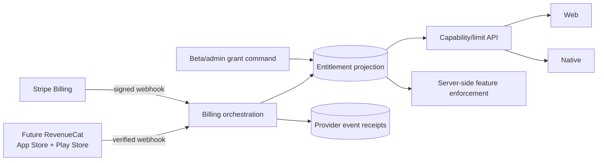

# Phase 4 — Entitlements and subscriptions

> **Status:** planned
> **Depends on:** [Phase 0](00-cross-platform-foundation.md)
> **Unlocks:** enforced paid tiers, professional fee waivers, and commerce fulfillment
> **Primary ADRs:** [0001](../adr/0001-package-boundaries.md), [0002](../adr/0002-kysely-writes-authored-hydration.md)

## Goal

Create one provider-neutral entitlement model and use it to enforce Artificer capabilities and limits. Launch web subscriptions through Stripe Billing, let native clients consume the resulting entitlements, and defer native purchase controls until plans and store-policy treatment are approved.

## Current starting point

- Marketing pricing is disabled display content; no limit is enforced by the backend.
- There are no plan, capability, entitlement, billing-customer, subscription, webhook, grace-period, or account-management domains.
- Supabase user identity is the current account key.
- Native store billing and RevenueCat do not exist.

## Requirements

- Define stable internal capabilities and limits independently of marketing plan names.
- Project all access into `EntitlementGrant.source = STRIPE | APP_STORE | PLAY_STORE | BETA | ADMIN`.
- Treat Artificer's database projection as the product authorization source. Clients never self-grant from a checkout redirect or local receipt.
- Enforce limits and capabilities in application services before adding plan-gated UI.
- Support beta/admin grants with creator, reason, effective interval, revocation, and audit data.
- Add Stripe customer/subscription mapping, signed idempotent webhooks, subscription status, billing period, cancellation, grace state, and customer-portal access.
- Process duplicate, delayed, missing, and out-of-order events deterministically.
- Keep immutable provider-event receipt data separate from the current entitlement projection.
- Native v1 refreshes and displays entitlements but has no subscription purchase CTA.
- Add RevenueCat, StoreKit, and Play Billing only in a follow-up slice after product plans and store policy are approved.

## Design

Capabilities should answer product questions such as “may create another character,” “may create a Campaign,” or “marketplace fee waived,” without requiring domain code to know the provider or marketing tier name.

## Ordered workstreams

1. **Lock the commercial product model.** Define initial plans, capabilities, limits, trials, grace, cancellation, beta treatment, and whether web and native subscriptions are equivalent products.
2. **Define entitlement contracts.** Model capability keys, numeric limits, grant source, scope, effective interval, priority/combination rules, and an explainable resolved entitlement view.
3. **Add persistence and authorization.** Create provider-neutral grant/projection records, provider-customer mappings, event receipts, and minimal operator audit access.
4. **Enforce capabilities server-side.** Add checks at the owning application service for character/homebrew/Campaign creation and future fee capabilities; avoid one global subscription middleware.
5. **Integrate Stripe Billing on web.** Create server-owned Checkout/Portal sessions and signed webhook handling; never accept client-authored price or subscription state.
6. **Implement convergence and grace.** Recompute effective access from stored provider facts and grants so reordered events converge.
7. **Expose account state to both clients.** Return current capabilities, limits, consumption, grace/cancellation explanation, and refresh timing.
8. **Validate provider and enforcement behavior.** Use Stripe test clocks/fixtures where appropriate and cover signatures, retries, order changes, revocation, grace, and concurrent limit consumption.

## Acceptance gates

- Every gated operation is denied server-side when the capability or remaining limit is absent.
- Duplicate provider events create one effective transition.
- Delayed or out-of-order events converge on the provider's current subscription facts.
- A checkout redirect without a verified webhook grants nothing.
- Grace, cancellation-at-period-end, expiration, refund, and manual revocation are distinguishable and tested.
- Beta and admin grants are auditable and can be revoked without editing provider state.
- Web and native display the same resolved entitlement view.
- Native exposes no prohibited or unimplemented purchase CTA.

## Out of scope

- Marketplace orders, creator payouts, paid tables, taxes, coupons, multi-currency, native subscription purchase, Venmo, and generalized feature-flag infrastructure.
- Locking final prices in this roadmap document.

## Questions for the phase subplan

- Which plan names, capabilities, hard limits, and grace periods ship first?
- Do existing beta users receive permanent, expiring, or manually revoked grants?
- What is the exact source-of-truth rule when an admin grant and provider subscription overlap?
- Does deleting an account immediately cancel provider subscriptions, or must cancellation finish before deletion?
- Which Stripe tax, invoice, trial, proration, and customer-portal behaviors are required at launch?
- What store-policy decision gates native subscription purchase work?

## New-session instruction

Do not start with Stripe UI. First produce a capability/limit matrix and identify every server operation that must enforce it. Keep paid marketplace and payout accounting out of this phase.
