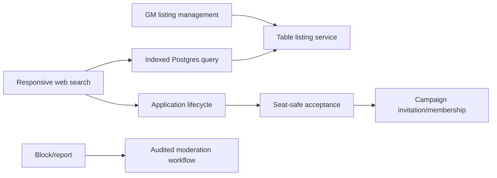

# Phase 04 — Social Hub and free table formation

> **Status:** implemented
> **Depends on:** [Phase 03](03-campaign-core.md) and the current authenticated account/profile baseline; notification integration follows [Phase 05](05-notifications-and-delivery.md)
> **Unlocks:** public table discovery and the paid-table extension
> **Primary ADRs:** [0001](../adr/0001-package-boundaries.md), [0008](../adr/0008-ruleset-identity-and-content-binding.md), [0014](../adr/0014-social-projection-and-tokenless-admission.md), [0015](../adr/0015-campaign-format-copy-and-maturity-presentation.md)

## Goal

Launch a moderated table-formation service for authenticated users 13 and older to form private and public free Campaigns in explicit One-shot or Ongoing formats. Hosts may invite directly or publish a structured listing; players search, filter, apply, and receive a decision; accepted applicants become Campaign members. Both formats use the same Campaign tools, and repeat one-shots begin from a fresh Campaign copy.

## Implemented boundary

- Browsing is authenticated. Public launch Terms require users to represent that they are at least 13; registration does not collect a birth date or perform age or location verification.
- Public Social profiles expose only a random UUID and current username. Email, bio, account IDs, and account metadata remain private.
- Campaigns are uniformly private. A separate Social listing owns invitation-only or public table formation and never grants Campaign access.
- Campaign owns format, tone, and maturity. Social stores only the indexed projection needed for discovery and masks Standard shared/public text before serialization.
- Product invitations are username-bound inbox records. Their UUIDs are identifiers, not bearer grants; link/email invite kinds and token storage are removed.
- PostgreSQL owns discovery, indexed filters, deterministic cursors, durable rate limits, and admission locks. There is no external search, queue, or cache.

## Requirements

- Listings derive title, Campaign format, one to three tone tags, optional tone details, and maturity from their Campaign. They own system/ruleset, play mode, schedule, coarse location, seat capacity, content guidance, expectations, safety practices, free/paid state, and nullable price metadata.
- English is the only supported launch language. Social DTOs and discovery filters do not expose a language field.
- One-shot listings permit flexible or one-time schedules, not recurring schedules. Converting an open recurring listing to One-shot is rejected until it is closed or rescheduled.
- Owner-only Campaign copying carries reusable metadata, approved rules/content, attunement overrides, and Campaign-level notebook preparation into a fresh Campaign. It does not carry members, Sessions, run state, chat, inventory, invitations, applications, or a Social listing.
- Phase 04 permits publishing free listings only. Paid state and price exist only where needed to avoid a destructive Phase 10 migration; paid activation remains server-disabled.
- Search supports indexed filters and deterministic pagination using PostgreSQL.
- Applications have explicit lifecycle: submitted, withdrawn, accepted, declined, expired, or blocked.
- Acceptance consumes capacity safely and creates or prepares the appropriate Campaign membership/invitation.
- Blocking prevents future interaction and discovery according to a documented policy.
- Reporting supports listing, profile, and application concerns with reason, evidence metadata, status, moderator action, and audit.
- Before acceptance, applicants can review the Campaign's player-facing expectations: attendance policy, allowed content/rules, tone, table conduct, content boundaries, and how the selected safety practice works. Do not collect private explanations for a boundary in a public listing.
- Social surfaces are intended for users 13 and older. The service relies on the account's Terms representation for the 13+ minimum rather than collecting a birth date at registration.
- The private Social viewing preference defaults to Standard. Selecting Mature in user settings requires 18+ self-attestation when none is on file.
- Standard Campaign shared/public fields are masked server-side with asterisks for every viewer, including their author and GM. Mature Social projections remain masked unless viewed by the Campaign owner or an adult-attested user who selected Mature; private authoring, author-owned private notes, and audited moderation evidence retain original text.
- Responsive web supports discovery, applications, invitation inbox records, and listing administration. Native consumes these contracts only after the web viability gate.
- Phase 05 turns application and invitation events into Supabase-backed inbox notifications and preference-controlled Resend email. Records contain no sensitive copied application text and blocked parties cannot use them as a side channel.

## Design

Social Hub authorizes public discovery separately from private Campaign/Encounter access. A public listing never grants access to its underlying Campaign, Encounter, chat, notes, or members.

## Ordered workstreams

1. **Define safety and visibility policy.** Decide public profile fields, authenticated 13+ access, block semantics, report categories, moderation roles, retention, appeals, and Mature presentation.
2. **Define listing and application contracts.** Include system/ruleset compatibility, schedule/timezone semantics, capacity, content guidance, selected safety practices, lifecycle, stable public IDs, and conversion results.
3. **Add persistence, indexes, and RLS.** Create listings, schedule data, applications, blocks, reports, moderator actions, and capacity constraints.
4. **Add discovery and lifecycle orchestration.** Use deterministic indexed Postgres queries; do not add an external search engine for unmeasured scale.
5. **Integrate acceptance.** Convert to Campaign access idempotently and atomically with seat consumption.
6. **Integrate Phase 05 notifications when available.** Keep staff access explicit and audited; prevent blocked parties from using notification side channels.
7. **Build responsive web journeys.** Cover direct invitations, search/filter/detail/apply/withdraw/status, listing management, and moderation administration.
8. **Validate privacy, concurrency, and abuse cases.** Test oversubscription, repeated acceptance, removed listings, blocks, reports, private-scope leakage, and pagination stability.

## Acceptance gates

- A listing exposes no private Campaign/Encounter/member data.
- Filters and pagination are deterministic under concurrent listing updates.
- Applications cannot be submitted to closed, full, blocked, incompatible, or unavailable listings.
- Concurrent acceptances cannot exceed seat capacity.
- Repeated acceptance creates one effective membership/invitation.
- Blocking closes every documented interaction and notification path.
- Report review and moderator action are audited.
- Paid listings cannot be published until Phase 10 enables them.
- A listing cannot be published without player-facing expectations and at least one selected safety practice; those disclosures remain available after acceptance.
- Campaign name changes synchronize listing search data without expiring pending admission; format, tone, and maturity changes are material and expire pending applications and invitations.
- Standard projections do not expose unmasked sentinel language through API DTOs, SSR, mutation responses, Realtime payloads, logs, or telemetry.
- Responsive web application and membership status agree.

## Out of scope

- Payments, paid-seat checkout, native clients, reviews, ratings, comments, direct messages, algorithmic recommendation, minors, identity verification, background checks, voice/video, and external search infrastructure.

## Locked launch policy

- Browsing is authenticated-only. Public identity is the Social profile UUID plus username.
- Schedules are flexible, one-time, or weekly/biweekly recurring, always with an IANA timezone and plain-language summary. One-shot Campaigns exclude recurring schedules.
- Application text is visible only to its applicant, the sole Campaign owner, and a superadmin opening report evidence through the audited mutation.
- Accepted Campaign membership survives listing closure, edits, moderation removal, and ownership transfer. Submitted applications and pending invitations do not.
- Blocks are directional records enforced symmetrically in Social Hub. They do not alter existing Campaign membership, chat, or access.
- Current superadmins moderate launch content. Phase 04 promises no response SLA or in-product appeal workflow.

## Privacy matrix

| Data                                                                        | Applicant                                         | Campaign owner                       | Other eligible user                               | Superadmin                          |
| --------------------------------------------------------------------------- | ------------------------------------------------- | ------------------------------------ | ------------------------------------------------- | ----------------------------------- |
| Social profile UUID and username                                            | visible unless blocked                            | visible unless blocked               | visible unless blocked                            | visible                             |
| Open public listing projection                                              | Standard masked; Mature follows viewer preference | Standard masked; own Mature original | Standard masked; Mature follows viewer preference | visible; evidence access is audited |
| Private, draft, closed, or hidden listing                                   | no                                                | own listing only                     | no                                                | report evidence only                |
| Application message and expectations snapshot                               | own application                                   | masked for Standard listings         | no                                                | audited report evidence only        |
| Campaign ID, route, roster, chat, exact venue, email, bio, account metadata | no Social access                                  | ordinary Campaign authority only     | no                                                | no Social projection                |
| Report details and captured evidence                                        | receipt only                                      | no                                   | no                                                | audited evidence mutation only      |

Phase 05 adds durable Supabase inbox notifications and preference-controlled email for invitation and application decisions. Those records
must reference source UUIDs, reauthorize destinations when read, omit application text, and apply the
same symmetric block predicate. Phase 04 adds no event bus, notification table, or compatibility stub.

## New-session instruction

The subplan must begin with the public/private data boundary and capacity-safe acceptance transaction. Do not treat a stable public ID as an authorization grant.
