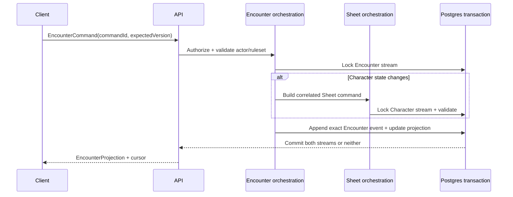

# Phase 05 — Encounters on all clients

> **Status:** planned
> **Depends on:** [Phase 03](03-campaign-core.md) and the relevant live-play primitives from [Phase 04](04-live-campaign-play.md)
> **Unlocks:** standalone one-shots and the VTT
> **Primary ADRs:** [0005](../adr/0005-pure-rules-system-engine.md), [0006](../adr/0006-character-builder-sheet-boundary.md), [0008](../adr/0008-ruleset-identity-and-content-binding.md), [0009](../adr/0009-vtt-encounter-event-boundary.md)

## Goal

Add a manual, server-authoritative Encounter aggregate for Campaign play and standalone one-shots. GMs can manage actors and initiative, inspect authorized Character Sheets, update creature state, chat, and roll; players can participate on web and native without combat automation.

## Current starting point

- ADR 0009 already reserves Encounter as a separate aggregate/event log and forbids overloading Character Sheet history.
- Character Sheet commands support character-local HP, conditions, resources, slots, and inventory play state.
- Compiled Characters and Creatures provide useful static actor statistics, but no shared Encounter actor or mutable creature state exists.
- Authored effects describe possible mechanics, but there is no general dice executor, target validator, attack/save resolver, initiative model, or proposed-outcome pipeline.
- Cross-aggregate synchronization between Encounter history and persistent Character Sheet truth is not implemented.

## Requirements

- An Encounter records explicit system/ruleset identity and is either Campaign-owned or standalone, never both.
- Standalone Encounters own invitation, membership, role, expiry, and actor-control policy without requiring Campaign membership.
- Actors use `EncounterActorRef = CHARACTER | CREATURE`; actor projections include current/max/temp HP, spell-slot summary where applicable, initiative, control authority, and source revision identity.
- GMs set initiative values and order manually. Turn/round automation is deferred unless required for deterministic projection ordering.
- Authorized users can navigate from actor summary to the full Character Sheet.
- Encounter and player-only chat reuse Phase 04 channel security with Encounter-scoped authorization.
- Rolls use the server-authoritative dice contract and Encounter retention policy of 2,000 entries by default.
- Creature HP, conditions, resources, notes, and other manual state remain Encounter-local.
- Commands are idempotent and version-checked. Events are append-only, and a current projection is rebuildable from persisted exact event data.
- When an Encounter command changes a character's Sheet-owned state, orchestration locks both streams and commits the Encounter event plus correlated Sheet command in one Postgres transaction.

## Design

Replay never resolves mutable “active” content. Each event stores exact content/ruleset revision IDs plus all rolls, selections, proposed outcomes, applied outcomes, and manual overrides needed to explain the state transition.

## Core contracts

- `EncounterAuthorityContext`
- `EncounterActorRef` and actor-control assignment
- `EncounterCommand` with command ID and expected version
- `EncounterEvent` with exact rules/content identity
- `EncounterProjection` with version and cursor
- `RollCommand` and normalized `RollResult`
- `ProposedOutcome` and `AppliedOutcome`, even though automated resolution remains later
- Correlation identity connecting one Encounter event to any Sheet command/event

Use the existing character command pattern as a reference, not as a universal event abstraction. Encounter and character events remain distinct types and persistence streams.

## Ordered workstreams

1. **Resolve ownership and transaction policy.** Finalize Campaign versus standalone authority, actor control, Sheet truth, creature-local truth, and lock order for correlated operations.
2. **Define contracts and replay invariants.** Specify commands, events, projection, cursor, actor summaries, invitations, rolls, visibility, and exact revision recording.
3. **Add persistence and repositories.** Create Encounter, membership/invitation, actor, event, projection, creature-state, initiative, and correlation storage with RLS and version constraints.
4. **Add application orchestration.** Implement lifecycle, membership, actor management, manual initiative, creature changes, rolls, and projection/replay in `packages/functions`.
5. **Coordinate Character mutations.** Reuse Sheet validation and command semantics while guaranteeing one transaction, deterministic lock order, and retry idempotency.
6. **Add thin API procedures and Realtime delivery.** Persist first, then notify authorized clients to reconcile from a cursor.
7. **Build web and native play surfaces.** Provide high-level actor list, HP/slot summaries, manual initiative, Sheet navigation, chat, rolls, join/leave, and clear authority feedback.
8. **Validate replay, concurrency, and access.** Test campaign and standalone matrices, duplicate commands, simultaneous Sheet/Encounter edits, exact replay, reconnect, removed participants, and player-only channels.

## Acceptance gates

- A standalone invitee can join an authorized standalone Encounter without joining a Campaign.
- A Campaign non-member cannot infer or access its Encounter.
- Manual initiative order is stable, versioned, and identical on web/native.
- Creature changes replay entirely from Encounter events.
- Character HP/resource changes appear once in both Encounter and Sheet projections or in neither.
- Concurrent direct Sheet and Encounter commands resolve through expected-version conflicts without lost updates.
- Retried commands return the original effective result and do not append duplicate events.
- Rebuilding from event zero yields the stored current projection.
- Rebuild does not query newer active content to reinterpret old events.
- Player-only Encounter chat retains the Phase 04 confidentiality tests.

## Out of scope

- Automated attacks, saves, damage, healing, conditions, reactions, effect execution, action economy, AI creatures, maps, tokens, fog, and VTT interaction.
- A generic cross-domain event framework. The Encounter event model is purpose-built and separate from Character history.

## Questions for the phase subplan

- What roles exist in standalone Encounters, and who may create or control creature actors?
- Can one character join multiple simultaneous standalone Encounters, and how are concurrent Sheet mutations presented?
- What deterministic lock order prevents deadlocks across Encounter and Character streams?
- Does initiative need rounds/turn pointers in v1, or only an ordered list with a manually selected current actor?
- Which creature state fields are required beyond HP, temp HP, conditions, resources, and GM notes?
- What event snapshot/compaction policy is acceptable while preserving exact replay?

## New-session instruction

The first subplan must settle correlated Encounter/Sheet ownership and lock order before schema or UI work. Do not start the VTT renderer in this phase.
