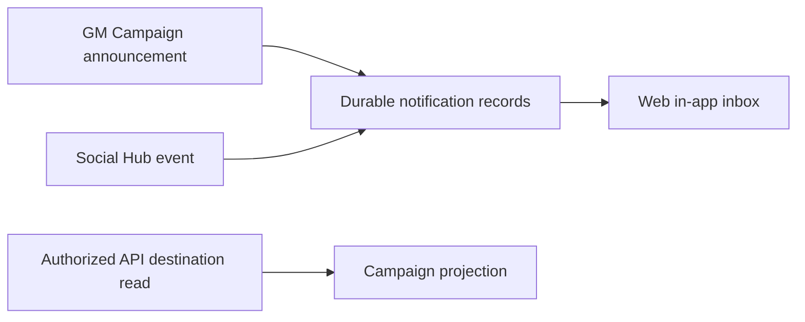
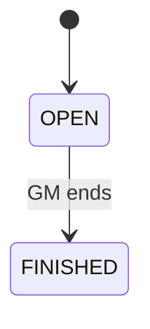

# Phase 05 — Live Campaign play

> **Status:** planned
> **Depends on:** [Phase 02](02-media-and-file-pipeline.md), [Phase 03](03-campaign-core.md), and [Phase 04](04-social-hub.md) where Social Hub events are integrated
> **Unlocks:** richer Campaign play, [Phase 07 VTT](07-vtt.md), and [Phase 09 paid-table notifications](09-paid-tables.md)
> **Primary ADRs:** [0001](../adr/0001-package-boundaries.md), [0006](../adr/0006-character-builder-sheet-boundary.md), and [0009](../adr/0009-vtt-encounter-event-boundary.md)

## Goal

Extend Campaign Core with a lightweight prepare/run/closeout loop for sessions, vehicles, supporting files and handouts, a manual authoritative Campaign clock, richer live-play workflows, and the provider-neutral web notification inbox and GM Campaign announcements.

## Current starting point

- Phase 03 already owns party inventory/currency, durable Campaign rolls/chat, Campaign and session notes, and private Broadcast reconciliation.
- Phase 02 provides ready asset identity and private transfer/delivery. This phase owns Campaign file/handout references, not another asset lifecycle.
- No durable product notification, Campaign-announcement, live-session, or Campaign-clock domain exists. Push and paid-game delivery remain later work.

## Requirements

### Vehicles, files, sessions, and clock

- Extend inventory ownership to `VEHICLE`; a vehicle pins an authored Vehicle revision and has its own inventory. Automated vehicle combat remains deferred.
- Authorized members upload/download size-limited Campaign files through the Phase 02 pipeline. Attachments record uploader, asset, Campaign, display metadata, and optional session/note association; removed members lose future API and Storage access.
- `CAMPAIGN_HANDOUT_MAP` is an ordinary ready Campaign asset and cannot gain VTT behavior or bypass the separate `VTT_MAP` profile.
- Campaign live-session records are `OPEN` or `FINISHED`. A Campaign may keep multiple sessions `OPEN` while the GM prepares them; opening a session is navigation, not a singleton live-state transition. A Campaign clock is independent from session state and persists across sessions unless the GM explicitly resets it.
- A session has an immutable Campaign-scoped number, optional title, optional scheduled start/end with an explicit timezone, RSVP state, actual attendance, and versioned GM commands. Campaign Settings may provide a normal cadence, expected duration, quorum, and absent-character policy without forcing every group through a scheduling poll. Free games may omit a schedule; a paid session must later provide one before Phase 09 can book or charge it.
- Session preparation stays flexible and GM-private. The GM can keep a short opening/agenda, possible scenes or beats, secrets/clues, rewards, and a scratchpad; attach Encounter templates and handouts; and pin existing Campaign notes or authored rules, Creatures, Items, and Spells for one-click reference. These are optional blocks, not a mandatory adventure-authoring workflow.
- During play, the Session workspace keeps the current plan, pinned references, party summaries, chat/dice, handouts, Encounter runs, and quick-capture notes reachable without presenting them as one long form. The GM can add an improvised note or reference without leaving the Session.
- Finishing records actual attendance and supports a short recap, the party's ending location/state, improvised people or facts that became canon, unresolved threads or rulings, rewards/milestone decisions, and follow-up tasks. Existing collaborative Session notes remain editable after finish; finishing does not freeze the historical record.
- Campaign Settings keep player-facing table expectations, allowed content/rules, attendance policy, content boundaries, and selected safety practices available to every active member. Live play exposes the chosen pause/change/skip method without persisting sensitive boundary details in chat or analytics.
- The manual Campaign clock stores start/stop segments and derives authoritative in-game time as `Day N` plus time of day without a background timer service. A Campaign configures dawn and dusk; custom calendars are out of scope.
- GM start, pause, and advance commands move the clock forward. Rewind is a correction-only GM command with an explicit correction reason. Reset-boundary processing is monotonic: a processed boundary is never replayed by a rewind.
- Campaign management is the GM workspace and launch point for live session controls. It composes existing Campaign controls and live-state projections; it is not a second Campaign aggregate.

### Notifications and Campaign announcements

- Add durable, per-recipient, provider-neutral notifications with source references, unread/read state, authorized deep links, and user preferences for optional events.
- Add a web in-app inbox. Notification payloads contain no sensitive copied content; authorized API reads resolve the destination.
- Owners may publish Campaign announcements stored independently from Phase 03's 500-entry chat cap and delivered to current Campaign members.
- Integrate Social Hub application and membership events when Phase 04 is present. Party-only sources must preserve Phase 03 room isolation across records, counts, reads, and delivery.
- Define required versus optional notification policy. Keep announcement and notification creation idempotent and auditable.

## Design

The notification record is the product truth. Delivery adapters added later consume it; they never become an authorization bypass or copy private content into an external payload.

Clock start, pause, advance, and correction commands persist before any derived live-state projection is published. The system does not run a timer or schedule work in the background.

## Ordered workstreams

1. **Extend live-play capability rules.** Cover vehicles, file references, session lifecycle, GM controls, clock, announcements, inbox reads, preferences, and source visibility.
2. **Add vehicles and Campaign file references.** Reuse Phase 02 profiles, access, ready-state checks, and asset IDs.
3. **Add sessions and clock.** Persist `OPEN`/`FINISHED` sessions, scheduling/RSVP/attendance, optional prep blocks and reference pins, quick capture and closeout, Campaign workspace controls, clock segments and configurable dawn/dusk, and correction-only rewind plus monotonic reset boundaries.
4. **Add notifications and announcements.** Create source references, recipient projections, inbox/read commands, preferences, and owner announcement publishing.
5. **Integrate Social Hub events.** Only after Phase 04 semantics exist; retain blocked-party and private-scope protections.
6. **Ship responsive web.** Cover the Session list, optional preparation, in-play reference workspace, closeout, attendance, vehicle custody, files, clock, announcement composition/history, inbox, preference states, and authorized deep links.
7. **Validate authorization and recovery.** Test recipient isolation, idempotency, removal, deep-link failure, file access revocation, and clock concurrency.

## Acceptance gates

- Campaign announcements survive independently of chat retention and reach only current authorized members.
- A player-only source cannot create a GM-visible notification, count, or delivery attempt.
- Inbox records and links reveal no protected content without a fresh authorized API read.
- Removed members cannot list, download, or refresh private Campaign files through prior routes.
- Multiple Campaign sessions may remain `OPEN`; clock controls and announcements remain available from Campaign management regardless of which session the GM is viewing.
- A GM can move from session list to preparation, live reference, and closeout without duplicating a Session or losing notes; finished sessions retain editable collaborative notes and immutable attendance history.
- Session reference pins resolve through existing authorized content rather than copying mutable rules text, and removed members cannot use a prior pin to bypass access. The GM can keep the small working set visible without opening a pile of overlapping sheets or notes.
- Player-facing expectations and the selected live safety method remain accessible without exposing private safety responses or boundary details.
- Clock segments, Day N projection, dawn/dusk configuration, correction-only rewind, and monotonic reset boundaries remain correct across retries, reconnects, and concurrent GM commands.
- Vehicle custody remains isolated from Builder aggregate replacement.

## Out of scope

- Party inventory/currency, conversations/rolls, base notes/collaborative session sections, and Broadcast reconciliation: [Phase 03](03-campaign-core.md).
- Email/external notification delivery, paid-game events/reminders, retries, and delivery state: [Phase 09](09-paid-tables.md).
- Native push, device registration, native deep links, co-GMs, custom calendars, and automatic clock-driven jobs: Phase 10 or a later approved phase.
- VTT maps/scenes/tokens, voice/video, automated recaps or session transcription, end-to-end encryption, unlimited history, and general background-job infrastructure.

## New-session instruction

Keep notifications durable and provider-neutral. Do not add email, push, a queue, or delivery-provider abstraction until the owning later phase requires it.
