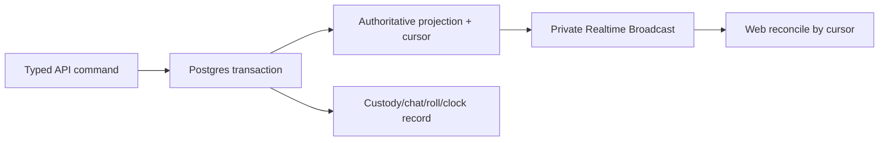

# Phase 05 — Live Campaign play

> **Status:** planned
> **Depends on:** [Phase 01](01-dice-and-roll-infrastructure.md), [Phase 02](02-media-and-file-pipeline.md), and [Phase 03](03-campaign-core.md)
> **Unlocks:** full web Campaign beta, richer Encounters, and the web VTT
> **Primary ADRs:** [0001](../adr/0001-package-boundaries.md), [0006](../adr/0006-character-builder-sheet-boundary.md), [0009](../adr/0009-vtt-encounter-event-boundary.md)

## Goal

Turn Campaign Core into a usable responsive web live-play workspace. Add atomic item transfer, group and vehicle inventories, sessions, collaborative notes and supporting files, a manual Campaign clock, persisted Campaign visibility and history for Phase 01 authoritative rolls, separate Campaign/player-only chat, and Realtime reconciliation.

## Current starting point

- Character inventory, currency, notes, and Sheet commands are character-owned.
- Builder aggregate replacement can delete and reinsert character-owned children; shared Campaign state cannot live inside `CharacterAuthored`.
- Equipment definitions are revisioned content, while character inventory rows are runtime instances.
- Character events provide a useful idempotent command/event pattern but are not a universal event store.
- Phase 01 is expected to provide the restricted authoritative roller and exact semantic evidence. No Campaign-scoped roll visibility, persistence, retention, or history exists.
- No application chat, Realtime channel model, shared notes, or Campaign clock exists.
- Phase 02 is expected to provide ready-asset identity, upload safety, and authorized delivery; this phase owns how Campaign collaboration references and presents those assets.

## Requirements

### Inventory and vehicles

- Introduce a first-class inventory aggregate with `InventoryOwnerRef = CHARACTER | CAMPAIGN | VEHICLE`.
- Backfill one inventory for each character while retaining existing Sheet DTO compatibility.
- Transfer full items or partial stacks in one transaction after authorization and expected-version checks.
- Keep denomination-specific balances per inventory owner and optional container. Owner-wide totals aggregate each balance exactly once, while container breakdowns preserve custody without double counting.
- Apply Campaign exchange policy only through explicit, versioned conversion commands. Display, transfer, and container-placement changes never normalize currency implicitly.
- Clear equipped, attuned, and container-placement state when custody changes.
- Reject non-empty container transfers initially.
- Append correlated custody/audit records and commit both sides or neither.
- Depositing a homebrew-backed item gives authorized Campaign members the exact-revision read/use access required to understand and use that item. It does not copy the definition into their Libraries or grant ownership, editing, personal export, or Marketplace sale rights.
- Campaign vehicle instances pin an authored Vehicle revision and own an inventory. Automated vehicle combat is deferred.

### Sessions, notes, clock, rolls, and chat

- Sessions act as Campaign folders with contributed notes, authorship, timestamps, edit history or explicit last-writer policy, and role-aware visibility.
- The manual Campaign clock records start/stop segments and derives elapsed in-game time without requiring a background timer service.
- Campaign roll commands call the Phase 01 service and persist its normalized expression, ordered faces, modifiers, subtotals, and total with Campaign-owned actor, visibility, scope, ruleset, and timestamp metadata.
- This phase must not create another expression parser, evaluator, randomness source, or client-side roll path.
- Campaign roll history retains the newest 5,000 entries by default without deleting audit data required by another domain.
- Campaign chat is visible to authorized Campaign members including GMs.
- Player-only chat is inaccessible to GMs through fetch, subscription, notification, search, analytics, and ordinary administration paths.
- Authorized safety staff may inspect reported content through a separate audited moderation capability.

### Campaign files and handouts

- Authorized Campaign members may upload and download size-limited supporting files through the Phase 02 asset pipeline.
- Campaign attachments inherit Campaign access and use explicit upload/delete capabilities. Removing a member revokes future API and Storage access.
- A Campaign attachment records uploader, asset, Campaign, display filename, description, timestamps, and optional session/note association selected by the phase subplan.
- `CAMPAIGN_HANDOUT_MAP` is a normal viewable/downloadable Campaign asset. It does not gain VTT grid, fog, token, scene, or large-map behavior.
- Executables, archives, scripts, and unsupported active content remain disallowed. Files are not listed or downloadable until required validation/scanning reaches `READY`.
- Campaign attachment limits and quotas are independent from the larger `VTT_MAP` profile.

### Realtime and responsive web

- Persisted writes continue through tRPC. Broadcast only after the authoritative commit.
- Clients reconnect from a projection/event cursor and deduplicate messages.
- Presence communicates slow-changing connection state only; typing and other transient signals use Broadcast.
- Responsive web surfaces reconcile from the same authoritative cursor after navigation, sleep, reconnect, or missed Broadcast delivery.

## Design

Realtime messages are hints containing scope, event identity, and cursor. Clients recover from loss by fetching the authoritative projection or missing range; they do not treat Broadcast delivery as durable persistence.

## Ordered workstreams

1. **Define shared live-play authorization.** Extend Campaign capabilities for inventories, transfers, vehicle custody, sessions, notes/files, clock, roll visibility, channel subscription, and moderation.
2. **Extract the inventory aggregate.** Design migration/backfill, compatibility projection, versioning, repository locks, and transfer command/event contracts.
3. **Add vehicles, sessions, notes/files, and clock.** Keep each Campaign-owned, attach only ready Phase 02 assets, and model clock segments instead of a continuously running server process.
4. **Add Campaign roll visibility and history.** Reuse Phase 01 validation and exact roll evidence; add Campaign authorization, actor/scope metadata, visibility, retention, persistence, and history queries.
5. **Add chat and safety boundaries.** Define channel kinds, membership snapshots, message lifecycle, reporting, blocking interaction, retention, RLS, and private notification rules.
6. **Add Realtime reconciliation.** Authorize private channels, emit after commit, track cursors, and handle reconnect, duplicate, delayed, and out-of-order delivery.
7. **Ship responsive web live-play surfaces.** Cover group and vehicle inventory, sessions, notes/files, clock, roll history, Campaign chat, player-only chat, reconnect, and error states.
8. **Validate collaboration and recovery.** Exercise authorization, concurrency, cursor recovery, duplicate/out-of-order delivery, responsive layouts, and private-channel isolation.

## Acceptance gates

- Conflicting or retried transfers never duplicate, lose, or partially move an item or currency amount.
- Container transfer and explicit conversion preserve exact denomination totals atomically; owner totals never double-count a container balance.
- Non-empty container transfer is rejected without changing either inventory.
- Builder save cannot delete or replace Campaign, vehicle, or shared inventory data.
- Clock totals remain correct across repeated start/stop, reconnect, and concurrent GM commands.
- Phase 01 limits reject abusive expressions; stored semantic evidence reproduces the displayed Campaign result without re-evaluation.
- GMs cannot fetch, subscribe to, receive notification content from, or infer player-only chat.
- Reconnect from a cursor produces no duplicate messages, rolls, transfers, or clock segments.
- Unsupported, unsafe, oversized, or over-quota Campaign files never become downloadable; upload/finalize retries do not duplicate attachments.
- A removed member cannot list, download, or refresh access to private Campaign attachments, including through a previously opened client route.
- Ordinary Campaign handout maps remain subject to Campaign attachment limits and cannot bypass the separate VTT map profile.

## Out of scope

- The underlying roll grammar, evaluator, randomness source, Sheet animation, Encounters, initiative, creature state, VTT, voice/video, end-to-end encryption, offline mutation queues, automated vehicle combat, non-empty container transfer, and unlimited history.
- General background-job infrastructure. Retention and notification work should use the smallest provider/database mechanisms justified by measured needs.
- Native cache, push, deep links, and mobile distribution; Phase 10 adds those against the proven live-play contracts.

## Questions for the phase subplan

- May players create and edit session folders, or only contribute notes inside GM-created sessions?
- Are contributed notes jointly editable, author-editable, or append-only in beta?
- Can players withdraw from group inventory directly, or does that require GM approval?
- Is the Campaign clock one canonical elapsed timeline or a ledger with named in-game intervals and manual correction?
- What retention, edit/delete window, report workflow, and staff-access audit policy applies to chat?
- May supporting files attach only to the Campaign, or also to individual sessions and contributed notes in beta?
- Which roles may upload/delete files, what initial file allowlist and per-Campaign quota apply, and may players contribute handouts without GM approval?

## New-session instruction

Split this phase into at least inventory, collaboration/Realtime, and responsive web subplans. Do not let those branches concurrently edit the same Campaign capability or projection contracts without an integration order.
