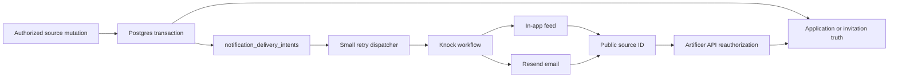
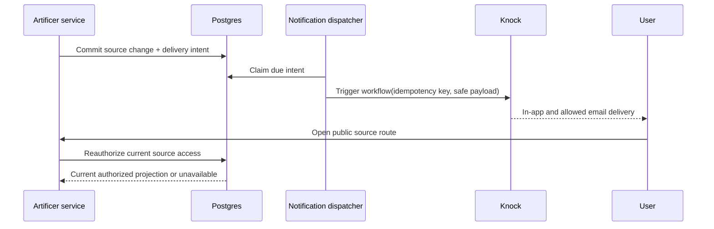

# Phase 05 — Notifications and delivery

> **Status:** planned
> **Depends on:** [Phase 03](03-campaign-core.md), [Phase 04](04-social-hub.md), and the current authenticated account/profile baseline
> **Unlocks:** Campaign announcements in [Phase 06](06-live-campaign-play.md), paid-table delivery in [Phase 10](10-paid-tables.md), and native push in [Phase 11](11-cross-platform-foundation.md)
> **Primary ADRs:** [0001](../adr/0001-package-boundaries.md), [0014](../adr/0014-social-projection-and-tokenless-admission.md), and [0016](../adr/0016-knock-notification-delivery.md)

## Goal

Add rules-driven in-app and email notifications using Knock Cloud with Resend, starting with Social Hub applications and invitations. Users control optional delivery by category and channel, actionable items remain available beyond ordinary session cadence, and every destination is reauthorized by Artificer when opened.

## Assumptions

- Knock Cloud owns workflow execution, in-app feed state, and notification preferences; Resend is the email provider.
- In-app and email ship in this phase. Push is added through the same Knock workflows in Phase 11 when native clients exist. SMS is out of scope.
- The application database remains the source of truth for applications, invitations, memberships, Campaigns, and moderation. A notification never grants access or replaces the owning screen's status.
- Supabase account-confirmation and recovery email remain outside product-notification preferences.

## Requirements

### Sources and delivery

- Initial sources are Social application submitted, application decided, invitation received, invitation decided, and invitation revoked or expired. Phase 06 and Phase 10 add their own sources without creating another notification system.
- A GM can receive a grouped notification such as “3 new applications for Lanterns of Greyhaven.” Opening it routes to that listing's application-management view after normal authorization.
- Source mutations insert one narrow `notification_delivery_intents` row in the same Postgres transaction. A small dispatcher claims due rows, triggers the exact Knock workflow with an idempotency key, and records attempt, success, or retry timing. This is not a general event bus, queue platform, or cross-domain job framework.
- A source public ID, recipient identity, workflow key, event time, grouping key, and minimal safe display copy are sufficient delivery data. Do not copy application messages, private Campaign text, email addresses, auth IDs, session values, or bearer/server secrets into notification payloads.
- Knock workflow executions use stable idempotency and cancellation keys derived from the source event. Withdrawal, revocation, acceptance, expiry, blocking, or loss of access updates or removes stale actions where the workflow supports it; the owning source remains authoritative regardless of delivery outcome.
- Optional product categories expose per-channel in-app and email preferences. Future push preferences appear only when Phase 11 adds push. Disabling a channel stops future optional delivery but does not hide the source record from its owning product screen.
- Actionable feed items are not automatically deleted after seven days. They remain readable until the user archives them or the product resolves them; the owning application or invitation remains accessible under its own retention policy.

### Authorization and secrets

- `apps/apis` issues only a short-lived Knock user token scoped to the authenticated recipient. Knock API keys, signing keys, Resend keys, Supabase server keys, and user session values remain server-only and never enter `VITE_` configuration, URLs, DTOs, logs, telemetry, or browser storage.
- Notification routes contain public source identifiers only. Opening a notification performs a fresh Artificer API read that applies membership, ownership, moderation, and symmetric block predicates; unavailable destinations fail closed with generic behavior.
- Recipient resolution occurs server-side from the authenticated account. Clients cannot choose an arbitrary Knock recipient or email target.
- Player-only and direct-message sources preserve their existing visibility predicates at source selection, recipient calculation, counts, feed reads, and destination authorization.
- Realtime payloads remain hints or Knock feed updates and carry no raw protected source content.

### Web experience

- Add one notification entry point to the existing authenticated Shell and one notification settings section to existing user settings. Do not add another shell.
- Build the feed and preferences with Knock's headless React client, Mantine controls, existing tokens, and direct domain adapters. Do not add a generic notification component framework, provider-neutral facade, or controller object.
- The feed supports unread count, read/unread, archive, grouped application counts, source-aware copy, timestamps through `Intl`, keyboard operation, screen-reader labels, focus management, and responsive drawer/page presentation.
- Email copy contains enough context to explain the event but no private application message or Campaign content. Links return to the authenticated web app and reauthorize the target.
- Delivery failures are visible to operators through bounded attempt metadata without logging recipient content or credentials.

## Design

The outbox closes the transaction-to-provider reliability gap. It stores delivery intent and bounded attempt state only; Knock owns the user-facing feed, preference state, grouping, and channel workflow.

## Build plan

1. Add ADR 0016, workflow/category contracts, preference DTOs, and the delivery-intent table with claim/retry indexes, RLS, and browser-role revokes.
2. Add direct notification orchestration in `packages/functions`, thin token/preferences/source procedures in `apps/apis`, and one bounded dispatcher/operator path. Keep source-specific recipient rules in their owning services.
3. Configure Knock development and production environments, Resend email delivery, stable workflow keys, grouping, cancellation, and server-only secrets.
4. Integrate Social application and invitation mutations with transactionally inserted intents and safe public-source payloads.
5. Add the existing-Shell inbox entry, responsive feed, grouped application navigation, and user settings for optional in-app/email categories.
6. Validate duplicate and out-of-order attempts, provider outages, retries, preference changes, blocked/removed users, revoked sources, expired actions, deep-link substitution, feed retention, and no-secret/no-sensitive-text payloads.
7. Update canonical transport, persistence, operations, privacy, and environment documentation after the implementation shape is verified.

## Acceptance gates

- A GM receives a grouped count for new applications and reaches the correct listing review screen after a fresh authorization check.
- Applicants and invite recipients receive the correct decision/status notifications without application text or private Campaign data in Knock, email, URLs, logs, or telemetry.
- Duplicate dispatch and provider retry cannot create duplicate logical notifications or email actions.
- Blocking, membership removal, listing closure, and moderation make protected destinations unavailable even if an older notification remains visible.
- Optional in-app and email preferences are enforced per category. The source status remains available on its owning screen when a channel is disabled.
- Actionable notifications remain available across multi-week session gaps and are not subject to a seven-day product retention limit.
- Browser code receives only a short-lived recipient-scoped Knock token. No Knock, Resend, Supabase, auth, or session secret is exposed.
- Provider failure cannot roll back or lose the underlying application, invitation, or decision.

## Concerns and expansions

- Knock is an intentional managed-service dependency. Reconsider self-hosting or another provider only when cost, data residency, or reliability evidence justifies migration work.
- Phase 11 adds Expo push tokens and native deep links through the same workflows and preferences. It must not add another inbox or notification policy model.
- Digests, reminders, notification motivations, and additional categories should be added from observed user needs. Phase 05 does not add SMS, marketing automation, chat-by-SMS, a generalized scheduler, or a generic event bus.