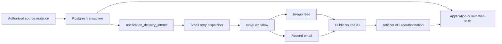

# Phase 05 — Notifications and delivery

> **Status:** Implemented baseline; provider configuration/deployment and staging smoke pending
> **Depends on:** [Phase 03](03-campaign-core.md), [Phase 04](04-social-hub.md), and the current authenticated account/profile baseline
> **Unlocks:** Campaign announcements in [Phase 06](06-live-campaign-play.md), paid-table delivery in [Phase 10](10-paid-tables.md), and native push in [Phase 11](11-cross-platform-foundation.md)
> **Primary ADRs:** [0001](../adr/0001-package-boundaries.md), [0014](../adr/0014-social-projection-and-tokenless-admission.md), and [0016](../adr/0016-novu-notification-delivery.md)

## Goal

Add rules-driven in-app and email notifications using Novu Cloud with Resend, starting with Social Hub applications and invitations. Users control optional delivery by category and channel, recent notification history remains available, and every destination is reauthorized by Artificer when opened.

## Assumptions

- Novu Cloud owns workflow execution, in-app feed/read/seen state, and notification preferences; Resend is the email provider.
- In-app and email ship in this phase. Push is added through the same Novu workflows in Phase 11 when native clients exist. SMS is out of scope.
- The application database remains the source of truth for applications, invitations, memberships, Campaigns, and moderation. A notification never grants access or replaces the owning screen's status.
- Supabase account-confirmation and recovery email remain outside product-notification preferences.

## Requirements

### Sources and delivery

- Initial sources are Social application submitted, application decided, invitation received, and invitation decided. Revocation and expiry silently cancel pending invitation-received delivery; an older feed item may remain as history and resolves through the authoritative Invitations view. Phase 06 and Phase 10 add their own sources without creating another notification system.
- A GM can receive a grouped notification such as “3 new applications for Lanterns of Greyhaven.” Opening it routes to that listing's application-management view after normal authorization.
- Source mutations insert the required narrow `notification_delivery_intents` rows in the same Postgres transaction. A small dispatcher claims due rows, triggers the exact Novu workflow with an idempotency key, and records attempt, success, or retry timing. This is not a general event bus, queue platform, or cross-domain job framework.
- A source public ID, recipient identity, workflow key, event time, grouping key, and minimal safe display copy are sufficient delivery data. Do not copy application messages, private Campaign text, email addresses, rendered email HTML/text/subjects, auth IDs, session values, or bearer/server secrets into notification payloads or logs.
- Novu workflow executions use the intent UUID as the idempotency key and a stable workflow/source cancellation key. Withdrawal, revocation, acceptance, expiry, blocking, or loss of access updates or removes stale actions where the workflow supports it; the owning source remains authoritative regardless of delivery outcome.
- Optional product categories expose per-channel in-app and email preferences. Future push preferences appear only when Phase 11 adds push. Disabling a channel stops future optional delivery but does not hide the source record from its owning product screen.
- Novu retains feed items under the configured provider policy. The product shows the latest 25 notifications without pagination or archive controls; the owning application or invitation remains accessible under its own retention policy.
- Listing titles use the Standard Social text projection in notification payloads and email previews, even when the recipient may reveal Mature text after opening the reauthorized source screen.

### Authorization and secrets

- `apps/apis` issues only a server-generated Novu subscriber HMAC scoped to the authenticated recipient. `NOVU_SECRET_KEY`, Resend keys, Supabase server keys, and user session values remain server-only and never enter `VITE_` configuration, URLs, DTOs, logs, telemetry, or browser storage.
- Notification routes contain public source identifiers only. Opening a notification performs a fresh Artificer API read that applies membership, ownership, moderation, and symmetric block predicates; unavailable destinations fail closed with generic behavior.
- Recipient resolution occurs server-side from the authenticated account. Clients cannot choose an arbitrary Novu subscriber or email target.
- Player-only and direct-message sources preserve their existing visibility predicates at source selection, recipient calculation, counts, feed reads, and destination authorization.
- Realtime payloads remain hints or Novu feed updates and carry no raw protected source content.

### Web experience

- Add one notification entry point to the existing authenticated Shell and one notification settings section to existing user settings. Do not add another shell.
- Build the feed and preferences with `@novu/react`, Mantine controls, existing tokens, and direct domain adapters. Do not add a generic notification component framework, provider-neutral facade, or controller object.
- The bell counts unseen notifications. Opening the drawer or page marks the feed seen and clears the badge; activating a notification marks that item read and opens its authoritative destination. The latest 25 items retain subtle unread emphasis without read, archive, or mark-all controls. The feed also supports grouped application counts, source-aware copy, timestamps through `Intl`, keyboard operation, screen-reader labels, focus management, and responsive drawer/page presentation.
- Email copy contains enough context to explain the event but no private application message or Campaign content. Links return to the authenticated web app and reauthorize the target.
- Delivery failures are visible to operators through bounded attempt metadata without logging recipient content or credentials.

## Design

The outbox closes the transaction-to-provider reliability gap. It stores delivery intent and bounded attempt state only; Novu owns the user-facing feed, preference state, grouping, and channel workflow.

## Implementation checklist

- [x] Lock ADR 0016, the four workflow contracts, stable recipient identity, and the delivery-intent table with claim/retry indexes, RLS, and browser-role revokes.
- [x] Add transactional source orchestration, the bounded expiry/retry dispatcher, authenticated Novu session, and provider-subscriber cleanup during account deletion.
- [x] Integrate direct and bulk Social application/invitation transitions, including the authoritative host sent-invitation list and revoke path.
- [x] Add the existing-Shell headless feed, responsive drawer/page composition, Social Hub channel preferences, and reauthorized public-ID deep links.
- [x] Add repository-owned Novu Framework workflow definitions with branded React Email rendering in the public Netlify Bridge, without adding rendered content to runtime payloads.
- [x] Pass focused contract, persistence, service, API, Social Hub, web, build, Netlify, and affected-typecheck gates; document the canonical boundaries and operator path.
- [ ] Configure Novu Development and Production, sync the four workflows, configure the Social Hub preference category and Resend integration, and set server-only environment values. Use Novu Development for the deployed app's staging smoke unless another provider environment is intentionally provisioned.
- [ ] Deploy the migration, app, and scheduled function, then record the live staging smoke checks from the [notification delivery runbook](../runbooks/notification-delivery.md).

## Acceptance gates

- A GM receives a grouped count for new applications and reaches the correct listing review screen after a fresh authorization check.
- Applicants and invite recipients receive the correct decision/status notifications without application text or private Campaign data in Novu, email, URLs, logs, or telemetry.
- Duplicate dispatch and provider retry cannot create duplicate logical notifications or email actions.
- Blocking, membership removal, listing closure, and moderation make protected destinations unavailable even if an older notification remains visible.
- Optional in-app and email preferences are enforced per category. The source status remains available on its owning screen when a channel is disabled.
- The latest 25 notifications remain visible until displaced by newer activity; opening the feed clears only the unseen badge, while activating a row marks that notification read.
- Browser code receives only a recipient-scoped Novu HMAC and application identifier. No Novu, Resend, Supabase, auth, or session secret is exposed.
- Provider failure cannot roll back or lose the underlying application, invitation, or decision.

## Concerns and expansions

- Novu Cloud is an intentional managed-service dependency. Reconsider another provider only when cost, data residency, or reliability evidence justifies migration work; self-hosting is out of scope.
- Phase 11 adds Expo push tokens and native deep links through the same workflows and preferences. It must not add another inbox or notification policy model.
- Digests, reminders, notification motivations, and additional categories should be added from observed user needs. Phase 05 does not add SMS, marketing automation, chat-by-SMS, a generalized scheduler, or a generic event bus.
