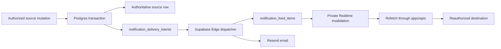

# Phase 05 — Notifications and delivery

> **Status:** Complete — Supabase-native feed, preferences, Realtime invalidation, and Edge delivery replace Novu; production smoke remains a pre-launch release gate
> **Completed:** 2026-08-12
> **Depends on:** [Phase 03](03-campaign-core.md), [Phase 04](04-social-hub.md), and the authenticated account/profile baseline
> **Unlocks:** Campaign announcements in [Phase 06](06-live-campaign-play.md), paid-table delivery in [Phase 10](10-paid-tables.md), and native push in [Phase 11](11-cross-platform-foundation.md)
> **Primary ADRs:** [0001](../adr/0001-package-boundaries.md), [0014](../adr/0014-social-projection-and-tokenless-admission.md), and [0017](../adr/0017-supabase-notification-delivery.md)

## Goal

Provide preference-controlled in-app and email notifications for Social and Campaign events without making notification delivery an authorization boundary or requiring a third-party workflow control plane.

## Requirements

- Source mutations commit a narrow `notification_delivery_intents` row in the same transaction as the authoritative application, invitation, decision, or announcement.
- The latest 25 feed items and their seen/read state are durable Postgres data. Users control in-app and email delivery independently for `SOCIAL` and `CAMPAIGN` categories.
- A scheduled Supabase Edge Function claims no more than ten due intents, honors current preferences, writes feed rows idempotently, sends enabled email through Resend, and records bounded retry or terminal failure metadata.
- Cancellation prevents pending delivery without erasing retained history. Request-time and scheduled invitation expiry use the same cancellation semantics.
- Payloads contain only safe display copy, fixed kind identifiers, public source IDs, and event time. They never contain application messages, private Campaign text, rendered email, email addresses, auth/session values, or secrets.
- Notification tables force RLS and revoke browser product access. The web reads and mutates feed/preferences only through authenticated `apps/apis` procedures.
- Private Supabase Realtime messages carry recipient-scoped invalidation hints only. The browser always refetches authoritative state and falls back to polling after disconnect.
- Every notification destination performs its ordinary Social or Campaign read and current authorization. A stale feed item never grants access.

## Design

The outbox provides delivery reliability. Postgres owns presentation state. Realtime improves latency but carries no durable or protected notification content.

## Implemented scope

- Social application submitted/decided and invitation received/decided sources.
- Campaign announcement source added by Phase 06.
- Durable latest-25 feed with unseen badge, seen-on-open, read-on-activation, responsive drawer/page, keyboard operation, and known internal destinations.
- Category preferences for in-app and email delivery.
- Notification-specific claim lease, cancellation suppression, invitation expiry, exponential retry, ten-attempt ceiling, and aggregate-only logs.
- Direct Resend delivery from a portable Deno-compatible Edge Function.
- Novu SDKs, Framework Bridge, subscriber HMAC/session, workflow synchronization, CSP origins, and account-deletion cleanup removed.

## Acceptance gates

- Duplicate dispatcher invocations create at most one logical feed row and one email action per delivery intent.
- Blocking, membership removal, listing closure, or moderation makes a protected destination unavailable even if its feed item remains.
- Disabled channels suppress future delivery without hiding the source from its owning product screen.
- Browser code receives no delivery, database, auth, or email-provider secret.
- Provider failure cannot roll back or lose the underlying product action.
- A local two-user proof covers Campaign membership, GM publication, player-only delivery, feed read/deep link, publisher exclusion, and cleanup.
- Production source-to-feed/email smoke remains an operator-owned gate immediately before real users.

## Concerns and expansions

- Phase 11 may add Expo push using the same category preferences and delivery intents. It must not add another inbox.
- Digests, reminders, and additional categories should follow observed product needs. SMS, marketing automation, user-authored rules, and a generic workflow engine are not part of this phase.
