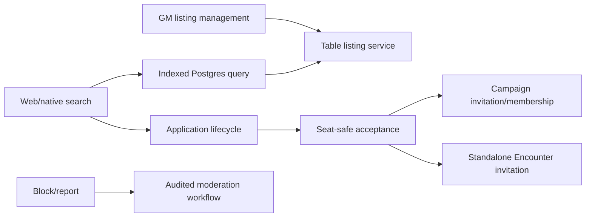

# Phase 5 — Free Social Hub

> **Status:** planned
> **Depends on:** [Phase 1](01-campaign-core.md), [Phase 3](03-encounters.md), and account capabilities from [Phase 4](04-entitlements-and-subscriptions.md)
> **Unlocks:** public table discovery and the paid-table extension
> **Primary ADRs:** [0001](../adr/0001-package-boundaries.md), [0008](../adr/0008-ruleset-identity-and-content-binding.md)

## Goal

Launch a moderated, adults-only table-finding service for free Campaigns and one-shots. GMs publish structured listings; players search, filter, apply, and receive a decision; accepted applicants can be converted into a Campaign membership or standalone Encounter invitation.

## Current starting point

- Public profiles contain only basic identity fields and are not yet a complete product contract.
- Campaign membership and standalone Encounter invitations arrive in earlier phases.
- No listing, application, seat, schedule, discovery, blocking, reporting, or moderation domain exists.
- No external search service exists, and beta scale does not require one.

## Requirements

- Listings include owner/GM, system/ruleset, Campaign or one-shot type, tone, adult age band, timezone, schedule summary, seat capacity/availability, language if approved, free/paid state, and nullable price metadata.
- Phase 5 permits publishing free listings only. Paid state and price exist only where needed to avoid a destructive Phase 7 migration; paid activation remains server-disabled.
- Search supports indexed filters and deterministic pagination using PostgreSQL.
- Applications have explicit lifecycle: submitted, withdrawn, accepted, declined, expired, or blocked.
- Acceptance consumes capacity safely and creates or prepares the appropriate Campaign membership/invitation or standalone Encounter invitation.
- Blocking prevents future interaction and discovery according to a documented policy.
- Reporting supports listing, profile, and application concerns with reason, evidence metadata, status, moderator action, and audit.
- Social surfaces are 18+ and US-only at launch; do not represent this assumption as age assurance.
- Web and native support discovery and applications. Listing administration may remain web-first initially.
- Notifications reuse the device/push foundation and contain no sensitive application text.

## Design

Social Hub authorizes public discovery separately from private Campaign/Encounter access. A public listing never grants access to its underlying Campaign, Encounter, chat, notes, or members.

## Ordered workstreams

1. **Define safety and visibility policy.** Decide public profile fields, anonymous versus authenticated browsing, block semantics, report categories, moderation roles, retention, appeals, and 18+ presentation.
2. **Define listing and application contracts.** Include system/ruleset compatibility, schedule/timezone semantics, capacity, lifecycle, stable public IDs, and conversion results.
3. **Add persistence, indexes, and RLS.** Create listings, schedule data, applications, blocks, reports, moderator actions, and capacity constraints.
4. **Add discovery and lifecycle orchestration.** Use deterministic indexed Postgres queries; do not add an external search engine for unmeasured scale.
5. **Integrate acceptance.** Convert to Campaign or standalone Encounter access idempotently and atomically with seat consumption.
6. **Add moderation and notification paths.** Keep staff access explicit and audited; prevent blocked parties from using notification side channels.
7. **Build web/native journeys.** Cover search/filter/detail/apply/withdraw/status; add web-first listing and moderation administration.
8. **Validate privacy, concurrency, and abuse cases.** Test oversubscription, repeated acceptance, removed listings, blocks, reports, private-scope leakage, and pagination stability.

## Acceptance gates

- A listing exposes no private Campaign/Encounter/member data.
- Filters and pagination are deterministic under concurrent listing updates.
- Applications cannot be submitted to closed, full, blocked, incompatible, or unavailable listings.
- Concurrent acceptances cannot exceed seat capacity.
- Repeated acceptance creates one effective membership/invitation.
- Blocking closes every documented interaction and notification path.
- Report review and moderator action are audited.
- Paid listings cannot be published until Phase 7 enables them.
- Web and native application status agree.

## Out of scope

- Payments, paid-seat checkout, reviews, ratings, comments, direct messages, algorithmic recommendation, minors, identity verification, background checks, voice/video, and external search infrastructure.

## Questions for the phase subplan

- Is browsing anonymous or authenticated-only, and which profile fields are public?
- What schedule model is required: free text, recurring structured slots, or both?
- Is application text visible to all Campaign GMs or owner-only?
- What happens to accepted applicants when a listing closes, changes schedule, or is moderated?
- Which block direction and existing-Campaign exceptions are required?
- Who moderates launch content, and what response/appeal expectations are promised?

## New-session instruction

The subplan must begin with the public/private data boundary and capacity-safe acceptance transaction. Do not treat a stable public ID as an authorization grant.
