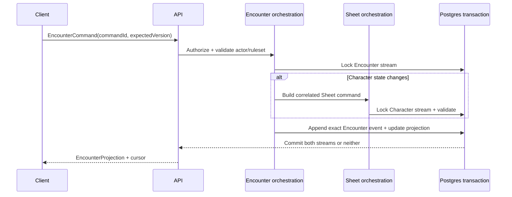

# Phase 06 — Encounters

> **Status:** planned
> **Depends on:** [Phase 01](01-dice-and-roll-infrastructure.md), [Phase 03](03-campaign-core.md), and the relevant live-play primitives from [Phase 05](05-live-campaign-play.md)
> **Unlocks:** standalone one-shots and the [Phase 07 web VTT](07-vtt.md)
> **Primary ADRs:** [0005](../adr/0005-pure-rules-system-engine.md), [0006](../adr/0006-character-builder-sheet-boundary.md), [0008](../adr/0008-ruleset-identity-and-content-binding.md), [0009](../adr/0009-vtt-encounter-event-boundary.md)

## Goal

Add a manual-resolution, server-authoritative Encounter aggregate for Campaign play and standalone one-shots. GMs run encounters by managing enemies against party participants, using actionable enemy stat blocks, controlling encounter-level enemy HP/state/resources, and orchestrating turn/round flow while players keep character-owned progression integrity. GM and player participation stays through responsive web without automatic targeting or outcome application.

## Current starting point

- ADR 0009 already reserves Encounter as a separate aggregate/event log and forbids overloading Character Sheet history.
- Character Sheet commands support character-local HP, conditions, resources, slots, and inventory play state.
- Compiled Characters and Creatures provide useful static actor statistics, but no shared Encounter actor or mutable creature state exists.
- Phase 01 provides restricted authoritative dice evaluation, but Creature actions do not yet expose the structured attack/save/damage definitions needed for direct Encounter action rolls. No target validator, hit/save resolver, initiative model, or proposed-outcome pipeline exists at this starting point.
- Cross-aggregate synchronization between Encounter history and persistent Character Sheet truth is not implemented.

## Requirements

- An Encounter records explicit system/ruleset identity and is either Campaign-owned or standalone, never both. Campaign-owned encounters can be reusable enemy templates, and a Campaign session can launch multiple template-based encounter runs.
- Standalone Encounters own invitation, membership, role, expiry, and actor-control policy without requiring Campaign membership.
- Encounter participants are `CHARACTER` and `ENEMY` projections. Characters are linked to party participants; ENEMIES carry Encounter-local mutable combat state and snapshots from authored monster references. Enemy templates are reusable campaign assets and are copied into Encounter runs as immutable snapshots.
- GM controls party readiness, enemy initiative entry, deterministic tiebreak ordering, and manual round/turn progression. The Encounter projection stores the current participant turn and round; the GM can move forward or backward and explicitly correct either value. Progression remains GM-driven, not combat automation.
- Each enemy exposes a compact immutable stat-block snapshot with abilities, defenses, movement/senses, actions, bonus actions, reactions, traits, and limited-use resources when the source provides them. The GM can expand detail without navigating away from the Encounter.
- The GM can execute an enemy initiative, attack, damage, healing, saving throw, or ability-check roll directly from that snapshot when its authored action contains an explicit roll definition. The authoritative roll executes once and is stored as `PRIVATE` or published to `TABLE`; publishing never rerolls it. An action may atomically spend an explicit Encounter-local feature charge, but it does not select a target or automatically apply damage, healing, a condition, or another outcome.
- The GM can use or restore an enemy feature charge manually and see its reset instruction. Automatic recharge rolls and automatic rest/reset execution remain deferred.
- A live run may add a snapshotted Creature or lightweight custom enemy as an improvised reinforcement and remove an enemy. Player participation continues to come from Session attendance; the UI does not expose a generic actor-type builder.
- Conditions and effects support manual labels plus an optional end-of-turn, end-of-round, or round-number reminder. The turn order can also contain a non-actor reminder for a lair action, hazard, chase consequence, or other timed beat. Reminders never silently remove or resolve state.
- Authorized users can navigate directly from an encounter character participant to the full Character Sheet.
- Encounter conversation visibility reuses the Phase 03 scope predicates with Encounter-scoped authorization. Actor health projections expose exact values to the GM and only a qualitative health band to players when an actor is hidden from them.
- Encounter retains its newest 2,000 durable events, including rolls, under its server-authoritative retention policy; event compaction is not introduced in this slice.
- Enemy HP, conditions, resources, notes, and other manual state remain Encounter-local.
- Commands are idempotent and version-checked. Events are append-only, and a current projection is rebuildable from persisted exact event data.
- When an Encounter command changes a character's Sheet-owned state, orchestration locks both streams and commits the Encounter event plus correlated Sheet command in one Postgres transaction.

## Design

Replay never resolves mutable “active” content. Each event stores exact content/ruleset revision IDs plus all rolls, selections, proposed outcomes, applied outcomes, and manual overrides needed to explain the state transition.

### Encounter privacy matrix

| Projection                               | GM                          | Player with actor visibility         | Player without actor visibility |
| ---------------------------------------- | --------------------------- | ------------------------------------ | ------------------------------- |
| Actor identity and initiative            | Exact                       | Authorized projection                | Omitted                         |
| Current/max/temp HP and state            | Exact                       | Qualitative health band only         | Omitted                         |
| Hidden actor notes and control authority | Exact                       | Omitted                              | Omitted                         |
| Character Sheet detail                   | Authorized Sheet projection | Existing authorized Sheet projection | Omitted                         |

## Core contracts

- `EncounterAuthorityContext`
- `EncounterActorKind = CHARACTER | ENEMY` and participant-control assignment
- `EncounterCommand` with command ID and expected version
- `EncounterEvent` with exact rules/content identity
- `EncounterProjection` with version and cursor
- `RollCommand` and normalized `RollResult`
- Enemy action-roll definitions and a versioned feature-resource command tied to the immutable actor snapshot
- `ProposedOutcome` and `AppliedOutcome`, even though automated resolution remains later
- Correlation identity connecting one Encounter event to any Sheet command/event

Use the existing character command pattern as a reference, not as a universal event abstraction. Encounter and character events remain distinct types and persistence streams.

## Ordered workstreams

1. **Resolve ownership and transaction policy.** Finalize Campaign versus standalone authority, participant control, Character/Enemy truth boundaries, and lock order for correlated operations.
2. **Define contracts and replay invariants.** Specify prepared/active/completed lifecycle, commands, events, projection, cursor, manual/rolled initiative/tie-break/reorder, forward/backward/current turn and round correction, timeline reminders, actor summaries, invitations, rolls, visibility, and immutable Campaign content-version recording.
3. **Add persistence and repositories.** Create Encounter, membership/invitation, actor, event, projection, creature-state, initiative, and correlation storage with RLS and version constraints.
4. **Add application orchestration.** Implement lifecycle, membership, actor management, manual initiative, improvised reinforcements, creature changes, structured enemy rolls/charges, reminders, and projection/replay in `packages/functions`.
5. **Coordinate Character mutations.** Reuse Sheet validation and command semantics while guaranteeing one transaction, deterministic lock order, and retry idempotency.
6. **Add thin API procedures and Realtime delivery.** Persist first, then notify authorized clients to reconcile from a cursor.
7. **Build responsive web play surfaces.** Provide compact actionable enemy stat blocks, actor list, HP/slot summaries, manual initiative, feature charges, Sheet navigation, chat, private/table rolls, reminders, join/leave, and clear authority feedback.
8. **Validate replay, concurrency, and access.** Test campaign and standalone matrices, duplicate commands, simultaneous Sheet/Encounter edits, exact replay, reconnect, removed participants, and player-only channels.

## Acceptance gates

- A standalone invitee can join an authorized standalone Encounter without joining a Campaign.
- A Campaign non-member cannot infer or access its Encounter.
- An Encounter moves only through `PREPARED`, `ACTIVE`, and `COMPLETED` lifecycle states; one Campaign has at most one active Campaign Encounter.
- Manual and rolled initiative ties resolve deterministically; manual reorder, previous/next turn, current-turn correction, and round correction are stable, versioned, and consistent across responsive web surfaces.
- Every enemy roll uses immutable snapshot mechanics and records exact evidence once; private rolls never enter the table timeline, and publishing an existing result never rerolls it.
- Feature use cannot underflow or exceed its snapshotted maximum, and retries cannot spend a charge twice.
- An improvised reinforcement snapshots its source at insertion and replay never resolves it against newer active content.
- Player actor projections expose only qualitative health for hidden actors; GM projections retain exact state.
- Creature changes replay entirely from Encounter events.
- Character HP/resource changes appear once in both Encounter and Sheet projections or in neither.
- Concurrent direct Sheet and Encounter commands resolve through expected-version conflicts without lost updates.
- Retried commands return the original effective result and do not append duplicate events.
- Rebuilding from event zero yields the stored current projection.
- Rebuild does not query newer active content to reinterpret old events.
- Player-only Encounter chat retains the Phase 03 confidentiality tests.

## Out of scope

- Automatic targeting, hit/save resolution, damage/healing application, condition/effect execution, recharge/reset automation, action-economy enforcement, AI creatures, maps, tokens, fog, and VTT interaction. Direct GM-triggered enemy rolls and manual feature-charge tracking are in scope.
- Native Encounter surfaces; Phase 10 consumes the proven contracts after web viability.
- A generic cross-domain event framework. The Encounter event model is purpose-built and separate from Character history.

## Questions for the phase subplan

- What roles exist in standalone Encounters, and who may create or control character/enemy participants?
- Can one character join multiple simultaneous standalone Encounters, and how are concurrent Sheet mutations presented?
- What deterministic lock order prevents deadlocks across Encounter and Character streams?
- Which creature state fields are required beyond HP, temp HP, conditions, resources, and GM notes?
- What event snapshot/compaction policy is acceptable while preserving exact replay?

## New-session instruction

The first subplan must settle correlated Encounter/Sheet ownership and lock order before schema or UI work. Do not start the VTT renderer in this phase.
