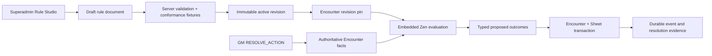
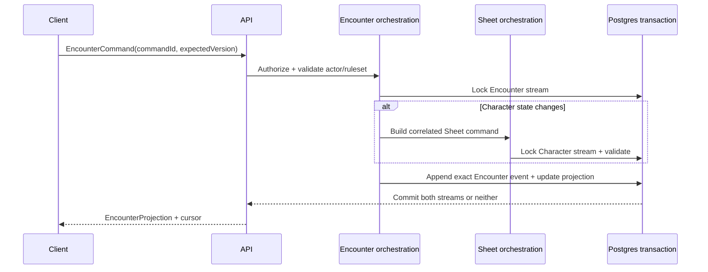

# Phase 07 — Rules Platform and Encounter Resolution

> **Status:** implemented locally; Linux deploy-preview verification pending
> **Depends on:** [Phase 01](01-dice-and-roll-infrastructure.md), [Phase 03](03-campaign-core.md), and the relevant live-play primitives from [Phase 06](06-live-campaign-play.md)
> **Unlocks:** authoritative tactical play for one-shot and ongoing Campaigns and the [Phase 08 web VTT](08-vtt.md)
> **Primary ADRs:** [0005](../adr/0005-pure-rules-system-engine.md), [0006](../adr/0006-character-builder-sheet-boundary.md), [0008](../adr/0008-ruleset-identity-and-content-binding.md), [0009](../adr/0009-vtt-encounter-event-boundary.md), [0018](../adr/0018-embedded-rule-packs-and-encounter-resolution.md)

## Goal

Complete the server-authoritative Encounter aggregate and add a small, production-shaped rules platform. Superadmins author bounded declarative rule packs, prove revisions with fixtures, and activate immutable versions. Encounters pin an exact compatible revision and can resolve an explicit GM action into typed, validated, transactionally applied outcomes while retaining complete evidence. This is a tracer bullet for expandable game-system mechanics, not blanket automation of the existing authored-effect catalog.

## Current starting point

- ADR 0009 already reserves Encounter as a separate aggregate/event log and forbids overloading Character Sheet history.
- Character Sheet commands support character-local HP, conditions, resources, slots, and inventory play state.
- Compiled Characters and Creatures provide useful static actor statistics, but no shared Encounter actor or mutable creature state exists.
- The manual Encounter lifecycle, actors, initiative, rolls, reminders, visibility, idempotent commands, and correlated Character Sheet transaction spine already exist.
- The Character engine already resolves explicit ruleset code/version through a fail-closed registry, but it is intentionally D&D-5e-family-shaped and is not a VTT action evaluator.
- Existing authored effects compile into typed descriptions. Many kinds, including `CLOSED_RULE` and manual adjudication, have no explicit live resolver and must remain fail-closed.
- No immutable rule-pack store, activation gate, administrative rule editor, exact Encounter rule binding, or typed action-resolution evidence exists at this starting point.

## Requirements

- Every Encounter belongs to one Campaign and records explicit system/ruleset identity. The Campaign `ONE_SHOT | ONGOING` format describes the table; it does not create a different Encounter aggregate. A Campaign may own reusable enemy templates, and a Campaign session can launch multiple template-based runs.
- Encounter participation derives from Campaign membership, ownership, Character assignment, and Session attendance. Encounters own no invitation, membership, Social listing, or cohort lifecycle.
- Encounter participants are `CHARACTER` and `ENEMY` projections. Characters are linked to party participants; ENEMIES carry Encounter-local mutable combat state and snapshots from authored monster references. Enemy templates are reusable campaign assets and are copied into Encounter runs as immutable snapshots.
- GM controls party readiness, enemy initiative entry, deterministic tiebreak ordering, and manual round/turn progression. The Encounter projection stores the current participant turn and round; the GM can move forward or backward and explicitly correct either value. Progression remains GM-driven, not combat automation.
- Each enemy exposes a compact immutable stat-block snapshot with abilities, defenses, movement/senses, actions, bonus actions, reactions, traits, and limited-use resources when the source provides them. The GM can expand detail without navigating away from the Encounter.
- The GM can execute an enemy initiative, attack, damage, healing, saving throw, or ability-check roll directly from that snapshot when its authored action contains an explicit roll definition. The authoritative roll executes once and is stored as `PRIVATE` or published to `TABLE`; publishing never rerolls it. An action may atomically spend an explicit Encounter-local feature charge, but it does not select a target or automatically apply damage, healing, a condition, or another outcome.
- The GM can use or restore an enemy feature charge manually and see its reset instruction. Automatic recharge rolls and automatic rest/reset execution remain deferred.
- A live run may add a snapshotted Creature or lightweight custom enemy as an improvised reinforcement and remove an enemy. Player participation continues to come from Session attendance; the UI does not expose a generic actor-type builder.
- Conditions and effects support manual labels plus an optional end-of-turn, end-of-round, or round-number reminder. The turn order can also contain a non-actor reminder for a lair action, hazard, chase consequence, or other timed beat. Reminders never silently remove or resolve state.
- Authorized users can navigate directly from an encounter character participant to the full Character Sheet.
- Encounter conversation visibility reuses the Phase 03 scope predicates with Encounter-scoped authorization. Actor health projections expose exact values to the GM and only a qualitative health band to players when an actor is hidden from them.
- Encounter retains every durable command event because the row is also its idempotency receipt and exact action-resolution evidence. Timeline reads remain bounded through cursor pagination.
- Enemy HP, conditions, resources, notes, and other manual state remain Encounter-local.
- Commands are idempotent and version-checked. Events are append-only, and a current projection is rebuildable from persisted exact event data.
- When an Encounter command changes a character's Sheet-owned state, orchestration locks both streams and commits the Encounter event plus correlated Sheet command in one Postgres transaction.
- Rule packs are identified by explicit ruleset code/version and contain bounded JDM models plus fixtures. One pack has at most one draft and one active revision pointer; activated revisions are immutable.
- Rule Studio is superadmin-only, lazy-loaded, and uses JDM for authoring. The server rejects unsupported/function nodes, missing model references, nondeterministic calls, excessive graphs/documents, and invalid fixture references regardless of what the editor renders.
- Activation reruns every fixture through the embedded server Zen runtime. A fixture that requests randomness uses one deterministic application-owned standalone-dice stage and proves the final post-roll result.
- New Encounters require one compatible active revision and store its exact ID. A prepared Encounter may explicitly upgrade to the current compatible active revision; active/completed runs do not silently move.
- `RESOLVE_ACTION` accepts a GM-selected actor, bounded targets, model key, and untrusted selections. The server assembles authoritative facts, evaluates the pinned revision, validates target scope and typed outcomes, applies supported Encounter/Sheet changes atomically, and stores revision/checksum/facts/trace/roll/outcome/override evidence.
- Supported tracer outcomes are damage, healing/temporary HP, condition add/remove, resource delta, and explicit manual instructions. Existing effect kinds without an implemented mapping remain manual.

## Design

Zen is an embedded application dependency, not a client authority or separately deployed service. The browser may use JDM/WASM for editing assistance, but save validation, activation, and live evaluation always execute on the server. The product API remains the only client-facing backend when more TTRPG systems are added.

Replay never resolves mutable “active” content. Each event stores exact content/ruleset revision IDs plus all rolls, selections, proposed outcomes, applied outcomes, and manual overrides needed to explain the state transition.

### Encounter privacy matrix

| Projection                               | GM                          | Player with actor visibility         | Player without actor visibility |
| ---------------------------------------- | --------------------------- | ------------------------------------ | ------------------------------- |
| Actor identity and initiative            | Exact                       | Authorized projection                | Omitted                         |
| Current/max/temp HP and state            | Exact                       | Qualitative health band only         | Omitted                         |
| Hidden actor notes and control authority | Exact                       | Omitted                              | Omitted                         |
| Character Sheet detail                   | Authorized Sheet projection | Existing authorized Sheet projection | Omitted                         |

## Core contracts

- `EncounterAuthorityContext`
- `EncounterActorKind = CHARACTER | ENEMY` and participant-control assignment
- `EncounterCommand` with command ID and expected version
- `EncounterEvent` with exact rules/content identity
- `EncounterProjection` with version and cursor
- `RollCommand` and normalized `RollResult`
- Enemy action-roll definitions and a versioned feature-resource command tied to the immutable actor snapshot
- `ProposedOutcome` and `AppliedOutcome` for the closed tracer set; unmapped mechanics remain manual
- `RulePackDocument`, immutable `RulePackRevision`, conformance fixture, and active revision pointer
- `RuleEvaluation` with eligibility, one bounded roll-request stage, and typed proposed outcomes
- `RuleResolutionEvidence` with exact revision/checksum, normalized facts, traces, rolls, proposed/applied outcomes, and override
- Correlation identity connecting one Encounter event to any Sheet command/event

Use the existing character command pattern as a reference, not as a universal event abstraction. Encounter and character events remain distinct types and persistence streams.

## Ordered workstreams

1. **Resolve ownership and transaction policy.** Finalize Campaign authority, participant control, Character/Enemy truth boundaries, and lock order for correlated operations.
2. **Define contracts and replay invariants.** Specify prepared/active/completed lifecycle, commands, events, projection, cursor, manual/rolled initiative/tie-break/reorder, forward/backward/current turn and round correction, timeline reminders, actor summaries, rolls, visibility, and immutable Campaign content-version recording.
3. **Add persistence and repositories.** Create Encounter template/run, actor, event, projection, creature-state, initiative, and correlation storage with RLS and version constraints; reuse Campaign membership rather than duplicating it.
4. **Add application orchestration.** Implement lifecycle, Campaign-authorized actor management, manual initiative, improvised reinforcements, creature changes, structured enemy rolls/charges, reminders, and projection/replay in `packages/functions`.
5. **Coordinate Character mutations.** Reuse Sheet validation and command semantics while guaranteeing one transaction, deterministic lock order, and retry idempotency.
6. **Add thin API procedures and Realtime delivery.** Persist first, then notify authorized clients to reconcile from a cursor.
7. **Build responsive web play surfaces.** Provide compact actionable enemy stat blocks, actor list, HP/slot summaries, manual initiative, feature charges, Sheet navigation, chat, private/table rolls, reminders, readiness, and clear authority feedback.
8. **Validate replay, concurrency, and access.** Test Campaign owner/member/non-member matrices, one-shot and ongoing Campaigns, duplicate commands, simultaneous Sheet/Encounter edits, exact replay, reconnect, removed participants, and player-only channels.
9. **Add immutable rule packs.** Persist draft/active/retired revision state, canonical checksums, RLS/revokes, and staged Encounter revision pins.
10. **Prove the embedded evaluator.** Validate bounded deterministic JDM documents, run fixtures during activation, and record one application-owned roll stage without giving Zen I/O or randomness.
11. **Add Rule Studio.** Provide a lazy superadmin workspace for pack/revision navigation, model editing, fixture simulation, import/export, activation, and retirement without exposing rule tables to the browser.
12. **Resolve one real action path.** Run a pinned model from a versioned Encounter command, validate targets/outcomes, apply supported enemy or Character changes atomically, and project only a table-safe summary to players.

## Acceptance gates

- A one-shot Campaign member can participate in its Encounter through the same Campaign authority as an ongoing Campaign member; no separate Encounter invitation is required.
- A Campaign non-member cannot infer or access its Encounter.
- An Encounter moves only through `PREPARED`, `ACTIVE`, and `COMPLETED` lifecycle states; one Campaign has at most one active Campaign Encounter.
- Manual and rolled initiative ties resolve deterministically; manual reorder, previous/next turn, current-turn correction, and round correction are stable, versioned, and consistent across responsive web surfaces.
- Every enemy roll uses immutable snapshot mechanics and records exact evidence once; private rolls never enter the table timeline, and publishing an existing result never rerolls it.
- Feature use cannot underflow or exceed its snapshotted maximum, and retries cannot spend a charge twice.
- An improvised reinforcement snapshots its source at insertion and replay never resolves it against newer active content.
- Player actor projections expose only qualitative health for hidden actors; GM projections retain exact state.
- Creature changes replay entirely from Encounter events.
- Character HP/resource changes appear once in both Encounter and Sheet projections or in neither.
- Concurrent direct Sheet and Encounter commands resolve through expected-version conflicts without lost updates.
- Retried commands return the original effective result and do not append duplicate events.
- Rebuilding from event zero yields the stored current projection.
- Rebuild does not query newer active content to reinterpret old events.
- Player-only Encounter chat retains the Phase 03 confidentiality tests.
- Non-superadmins cannot list, simulate, save, activate, or retire rule packs; direct browser table access remains revoked.
- An activated revision cannot be changed or deleted, and an Encounter never resolves against a mutable “current” document.
- Activation fails when any model lacks a fixture, a fixture output differs, a roll request is not executable by the application dice boundary, or a second roll stage is requested.
- A resolved action cannot target an unrelated actor, mutate state after a denial, or return an untyped outcome. GM overrides require a bounded reason and remain in private evidence.
- TABLE viewers receive only roll records and outcome kind/status summaries; normalized facts, traces, before/after state, and override details remain private.
- The native Zen runtime evaluates and bundles on Windows locally; production eligibility additionally requires a successful Linux Netlify deploy-preview simulation.

## Out of scope

- Automatic target selection, reactions, recharge/reset automation, general action-economy enforcement, automatic execution of the full authored-effect catalog, AI creatures, maps, tokens, fog, walls, doors, zones, and VTT interaction. The explicit GM action plus bounded typed tracer outcomes is in scope.
- Arbitrary JavaScript/function nodes, user-authored executable code, network/database access from rules, a custom BRMS, a Rust service, or a second client-facing backend.
- A production-complete D&D rule pack. This tranche proves the platform and activation path; each production rule requires explicit fixtures and resolver coverage before activation.
- Native Encounter surfaces; Phase 11 consumes the proven contracts after web viability.
- A generic cross-domain event framework. The Encounter event model is purpose-built and separate from Character history.

## Questions for the phase subplan

- Which existing Campaign roles may create runs, control enemies, and correct turn state?
- How are simultaneous Encounter and direct Sheet mutations presented when the same Campaign Character is active?
- What deterministic lock order prevents deadlocks across Encounter and Character streams?
- Which creature state fields are required beyond HP, temp HP, conditions, resources, and GM notes?
- What event snapshot/compaction policy is acceptable while preserving exact replay?

## New-session instruction

Begin the next session at the Phase 08 scene boundary. Reuse the pinned Encounter/rule-resolution contracts; do not move geometry, fog, walls, doors, token interpolation, or renderer state into Zen. Preserve one internet-hosted product API and prove transient versus committed movement before selecting any additional client packaging.
