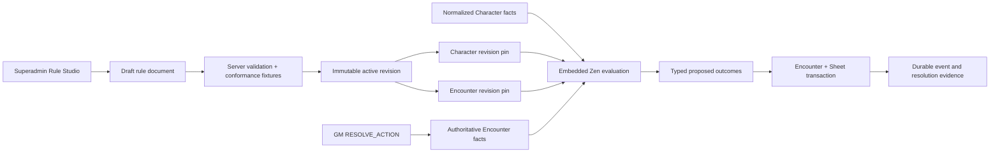
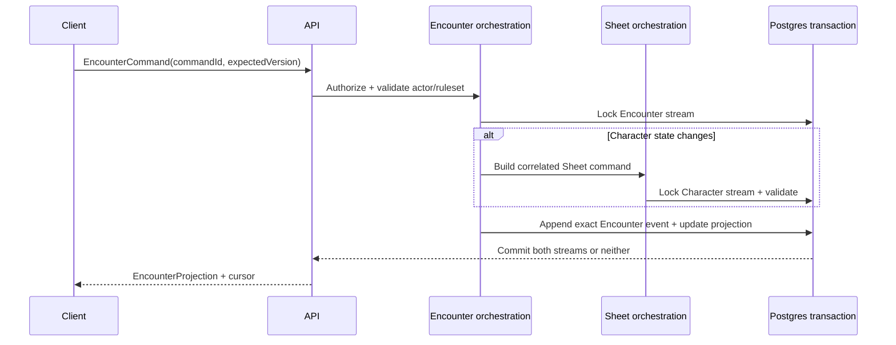

# Phase 07 — Rules Platform and Encounter Resolution

> **Status:** complete as of 2026-08-15; rules-runtime convergence, legacy-engine removal, bounded Character and Encounter command policies, exact committed snapshots, cross-process active-session command authority, and authenticated local/Linux recovery and latency gates are validated
> **Depends on:** [Phase 01](01-dice-and-roll-infrastructure.md), [Phase 03](03-campaign-core.md), and the relevant live-play primitives from [Phase 06](06-live-campaign-play.md)
> **Unlocks:** authoritative tactical play for one-shot and ongoing Campaigns and the [Phase 08 web VTT](08-vtt.md)
> **Primary ADRs:** [0006](../adr/0006-character-builder-sheet-boundary.md), [0008](../adr/0008-ruleset-identity-and-content-binding.md), [0009](../adr/0009-vtt-encounter-event-boundary.md), [0018](../adr/0018-embedded-rule-packs-and-encounter-resolution.md), [0019](../adr/0019-versioned-cross-domain-rules-runtime.md), [0020](../adr/0020-local-and-remote-live-session-host.md), and [0021](../adr/0021-command-scoped-rules-responsibilities.md)

## Goal

Complete the server-authoritative Encounter aggregate and converge mechanical authority on one embedded Zen runtime for Character, Encounter, and future VTT decisions. Superadmins author bounded declarative rule packs, prove revisions with fixtures, and activate immutable versions. Characters and Encounters pin exact compatible revisions; an Encounter can resolve an explicit GM action into typed, validated, transactionally applied outcomes while retaining complete evidence. This is a tracer bullet for expandable game-system mechanics, not blanket automation of the existing authored-effect catalog.

## Original starting point

The following records the baseline that Phase 07 replaced; it is not the current runtime architecture.

- ADR 0009 already reserves Encounter as a separate aggregate/event log and forbids overloading Character Sheet history.
- Character Sheet commands support character-local HP, conditions, resources, slots, and inventory play state.
- Compiled Characters and Creatures provide useful static actor statistics, but no shared Encounter actor or mutable creature state exists.
- The manual Encounter lifecycle, actors, initiative, rolls, reminders, visibility, idempotent commands, and correlated Character Sheet transaction spine already exist.
- During convergence, the TypeScript Character engine was quarantined as a test-only parity oracle. It was deleted after the Character policy families passed their parity gates; production Character Builder and Sheet paths now resolve a pinned rule-pack revision and fail closed rather than falling back to TypeScript mechanics.
- Existing authored effects compile into typed descriptions. Many kinds, including `CLOSED_RULE` and manual adjudication, have no explicit live resolver and must remain fail-closed.
- At phase start, no immutable rule-pack store, activation gate, administrative rule editor, exact Encounter rule binding, or typed action-resolution evidence existed.

## Requirements

- Every Encounter belongs to one Campaign and records explicit system/ruleset identity. The Campaign `ONE_SHOT | ONGOING` format describes the table; it does not create a different Encounter aggregate. A Campaign may own reusable enemy templates, and a Campaign session can launch multiple template-based runs.
- Encounter participation derives from Campaign membership, ownership, Character assignment, and Session attendance. Encounters own no invitation, membership, Social listing, or cohort lifecycle.
- Encounter participants are `CHARACTER` and `ENEMY` projections. Characters are linked to party participants; ENEMIES carry Encounter-local mutable combat state and snapshots from authored monster references. Enemy templates are reusable campaign assets and are copied into Encounter runs as immutable snapshots.
- GM controls party readiness, enemy initiative entry, deterministic tiebreak ordering, and manual round/turn progression. The Encounter projection stores the current participant turn and round; the GM can move forward or backward and explicitly correct either value. Progression remains GM-driven, not combat automation.
- Each enemy exposes a compact immutable stat-block snapshot with abilities, defenses, movement/senses, actions, bonus actions, reactions, traits, and limited-use resources when the source provides them. The GM can expand detail without navigating away from the Encounter.
- The GM can execute an enemy initiative, attack, damage, healing, saving throw, or ability-check roll directly from that snapshot when its authored action contains an explicit roll definition. The authoritative roll executes once and is stored as `PRIVATE` or published to `TABLE`; publishing never rerolls it. An action may atomically spend an explicit Encounter-local feature charge, but it does not select a target or automatically apply damage, healing, a condition, or another outcome.
- The GM can use or restore an enemy feature charge manually and see its reset instruction. Automatic recharge rolls and automatic rest/reset execution remain deferred.
- A live run may add a snapshotted Creature or lightweight custom enemy as an improvised reinforcement and remove an enemy. Player participation continues to come from Session attendance; the UI does not expose a generic actor-type builder.
- Conditions and effects support manual labels plus an optional end-of-turn, end-of-round, or round-number reminder. The turn order can also contain a non-actor reminder for a lair action, hazard, chase consequence, or other timed beat. Reminders never silently remove or resolve state.
- Authorized users can navigate directly from an encounter character participant to the full Character Sheet.
- Encounter conversation visibility reuses the Phase 03 scope predicates with Encounter-scoped authorization. Actor health projections expose exact values to the GM and only a qualitative health band to players when an actor is hidden from them.
- Encounter retains every durable command event because the row is also its idempotency receipt and exact action-resolution evidence. Timeline reads remain bounded through cursor pagination.
- Enemy HP, conditions, resources, notes, and other manual state remain Encounter-local.
- Commands are idempotent and version-checked. Events are append-only, and a current projection is rebuildable from persisted exact event data.
- When an Encounter command changes a character's Sheet-owned state, orchestration locks both streams and commits the Encounter event plus correlated Sheet command in one Postgres transaction.
- Rule packs are identified by explicit ruleset code/version and contain bounded JDM models plus fixtures. One pack has at most one draft and one active revision pointer; activated revisions are immutable.
- Rule Studio is superadmin-only, lazy-loaded, and uses JDM for authoring. The server rejects unsupported nodes, arbitrary Function nodes, missing model references, nondeterministic calls, excessive graphs/documents, and invalid fixture references regardless of what the editor renders. The only Function exceptions are the hidden, exact repository-owned `character-grant-fold`, `character-action-resolve`, and `encounter-actor-policy` models; the server rejects any source or graph mutation and every additional Function node.
- Activation reruns every fixture through the embedded server Zen runtime. Fixtures supply any application-owned dice evidence as facts and prove the final typed result.
- Zen is the one production evaluator for Character mechanics and Encounter action mechanics. TypeScript loads and normalizes facts, attaches stable IDs/provenance, authorizes, validates, persists, transacts, and renders; it does not decide game-system mechanics. Zen output includes typed domain explanations and source IDs; native traces are diagnostic only.
- A draft Character preview uses the current compatible active revision. First finalization transactionally rechecks and pins exact revision/checksum plus evaluator and model-contract versions. Later activation or retirement does not silently change or invalidate a Character; explicit upgrade preview/reconciliation commands repin transactionally and increment the Character stream version.
- New Encounters require one compatible active revision and store its exact ID. A prepared Encounter may explicitly upgrade to the current compatible active revision; active/completed runs do not silently move.
- `RESOLVE_ACTION` accepts a GM-selected actor, bounded targets, model key, and untrusted selections. The server assembles authoritative facts, evaluates the pinned revision, validates target scope and typed outcomes, applies supported Encounter/Sheet changes atomically, and stores revision/checksum/facts/trace/roll/outcome/override evidence.
- GM projections and Encounter commands batch non-Character initiative and feature-resource facts through `encounter-actor-policy` under the same exact pin. A state-changing command evaluates its final fact set before returning one projection; no intermediate actor state is sent to the client.
- Supported tracer outcomes are damage, healing/temporary HP, condition add/remove, resource delta, and explicit manual instructions. Existing effect kinds without an implemented mapping remain manual.

## Design

Zen is an embedded application dependency, not a client authority or separately deployed rules service. The browser may use JDM/WASM for editing assistance, but save validation, activation, and all production Character/Encounter evaluation execute in the authoritative Node process. Ordinary product requests remain on the API; Phase 08 live-session commands use the separately deployed local/remote Colyseus host from ADR 0020, which embeds the same evaluator and shared packages. Arbitrary Function, I/O, wall-clock, random, and mutation nodes remain forbidden; the reserved repository-owned `character-grant-fold`, `character-action-resolve`, and `encounter-actor-policy` models are the bounded, exact-source exceptions and are not authorable in Rule Studio. Application-owned dice is external evidence supplied as facts. VTT geometry, movement, fog, walls, doors, zones, and renderer state remain outside Zen, while mechanically triggered effects remain inside it.

Replay never resolves mutable “active” content. Each event stores exact content/ruleset revision IDs plus all rolls, selections, proposed outcomes, applied outcomes, and manual overrides needed to explain the state transition.

### Encounter privacy matrix

| Projection                               | GM                          | Player with actor visibility         | Player without actor visibility |
| ---------------------------------------- | --------------------------- | ------------------------------------ | ------------------------------- |
| Actor identity and initiative            | Exact                       | Authorized projection                | Omitted                         |
| Current/max/temp HP and state            | Exact                       | Qualitative health band only         | Omitted                         |
| Hidden actor notes and control authority | Exact                       | Omitted                              | Omitted                         |
| Character Sheet detail                   | Authorized Sheet projection | Existing authorized Sheet projection | Omitted                         |

## Core contracts

- `EncounterAuthorityContext`
- `EncounterActorKind = CHARACTER | ENEMY` and participant-control assignment
- `EncounterCommand` with command ID and expected version
- `EncounterEvent` with exact rules/content identity
- `EncounterProjection` with version and cursor
- `RollCommand` and normalized `RollResult`
- Enemy action-roll definitions and a versioned feature-resource command tied to the immutable actor snapshot
- `ProposedOutcome` and `AppliedOutcome` for the closed tracer set; unmapped mechanics remain manual
- `RulePackDocument`, immutable `RulePackRevision`, conformance fixture, active revision pointer, evaluator kind/version, and model-contract version
- `CharacterRulePin` plus explicit upgrade preview/reconciliation command
- `RuleEvaluation` with typed explanations/source IDs and typed proposed outcomes; native trace is diagnostic only
- `RuleResolutionEvidence` with exact revision/checksum, normalized facts, traces, rolls, proposed/applied outcomes, and override
- Correlation identity connecting one Encounter event to any Sheet command/event

Use the existing character command pattern as a reference, not as a universal event abstraction. Encounter and character events remain distinct types and persistence streams.

## Ordered workstreams

1. **Resolve ownership and transaction policy.** Finalize Campaign authority, participant control, Character/Enemy truth boundaries, and lock order for correlated operations.
2. **Define contracts and replay invariants.** Specify prepared/active/completed lifecycle, commands, events, projection, cursor, manual/rolled initiative/tie-break/reorder, forward/backward/current turn and round correction, timeline reminders, actor summaries, rolls, visibility, and immutable Campaign content-version recording.
3. **Add persistence and repositories.** Create Encounter template/run, actor, event, projection, creature-state, initiative, and correlation storage with RLS and version constraints; reuse Campaign membership rather than duplicating it.
4. **Add application orchestration.** Implement lifecycle, Campaign-authorized actor management, manual initiative, improvised reinforcements, creature changes, structured enemy rolls/charges, reminders, and projection/replay in `packages/functions`.
5. **Coordinate Character mutations.** Reuse Sheet validation and command semantics while guaranteeing one transaction, deterministic lock order, and retry idempotency.
6. **Add thin API procedures and Realtime delivery.** Persist first, then notify authorized clients to reconcile from a cursor.
7. **Build responsive web play surfaces.** Provide compact actionable enemy stat blocks, actor list, HP/slot summaries, manual initiative, feature charges, Sheet navigation, chat, private/table rolls, reminders, readiness, and clear authority feedback.
8. **Validate replay, concurrency, and access.** Test Campaign owner/member/non-member matrices, one-shot and ongoing Campaigns, duplicate commands, simultaneous Sheet/Encounter edits, exact replay, reconnect, removed participants, and player-only channels.
9. **Add immutable rule packs.** Persist draft/active/retired revision state, canonical checksums, evaluator/model-contract versions, RLS/revokes, staged Encounter pins, and Character finalization pins.
10. **Prove the embedded evaluator.** Validate bounded deterministic JDM documents, run fixtures during activation, supply application-owned dice as facts without giving Zen I/O or randomness, and require typed explanations/source IDs.
11. **Add Rule Studio.** Provide a lazy superadmin workspace for pack/revision navigation, model editing, fixture simulation, import/export, activation, and retirement without exposing rule tables to the browser.
12. **Resolve one real action path.** Run a pinned model from a versioned Encounter command, validate targets/outcomes, apply supported enemy or Character changes atomically, and project only a table-safe summary to players.
13. **Converge Character mechanics by gated family.** Migrate grant/source ordering and eligibility, modifiers/stacking, derived formulas, spell access/slots, resources/charges, rest/exhaustion/attunement, action availability, and typed explanations. First prove the locked grant fold against `applyGrants`; then prove one top-level evaluation feeds folded proficiencies/modifiers into stacking and derived results without a TypeScript mechanics pass. Use the TypeScript engine only as a parity oracle, then delete `RulesSystem`, `runEngine`, and duplicated mechanical logic.
14. **Install the canonical Character policy.** Merge repository-owned D&D Character model keys into the active ruleset pack after SRD seeding, preserve unrelated administrator models, refuse to overwrite a different draft, and retry-safely backfill unpinned active Characters.

## Acceptance gates

- A one-shot Campaign member can participate in its Encounter through the same Campaign authority as an ongoing Campaign member; no separate Encounter invitation is required.
- A Campaign non-member cannot infer or access its Encounter.
- An Encounter moves only through `PREPARED`, `ACTIVE`, and `COMPLETED` lifecycle states; one Campaign has at most one active Campaign Encounter.
- Manual and rolled initiative ties resolve deterministically; manual reorder, previous/next turn, current-turn correction, and round correction are stable, versioned, and consistent across responsive web surfaces.
- Every enemy roll uses immutable snapshot mechanics and records exact evidence once; private rolls never enter the table timeline, and publishing an existing result never rerolls it.
- Feature use cannot underflow or exceed its snapshotted maximum, and retries cannot spend a charge twice.
- An improvised reinforcement snapshots its source at insertion and replay never resolves it against newer active content.
- Player actor projections expose only qualitative health for hidden actors; GM projections retain exact state.
- Creature changes replay entirely from Encounter events.
- Character HP/resource changes appear once in both Encounter and Sheet projections or in neither.
- Concurrent direct Sheet and Encounter commands resolve through expected-version conflicts without lost updates.
- Retried commands return the original effective result and do not append duplicate events.
- Rebuilding from event zero yields the stored current projection.
- Rebuild does not query newer active content to reinterpret old events.
- Player-only Encounter chat retains the Phase 03 confidentiality tests.
- Non-superadmins cannot list, simulate, save, activate, or retire rule packs; direct browser table access remains revoked.
- An activated revision cannot be changed or deleted, and an Encounter never resolves against a mutable “current” document.
- Activation fails when any model lacks a fixture, a fixture output differs, required application-owned dice evidence is absent or invalid, or a rule document attempts a second roll stage.
- A resolved action cannot target an unrelated actor, mutate state after a denial, or return an untyped outcome. GM overrides require a bounded reason and remain in private evidence.
- TABLE viewers receive only roll records and outcome kind/status summaries; normalized facts, traces, before/after state, and override details remain private.
- The native Zen runtime evaluates and bundles on Windows locally; production eligibility additionally requires a successful Linux Netlify deploy-preview simulation.
- The Character lifecycle proof reports cold and warm Sheet-read latency, Builder-resolution latency, and Sheet-command latency; rule evaluation separately reports its binding, fact-assembly, Zen, runtime, and total timing. The Encounter proof also reports batched actor-policy and command/projection latency. Record p50, p95, maximum, sample count, rule-document size, and normalized fact/result sizes on both local Windows and the Linux deploy-preview path before removing the TypeScript parity fallback.
- 2026-08-14 convergence evidence: the Linux Netlify deploy-preview simulation completed successfully. The database-backed Linux Character lifecycle reported Builder p50/p95 `702/1027 ms`, Sheet read `1355.55/2075.76 ms`, Sheet command `2571.98/4191.01 ms`, total rule evaluation `73.91/232.48 ms`, and native Zen evaluation `19.15/26.19 ms`; its largest document/fact/result payloads were `333887/200150/150386` bytes. The equivalent Windows lifecycle reported Builder `407/627 ms`, Sheet read `740.17/1240.03 ms`, Sheet command `1455.76/2450.64 ms`, total rule evaluation `42.99/146.44 ms`, and native Zen evaluation `18.85/27.67 ms`. The 20-actor/80-resource Encounter actor batch measured Windows p50/p95 `5.15/5.75 ms` and Linux `5.90/7.19 ms` over 30 measured samples after 5 warmups. These are local validation baselines, not production SLAs.
- 2026-08-14 deletion evidence: the superseded `packages/shared/src/domains/engine` implementation, the Functions Character-engine bridge, and the TypeScript Sheet mechanics projector were removed. A production-source scan contains no remaining `runEngine`, `RulesSystem`, `resolveCharacterSheetEngine`, or `resolveSpellGrantState` references. After deletion, the complete Schema (`263` tests), Shared (`112` tests), Database (`524` tests), and serialized Functions (`673` tests) suites passed; affected typechecking, the complete package build, and the production Web/SSR bundle also passed.
- 2026-08-14 live-session evidence: the disposable authenticated local gate verifies two-client state synchronization, persisted Character commands, exact replay, committed broadcast, and a buffered command across automatic reconnect. Eager pinned Character hydration moved the first active-play command from `1995.89 ms` to `325.23 ms`; eight warm commands measured p50/p95/max `294.71/382.91/382.91 ms`, and reconnect measured `343.78 ms`. The same gate against the production Linux Docker image measured first command `375.24 ms`, warm p50/p95/max `325.12/380.88/380.88 ms`, and reconnect `432.82 ms`. Both are local-Supabase validation baselines, not hosted-region SLAs; the image is verified but managed deployment remains separate operations work.
- 2026-08-15 Encounter room-snapshot evidence: admission materializes the exact pinned `encounter-actor-policy` result, usage-only commands reuse it, and `RESOLVE_ACTION` receives that actor result before evaluating only its bounded pinned action contract. The authenticated two-client resource command persisted and broadcast in `33.8 ms` locally and `58.8 ms` through the rebuilt Linux image. Linux service timing was `39.5 ms` with lane `NONE` and `0 ms` actor/action evaluation. The focused action-resolution gate proves the separate bounded native-Zen action path, including its typed second stage when application-owned dice evidence is requested.
- 2026-08-15 command-authority evidence: the local and Linux gates claimed the same expiring Postgres room lease, rejected parallel direct Character and Encounter mutations, continued to commit room commands, survived reconnect, and removed the lease on room disposal. The lease is process-independent and transactionally checked, so the Netlify API and separately deployed local/remote host cannot concurrently mutate an attached aggregate.
- 2026-08-15 final authority audit: known inventory items, hydrated companions, spell-cast availability, and spell mechanics now fail closed when the pinned Character policy omits their typed result; `CAST_SPELL` consumes the exact policy-projected cast decision instead of re-deriving cast rules in TypeScript. The focused Sheet/command/boundary gate passed `110` tests, the affected typecheck passed all `9` packages, and the Functions build passed all `6` tasks. A final production-source scan found no `runEngine`, `RulesSystem`, `resolveCharacterSheetEngine`, `resolveSpellGrantState`, legacy Character-engine bridge, or Sheet mechanics projector references; the remaining `applyGrants` text is only the authored effect-node identifier.
- A finalized Character records exact revision/checksum plus evaluator/model-contract versions. Identical normalized facts and that exact identity produce identical results; an active-pack change or retirement neither changes nor invalidates its pin.
- Character previews use the current active compatible revision, while explicit upgrade preview/reconciliation is the only path that repins a finalized Character and increments its stream version.
- Canonical seeding is idempotent, never overwrites an unrelated administrator draft, preserves non-canonical models, and backfills only active Characters whose revision pin is null.

## Out of scope

- Automatic target selection, reactions, recharge/reset automation, general action-economy enforcement, automatic execution of the full authored-effect catalog, AI creatures, maps, tokens, fog, walls, doors, zones, and VTT interaction. The explicit GM action plus bounded typed tracer outcomes is in scope.
- Arbitrary JavaScript/Function nodes, user-authored executable code, network/database access from rules, any Function beyond the exact reserved Character grant-fold, Character action-resolve, and Encounter actor-policy models, a custom BRMS, a Rust rules service, or a second rules implementation. ADR 0020's live-session host is an approved application boundary, not a rules service.
- Blanket automatic execution of authored effects that still resolve to `CLOSED_RULE` or manual adjudication. Each newly executable mechanic requires an explicit typed model contract and fixtures before activation.
- Native Encounter surfaces; Phase 11 consumes the proven contracts after web viability.
- A generic cross-domain event framework. The Encounter event model is purpose-built and separate from Character history.

## Phase exit

Phase 07 closed on 2026-08-15 after the bounded Character and Encounter command-policy lanes, exact pinned snapshots, cross-process room command authority, local/Linux recovery gates, and legacy-engine deletion audit passed. Phase 08 reuses those contracts without moving geometry, fog, walls, doors, token interpolation, or renderer state into Zen.
