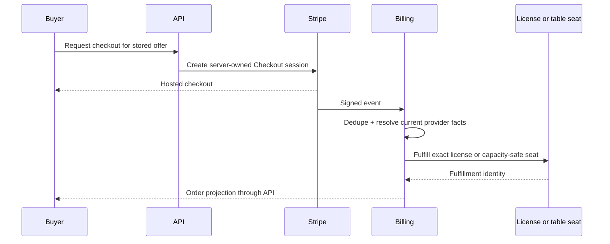

# Phase 7 — Paid Marketplace and paid tables

> **Status:** planned; commercial/legal decisions required before implementation
> **Depends on:** [Phase 4](04-entitlements-and-subscriptions.md), [Phase 5](05-social-hub.md), and [Phase 6](06-free-marketplace.md)
> **Unlocks:** creator and professional-GM revenue
> **Primary ADRs:** [0001](../adr/0001-package-boundaries.md), [0007](../adr/0007-authored-revisions-and-active-projections.md), [0008](../adr/0008-ruleset-identity-and-content-binding.md)

## Goal

Add approved web payment paths for single-seller Marketplace releases and paid table seats. Preserve immutable order economics, idempotent fulfillment, creator/GM payouts, refunds, disputes, taxes, and professional fee-waiver entitlements. Native paid controls remain disabled until each product's store-policy path is separately approved.

## Entry decisions

Do not write payment code until the business owner and qualified legal/tax advisors settle:

- Merchant-of-record and marketplace facilitator responsibilities.
- Supported jurisdiction, currency, tax collection, invoicing, and seller reporting.
- Seller eligibility, identity/KYC, prohibited content/services, payout timing, and reserves.
- Refund, cancellation, no-show, dispute, chargeback, and takedown consequences.
- Platform fee schedule and how Player, DM, DM Professional, and Content Creator Pro entitlements affect it.
- Apple/Google treatment of subscriptions, digital content, and paid table services.

## Requirements

- Use Stripe Connect hosted onboarding for creator/GM payout accounts unless a later provider decision replaces it.
- Use server-created checkout from stored listing/offering economics. Clients cannot submit authoritative price, currency, seller, fee, or fulfillment state.
- Limit v1 Marketplace checkout to one seller and one release per order.
- Snapshot release, license, seller, gross price, tax treatment, platform fee, provider fee policy, net allocation, currency, and terms at purchase time.
- Verify signed webhooks and process duplicate, delayed, and out-of-order events idempotently.
- Grant the exact release license only after confirmed payment.
- Model refund, cancellation, dispute, and chargeback effects without deleting financial history.
- Paid table offerings define session/seat scope, capacity, schedule, price, cancellation terms, and GM payout identity.
- Seat fulfillment is capacity-safe and correlated with the Social Hub application and Campaign/Encounter access.
- Fee waivers are resolved from internal entitlements and captured in immutable order economics.
- Apple Pay and Google Pay may be exposed through Stripe only in approved web/service-payment paths. Venmo remains deferred.

## Design

Content licensing and table-seat fulfillment share payment receipt/orchestration patterns but remain different product aggregates. A refund cannot be modeled as deleting a license, seat, order, or membership row.

## Ordered workstreams

1. **Record commercial decisions.** Convert the entry decisions into approved product policy and an ADR where they affect load-bearing accounting or provider boundaries.
2. **Define accounting contracts.** Model seller accounts, offers, checkout attempts, immutable orders/line economics, provider events, allocations, refunds, disputes, payouts, licenses, and table seats.
3. **Add Connect onboarding and eligibility.** Keep onboarding hosted and web-first; block paid publication until account requirements are satisfied.
4. **Add server-owned checkout and webhook convergence.** Store idempotency and provider object identities; never fulfill from a client redirect.
5. **Fulfill paid releases.** Reuse Phase 6 immutable release/license paths and record acquisition source as the completed order.
6. **Fulfill paid table seats.** Coordinate application, capacity, payment, access, cancellation, and payout status without overselling.
7. **Apply fee entitlements.** Resolve professional/creator fee waivers before checkout and snapshot their effect into the order.
8. **Build web administration and customer flows.** Cover onboarding, offer management, checkout, receipts, orders, cancellations, refunds, and operator diagnostics.
9. **Complete policy and failure validation.** Test signatures, retries, reordering, partial failures, stale prices, capacity races, refund/dispute cases, seller isolation, and reconciliation.

## Acceptance gates

- A client cannot alter price, fee, seller, currency, tax input, release, or seat scope.
- Duplicate/reordered webhooks converge without duplicate licenses, seats, refunds, or payouts.
- Failed or abandoned checkout grants nothing.
- A paid content order grants the exact purchased release and terms version.
- Paid table capacity cannot be oversold under concurrent fulfillment.
- Refund, cancellation, dispute, no-show, and takedown behavior matches the approved written policy.
- Seller A cannot inspect Seller B's customers, orders, balances, or payout state.
- Order economics remain immutable and auditable after plans or fees change.
- Native clients can consume existing purchases but expose no unapproved purchase link or CTA.

## Out of scope

- Multi-seller carts, subscriptions to individual creators, bidding, gifting, coupons, multiple processors, custom payout rails, non-US commerce, native paid acquisition without approval, and Venmo.

## Questions for the phase subplan

- Who is merchant of record for each product type, and which Stripe Connect charge model is approved?
- Is a paid table sold per seat, per session, Campaign period, or recurring schedule?
- When is a seat reserved: application acceptance, Checkout creation, payment authorization, or completed payment?
- How do cancellations, GM cancellation, rescheduling, no-shows, disputes, and Campaign removal affect access and payout?
- Which taxes, receipts, seller forms, support workflows, and reconciliation reports are mandatory?
- Which native purchase/link paths are approved in each storefront and region?

## New-session instruction

The first deliverable is a signed-off commercial/accounting decision record and a provider event state machine. Do not begin UI or Connect integration while merchant-of-record, tax, refund, and fulfillment rules are unresolved.
