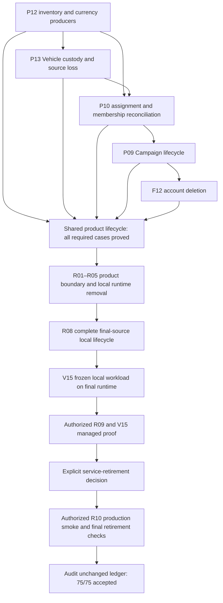

# Phase 8.2 — fixed remaining work

> **Current execution:** See the [living handoff](../handoffs/phase-08-2-convex-cutover.md) and [validation record](../validation/phase-08-2/README.md) for the regular checkout, declaration integration and latest scoped proof. The fixed ledger and this plan retain the 65/75 gate boundary.

Historical `.codex/validation/` evidence paths below are now available at `local-validation/` in the regular checkout. The old worktree is a retained backup.

## Goal

Close the remaining 10 cases in the unchanged 75-case ledger, complete the final-source local lifecycle and frozen workload, perform the bounded staging promotion, obtain explicit service-retirement authorization, and finish production smoke and retirement. The open cases are V15, R01–R06 and R08–R10; the current count is 65/75. Missing live Encounter movement is tracked under R06 ownership integration. V07, V10 and V13 retain their scoped feature acceptance; the combined current system remains unproven under R08 and V15. The acceptance JSON remains authoritative.

## Requirements

Preserve existing product behavior, shared contracts, privacy, transactional/replay semantics and creative capacity. Keep every required proof tier and release gate. Source or test changes invalidate affected release evidence. Current execution is local-only through the existing task container and volume. Staging/production promotion and service retirement require their separate explicit authorization gates.

### Accepted oversized inventory cleanup ruling — 2026-09-18

The accepted P12/P13/P10/P09/F12 lifecycle uses background cleanup for oversized inventories while
ordinary transfers remain atomic. The temporary spinner and read/write restriction apply only to the
affected bag, Vehicle cargo or currency group; unrelated inventory remains usable. Bounded durable
native scheduling preserves complete results, replay, privacy and integrity, including recovery after
account or source loss. This deliberately updates the uncapped aggregate-cleanup atomic guarantee;
frozen gate IDs, scenarios, proof tiers and thresholds remain unchanged. See
[ADR 0031](../adr/0031-oversized-inventory-cleanup.md).

### Campaign deletion ruling — 2026-09-23

The owner-confirmed Delete action uses one lifecycle for active and archived Campaigns of every size.
The first commit marks the Campaign **Deleting** and denies normal access; a bounded, resumable job
drains its captured live Session room, reconciles dependencies, and purges the data. The owner can
observe and retry a failed job. This replaces whole-Campaign atomic cleanup without changing the
complete cleanup requirement or any frozen gate. See [ADR 0032](../adr/0032-campaign-deletion-lifecycle.md).
Earlier P09 deletion proofs need affected revalidation against this source before final release.

## Design

## Build plan

### Next closure batch

Builder, initiative, custody, Campaign and account lifecycle cases retain their acceptance. The
current count is 65/75, with 10 open. Restore and verify the live Encounter movement authority
boundary under R06, then complete R01–R05 plus R08;
V15 local runs on that final runtime. R09, the managed V15 portion and R10 remain authorized
promotion work. Exact case status and evidence are maintained in the acceptance JSON and progress
tracker.

| Case | Next deliverable                                                                                                                                        |
| ---- | ------------------------------------------------------------------------------------------------------------------------------------------------------- |
| P02  | Accepted; Builder04 completes Fighter/Rogue, Cleric and Dragonborn with strict diagnostics and exact cleanup; see p02-root-session/accepted-proof.json. |
| V09  | Accepted; real native lifecycle, replay, contention and rollback/privacy proof is retained in v09-functional-validation-03/v09-acceptance.md.           |

The shared implementation must retain each issued decision and validate its current
audience, source, target, Scene and Run. Mechanics, response receipts, occurrence state,
Run state, token position and matching fog must publish atomically. A paused response
must preserve its evidence; an exact retry must not reroll or spend twice. Node geometry
preparation must not publish mechanics ahead of the final mutation.

Complete the implementation and focused correctness checks first, then activate that
checked source on the existing authorized local deployment and run the browser
and native transaction drivers serially. Their shared fixture writes prevent safely
running those two drivers together. Finish diagnostic review and exact cleanup before
acceptance. Preserve the existing proof tiers and R08 final-source lifecycle requirement.

Historical worker usage errors do not establish a current delegation block. The primary
chooses each worker's model and effort for its risk and dependencies, with exclusive ownership
for independent implementation and acceptance work. Profiles govern responsibility and boundaries.
Do not rerun passing evidence without a source change or a specific uncovered scenario.

Finish all functional deliverables before running the required performance gates or optimizing.
Performance criteria already included in the 75 remain open until verified. Address a performance
defect during integration only when it prevents a required operation from completing; defer broader
profiling and optimization until the complete paths are connected.

### Owner-deletion ruling — 2026-09-18

[ADR 0030](../adr/0030-owner-deletion-and-retained-dependencies.md) supersedes all deletion-only
third-party dependency restrictions. In the shared product lifecycle group, repair referenced-map,
Social, authored-parent/Spell and pending Encounter dependencies before activating native owner
content/Character/account deletion. FINISHED Session Runs remain history, including noncompleted
Runs. Preserve other owners' content, acquired inventory and shared history. Existing refusal cases
must become successful cleanup plus exact late-failure rollback/privacy cases; no gate is accepted
from the old refusal proof. Own Campaign transfer/deletion prerequisites remain as approved.
Independent implementation may run with exclusive ownership; shared source-frozen validation and
fixture-mutating journeys remain serial.

### Remaining delivery groups — current

The first gameplay and Builder/initiative batches are accepted. The remaining gates are grouped
by shared implementation and evidence, with separate acceptance for each unchanged ledger case.
This grouping replaces the former separate pre-removal local V15 batch: measure the final runtime
once after removal and complete functionality, rather than plan a measurement that later changes invalidate.
Managed V15 belongs with R09 after the complete local lifecycle; it is not a prerequisite to local runtime removal.

| Delivery group                | Cases                           | Internal order and completion point                                                                                                                                                                                                                                                                                                                                |
| ----------------------------- | ------------------------------- | ------------------------------------------------------------------------------------------------------------------------------------------------------------------------------------------------------------------------------------------------------------------------------------------------------------------------------------------------------------------ |
| 3 — Shared product lifecycle  | P12, P13, P10, P09, F12         | Settle shared custody producers and Vehicle identity/disposition; integrate source loss, assignment/member departure and ownership; complete Campaign lifecycle; integrate account deletion. Finish affected functionality before the complete combined journeys. Accept each case as soon as its complete original catalogue and proof tier pass.                 |
| 4 — Final local release       | R01–R05, R08, V15 local portion | Audit every product-data flow, retain the completed local runtime removal and R06/R07 review evidence, regenerate artifacts and fresh outputs, then run the complete ordered final-source local lifecycle and frozen local workload. One stable source and release manifest supplies each applicable case's evidence. V15 remains open until managed proof passes. |
| 5 — Staging promotion         | R09, V15 managed portion        | Obtain authorization against the completed local release manifest. Run one bounded managed packaging/integration/network/permissions/performance verification using the frozen scenarios and thresholds. Record the explicit service-retirement decision. Any application correctness failure returns to local coverage and lifecycle before another attempt.      |
| 6 — Production and retirement | R10 and final retirement checks | After accepted R09 and the explicit retirement decision, obtain the required production/retirement authorization, deploy, complete bounded smoke and final retirement checks, then audit all 75 cases. Local dependency removal never authorizes external service or production-data deletion.                                                                     |

P12, P13 and P10 share contracts and authority; parts depend on each other, rather than every
whole case depending on completed P12. Independent earlier work is retained. The remaining shared
producer/reconciliation seams are integrated together before full journeys, reducing repeated deployment
and setup while preserving every case. Begin the R01 boundary inventory during group 3 so an affected
product gate cannot pass with a remaining legacy product request.

At each group boundary, reconcile a bounded matrix against the acceptance JSON: implemented behavior,
applicable retained source/evidence, missing producer or journey, and uncovered ruling. Record actual
dependencies between slices, not just whole-case arrows. Resolve public contracts and behavior before
delegating independent work. Reuse one journey across cases only when it covers each required tier and
assertion; do not substitute aggregate test counts for full catalogue coverage.

Use focused checks for each root fix. Run official tooling and affected complete journeys after the
shared source stabilizes, serially where drivers share fixtures. During a real proof and its collector,
freeze its source and runtime outputs. Advance independent work only when it cannot invalidate that
proof. Do not repeat passing checks without an affected change or a specific uncovered scenario.
Subsequent relevant changes rerun from the earliest affected lifecycle stage and remeasure affected
performance; the grouping does not override freshness.

Only uncovered policy slices pause. Archived Campaign permanent deletion is approved for the canonical
current owner with ACTIVE OWNER membership, using the same explicit DELETE confirmation, root version,
moderation restrictions and background lifecycle as active Campaign deletion. Earlier 34-case atomic
deletion evidence is retained as historical proof; the affected native and browser cases require
revalidation against the unified lifecycle. Account-deletion history attribution is settled: shared
Campaign messages, rolls and Session history remain with the author shown as `Deleted user`; private
Characters and personal data are removed. The old Rule Studio and its GoRules pack-management code
are approved for retirement and deletion, preserving native System authoring. R08's fresh isolated
development proof must also be reconciled with the existing-container/volume-only constraint before
that proof; do not create replacement infrastructure or weaken isolation. The progress tracker records
these blockers and continues independent authorized work.

### Current custody batch

The affected Native matrix passed 121 cases in 23 files after fresh dependency builds. The public
Character custody driver also passes its Native adapter proof for a filled physical backpack moving
through Character, party and Vehicle owners with exact replay and complete inventory/audit reads.
Placement action checks pass seven frontend cases, and current web application/test types pass.
These are local implementation checks; real-backend lifecycle and complete affected browser evidence
remain required. Evidence: `.codex/validation/movement-replay-duplicates-20260916/custody-driver-public-01/`
and `custody-ui-placement-01/`. No gate is accepted by these checks.

| Slice              | Implemented / applicable evidence                                                                                                                                                                                                                                                                                            | Remaining acceptance evidence                                                                                                                      |
| ------------------ | ---------------------------------------------------------------------------------------------------------------------------------------------------------------------------------------------------------------------------------------------------------------------------------------------------------------------------- | -------------------------------------------------------------------------------------------------------------------------------------------------- |
| P12 physical items | One shared filled-container planner; native Character, party and Vehicle producers; pure 9-test planner/starting-equipment proof and focused mixed-owner checks                                                                                                                                                              | Native mixed-owner and placement coverage passes; complete real-backend retention/lifecycle and browser journeys remain                            |
| P12 currency       | qualified-currency-local-01 passes all ten directed owner-kind pairs and same-UUID namespace isolation; currency-lifecycle-local-02 completes currency-system conversion/removal across all five owners, original groups, exact BigInt values, refusals and cleanup; membership/source departure evidence remains applicable | Direct assignment/replacement departure, real post-write rollback, approved maximum workload and affected browser evidence                         |
| P13 Vehicles       | custody-local-04 proves return, destroy, unavailable/restoration, Player denial and retained cargo; authored-custody-deletion-local-03 and E20 prove automatic Vehicle source-loss applicability across every cause with original groups and qualified balances                                                              | Complete source-picker/catalogue applicability and affected rendered Vehicle lifecycle, reconnect, convergence and clean diagnostics               |
| Native web seam    | Complete paginated native inventory and pickers, exact transfer retry, current owner fences, native party actions and currency-system editor                                                                                                                                                                                 | Fresh bindings, application/test types and placement action checks pass; final official codegen/deployment and affected end-to-end journeys remain |

Current focused evidence is retained under .codex/validation/movement-replay-duplicates-20260916/ in
character-custody-native-01, character-item-native, inventory-query-proofs,
inventory-native-boundary-01, and currency-editor-native-01. These checks advance
implementation; they do not accept an incomplete gate or replace R08. No custody ruling remains
unresolved: filled-container contents travel with that physical unit, and unavailable Vehicles retain
DM access/restoration while excluding players. Acquired Equipment retention is already approved and
requires implementation before source-loss guards change.

### Fixed acceptance checklist

| Case | Remaining deliverable                                                                                   | Dependencies / actual restriction                                                                                                                                                   | State       |
| ---- | ------------------------------------------------------------------------------------------------------- | ----------------------------------------------------------------------------------------------------------------------------------------------------------------------------------- | ----------- |
| F12  | Native account deletion, authored cleanup, active-actor removal and shared-history retention            | Accepted evidence is retained in the ledger and progress tracker; final-source replay belongs to R08.                                                                               | Accepted    |
| P02  | Full Fighter/Rogue, Cleric and Dragonborn Builder journeys including finalization within backend limits | Builder04 passes all three journeys together with strict diagnostics, exact cleanup, current-token denial and no functional native errors; see p02-root-session/accepted-proof.json | Accepted    |
| P09  | Campaign create/update/archive/selectable background copy/delete lifecycle                              | Accepted evidence includes bounded copy jobs, cancellation/cleanup and owner deletion.                                                                                              | Accepted    |
| P10  | Membership, authority, source/currency reconciliation and privacy lifecycle                             | Accepted evidence is retained; final-source replay belongs to R08.                                                                                                                  | Accepted    |
| P12  | Character, party and Vehicle custody, transfers and currency lifecycle                                  | Accepted evidence is retained; final-source replay belongs to R08.                                                                                                                  | Accepted    |
| P13  | Vehicle transfer, removal, unavailable/restoration and source-loss lifecycle                            | Accepted evidence is retained; final-source replay belongs to R08.                                                                                                                  | Accepted    |
| V02  | Independent Scene authoring, hydration, live edit and reconnect                                         | Browser-26, managed auth review and exact cleanup pass; final release lifecycle remains R08                                                                                         | Accepted    |
| V06  | Native Worker collaboration and reauthentication                                                        | Real owner/player journey and exact cleanup pass; managed Worker packaging remains R09                                                                                              | Accepted    |
| V07  | Complete bound/standalone movement, reactions, stopped-path fog, undo and multi-client convergence      | Scoped feature proof retained. The new live authority integration gap belongs to R06; final-source combined verification remains R08/V15.                                           | Accepted    |
| V09  | Actor removal, immediate remaining-turn reorder and initiative-position reinforcements                  | Real Manual plus all four Automatic/Assisted actor/side/cadence lifecycles, exact replay, contention, rollback/privacy and cleanup pass                                             | Accepted    |
| V10  | Native actions, effects, reactions and selected optional-rule outcomes through browser controls         | Existing proof retained; the upstream movement routing refusal does not invalidate reaction logic. Dependent final-source journeys remain in R08.                                   | Accepted    |
| V11  | Decision audience, pause, response validation, resume and existing cancellation                         | Accepted at LOCAL_INTEGRATION; v11-acceptance-20260916/acceptance.md                                                                                                                | Accepted    |
| V12  | Complete GM/controller/player/outsider/departed privacy and redaction                                   | Accepted at AUTHORIZATION; v12-authorization-20260916/acceptance.md                                                                                                                 | Accepted    |
| V13  | Exact receipts, replay and reconnect across all new command paths                                       | Existing proof retained; the upstream movement routing refusal does not invalidate receipt/replay behavior. Dependent final-source journeys remain in R08.                          | Accepted    |
| V14  | Real same-aggregate contention and unrelated aggregate concurrency                                      | Accepted at CONCURRENCY; v14-acceptance-20260916/acceptance.md                                                                                                                      | Accepted    |
| V15  | Frozen local and managed workload simulation with original thresholds                                   | Run the local portion on the final R01–R08 source; managed proof remains part of authorized promotion.                                                                              | Open        |
| R01  | Verify every product-data flow uses Convex                                                              | Local boundary removal and Session DO authority/publication proof pass; complete the same-source R08 request/runtime catalogue.                                                     | In progress |
| R02  | Remove Supabase runtime dependency and verify retirement                                                | Local runtime/config/dependency removal passes; final R08 proof and separately authorized external retirement remain.                                                               | In progress |
| R03  | Remove Kysely/application SQL/migrations/generated Supabase types while preserving canonical corpus     | SQL runtime is removed, F15 remains accepted and the protected corpus matches; final native seed/audit remains R08.                                                                 | In progress |
| R04  | Remove GoRules runtime dependency                                                                       | GoRules/Rule Studio source and dependencies are removed; final native rule-corpus R08 proof remains.                                                                                | In progress |
| R05  | Remove tRPC and product Netlify functions                                                               | Local product functions, clients and durable compatibility are removed; final R08 journeys/request audit remain.                                                                    | In progress |
| R06  | Session Durable Object active live-command authority                                                    | Complete heavy live fact preparation and rule evaluation in the DO, with ordered, validated atomic Convex commits; see ADR 0029 clarification.                                      | In progress |
| R07  | Final canonical guides, ADRs, ERDs, runbooks and links                                                  | Final-source reconciliation and refreshed 436-link/54-anchor audit pass.                                                                                                            | Accepted    |
| R08  | Complete fresh final-source development lifecycle and retained release manifest                         | Official artifacts, serial fresh builds, every current package check, Convex seed/audit, native transaction/replay/rollback/privacy and complete local E2E must pass together.      | Open        |
| R09  | One bounded staging packaging/integration/performance promotion and retirement decision                 | R08 green; return any correctness failure to local; explicit retirement approval                                                                                                    | Downstream  |
| R10  | Production deployment and bounded smoke                                                                 | R09 accepted and explicit retirement decision; final retirement checks afterward                                                                                                    | Downstream  |

### Historical implementation ownership

The workstreams below record the completed product batches. Current work is the final R01–R08 cutover and release lifecycle above.

- **W1 — primary:** Convex Scene preparation/final mutation, bound movement orchestration, movement/reaction and forced-movement integration, common Encounter dispatcher/projection seams, CampaignVttStage routing, integration acceptance decisions. Primary currently also owns the correction to Scene undo selection.
- **W2 — Worker integration:** `apps/session-worker/src/**`, `apps/session-worker/test/**`, Worker/test configuration, `apps/web/tests/live-backend/sceneLive.ts` and dedicated real-native-room browser helper. Preserve the `LiveSessionRoom` binding identity and current wire protocol. Do not substitute mocked sockets for V06.
- **W3 — native actions:** new `apps/apis/convex/encounters/action*.ts` implementation/tests and action-owned neutral runtime modules. Existing shared action DTOs are unchanged. The native entry contract is `executeNativeEncounterAction(ctx, command): Promise<EncounterCommandResultDto>` for RESOLVE_ACTION and action-owned RESOLVE_RULE_OCCURRENCE. Primary routes common commands and owns spatial publication. Only RESOLVE_ACTION may be added to the existing occurrence-backed Run-command enum; other common contract changes return to primary.
- **W4 — acceptance implementation:** new cutover privacy/concurrency tests, `apps/apis/tests/developmentEncounterTransactions.ts` and dedicated acceptance driver modules. Preserve frozen scenarios/thresholds; report missing producers instead of replacing their acceptance with mocks. No edits to production command implementations.

Builds are serialized by primary so concurrent validation never observes changing package outputs. Independent tests and implementation advance during verification. Workers retain complete logs and source backups and report completed scenarios, missing dependencies and actual blockers. Primary inspects source and evidence before accepting work.

The managed Scene and Encounter drivers also run serially: both bootstrap shared System fixture
data, even when their Campaigns differ. Browser-20 correctly rejected a Scene command whose vision
dependencies changed during real-07's System import. This does not permit weakening freshness fences.
Local implementation and isolated checks may proceed alongside a managed journey; shared builds wait
until that browser exits.

### Current integration state

R06 implementation and review are in progress. The user reaffirmed that heavy live rule evaluation
and fact preparation belong in the DO because the real workload exceeded Convex execution and size
limits. The Character-in-Convex amendment governs writes; it does not place heavy live Encounter
computation in Convex. V15-20260924-05 also exposed the missing live Encounter movement path: the DO
rejects it while direct Convex movement is fenced. Complete ordered DO evaluation with authorized
stored inputs and validated atomic Convex commits as recorded in ADR 0029. The earlier alternatives
retaining heavy evaluation in Convex are superseded. Full V15 and final-source R08 proofs remain open.

The 2026-09-21 live-session correction removes the periodic same-token authentication heartbeat.
Sockets authenticate on connection and refresh only after JWT expiry or an explicit Worker challenge.
Campaign departure and account deletion now schedule exact-user eviction; Session finish and Campaign
archive/delete schedule room closure through the shared private control path. Auth-account
suspension/deactivation and administrative auth-session revocation must use that same path when those
producers are added. Sign-out and password/security actions close the browser socket; Social profile
suspension remains separate and preserves Campaign access. Shared-party fog is the current local and
remote default; recipient-specific fog is retained for DM preview and a future explicit remote setting.
Focused Worker lifecycle tests pass 31/31, web client tests pass 7/7, Worker/Convex/web types pass and
official local codegen/deploy pass. The retained token checkpoint
`vtt-token-drag-event-auth-diagnostic-01` completes with native exit 0, completed collector, unchanged
5997-entry source, 564 ms ephemeral delivery and 737 ms durable convergence. This single pair earns no
R08 or V15 credit; fog preview/convergence is next.

The current 2026-09-15 packet adds native Character-source maintenance proof and Scene movement
maintenance forecasting/publication to the earlier direct-action and turn integration. Automatic and
Assisted Encounter actor movement journeys prove ordered replacement/condition cleanup, pending stale
refusal, valid resume, rollback and replay. Cleanup state and owner-version receipts continue the exact
spatial timeline; raw receipts stay internal. Compiler fixes align recurring dice-heal graph identity
and reuse the existing validated movement-reaction activation policy for recurring saves.
Commands and source identities are retained in
`.codex/validation/movement-maintenance-20260915/integration-evidence.json`.
The follow-on native Scene proofs cover present/detached Character owners, independent condition
causes, coalesced mechanics/cleanup increments, actor/snapshot mirrors, and cumulative detached-owner
versions across a non-pausing passage. The passage regression detects the reviewed omitted forecast
argument; exact production source is restored. Combined evidence is retained in
`.codex/validation/movement-maintenance-owners-20260915/integration-evidence.json`.
Concentration now has canonical c3 maintenance publication linked to c2 and rule-scoped feature save
modifiers. Native direct/Cleaving damage coordinates Automatic and Assisted child checks, exact
currentness, cleanup and replay. A single sealed Cleaving choice may follow those checks; ordinary
Constitution saves exclude Concentration-only modifiers. Local publication, modifier, native child and
handoff evidence is retained in `.codex/validation/concentration-integration-20260915/`.
The next local packet, `.codex/validation/turn-concentration-20260915/`, contains applied damage
normalization/ordering groundwork and the rule-reference authoring selector. After the risk explanation,
the user approved local application and testing of the terminal turn/Assisted continuation/replay
patch. It is applied; all four public turn scenarios and the expanded 142-test/17-file regression
pass, as do both API typechecks, the API build and 14-file format/lint. Shared lifecycle coverage
exposed and corrected terminal replay selection and detached Character condition hydration; old
Campaign reads cannot load private conditions from a later assignment. The ownership-transfer
fixture restores assignment before continuing play. Final commands and source identities are in
`integration/integration-evidence.json`. Earlier rejections/red proof are historical.
Personal development is dedicated to this pre-live migration and should mirror checked local source,
contracts, fixtures and journeys; application failures must be reproduced and fixed locally.
Independent inventory proof now uses `developmentDrafts.ts --campaign-inventory` and the same
public-command driver through the native local test adapter. It verifies party/Vehicle transfers,
every transfer's exact replay and audit/version change, player reads, exact/lossy conversion and
guarded fixture cleanup. It now adds public owned-Vehicle publication/share/unshare, cargo evacuation,
retained unrelated custody and source-loss receipt replay. The earlier transfer-only checkpoint is
`.codex/validation/campaign-inventory-proof-20260915/`; current combined checks are in the turn packet's
`integration/` directory. Development activation was previously rejected by automatic review for
private-source upload authorization; assess it after the approved local checks pass. No activation or
authenticated HTTP inventory run occurred. Real selected-development and complete P12 lifecycle
evidence remain open. Remaining contextual outcomes, public action/browser journeys
and the final-source lifecycle remain.
Following the green local gate, official code generation was also rejected before execution for the
private-source upload. A fresh deployment guard passed; explicit approval for the verified source
upload, generated-contract refresh, activation after local recheck and disposable inventory proof
remains pending. The rejection is retained in `turn-concentration-20260915/development/` under
`.codex/validation/`. This attempt changed neither generated source nor the hosted backend.
The fixed ledger remains 52/75; no whole case or release gate is accepted from this implementation packet.

The subsequent movement Concentration packet **passes its scoped local integration gate**. The user approved
the concrete coordinator and schema corrections in
`.codex/validation/movement-concentration-20260915/approval-review/proposal.md`; earlier automatic-review
rejections no longer block those local edits. Root/child identity wiring, per-contact preparation and
ordered cleanup settlement are applied. The final run passes 132 tests across 31 files, four
package/Convex typechecks, fresh schema/runtime/API builds, format/lint for 39 files and the scoped diff
check. Six native Concentration Scene journeys cover modifiers, shared hazard lifecycle, controller
privacy, stale refusal, rollback and replay. Shared-hazard proof
also exposed and corrected an absent reaction target Character binding and a spatial-pause validator
that rejected a valid committed prefix followed by uncommitted execution evidence. Failed checks are
retained. Ordered commands, source identities and limitations are recorded in that packet's
`integration/integration-evidence.json`. The earlier
turn/forecast gates do not validate this changed source. Development-upload approval remains separate;
the user's intended development environment mirrors the complete verified local source and fixtures.
Native Disarm passes its scoped backend gate under `.codex/validation/native-disarm-20260915/` with
explicit local coordinator/testing approval. The shared helpers, preparation, Character/Creature
settlement, participant authority and exact replay pass 85 tests across 15 files, four typechecks,
fresh schema/runtime/API builds, format/lint for 24 files and the scoped diff check. The final manifest
retains source identities, failures and corrections. The follow-on client packet is now implemented in
`.codex/validation/disarm-client-20260915/`: OWNER-only native action/optional-choice queries reuse
the same Disarm preparation and descriptor, and the tabletop consumes issued choices for Character
and Creature sources. Native fixtures now discover choices through public queries. The final combined
gate passes 62 native tests, four Chromium drawer stories, seven typechecks, fresh schema/runtime/API
builds and 15-file format/lint on unchanged source. The stories prove exact intent, Creature submission
and stale-response isolation; they are not a live Stage/backend journey. Official generation and its
TypeScript check now pass against the isolated official Linux backend. Its current loopback endpoints
use 3210/3211, matching the official container ports for Node callbacks. The
Windows executor's symlink failure remains an environment limitation. The Linux run exposed test-only
fixtures in the deployment directory and an oversized Scene pending validator; fixture relocation and
reuse of the four already-allowed movement schemas pass 43 fixture tests and 34 movement tests.
Retained evidence is in `.codex/validation/local-convex-linux-20260915/`. Seven generated-consumer
typechecks, builds, static API checks and real local foundation HTTP proof pass. Regeneration adds
only the approved c3 Concentration definition to the canonical manifest. Canonical seed/audit now
pass with 1 System, 1,051 subjects and 51 definitions. The existing local R2 protocol server runs
inside the container on host-loopback port 8026; map upload/finalization/delivery and its default
transport regression pass. Initial action/reaction runs found fixture Campaign quota and catalogue
setup defects; local corrections reuse the Campaign and admit the published policies before Run
start. Real action contention/replay passes in `action-transactions-02`. Reaction attempt 04 exposed
fixture privacy and participant-cleanup assertions; corrections pass ten cleanup tests and local
activation. Exact failed-fixture recovery and scheduled physical deletion pass; the local R2 server
now serves the allowed browser origins. Action-effect save/privacy/replay passes in
`effects-transactions-01`. The completed native `reaction-transactions-10` now passes contention,
exact replay, redaction, mechanics and guarded fixture cleanup on local `deploy-12` source. Its
corrections preserve critical-damage inputs, unchanged-version evidence receipts, persistent
exploration and exact GM-authored Character receipt ownership. Initial movement reuses verified
Scene reads within one transaction; Passage options share current System and allowance reads.
Complete Character catalogue resolution remains intact. Browser attempt 07 commits initial movement
without backend errors, then outlasts a 30-second assertion during Scene hydration. The functional
driver now uses its existing 90-second hydration allowance. The indexed participant reader and
sealed-contact perception capture are active in local `deploy-14`; 17 affected tests and Convex types
pass. Browser attempt 11 displays the choice and selects Overrun, then its initiator d20 reaches the
one-second `scenes/spatialPreparation:prepare` limit. Passage preparation now loads complete mechanics
for the mover/blocker first and the other actors before successful continuation. The Run-wide
Character identity guard, 19 affected tests and Convex types pass. Participant currentness and
continuation validation remain. Browser 12 completes initiator evidence and enforces defender-only
privacy, then exposes missing Character reaction sources when movement resumes. Both Passage loads
now preserve those sources and staged allowance use; 11 Passage tests and types pass. Local deploy 16
includes that correction. Browser 13 instead aborts initial preparation at the one-second limit.
Initial reaction loading now uses one complete validated actor read instead of duplicating it.
Browser 14 passes initial movement but its pending-occurrence query aborts while selecting Passage.
Both pending snapshot schemas now dispatch on their existing required `snapshotKind`; 34 targeted
tests pass and generated native validators are identical. The Disarm real-backend driver passes on
deploy 17: public discovery, participant authority, item/ACTION settlement, receipt agreement, replay
and exact cleanup. Evidence is in `.codex/validation/disarm-live-driver-20260915/functional-evidence.json`;
the VTT action and evidence browser journey remains.
Browser 15 reaches defender resolution but final publication aborts while duplicating current Character
reads for next-choice revalidation. The guard now receives original targets from the same evaluation,
separate from projected allowance/effect changes; final commit still loads fresh facts.
A broader context-reuse patch was rejected and not applied.
Complete Passage/reaction browser/reconnect proof, the full
contention workload and final local lifecycle remain open. Performance profiling is deferred until
functional integration is complete; no whole-case acceptance is claimed.

Ordinary movement-reaction effects are now connected to Scene forecasting and atomic publication.
The native Creature journey creates a repeated-save condition through Automatic and Assisted reactions
and advances its actual turn lifecycle. Character journeys preserve independently owned conditions,
prove provisional rollback and exact replay, and carry sequential effect ordinals through an automatic
contact followed by a pending-choice contact. Nested-save compiler binding and interpretation defects
found by those journeys are corrected, with failed/successful save, immunity and tamper proofs.
Scoped source identities and commands are retained in
`.codex/validation/movement-reaction-effects-20260914/integration-evidence.json`.
Maintenance, remaining contextual outcomes, browser/managed journeys and the full final-source lifecycle
remain open. This packet leaves the fixed acceptance count at 52/75.

The local mixed spatial/reaction coordinator now retains applied prefixes across selected and
automatic actions, Assisted spatial evidence, Legendary Resistance, and STOP. Scene finish dispatches
verified spatial/action plans in contact order, preserves cumulative receipts, and records only the
current command's Character version spans. Actual Scene journeys cover spatial work before, between,
and after reactions; retained system dice; preparation without mechanics writes; rollback; and exact
replay. Contact-order assertions use observed fixture geometry. The integration evidence lives in
`.codex/validation/scene-spatial-coordinator-20260914/`; its scoped verification is not the R08 lifecycle.
Passage continuation, the complete browser/privacy/contention journeys, and the managed finish CPU
failure remain open. The acceptance count stays 52/75.

The current functional completion work includes native initiative declarations, Recharge, Legendary
Action choices and Cleaving decisions, plus contextual action/effect execution. These remain part of
V10/V11 and their related privacy/replay coverage. Distance-based action targeting is connected locally;
its Automatic and Assisted native journeys now pass, including rollback, exact replay, uppercase
immutable token IDs, current token overrides and removal. Scoped format, lint and review also pass;
the retained packet is `action-scene-integration-20260914/contextual-action-evidence.json` under the
local validation directory. Native initiative declaration continuation now passes Automatic and Assisted
settlement, EACH_ROUND reissuance, exact retries, enclosing rollback, cohort/source-round refusal and
current Character-controller privacy. The GM, player Session and tabletop expose prepared decisions
through the existing drawer; local component journeys pass. Native Creature/Spell sources, exact Spell
publication pins and republishing refusal, and terminal completion by either of two current Character
owners now pass. Scoped backend/web types, formatting, lint, the action/Run integration and response
bridge checks pass. Ordered evidence and source hashes are retained in
`initiative-declaration-integration-20260914/integration-evidence.json` under local validation.
Native Recharge now uses the same staged turn completion boundary: Automatic server dice, Assisted
owner evidence, multiple Feature candidates, exact response/root retries, retained terminal dice and
all-or-nothing charge/initiative/Run publication pass. The combined native run also preserves Manual
result shape and ordinary advancement after an unrelated Character Sheet edit. Its scoped evidence is
`turn-recharge-integration-20260914/integration-evidence.json` under local validation.
Native Legendary Action choices now retain ordered owner decisions, Assisted d20 evidence and
incoming pool refresh through ordinary and declared EACH_ROUND initiative and Recharge. Combined
native journeys preserve ordinary initiative, unrelated Character Sheet edits, exact replay and
atomic terminal publication. Cleaving now connects the finalized attack to bounded child choices,
including current Character-controller privacy, post-consumption source pins, stale-choice refusal,
decline after geometry changes, replay and rollback. Both use the existing tabletop decision drawer.
Scoped integration evidence is retained under `turn-legendary-integration-20260914/` and
`cleaving-completion-20260914/`. Remaining action/effect producers, actual browser journeys and
the complete release lifecycle still precede V10/V11 acceptance. The ledger remains 52/75.
Native action effect creation now has local public-command coverage for save success/failure,
immunity and Character effect-only creation/retry, plus shared relationship ownership/path coverage.
Final source checks are retained under `action-effects-integration-20260914/`. The user explicitly
approved the complete turn integration on 2026-09-14. It is applied, and the combined native effect,
initiative, Recharge and Legendary journeys pass, including cross-phase replay and rollback.
Formatting/lint, backend Turbo types and ordinary Manual/actor/side initiative checks pass; ordered
evidence is in `turn-effects-integration-20260914/approved-integration-evidence.json`.
The shared public action-effect driver and exact fixture cleanup proof pass locally under
`action-effects-public-20260914/`; `--encounter-effects` is wired but its managed invocation has not run.
Remaining producers, browser/managed
journeys and complete release gates remain open; no case was accepted by these local checks.
The Passage browser blocker
is now `scenes/spatialPreparation:prepare` exceeding the managed CPU limit before finish. The duplicate
initial-finish catalogue load was removed and its local checks passed; preparation remains unresolved.
Broader workload/performance testing is deferred until the functional command paths are complete.

The local native Passage integration is now complete through Scene spatial/reaction/Legendary Resistance
continuation: Overrun/Tumble choice and decline, Automatic and Assisted two-d20 evidence, ordered
continuation, retained exact replay, no-spend-before-terminal, same-mutation rollback/retry, current
Character-to-actor privacy and endpoint-footprint boundaries all pass. Fresh format/lint, shared/schema/
rules-runtime builds, official codegen, API/Functions/runtime typechecks, 15 native files and shared/schema
contracts are green from source manifest `f1668aaa3831a69f53d3fd731b513997bafc8823ba04a2850f4676002c55d7b6`.
Evidence: `.codex/validation/scene-passage-coordinator-20260914/local-integration-evidence.json`.
This is local implementation evidence only: browser Passage/combined frozen journeys, the original managed
initial MOVE CPU failure, the full workload and R08 remain open; no acceptance case is closed.

Real-07 passed Manual/Automatic/Assisted lifecycle, actor removal, Scene binding and forced rollback
proofs, then failed during movement contention when its HTTP JWT expired. Its exact cleanup passed.
The driver now refreshes owner authentication before fixture preparation and refreshes both independent
contenders immediately before contention. Browser-21 passed authoring but stopped because its launcher
omitted the documented local Worker endpoint. Browser-22 restored that endpoint and exposed a pointer
backlog before JWT-expiry coverage: owner pointer samples continued draining while player samples waited.
The local workerd reproduction observed 82 authority captures for one in-flight sample plus 40 queued
samples. Coalescing pending pointer samples reduces this to four while retaining both authority captures
per processed sample and every ordered token-drag segment. Native Worker proofs pass; the complete real
journey remains open. Evidence: `.codex/validation/native-pointer-backlog-20260913/`.

The public Assisted action path now passes local TEST/OUTCOME continuation, no-spend-before-terminal,
GM-only pending reads, stale source/target rejection, response-conflict refusal, exact replay and enclosing
transaction rollback. Normal package-resolution action/continuation checks pass after a fresh schema
build. Official codegen, affected API/Functions/runtime/Worker typechecks, Character transaction
proofs and strict scoped lint pass. The checked source is active on personal development; the
complete Scene journey and final R08 lifecycle remain pending. Evidence:
`.codex/validation/assisted-public-actions-20260913/`. No acceptance count changes follow from these
implementation checks; the ledger remains 50/75.

The user explicitly approved the local Assisted-action, custody-transfer and actor-removal work,
temporary personal-development fixtures and cleanup, and exact read-only asset observations.
The earlier automatic approval blocks are resolved; no repeat approval is required for that scope.

P12/P13 native party/Vehicle item and currency transfers are implemented. The user also clarified
that a nonempty bag must transfer with its contents. The native whole-container transaction now
preserves nested items, empty and populated currency groups, balances and internal placement while
detaching only the root. Its local proof passes for party-to-Vehicle, Vehicle-to-Vehicle and return
to party, exact replay after later moves, owner versions/audit and enclosing rollback. The same
proof rejects cycles and inconsistent currency placement without writes. Evidence is retained in
`.codex/validation/container-transfers-20260913/`; `focused-01.log` passes all eight transfer cases
but its separate concentration fixture failed and was repaired afterward. Partial nonempty-stack
allocation, Character custody/currency identity and nonempty Vehicle removal remain unfinished.
The complete P12/P13 lifecycle and release gates remain open; no acceptance case is added.

Assisted Character-source proof now covers entered healing evidence on self and system-rolled
evidence on a separate actor, preserving resource holds, Character currentness, rollback and replay.
Browser attempt 23 passed bidirectional pointer fanout before and after actual JWT expiry/renewal,
live edits and private-token exclusion. Its later offline check exposed expiry of the separate
HTTP fixture client's token; the driver now refreshes that client before the disconnected update.
Browser attempt 24 passed actual JWT renewal, offline reconnect and reload, then failed departure
reload and cleanup. The exact cleanup failure reproduces locally and is repaired for one verified
player-departure receipt, with foreign-receipt refusal and transaction rollback. Map delivery now
refreshes before its five-minute URLs expire. The Tabletop loader uses the existing not-found state
for missing Campaign access while preserving unrelated failures. The browser driver requires the
departure response to be 404 and no Scene or new Worker admission. It retains deliberately induced
offline, stale-snapshot and access-denial diagnostics separately; map, CSP, HTTP 500 and unrelated
errors still fail. Focused native/route checks, official generation, affected types, driver types and
strict lint pass. Evidence: `.codex/validation/scene-browser24-recovery-20260913/evidence.json`.
The native repair and command-reservation index were activated on personal development at
2026-09-13 19:00 UTC. Exact Campaign, Session, membership, event and both account/profile cleanup is
verified; exact physical media cleanup passed after the original fences. An independent Chromium 404
probe also reproduced missing nonce headers on SSR error responses. The Start middleware now applies
the unchanged policy to its returned response, and the app typecheck includes that entrypoint.
Chromium verifies matching header/script nonces and no CSP errors; types and lint pass.
Browser attempt 25 now passes the complete owner/player Scene journey: live edits, private-token
exclusion, actual JWT renewal, bidirectional previews, offline recovery, reload and departed-player
HTTP 404 with no new Worker admission. Unexpected browser diagnostics and legacy requests are empty;
exact fixture/account cleanup and physical media deletion pass. Managed log review found eight
exhausted Better Auth rate-limit writes, all on public JWKS key reads. The local HTTP reproduction
confirms those reads write a shared counter. The selected correction uses supported static JWKS
while preserving all rate limits. Local HTTP proof verifies existing/new JWTs and retained public-key
and sign-in throttling. The user approved copying the exact currently published key into the secret
JWKS setting on the same personal-development deployment. The guarded copy and activation completed
at 20:18 UTC. Browser attempt 26 passes the complete journey with no public JWKS calls or exhausted
auth limiter writes. Exact fixture/account and physical map cleanup pass after the unchanged fence.
V02/V06 are accepted at LOCAL_E2E; R08 remains open. Evidence:
`.codex/validation/phase82-scene-live-acceptance-20260913/acceptance.md` and
`.codex/validation/jwks-read-contention-20260913/`.

Real contention attempt 08 completed the shared Manual/Automatic/Assisted lifecycle, Scene entities,
rollback, command/binding/presentation/ownership/Session-finish schedules and bound-movement
contention/replay with exact fixture/account cleanup. Exact physical map cleanup also passed
after the original upload/cleanup fences.
The acceptance audit found the missing explicit unrelated-aggregate assertion: two authenticated
clients must concurrently update distinct Scenes, each advancing once, with exact replay and no
Run change. That assertion is now in the shared driver and passes format, lint and proof types.
The first local execution timed out while the browser proof was active. The corrected shared
lifecycle now passes locally without the browser workload. Real attempt 09 passed the same driver,
including both unrelated Scene writes and exact retries with no Run change. Exact fixture/account
cleanup and physical media deletion also pass. Its historical public-JWKS limiter failure is resolved
by the verified static-key correction. V14 remains open for the complete frozen action/reaction
contention workload, which depends on unfinished command producers. Evidence:
`.codex/validation/phase82-unrelated-concurrency-20260913/` and
`.codex/validation/phase82-ultra-continuation-20260911/workstreams/v14-real-20260913/real-09/`.
Native Assisted evidence IDs now reserve the Campaign command namespace across Runs. A reproduced
collision is refused before a new root is staged and by the common Run-command insertion path;
exact evidence retries retain their existing response. Public action/command, bound movement and
lifecycle checks, native types and strict lint pass. The retained source hashes and ordered checks
are in `.codex/validation/assisted-command-reservation-20260913/evidence.json`.

The native pending-movement audience proof now exercises public ownership request/accept and
membership departure. It verifies current GM access, player/outsider/anonymous/departed refusal,
private snapshot exclusion, stale Campaign/Run/root rejection and unchanged Run/actor state.
Its first concurrent execution timed out; the quiet rerun passes at the unchanged timeout, together
with formatting, strict lint and native types. Evidence:
`.codex/validation/movement-decision-privacy-20260913/evidence.json`. Complete V11/V12 scope remains open.

Docker Desktop startup was repaired by preserving only its stale, zero-byte socket directories;
the daemon readiness check passes. Existing containers, volumes, settings and stored secrets were
not reset. This is environment recovery, not Scene acceptance. ADR 0029 already permits real
backend integration and browser journeys on the selected personal development deployment after
the affected source checks; a separate local Convex container is unnecessary. The original handoff's
full-lifecycle-before-activation sequence belonged to V03, which is now accepted. ADR 0029 permits
unfinished source on personal development; R08's complete final-source lifecycle remains mandatory
before staging. V02/V06 are now accepted; all release gates remain open.

Official personal-development codegen refreshed the native bindings. Its typecheck exposed a Scene
result tuple mismatch, corrected by parsing the mutation result through the existing shared result
schema. Codegen/backend typecheck, web typechecks, affected ordinary/reaction Scene proofs and scoped
lint pass. Source/generated hashes and ordered logs are retained in
`.codex/validation/phase82-ultra-continuation-20260911/workstreams/reactions/approved-codegen-20260912/evidence.json`.
V02 no longer depends on stale generated references. Its browser journey and the complete final-source
release lifecycle remain open; acceptance remains 50/75.

The V02/V06 browser driver now covers an owner-browser live edit reaching the connected player,
private-token ID/label exclusion, actual JWT expiry with a fresh token on the same Worker socket,
bidirectional previews, offline update recovery, fresh-ticket reconnect and departed-player refusal.
The local Vite sign-in and native Worker health checks pass with matching personal-development
credentials. Personal-development activation passed and real browser attempts have begun;
Scene authoring create/edit/reload and exact fixture/account cleanup pass. The browser helpers now
use the existing functional budgets and click Mantine's visible Edit label. Both clients rendered
in browser-07, but its Worker traffic assertion failed. Bounded socket diagnostics traced this to
Yarn injecting the base checkout's staging endpoint into the proof process, while both real clients
connected to the local Worker. The launcher now pins this worktree's environment file. Browser-10
confirmed real local Worker sockets and player receipt of owner pointer previews. The assertion now
requires an exact envelope sent during the current gesture, since transient delivery does not
guarantee every pointer sample. Browser-13's secret-free frame diagnostics establish that the missing
direction is player-to-owner during heartbeat reauthentication. The native Worker unnecessarily
invalidated a still-live admission during same-token renewal. A local reproduction fails on the old
code; preserving that generation during renewal passes the native Worker suite, including deadline
expiry, hibernation and a newer membership denial superseding delayed authentication. Worker types
and focused lint pass. Browser-14 proved both directions but exposed a Router devtools control covering
the editor Save button; the app now places devtools below modal overlays. Browser-15 saved successfully
but opened the player's menu before recipient rehydration remounted it. The verifier now waits for the
visible new Scene version before opening controls. Browser-16 proves the live edit, private-token
exclusion and actual JWT expiry/refresh on the same socket. Its following gesture failed during a
retained 10-second upstream JWKS request timeout. The fanout proof now drives a continuing pointer
gesture within the unchanged 30-second delivery budget and still requires an exact sent envelope at
the other client. Browser-17 passes that gesture after actual JWT refresh, then fails its offline
Convex socket assertion. A short Chromium reproduction isolates the verifier's routed socket:
closing either or both forwarding sides does not emit the counted native network-close event.
The verifier now retains the browser's actual Convex socket, closes it directly and observes real
close/open events. The focused disconnect/reconnect reproduction, web proof types and lint pass;
evidence is in `.codex/validation/scene-offline-race-20260913/`. Browser-18 also passed JWT renewal
and pointer exchange, then exposed tsx's external function-name helper in the serialized browser
init script. The verifier now supplies a literal script, checks its installation before the long
JWT wait, and passes a real local close/reconnect probe using that exact source script. Browser-19
passed authoring, live editing and actual JWT renewal, then failed player-to-owner preview delivery.
Local reproductions show traffic cancelling pending authentication and an old-token capture failure
revoking a newer admission. The Worker now coalesces pending same-token checks, preserves their
deadline, and fences queued previews/failures by authentication generation. The complete native
Worker suite passes with expiry, membership, hibernation and privacy checks retained; evidence is in
`.codex/validation/native-renewal-race-20260913/`. Reconnect and membership revocation still require
the full browser journey; no V02/V06 acceptance is claimed.
Read-only provider observations confirm physical deletion of the exact browser-04,
browser-05 and Encounter real-01 assets. Approved later observations also confirmed physical deletion
of exact browser-11 asset `b648b432-db9d-4768-9e77-fb02ad1e12cd` and Encounter real-02 asset
`45701a0f-ad7e-4692-b869-f04ec43816a5`. Other later assets still require their exact observations.
Exact browser-11-live through browser-16 prefixes are now physically empty. The final browser-16
observation is retained in `.codex/validation/phase82-scene-provider/106031d9-a6ea-45ac-bd32-42c6ffd9db3c.json`.
No retention deadline was shortened and no provider object was manually deleted. Browser-17 asset
`9226859b-a082-48d8-b569-476f4da42a14` is also physically empty; its exact observation is retained in
the same provider packet. Browser-18 account/Scene cleanup succeeded; its exact asset
`dfd1eea8-b4d7-4804-a0da-2a302c1bc780` and real-04 asset
`de1ffb3b-7053-4b68-9617-c77cef24d25d` are now physically empty after their operation fences.

At the 2026-09-13 checkpoint, tabletop movement, undo, Encounter controls and the action drawer
dispatched directly to Convex. Current Door, standalone token move/undo and live Character routing is
superseded by the Session DO authority recorded above; other Encounter controls remain Convex-owned.
The focused browser stories passed for unbound and bound movement with their respective version fences,
undo, actor-token binding, turn advancement, staged fog, player privacy and native action feedback.
The story transport rejects product commands sent through the Worker. Evidence and source hashes are
retained in `.codex/validation/native-tabletop-integration-20260913/evidence.json`; these mocked stories
do not replace the real Scene journey or the unfinished public movement/action coordinators.
The separate real Encounter proof hit Convex's system-operation timeout. Instrumented real-02
locates it in Automatic Side Roll / Each Round / Advance Turn's first continuation. Independent
publication reads in Builder preparation now run together, preserving ordered assembly and all
validation. Focused catalogue checks, backend types and lint pass; personal-development activation
passed. Real-03 stopped during authentication with HTTP 429 before any Encounter scenario; retry
timing must respect the configured authentication limit. Automatic approval review rejected real-04
before process launch. The user subsequently approved creating and cleaning personal-development
authentication and Encounter fixtures. After the current shared local actor-removal lifecycle passed,
personal-development activation succeeded. Real-04 passed the Manual lifecycle, all four
Automatic/Assisted actor-removal journeys, Scene entities, rollback and concurrent command/binding/
ownership/Session-finish schedules. Its final contention fixture omitted a frozen initiative policy;
cleanup then rejected the added second Session and seventh Run. The exact fixture IDs are retained
for recovery. Local coverage now includes that complete setup, public bound movement, missing-Session
and stale-Encounter refusal, one contention winner, exact replay and complete cleanup. The public
geometry entry point now permits bound movement with its required Session context and existing
authoritative spatial checks. Cleanup permits at most six first-Session Runs and one second-Session
Run, verifies presentation receipts separately for each Session, and preserves ownership guards.
The complete local journey, cleanup/standalone refusal checks, types and strict lint pass.
Personal-development activation succeeded; exact real-04 recovery and read-back verified the
Campaign, Sessions, Runs, Scenes, Character, Blueprint, policies and both account profiles absent.
Its exact map prefixes are also physically empty. Real-05 stopped during
authentication with HTTP 429 and cleaned its accounts. Installed Better Auth limits sign-in to three
requests per ten seconds; independent journeys must stagger fixture authentication. Real-06 passed
the lifecycle and transaction schedules, then exposed a Campaign-wide spatial Run lookup that
included an ACTIVE Run retained in a finished Session. The failure reproduces locally. Selection now
uses the exact Session, and the shared local lifecycle passes. A separate public-action reproduction
proved a bound-token downgrade via a null Encounter version; staging and publication now check
authoritative token bindings. Local proof includes a binding installed between those mutations.
Evidence is in `.codex/validation/bound-movement-fence-20260913/`. Real-06 and browser-19 fixture/account
cleanup and exact physical asset deletion are verified. Their corrected full journeys remain open.
The owner/player standalone integration test exceeded Vitest's default five-second timeout during
fixture/module setup, movement, reads and replay; an isolated diagnostic completed in 10.4 seconds.
That functional test now uses the existing 30-second integration budget. No fixture, assertion,
product-performance threshold or authentication deadline was reduced.
Evidence is in `.codex/validation/encounter-cutover-fixture-20260913/`. The historical
rejection is retained in `workstreams/approval-history-20260913/encounter-real-04-review-rejection.txt`
under the continuation packet. Neither complete case is accepted. The full local
lifecycle exposed a missing scalar map in the shared spatial outcome fold and a stale effective-policy
test expectation; both are corrected and the affected native proofs pass. Fresh package outputs are
built. Every ordered lifecycle -04 stage passed, but its final source checksum failed because proof
helpers changed during verification. This is implementation evidence, not the final R08 release gate.
The subsequent Builder read change also requires the appropriate final lifecycle before staging.
V06 is a LOCAL_E2E
case; R09 separately owns managed Worker packaging/integration. Current work and retained logs are in
`.codex/validation/phase82-ultra-continuation-20260911/workstreams/native-browser-20260913/` and
`workstreams/spatial-gate-fix-20260913/` under the same continuation packet.

The local Automatic STOP/fog attempt reaches the existing controller-choice pause. This is not a
missing eligibility policy: the remaining dependency is the native movement-reaction continuation
that consumes that choice, settles the reaction, and publishes the clipped movement and fog together.
The failed attempt and nonexecuting proposal are retained under
`workstreams/stopped-movement-fog-20260913/`; no active test or policy change was retained.
V09 actor removal is implemented locally: maintained-effect cleanup, affected Character stream and
mirror advancement, exact pending initiative/concentration completion, actor/binding removal and
normalized initiative reconciliation share one transaction. Local proofs cover prepared/active Runs,
empty sides/Runs, subsequent initiative commands, historical replay, current authority, Character
mirrors and rollback. The concentration fixture now uses a real sealed installed-System graph and
passes its exact-version and unrelated-pause refusals. The shared local/real lifecycle driver now
removes the current Creature and its remaining side, rejects player and stale requests, explicitly
selects the surviving Character, advances another round and verifies exact historical replay,
unchanged Character/Scene state and complete fixture cleanup. The complete local journey passes at
its unchanged timeout; evidence is in `.codex/validation/actor-removal-lifecycle-20260913/`.
Real-backend proof and the final combined gates remain; active REORDER and reinforcement timing are
still pending product rulings. Earlier evidence
is in `workstreams/actor-removal-20260913/approved-implementation/` under the continuation packet,
with the corrected concentration run in `.codex/validation/container-transfers-20260913/`.
No case is newly accepted.

R08 source-capture evidence now retains every tracked/untracked file hash, tracked deletions, the
manifest checksum and the capture script checksum. Independent capture comparison confirms complete
inventory/hash parity and preserves the previous composite identity and generated-file hashes.
Output-path refusal also passes. This completes the evidence-capture repair; it does not make the
earlier changing-source lifecycle green or close R08. The implementation and retained checks are in
`workstreams/release-manifest-20260913/` under the continuation packet. No application suite was rerun
for this local evidence-script change.

Native Character action preparation now binds the current candidate's System saving-throw UUID
alongside the policy DC. This fixes Character saves reaching the executor without a save-modifier
fact. The sibling reaction proof passes for a Character resource source plus a Creature source
against one Creature target, and two Creature sources against one Character target. It verifies
resource usage, damage, allowances, Character mirrors, exact scoped Character receipt fingerprints,
and enclosing rollback without parent Run/occurrence publication. Resource-only Character changes
retain the existing no-history-receipt contract. API typecheck and scoped lint pass. Ordered checks
and final source hashes are retained in
`.codex/validation/phase82-ultra-continuation-20260911/workstreams/reactions/sibling-receipts-20260912/evidence.json`.
This completes bounded W1/W3 implementation proof; no acceptance case is newly closed, and the
required final local lifecycle remains outstanding.

The Scene Node action now uses the prepared boundary distance to clip the path used for explored fog.
Its internal action proof covers both a direct path and a path returning to its origin, exact replay,
and unchanged mechanics at the controller-choice pause. Ordinary bound movement now records an
`UNINTERRUPTED` preparation and rechecks current eligibility at finish. It preserves the full path,
Scene/fog receipt and exact replay without a Run advance or rule occurrence. The real Character
observation race proof rejects both finish and re-observe after a Sheet write. Public bound movement,
automatic reaction orchestration and complete resume/browser journeys remain open.
Native movement action settlement now shares current-source and
resource mechanics with direct actions and retains complete automatic phase evidence. Its current
execution proof exposed and fixed a shared reach-discovery defect: a mover's own reaction source
discarded all other contacts. The focused shared/native proofs, API and Functions typechecks, and
scoped lint pass. Tampered TEST/OUTCOME evidence, incomplete phases, exhausted allowance and enclosing
transaction rollback preserve state; an Assisted pause applies no mechanics. Current source hashes,
ordered checks and limitations for that prior source are retained in
`.codex/validation/phase82-ultra-continuation-20260911/workstreams/reactions/clipped-reaction-integration-evidence-20260912.json`.
Current ordinary-movement evidence is retained under its sibling `uninterrupted-20260912/` packet.
No case was accepted. The following manifests describe earlier source states, not the current working
tree.

Initial native pending boundary publication and automatic Character-source action settlement are
implemented. Scene finish commits the prepared contact, staged fog, occurrence and receipt together;
it rechecks current reactions, effect/target pins and retained continuation facts without rerolling.
Earlier spatial STOPs suppress unreachable later reaction choices. Character resource and self HP
settle in one stream advance; separate source and target settlement shares the same transaction.
Canonical Character-target receipts preserve Creature source charge evidence, and native action
results retain the full initial input checksum for exact replay independently of consumed facts.
Native Scene/action proofs, pure currentness/STOP proof, API and Functions typechecks, and scoped lint
pass. Evidence is retained in
`.codex/validation/phase82-ultra-continuation-20260911/workstreams/reactions/pending-action-integration-evidence-20260912.json`.
These remain W1/W3 implementation items;
the fixed ledger is unchanged at 50/75. Full reaction/action resume, controller reassignment coverage,
clipped fog and public/browser integration remain open. The earlier
`resource-pending-integration-evidence-20260912.json` and `native-integration-evidence-20260912.json`
describe their prior source states.

The native Scene reaction path now captures current server-owned contact footprints, pages Scene perception geometry in a Node action, rechecks exact Scene/grid/contact evidence, and seals a controller choice at the actual reach boundary. Native proof covers the capture-to-action-to-preparation path, rejected evidence keys, exact retry, no mechanics settlement and stale Scene refusal. Native Creature actions also settle Character HP/document/history/mirror atomically, with replay, stale source and enclosing transaction rollback proofs. Character condition outcomes remain refused pending the existing representation ruling. Reaction discovery uses current Character candidates and compiled entries; its proof checks nonempty identity alignment. These complete implementation work within W1/W3; automatic reaction execution/resume, no-candidate/manual movement, clipped fog and public integration remain open. No case was accepted: the ledger remains 50/75. Current scoped evidence is recorded in `.codex/validation/phase82-ultra-continuation-20260911/workstreams/reactions/native-integration-evidence-20260912.json`; older action evidence below describes earlier source states.

Terminal Run/occurrence/receipt publication and its composition into Scene finish are implemented and pass focused regression checks, including compact authoritative token reads, stationary/fog-only versions, replay integrity, prepared-save rebase guards and exact retry. Internal preparation now produces the frozen evidence consumed by that mutation; the preparation-to-publication regression passes. Undo uses native continuation cursors, preserves equal-version history, skips only no-op/no-fog receipts and refuses a latest fog-only event.

Native action integration reuses the existing System-owned allowance registry, usage writer and feature-mechanic normalization from the neutral runtime. Automatic TEST/OUTCOME execution now retains exact phase and d20 evidence; native relationship loading includes third-actor restrictions. Neutral reaction continuation and Legendary Resistance discovery retain their existing behavior. Review corrections preserve the graph's scalar facts in mechanics receipts and reject spatial directives before partial settlement. Full-command settlement/replay/rollback, phase checksum tamper rejection, scalar evidence agreement and forced-movement refusal pass. Native and Functions type gates, the affected native/Functions regressions and scoped lint pass; source hashes and ordered logs are retained in `.codex/validation/phase82-ultra-continuation-20260911/workstreams/actions/phased-integration-evidence-20260912.json`. These are W3 implementation deliverables, not accepted V10/V11 cases; Character sources, controller decisions, recurring effects, contextual outcomes and the complete reaction coordinator remain open. The earlier `integration-evidence-20260912.json` describes the prior immediate-action state and is historical.
The production Worker entrypoint exports the native room with the existing binding identity; its canonical local suite passes. The real browser journey has native transient readiness, pointer fanout and departure checks but has not executed. The workload driver measures individual command latency; its schedule/measurement checks pass. Real contention, workload and multi-client proof await complete producers. No acceptance status changes follow from these implementation checks.

## Concerns

The approved Assisted executor and pending-phase retention changes are now active locally. Primary
review repaired lost TEST evidence on OUTCOME resume, retained nested-save evidence through later
damage requests, and restored exact original template receipts. The focused proof compares completed
Assisted and automatic receipts/mechanics and rejects restarting sealed evidence as a fresh automatic
action. Native Convex types and focused lint pass; complete command integration remains unfinished.
The completed Automatic action scope is now connected to `encounters/commands:execute`. Existing
action settlement, exact replay, charged/self actions, unsupported contextual/effect refusal and
rollback proofs exercise the public mutation. Native typecheck and lint pass. The first combined
dispatcher run timed out in one existing resource case during dependency builds; its isolated retry
passes. Ordered evidence is retained in `.codex/validation/native-action-integration-20260913/`.
Character source and target proofs now use the public dispatcher as well: charged self actions,
separate Character-source/Creature-target settlement, Creature-source/Character-target HP and
mirror/history settlement, replay/tamper refusal, stale source and enclosing transaction rollback.
The focused native proofs, API types and strict lint pass. Evidence is retained in
`.codex/validation/native-character-action-entry-20260913/evidence.json`.
Those earlier proofs preceded the Assisted command coordinator described above. They do not accept
V10/V11; contextual actions, controller decisions and complete reaction integration remain open.
The independent native save binding fix and sibling transaction proof are complete; the public movement
gate remains open. Evidence is in `.codex/validation/assisted-implementation-20260913-01/`.

The approved codegen refresh against `flexible-goshawk-837.convex.cloud` completed successfully;
the generator uploads source for analysis without finalizing a deployment. Generated references are
current and were not hand-edited. The local generator's Windows symlink `EPERM` remains a local-tool
limitation, but no longer blocks this refresh. Historical successful codegen runs and accepted F11/V08
evidence were verified; no evidence explains why automatic approval review prompted differently for
this attempt. The scoped authorization and history audit are retained with the refresh evidence.
Existing pending product rulings freeze only their affected branches. Staging and production have
not been attempted.

### Local movement-response integration — 2026-09-13

The reviewed local response patch is authorized and implemented: exact private response staging,
current decision authority, original-path continuation, atomic response publication, frozen Run
policy provenance and current-occurrence replay. Native storage now admits the terminal
`RESOLVE_RULE_OCCURRENCE` Run event already required by the existing movement contract.
Shared pending verification rejects changed roots, history, Scene/Run, token and target/effect
facts. The root replay proof passes, including current completion and checksum rejection.
The independent native action-contention proof passes using public owned-Creature publication,
a separate fixture Campaign, exact replay and changed-payload rejection with scoped cleanup.

Evidence remains implementation feedback. Selected/Automatic reactions, applied prefixes,
passages, later reactions after spatial evidence, complete controller coverage and the combined
browser/managed workload are unfinished. No acceptance count changed: 52/75 accepted, 23 open.
The final-source local lifecycle, bounded promotion and retirement gates remain required.
Logs and exact local backups are retained under `.codex/validation/movement-response-integration-20260913/`,
`.codex/validation/movement-root-replay-20260913/`, `.codex/validation/movement-pending-resume-20260913/`
and `.codex/validation/action-contention-acceptance-20260913/`.

### Current movement response follow-up — 2026-09-13

The neutral spatial evaluator now preserves future reactions through an initial spatial evidence
pause. Its focused proof verifies the later boundary and unchanged empty-timeline behavior.
Character controller/GM authority, reassignment and departure coverage now uses real native choices.
Review identified a stale future-source gap when declining into the next choice. The native response
path now revalidates the exact next options during preparation and final publication, using retained
contact perception at the actual moved boundary. Full-path rediscovery was rejected because the
mover no longer occupies the original path origin. These are local implementation changes; the
combined native proof, Convex typecheck and scoped lint pass. Ordered evidence is recorded in
`.codex/validation/movement-next-choice-currentness-20260913/`.

The complete selected/Automatic reaction coordinator, applied prefixes, passages, full combined
browser/managed workload and the final-source promotion/retirement lifecycle remain open. The
fixed ledger is unchanged at 52/75. A new F12 question asks whether shared Campaign history survives
account deletion as “Deleted user” or is deleted with the account; no answer is assumed. Earlier
P09 and V09 product questions remain unresolved and have not been repeated.

### Movement planning and Vehicle source-loss proof — 2026-09-13

The native reaction planner now reuses the writer's mechanics, source resource, allowance and
receipt calculation. It retains all Run targets and rebuilds Character authored/Sheet state and
rule facts so successive reactions can be planned before either one publishes. The new proof
compares planned receipts and complete Character facts with atomic settlement and a fresh reload;
it also retains enclosing transaction rollback coverage. Review corrected an incomplete target map,
and the Character-target proof corrected a stale retained Builder candidate. Scoped native type,
planning and lint checks pass. Ordered local evidence and before-byte backups are retained under
`.codex/validation/movement-action-planning-20260913/`.

The independent Vehicle proof covers authored deletion, member departure and member removal.
Each producer evacuates nested cargo, currency groups and balances from every affected Vehicle,
retains unrelated custody, and rolls the enclosing transaction back on currency overflow. It found
no production gap. This completes local producer coverage within P12/P13; Character custody and
pending source-loss/manual-removal decisions still prevent accepting those cases.

The fixed ledger remains 52/75 accepted, 23 open. Selected/Automatic reaction response integration,
applied prefixes, passages, complete browser/managed journeys and the final-source release lifecycle
remain required. Campaign deletion has no native producer; its cross-aggregate cleanup contract
must be resolved from current ownership before assigning implementation. F12's shared-history
question remains unanswered. No deployment or retirement gate was advanced by these local checks.

### Selected movement actions and STOP evidence — 2026-09-13

Selected Scene reactions now retain OPTION, Assisted TEST and every integer OUTCOME request in
one occurrence. Preparation is free of gameplay writes; publication replays sealed phases against
current facts and settles the planned Character/Encounter changes atomically. A completed action
that pauses at a later choice advances the Run once; evidence-only pauses preserve its version.
Native journeys cover selected GM and Character reactions, later-choice decline, stale source/Scene/
Run rejection, exact replay, and authored STOP with enclosing Character/Run/receipt/Scene/fog rollback.
A STOP-bound miss resolves TEST_ONLY and reaches the original destination. The shared TEST compiler
now emits path authorization independently of OUTCOME proposals, and rejects altered authorization
and retained TEST evidence. Native journeys, compiler STOP checks, Convex types and scoped lint pass.

The tabletop drawer accepts integer OUTCOME evidence. The two-client browser driver compiles and
checks private decisions, durable positions, recipient visibility, reaction allowance, one terminal
Run/timeline increment, replay, reconnect and departure. Its real browser run remains pending; it
does not yet prove the full stopped-path fog algorithm or all frozen movement branches. Ordered logs
are retained under `.codex/validation/scene-reaction-coordinator-20260913/`.

The fixed ledger remains 52/75 accepted, 23 open. Automatic timeline entries, spatial prefixes,
passages, Legendary Resistance, full browser/managed journeys, and the final-source promotion and
retirement lifecycle remain required. No frozen case is accepted by these focused local checks.

### Legendary Resistance integration — 2026-09-14

The selected and automatic Scene paths now retain the original failed SAVE, issue Legendary
Resistance before OUTCOME, bind the effective outcome to the actual USE/DECLINE response, and
publish the target charge with the completed action. Authored failed-save STOP is suppressed by
USE and retained by DECLINE. Assisted mode converts automatic source policy to a controller choice,
then uses the actual TEST and OUTCOME requests without spending resources during those pauses.
The combined coordinator check, issued-choice tamper proof, exact replay and scoped lint/format
pass; ordered evidence is in `movement-legendary-resistance-20260914/final-coordinator-20` under
the local validation directory. This is implementation evidence, not the complete R08 lifecycle.

Spatial-prefix integration is now in progress. Its native planner uses the existing mechanics
planner and target projection. The coordinator is being wired to carry current and projected
targets within one mutation, avoiding repeated source hydration and stale pre-action facts.
Spatial prefixes and passages remain guarded until their complete journeys pass.

The real browser MOVE reached geometry publication, which exceeded the managed mutation CPU
limit. Retained local profiling identifies complete Character catalogue hydration as a cost;
the catalogue remains complete. The checked source was activated on personal development.
Browser08 account, gameplay and provider cleanup completed; the exact provider observer confirms
zero objects. One empty fixture source awaits dashboard sign-in. No managed movement rerun,
promotion, retirement or acceptance closure is claimed. The fixed ledger remains 52/75.
