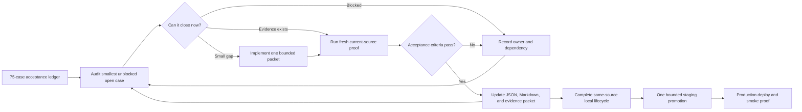

# Phase 8.2 — resume checkpoint

> **Historical checkpoint (2026-09-15).** Its workspace, count, process handles and next steps are superseded. Use the [living handoff](../handoffs/phase-08-2-convex-cutover.md), [validation record](../validation/phase-08-2/README.md) and fixed acceptance ledger for the current Phase 8.2 state.

Historical `.codex/validation/` evidence paths below are now available at `local-validation/` in the regular checkout. The old worktree is a retained backup.

- **Status:** active on 2026-09-15; Disarm client gate and official Linux local codegen pass; final lifecycle open
- **Branch:** `codex/phase-08-2-convex-cutover`
- **Workspace:** `D:/dev/artificer-toolkit/.codex/worktrees/phase-08-2-convex-cutover`
- **Base HEAD:** `989fbfdb437391b0d8ef41814c7ea04fa1ed5d3a`
- **Acceptance:** 55/75 in [the fixed ledger](08-2-convex-cutover-acceptance.json)
- **Session settings:** use the active task controls; historical model preferences below are superseded

## Local runtime startup

Docker Desktop startup is user-owned: launching it through PowerShell caused problems in this session.
Use the daemon the user starts normally. The existing verified task container may be resumed with its
original image and volume. The 2026-09-16 unexpected daemon shutdown ended the container with code 255,
without an OOM flag. Its database volume survived; the local R2 helper's in-memory objects did not.
Post-restart object absence must not be counted as scheduled physical-deletion proof.

## Current acceptance — 2026-09-16

V11 is accepted at LOCAL_INTEGRATION, V12 at AUTHORIZATION and V14 at CONCURRENCY.
The ledger is 55/75, with 20 open. Final-source Disarm03
passes participant privacy, pause, validated response, terminal contention and exact replay; fixture
cleanup and source parity pass. Packet: `.codex/validation/v11-acceptance-20260916/acceptance.md`.
Catalogue projection is active on local deploy-25; 61 integration tests and canonical seed03/audit03
pass. Reaction11 reached settlement but exposed an incorrect unique receipt lookup on loser retry.
The lookup now selects the root command receipt; seven targeted tests and Convex types pass.
Reaction12 passes every outcome race, including terminal settlement, exact winner/root replay and stale loser retry.
V14 packet: `.codex/validation/v14-acceptance-20260916/acceptance.md`.
V12 passes 89 authorization tests in 13 files on unchanged backend/domain source.
Packet: `.codex/validation/v12-authorization-20260916/acceptance.md`.
Passage19 passes the earlier choice but times out in final reaction outcome finish (669 reads, no writes).
The final combined response is being traced; browser proof is also gaining explicit socket reconnect
and bound token/fog undo coverage. Next attempts are Passage20, movement02 and Disarm07 after the fix.
Benchmarking remains deferred.

## Previous functional continuation — 2026-09-15

The Actions drawer now subscribes only while open. App/story types and all four existing drawer
interactions pass; combobox role locators replace labels that matched both input and listbox.
`passage-browser-18` reaches its real Passage choice, then selecting Overrun aborts in
`scenes/geometryCommands:finish` (943 documents, no writes). `movement-browser-01` reaches reaction
outcome evidence, then aborts in `scenes/spatialPreparation:prepare` (923 documents, no writes).
Both preserve all 5,810 source entries through the run and complete fixture/account cleanup with stale
JWT refusal. Provider deletion remains governed by the existing upload plus operation fences.

`disarm-live-02` passes real terminal contention: one winner, one rejected stale contender, unchanged
winner replay, one ACTION, one Character item transition, preserved ownership and unrelated inventory.
The retained receipt is `disarm-live-driver-20260915/receipt-d9705eed-4ab9-491a-8499-abe8cf781015.json`.
V14 still needs competing final movement-reaction outcomes; the existing driver is being extended for
that precise schedule. Completed occurrences may refuse an unreceipted retry as unavailable; this is
an allowed stale refusal, not a reason to change production error wording. Timeouts never count.

A shared operation blocker is full Equipment publication loading for complete Builder selector data.
The in-progress local fix is under `.codex/validation/equipment-builder-catalogue-20260915/`:
optional checksum-bound effective selector metadata in existing Equipment option facts, atomic writer
and descendant refresh, current authority and full parent-graph validation, and complete legacy reads
until all projections exist. Held/selected Equipment still uses full current mechanical sources.
Shared/schema/runtime builds and nine existing Builder regressions pass. Native writer/reader tests,
final source review/types, guarded local deploy-24, canonical seed/audit and real operation reruns are
pending. Backend remains deploy-23. Next real race is reaction-transactions-11; next browser attempts
are Passage19, movement02 and Disarm07 after the implementation is checked and activated locally.
No benchmark, cloud upload, staging promotion, source omission or increased limit is authorized by
this packet. The fixed ledger is still 52/75 pending acceptance review.

The acquired Equipment preservation policy is approved and recorded in ADR0013/persistence: existing
copies retain usable rules after unshare, author departure or deletion, while new acquisitions from
the withdrawn source stop. Its custody/source-loss implementation remains separate and unfinished.

## Immediate next work

Current movement Concentration packet: `.codex/validation/movement-concentration-20260915/`.
The user explicitly approved local implementation and testing of `approval-review/proposal.md` after
automatic approval review rejected the coordinator and schema corrections. The corrections and native
coordinator are now applied locally. One pending movement root retains a separately sealed c2 child;
damaging contacts forecast cleanup before evaluating the suffix. The **scoped local integration gate
passes**: 132 tests in 31 files (53 contract/runtime tests and 79 native tests), four package/Convex
typechecks, fresh schema/runtime/API builds, format/lint for 39 files and the scoped diff check.
Six native Scene journeys cover a real c3-scoped advantage feature, same-contact cleanup, Automatic
shared one-use and hidden/revealed hazards, Assisted controller privacy and reconstruction across a
later spatial save pause, recreated-hazard refusal, rollback and exact replay. Native proof exposed and
corrected two receipt validation gaps: explicit Character identity for a reaction hitting a different
Character from the spatial hazard, and an exact committed prefix before a later spatial dice pause.
The combined contract gate includes rejected identity, body and prefix tampering. Initial build,
fixture and integration failures remain under `integration/` and `native-proof/`. The final ordered
checks, source identities and limitations are recorded in `integration/integration-evidence.json`.
Spatial lifecycle transitions now apply once per movement root, retaining the exact original consumed
record only for pending contacts. Read-only review found no remaining lifecycle or public-summary leak.
The earlier 16-test cleanup forecast and 142-test turn packet below are historical checkpoints, not
current-tree release evidence. Hosted upload to `dev:flexible-goshawk-837` remains separately pending.
Development should mirror the verified local source, contracts, fixtures and journeys; hosting-specific
differences do not replace local correctness checks. Public/browser/reconnect/contention journeys and
the complete R08 lifecycle remain open. Acceptance remains 52/75.

Current local slice: native Disarm, under `.codex/validation/native-disarm-20260915/`.
The user explicitly approved its local coordinator and Disarm-only command/query integration after
automatic review raised transaction, replay and participant-authorization concerns. Reuse the accepted
two-check rule and state-only held-to-carried transition preserving ownership. Pure selection and
Creature item helpers now live in rules-runtime; Functions retains its existing facade. Preparation,
Character/Creature settlement, participant projection and replay readers are implemented locally.
The combined backend gate now passes 85 tests across 15 files (28 rule tests and 57 native tests),
four affected typechecks, fresh schema/runtime/API builds, format/lint for 24 files and the scoped
diff check. Native Automatic win/tie/loss and Assisted Character/Creature participants preserve item
ownership, current authority, one ACTION spend, rollback and exact root/response replay. Failed attempts
and their corrections remain retained; `integration-evidence.json` records the final commands and source.
The original action retains its initiator while evidence receipts identify each actual responder and
save the exact authorized response. The proposed scope and approval history are retained in
`approval-review/proposal.md`.

Disarm client discovery is now implemented under `.codex/validation/disarm-client-20260915/`.
OWNER-authorized native reads return the current Encounter action catalogue and exact published
Disarm descriptor with held-item and System-check labels. The existing command preparation supplies
the selection reads; effect readers use QueryCtx while settlement remains mutation-owned. The tabletop
uses this catalogue for both Character and Creature sources and rejects stale optional-choice responses
when the Run, actor, action, target, rule or Scene changes. Native fixtures now obtain their descriptors
through the public queries. The final scoped gate passes 62 native tests in 11 files, four Chromium
drawer stories, seven backend/web typechecks, fresh schema/runtime/API builds and format/lint for 15
files. The browser stories cover exact Disarm intent, Creature submission and out-of-order choices;
they do not mount the Stage or exercise a live backend. An initial browser resize-loop diagnostic was
resolved by waiting for the existing drawer animation, without suppressing errors. The final browser
run is clean and all 5,801 source entries stayed identical through the combined gate.

The Windows local Node executor still fails to create its external-dependency symlink (`EPERM`);
that attempt changed no source and its task-owned backend was stopped. The official Linux Docker
backend now runs as `phase82-convex-local-linux` on loopback ports 3210/3211 with a separate persistent
volume. Its image is pinned by digest in `.codex/validation/local-convex-linux-20260915/`.
The Linux generation attempt exposed two test-only fixtures under Convex's deployment directory and
a 64 MB module-loading failure. The fixtures now use the existing `tests/fixtures` folder; all 43
affected tests pass. Scene preparation now reuses only its four already-allowed pending contexts,
preserving snapshot integrity checks and the accepted stored shapes. Its generated return validator
shrinks from 9,611,717 to 3,128,170 bytes; all 34 targeted movement tests pass. Official local codegen
and its TypeScript check pass in `codegen-05`, after configuring empty `JWKS` for the fresh backend's
existing database-backed signing-key mode. No application dependency, OS permission or backend memory
limit changed. Seven generated-consumer typechecks, fresh schema/API builds, static API generator
regression, format/lint and source parity pass in `consumers-*-01`. Local activation also passes;
`foundation-03` proves real public queries, anonymous denial/session projection and closed signup.
Its wrapper explicitly sets and checks the local target after Yarn environment injection. A retry
was initially rejected by automatic review over possible cloud selection; read-only runtime URL
proof and this explicit in-process guard resolved that local restriction. Hosted approval is separate.
Canonical manifest regeneration changes only the missing approved c3 Concentration definition:
1 System and 1,051 subjects are unchanged; definitions increase from 50 to 51. Local activation of
that manifest passes in `deploy-02`. The first seed attempt exposed a Docker callback mismatch:
advertised loopback ports 3220/3221 differed from container ports 3210/3211. The task-owned container
was recreated on matching 3210/3211 ports with its exact volume, image and credentials retained.
Auth URL refresh (`deploy-03`) and canonical seed/audit (`seed-02`, `audit-02`) pass with 1 System,
1,051 subjects and 51 definitions. Actual backend/browser/reconnect/contention journeys and
the complete R08 lifecycle remain open. CLI fixture transport and target refusal checks pass with
explicit local routing; no application routing or public contract changed for that helper.
The local R2 protocol server now runs inside the same container on host-loopback port 8026;
its default transport regression passes and the real reaction fixture uploads, finalizes and reads
its map. The initial action run exposed an unnecessary second Campaign; the reaction run exposed
missing Campaign catalogue admission. Their shared fixture setup is corrected locally. The real
action contention/replay proof passes in `action-transactions-02`. Reaction attempt 04 exposed an
incorrect player-privacy assertion and a cleanup guard that rejected the known fixture player's
rule receipt. Both are corrected; ten cleanup tests and local activation pass. Exact recovery
removed the failed fixture and denied its stale JWTs; scheduled physical media deletion reached
zero objects before the local R2 server restarted with browser CORS support. Action-effect save,
privacy and replay pass in `effects-transactions-01`. Reaction attempt 05 cleans up correctly but
both duplicate selections exceed the unchanged one-second `scenes/spatialPreparation:prepare`
limit. Profiling found eager return-validator construction during module startup. Native metadata
getters now defer that conversion; all seven argument/return exports remain identical, 14 regression
tests and backend typechecking pass, and `deploy-05` activates the correction locally. Zero-document
startup probes measure about 400 ms for preparation and 267 ms for the Encounter query. Reaction
attempt 06 passes duplicate selection and D20 contention/replay, then exposes a driver assumption
that critical damage needs only one input. Its cleanup also incorrectly counts unchanged-version
evidence receipts as Scene advances. Both are corrected: the driver typecheck and 31 cleanup tests
pass, `deploy-06` activates the cleanup locally, and exact recovery removes the failed fixture and
rejects its stale sessions. Reaction attempt 07 exposed a hard timeout in initial movement finish.
The read-only phase now reuses its verified Scene save and geometry within the same transaction;
54 focused tests, Convex types and independent persistence review pass. `deploy-07` activates this
correction locally. Reaction attempt 08 reaches terminal movement, including evidence contention,
damage, allowance and receipt assertions. Its final visibility assertion was stale: a revealed,
non-hidden token remains visible in persistent exploration. The driver now checks that contract.
The Run cleaner now links native reaction Character receipts through verified terminal evidence;
14 regressions and exact orphan recovery pass. `reaction-transactions-10` completes real native
contention, replay, redaction, mechanics and guarded cleanup on the same source as local `deploy-12`.
Encounter condition presentation now reads validated records and vocabulary directly. Passage options
share current System/allowance reads within one transaction; selected execution still reloads them.
`passage-browser-07` commits initial movement successfully, but its 30-second UI wait expired during
Scene hydration. The functional driver now uses the existing 90-second Scene hydration allowance.
Passage/Concentration controller checks now use the existing indexed actor reader. Pending capture
uses sealed reaction contacts with fresh Scene geometry; 17 affected tests and Convex types pass.
`deploy-14` activates that source locally. Browser attempt 10 receives Scene version 1 on both clients
but misses its decision controls; attempt 11 adds direct pending-state and native query diagnostics,
then successfully displays the choice and selects Overrun. The initiator d20 aborts in
`scenes/spatialPreparation:prepare` at the unchanged one-second limit. Passage preparation now loads
complete mover/blocker mechanics first and loads other actors only before successful continuation;
19 affected tests and Convex types pass, including the restored Run-wide Character identity guard.
Participant currentness and all continuation validation remain. Browser 12 completes initiator evidence
and enforces defender-only privacy, then exposes missing Character reaction sources on continuation.
Both Passage loads now preserve those sources and staged allowance use; 11 Passage tests and types pass.
Local deploy 16 includes that fix. Browser 13 instead aborts initial preparation at the one-second limit.
Initial reaction loading now uses one complete validated actor read. Browser 14 passes initial movement
but its pending-occurrence query aborts while selecting Passage. Both pending snapshot schemas now
dispatch on the existing required `snapshotKind`, preserving their checks and native validators;
34 targeted tests pass. The real Disarm driver passes on deploy 17, including participant authority,
one item transition, one ACTION spend, persisted receipt agreement, exact replay and fixture cleanup
(`.codex/validation/disarm-live-driver-20260915/functional-evidence.json`). Its VTT browser journey remains.
Browser 15 reaches defender resolution but final publication hits the one-second limit while reading
full Character facts again for next-choice revalidation. That guard now reuses original current targets
from the same evaluation; projected allowance/effects stay separate and final commit loads fresh facts.
A broader response-context reuse
patch was rejected by automatic review and was not applied. Complete Passage/reaction browser proof
and generated API refresh remain required for V07 LOCAL_E2E acceptance. The full release lifecycle
belongs to R08 and remains mandatory before staging promotion. This corrects the later progress note;
the original frozen V07 and R08 proof tiers and all scenarios are unchanged.
Performance profiling is stopped until functional
integration is complete. Full Character catalogue resolution remains intact.
Local deploy 19 includes the Passage original-target reuse fix; 15 native tests and Convex types pass.
Passage browser 16 and Disarm browser 01 instead expose Encounter queries aborting before document
reads. Read-only turn projections and deterministic Concentration identities are now separated from
mutation mechanics imports. Disarm browser 01 also exposes Select dropdowns behind the action drawer;
its four Selects now render dropdowns within the drawer using the established Mantine option.
Both browser attempts cleaned up their exact fixtures. The next required runs are Disarm browser 02,
Passage browser 17 and the ordinary reaction movement browser journey after local activation.
Disarm browser 02 on deploy 20 still aborts during initial read loading, before any command; exact
fixture cleanup passes. Its native records show zero-document pendingPrepared/transientCapture
timeouts and an eight-document list timeout. The next correction separates Character state reads
from Builder/history schemas and transient join/role contracts from the full live command schema.
The non-browser Disarm proof also now contains a final-evidence race through the public action;
its existing single-item, ACTION, Run, Character and replay assertions remain required.
Failed attempts and cleanup evidence are retained in the same Linux packet. The action proof has
a direct `--encounter-action-contention`
entry, preserving the existing cutover entry and transaction assertions.
The fixed ledger remains 52/75; hosted upload remains separately pending.

Prior local turn/inventory packet: `.codex/validation/turn-concentration-20260915/integration/`;
prior completed integration packet: `.codex/validation/concentration-integration-20260915/integration-evidence.json`;
prior checkpoint: `.codex/validation/movement-maintenance-owners-20260915/integration-evidence.json`;
implementation baseline: `.codex/validation/movement-maintenance-20260915/integration-evidence.json`.
Character-originated Automatic and Assisted maintenance journeys now pass native mutation checks.
Movement maintenance forecasts exact slot/owner changes across contacts and verifies them during atomic
Scene publication. Native Encounter actor journeys cover Automatic replacement, ordered condition
cleanup, Assisted stale refusal/resume, rollback and replay. Receipt contracts preserve cleanup state
and Character version continuity; pending action/resistance phases bind maintenance currentness.
The compiler now aligns recurring dice-heal graph identities and admits validated recurring movement
saves. These are internal mutation-seam proofs; public action wrappers and browser journeys remain open.
Present/detached Character movement cleanup and cumulative stream increments now have native Scene
proof, including a detached owner changing across a non-pausing passage. The passage test detects the
reviewed missing forecast argument under fault injection; exact production source is restored.
The user settled Concentration as reusable published System content, used by spells and features.
Canonical c3 now publishes the maintenance policies and links c2. Save modifiers may reference c3 for
concentration-only bonuses or advantage; ordinary Constitution saves remain separate. Native direct
damage starts deterministic Automatic/Assisted child checks, validates exact current facts before dice,
and applies cleanup with independent-owner preservation and exact replay. Cleaving damage uses the same
child coordinator; one sealed deferred Cleaving choice follows concentration success or failure.
Publication, modifier, native Concentration and Cleaving handoff checks are recorded in the current
packet, with fresh builds, combined contracts/native regression, package types, source identities and
complete command/exit sidecars. Generic maintenance fixtures now publish actual typed definitions.
Terminal turn recurring damage now preserves outgoing-before-incoming execution order, distinguishes
repeated application ordinals across effects, and continues other owners after a maintained state ends.
The current movement packet above supplies native coordination while its Scene parent remains pending.
Turn damage normalization, bounded concentration ordering, and direct/Cleaving call adaptation are
applied locally. The feature modifier Authoring Schema now exposes the existing optional rule reference
through native reusable-definition choices. After the risk explanation, the user approved the
recommendation to apply and test the local terminal turn/Assisted continuation/replay patch first.
It is now **applied**. All four public turn scenarios pass, including Assisted success between failed
owners. That packet's local gate passed 142 tests in 17 files, both API typechecks, the API build and
format/lint for 14 files. Combined checks exposed and corrected an overbroad terminal replay and a
live condition read after Character unassignment. Detached actor reads preserve Run identity with no
condition fallback; another Campaign's conditions remain private. The shared lifecycle restores the
Character assignment after ownership returns. Read-only reviews found no actionable findings.
Commands, final source identity and limitations are in `integration/integration-evidence.json`.
Historical rejection and red-proof evidence remains retained; it no longer represents current source.
The user also clarified that personal development is dedicated to this pre-live Convex migration and
should mirror local source, generated contracts, fixture definitions and journeys. Hosting-specific
configuration may differ; application failures found there must be reproduced and fixed locally.
Independent P12 work now has a public-command driver at
`apps/apis/tests/developmentCampaignInventory.ts`, wired to `developmentDrafts.ts --campaign-inventory`.
It covers party/Vehicle transfers, exact replay/refusal, OWNER audit, player-visible inventory and
currency conversion. It now also creates an owned published Cart source, shares it, and verifies cargo
evacuation and exact replay when the source is unshared. Guarded cleanup validates the correlated
receipts and removes inventory before the existing Campaign/publication cleanup; the native proof
checks malformed custody, receipt mismatch and unrelated inventory preservation. The prior transfer-only
checkpoint is `.codex/validation/campaign-inventory-proof-20260915/`; current combined checks are in the
turn integration packet. Development activation was previously rejected by automatic approval review
for private-source upload authorization. No activation or authenticated HTTP inventory run occurred.
Assess activation after the approved local checks pass. A real selected-development run and remaining
Character custody/source-loss/lifecycle work are still required for P12.
After the green final local gate, a fresh personal-development guard passed. Official `convex codegen`
was rejected before execution by automatic approval review because private-source upload needs explicit
destination-specific approval. The upload/generated-contract refresh/activation-after-recheck and
disposable inventory proof approval is pending. See `turn-concentration-20260915/development/` under
`.codex/validation/`; no upload or generated-source change occurred in that attempt.
Continue remaining contextual outcomes and complete
public/browser/reconnect/contention journeys, then performance work and the final-source lifecycle.
Preserve the full frozen scope. No new case is accepted; the ledger remains 52/75.

The 2026-09-14 condition ruling is settled: one editable manual DM entry per condition type,
no rejection against an existing Sheet/spell/feature source, and independent source lifetimes.
Live Run queries project current Sheet and Campaign conditions with SECRET overlays hidden from
players; query/privacy proofs pass. The approved six-file mutation integration is applied and its
public action-to-turn, independent-source, replay, stale-response and shared mechanics checks pass.
The real next-turn proof exposed and fixed the shared planner's stale snapshot revision: Character
actor and snapshot revisions now advance together. Final scoped types, formatting and lint pass.
Ordered commands, source hashes and logs are recorded in
`.codex/validation/character-conditions-20260914/integration-evidence.json`.
Split-party support is explicitly deferred.
Recurring producer corrections are implemented: frozen graphs retain compiled fact contracts,
recurring save actions use the complete compiler, and recurring healing/damage/temporary HP admit
their executed outcome. Compiler and native producer-to-turn proofs pass under
`.codex/validation/action-recurring-effects-20260914/`. Final scoped type validation also covers
the repaired new test DTO boundaries. Acceptance remains 52/75.

Completed functional items: recurring action-to-turn producer; live Character condition reads;
independent Character condition settlement; ordinary movement-reaction active-effect creation;
existing action/reaction/movement/turn compatibility. Reaction effect planning now includes deterministic
records in subsequent-contact facts and verifies those records through the native store at settlement.
Public Creature and Character journeys cover Automatic/Assisted completion, same-type independent
condition sources, rollback, exact replay, sequential Character effect ordinals and turn expiry.
The real journeys exposed and corrected nested-save condition immunity binding and omitted nested
condition/damage applications in the shared interpreter. Failed/successful saves, condition immunity
and altered evidence now have executed compiler coverage. Scoped evidence and source hashes are in
`.codex/validation/movement-reaction-effects-20260914/integration-evidence.json`.
Remaining V10/V11 dependencies: maintenance coordination, remaining
contextual outcomes, browser journeys and managed proofs. These scoped results do not satisfy R08;
the complete final-source local lifecycle and all frozen acceptance gates remain required.

Native action effect creation is connected locally, including Automatic/Assisted save outcomes,
immunity refusal, relationship condition baselines, critical-only paths and Character effect-only
version/receipt replay. Native proof, backend types and scoped lint passed after the adapter-fact
representation correction. Evidence is retained under
`.codex/validation/action-effects-integration-20260914/`.
The user explicitly approved the complete six-file turn integration on 2026-09-14. It is applied,
including dispatcher, privacy, initiative restoration and terminal receipts. The combined native
turn-effect, initiative, Recharge and Legendary journeys pass after correcting cross-phase response
replay and retaining the already-corrected repeated-save operation names. Scoped formatting and lint
pass, as do final backend Turbo types and ordinary Manual/actor/side initiative compatibility checks.
Ordered evidence and source hashes are in
`.codex/validation/turn-effects-integration-20260914/approved-integration-evidence.json`.
The shared public action-effect development driver is connected to `--encounter-effects` and passes
the native failed/successful-save, pending privacy, terminal replay and durable effect-count proof.
Fixture cleanup removes only the selected Campaign's effects and rejects malformed ownership without
writes. Its native proof, types, formatting and lint pass; evidence is retained under
`.codex/validation/action-effects-public-20260914/`. The authenticated managed invocation has not run.
Browser/managed journeys, remaining producers and the complete release lifecycle remain open.
The fixed ledger remains 52/75; these local changes do not accept a whole case or promotion gate.

Use [the fixed remaining-work checklist](08-2-convex-cutover-remaining.md) for current dependencies, exclusive ownership and completion reporting. It supersedes the serial helper-checkpoint planning below; the 75-case acceptance ledger is unchanged.

The current initiative integration connects DECLARED_ACTION_ROLL to native START/EACH_ROUND and
prepared decisions in the GM workspace, player Session list and tabletop. Automatic/Assisted
settlement, replay, rollback, stale cohort/source-round refusal and current Character-controller
privacy pass locally. Native Creature/Spell publication and two distinct Character-controller journeys
also pass, including source republishing refusal and the public action boundary. Generated API types,
scoped backend/web types, formatting, lint and affected integration checks pass. The scoped source
identity and retained commands are in
`.codex/validation/initiative-declaration-integration-20260914/integration-evidence.json`.
Actual browser/personal-development initiative proof and the full release lifecycle remain open.
Native Recharge is also connected to all four initial/continued turn paths. Automatic and Assisted
entry, multiple Feature candidates, retained dice, earlier initiative decision retries, privacy,
rollback and advancement after an unrelated Character Sheet edit pass in the combined native run.
Evidence: `.codex/validation/turn-recharge-integration-20260914/integration-evidence.json`.
Native Legendary Action and Cleaving paths are now connected. Legendary decisions survive both
EACH_ROUND initiative procedures and Recharge without early mechanics writes. Cleaving retains exact
damage and source pins, supports current Character controllers, hides private targets, and permits
decline after geometry or Character changes. Native replay/privacy/rollback journeys pass; scoped
evidence is under `.codex/validation/turn-legendary-integration-20260914/` and
`.codex/validation/cleaving-completion-20260914/`.
Continue remaining action/effect producers and functional domain work; actual browser/managed
journeys and the complete final-source lifecycle still precede acceptance and promotion.
Finish the remaining functional producers before the required performance gates and optimization.
No acceptance count or promotion gate changes follow from this implementation packet.

Latest completion: V02/V06 pass the real Scene/native Worker journey, actual JWT renewal, privacy,
reconnect, departure refusal and exact fixture/account/provider cleanup. The user-approved static
JWKS copy and activation preserve the same signing key and every rate limit; managed verification
has no public key fetches or limiter failures. Evidence:
`.codex/validation/phase82-scene-live-acceptance-20260913/acceptance.md`.
The separate native pending-decision audience proof also passes. Continue movement-reaction
response/settlement and atomic remaining-path/fog publication, then the unfinished action, privacy
and frozen workload coverage. V14's existing schedules pass but its complete workload remains open.
R08 and all promotion/retirement gates remain open. The continuation notes below are historical.

Latest local backend integration also passes Passage choice/decline, Overrun/Tumble Automatic and Assisted
two-d20 continuation through spatial/reaction/Legendary Resistance, retained exact replay, no-spend-before-
terminal, same-mutation rollback/retry, current Character-to-actor privacy and endpoint-footprint boundaries.
The final source stayed unchanged at manifest `f1668aaa3831a69f53d3fd731b513997bafc8823ba04a2850f4676002c55d7b6`;
fresh format/lint, shared/schema/rules-runtime builds, official codegen, API/Functions/runtime typechecks,
15 native files and shared/schema contracts are green. Evidence:
`.codex/validation/scene-passage-coordinator-20260914/local-integration-evidence.json`.
Browser Passage/combined frozen journeys, the original managed initial MOVE CPU failure, full workload and
R08 remain open; acceptance stays 52/75 with no frozen case accepted.

Current continuation: authenticated V03 entity/geometry/privacy/replay/conflict/rollback execution
passed on personal development, followed by the real Scene upload/create/edit/reload journey with
zero browser diagnostics and exact fixture/account cleanup. Both native and successful browser
assets passed physical R2 cleanup after their fences; the final observation was 02:26:06.663Z.
The final integrated web lifecycle passed 1,296 unit tests, 206 stories and 23 Playwright journeys,
including the native Scene selector. V03 is ACCEPTED. Evidence and ordered logs are consolidated in
`.codex/validation/phase82-ultra-continuation-20260911/v03-integration.md`.

Supported Encounter reads, Blueprint/Run creation and commands now use native Convex adapters;
the Scene selector also traverses native live-summary pages. Complete live hydration/reconnect,
actor removal, REORDER and reinforcement behavior were open in V02/V09 at that checkpoint. The earlier notes
below are historical; current acceptance is 52/75. The user's active-turn and compact Spell metadata
decisions remain pending. Continue the full 75-case objective without restarting broad audits.

V02 continuation: `v02-recipient-fence-patch/` is applied, with tracked leave/rejoin regression,
schema export build and guarded official codegen passing. Native Scene hydration and Session
presentation subscriptions are implemented in the web adapter/tabletop; focused adapter and hook
tests pass, including interruption retry and same-Scene recipient revision changes. Primary review
identified missing inline Session authority; its corrective patch is applied and its eight focused
guard/proof tests pass. The shared proof now compares recipient content using each recipient's own
revision token. Native map/image delivery and live-session ticket admission are integrated; three
native ticket tests, five hook tests, two tabletop browser stories and Turbo web types pass. Independent
ticket security review found no issue. Official `v02-codegen-03/codegen-02` passes after rebuilding
the schema export; generation does not activate functions. The real GM/player hydration/reconnect
browser helper and exact native fixture are implemented and typechecked, but not executed.

The recovered full local run `v02-final-local-01/verification-02` passed all type stages and lint,
then failed native tests: 1,224 passed and one notification delivery test exhausted the scheduled
function timer pump. Its focused rerun passed nine tests; the full gate remains failed. No later
core/web/worker/story/Playwright stage ran in that lifecycle. Subsequent native ticket/media changes
require fresh final-source evidence. See the ignored continuation packets for retained logs.
This is implementation progress, not V02/V06 acceptance; acceptance remains 50/75.
The subsequent `v02-final-local-04/completion.md` records a complete passing baseline with identical
source hashes: 1,228 native, 3,619 core, 1,304 web and 26 Worker tests, 206 stories and 23 Playwright
journeys. The real tabletop still opens the legacy live host, so native V06 integration is required
before the clean V02 browser proof. Native transient capture, internal member vision/fog readers,
and protected paged HTTP hydration are now integrated locally. Their focused verification is retained
in `v06-backend-integrated-01/`. The native Worker implementation and browser authentication protocol are applied; production entrypoint binding and complete V06 proof remain pending. Browser auth passes 14 tests and web types; the Worker hydration helper passes eight tests. Two native Durable Object tests prove ticket admission, credential non-persistence and hibernation reauthentication. The Worker transport uses manual redirects and rejects non-success responses because Workers does not support redirect error mode. Negative concurrency and authority proofs are still being completed in `v06-native-room-01/`.
Current local continuation (2026-09-12): native transient integration has 19 passing tests, plus a
new six-test fanout run proving changed bound Character revisions force hydration and change emitted
vision layers. Canonical Worker test-project integration now passes all 46 tests across five files. Native tabletop Encounter
reads, turn/decision commands and paged Session-fenced fog are now wired. Focused proof passes 26
backend fog/geometry tests, eight tabletop stories, two decision tests, all three web type stages and
five-file lint. See `v06-tabletop-native-01/completion.md` and `v06-character-proof-01/` beneath the
ignored continuation packet. No new case is accepted; full final-source lifecycle and native Worker
production binding remain due. Legacy action resolution and movement/undo routing remain open.
Native binding continuation adds reactive metadata, recipient-visible paged actor bindings, final
Scene/Encounter/authority fences and native bind/actor-token mutations. Tabletop no longer reads
binding arrays or Encounter versions from READY. Twenty combined native binding tests, four web
hydration tests, eight tabletop stories without console diagnostics, native Convex types and lint
pass. See `v06-binding-native-01/`; web types are explicitly FAILED pending the two new generated API
members, not waived. The latest native fanout file also passes eight tests including deadline expiry
at final capture. No remote upload/activation or acceptance increase occurred.
Latest HTTP codegen is awaiting explicit upload authorization after automatic approval review rejected
the remote source-analysis upload. No new activation, staging or production operation is claimed.
Complete all affected gates and authenticated hydration/reconnect proof. The Durable Object and
committed movement cuts remain V06/V07. Existing V03 final evidence is historical to that accepted
source state; subsequent changes require their own release evidence.

V07 local continuation adds standalone native movement to the staged geometry transaction, preserving
the five-command frontend classifier and existing sampled-path exploration semantics. Current owners
can move any unlocked token; players require token control. Token and fog publication remains atomic,
with normalized immutable identities and current authority/version fences. Mechanics-bearing movement,
tabletop routing, and final acceptance remain open. Native standalone undo now restores the latest
eligible movement and prior fog references atomically, rejecting later token/fog conflicts; its local
verification is retained in `v07-undo-01/`. Retained movement proof and failures belong to
`v07-standalone-movement-01/`; consult its completion manifest rather than treating implementation as
an accepted V07 case. The canonical Worker suite separately passed 48 tests across five files in
`v06-worker-final-02/`. Acceptance remains 50/75.

The pure mechanics fold, frozen effect executor and adapter registry now live in rules-runtime,
with prior Functions exports preserved. The shared fold now persists equal-count condition replacement.
Native target mechanics publication passes 17 Character/non-Character tests, eight Convex type tasks
and focused lint, including rollback, stream mirrors, slots and effective maximum HP. Evidence:
`v07-native-mechanics-01/completion.md`, `v07-effect-kernel-01/completion.md` and
`v07-condition-replacement-01/completion.md`. The terminal movement coordinator must still integrate
these helpers. The earlier full native suite failed a stale geometry expectation; its focused repair
does not replace the required complete final-source lifecycle.

Native spatial-effect storage and current movement target loading are now implemented locally.
Spatial/active stores pass 14 transaction tests. Target/mechanics coverage passes 23 tests, with
10 legacy scalar tests, Functions/rules-runtime types, Convex types and focused lint also passing.
The real policy test caught and fixed the shared code-to-UUID scalar mapping defect, including
bonus and manual-override behavior. Evidence: `v07-spatial-store-01/completion.md` and
`v07-movement-targets-01/completion.md`. The next step remains terminal movement orchestration,
including paused evidence/reaction continuations and atomic Scene/fog publication; V07 remains open.

The neutral spatial coordinator and native terminal adapter now pass 26 legacy movement/executor tests,
55 focused native tests, nine Functions type/build tasks and eight Convex type/build tasks. Native proof executes actual frozen damage,
one-shot deletion, repeatable reveal, parent rollback and Scene-version position tolerance. Character
currentness pins also detect effect lifecycle changes without a Character stream change. Assisted
Character pause/resume rejects stale pins and records exact entered evidence. This roundtrip caught
and fixed key-order-sensitive contact and sealed evidence-policy comparisons. Evidence is
in `v07-spatial-coordinator-01`; this remains prerequisite evidence, with parent Scene/fog/occurrence
integration and the final local lifecycle still required. Acceptance stays 50/75.

The native evaluator now also supports a terminal preview for staged Scene/fog preparation.
Preview performs no mechanics/effect writes; commit reconstructs retained automatic evidence through
the existing frozen movement remainder. The real automatic Character test checks that commit draws
no additional random value, and Assisted/delete/reveal tests compare preview and committed receipts.
Evidence: `v07-spatial-plan-01/completion.md`. The subsequent `v07-spatial-preparation-01` packet
adds typed, checksummed terminal/pending evidence to the existing staged Scene save. Its internal
writer checks current Scene, Session, Run and binding scope, permits identical retries and rejects
replacement; all geometry-save reads validate stored evidence. Eleven storage/rollback/fence tests,
51 existing Scene tests, eight Convex type/build tasks and focused lint pass; independent review has
no findings. Evidence: `v07-spatial-preparation-01/completion.md`. Parent Scene transaction wiring
remains incomplete. Bound movement must reuse the selected, current Session Encounter binding;
the Worker already rejects multiple active overlays. Do not infer a Run by recency.

The `v07-spatial-commit-01` continuation adds an internal first-terminal commit helper. It
revalidates preparation and token control, excludes pending occurrences/root replay, reconstructs
retained outcomes, and rolls back with the parent transaction on receipt divergence. Review caught
a real gap in using the reaction remainder for this purpose: newly inserted contacts could be
ignored without a Run/Scene version change. A distinct frozen-terminal input now checks the full
fresh candidate set and currentness before reconstructing stored executions; reaction remainder
semantics are unchanged. Native proof also verifies no additional random draw for a Character
saving throw. Parent action, occurrence/projection/Scene/fog publication and reactions remain open;
the helper does not enable bound movement or add an accepted case.
Final evidence: `v07-spatial-commit-01/completion.md`, 28 native tests, 59 affected legacy tests,
nine Functions and eight Convex type/build tasks, lint and whitespace checks. The STOP regression
retains full contact validation after an early stop. A stale condition-perception checksum mock
found by an accidental broad run is repaired; that failed full suite remains failed evidence until
the required final lifecycle is rerun. Acceptance remains 50/75.

The `v07-spatial-publication-01` continuation adds internal terminal Run/projection publication,
completed occurrence and rule receipt, and private movement timeline persistence. Real native
proof covers damage, one-time replay, owner/player timeline privacy, receipt/summary tampering,
and parent rollback across mechanics and all publication records. The unchanged aggregate helper
now lives in rules-runtime and remains re-exported by Functions. Final focused evidence: 47 native
and five legacy tests, eight Convex and nine Functions type/build tasks. Public bound movement,
parent Scene/token/fog atomic wiring and pending/reaction continuation remain incomplete; V07
is not accepted. Evidence: `v07-spatial-publication-01/completion.md`. Acceptance remains 50/75.
Latest V03 checkpoint: the existing local Encounter lifecycle now runs the shared Scene verifier and
passes actual edits/geometry/privacy/replay/conflict/rollback plus complete local R2 cleanup. The same
verifier is wired into the authenticated development harness. Existing capacity and recipient tests
now cover nine maximum-size polygons and nine fog layers without adding cases. The lifecycle found
and fixed artificial pagination scan ceilings in Session discovery and fog headers; human fixture
vision expectations were corrected without changing product semantics. See
`.codex/validation/phase82-v03-development/integration.md`. Next: complete final-source local gates,
then guarded authenticated activation/proof/cleanup. V03 remains IN_PROGRESS; acceptance remains 49/75.
No managed activation has occurred. Earlier paragraphs below are historical packet evidence.

Latest V03 state: recipient reads and persisted collision/distance/line-of-sight proof pass 112 native
tests across 11 files and 46 shared/kernel/schema tests across five files on unchanged source. Thirteen
combined Turbo tasks, strict lint/format and guarded generation pass. Recipient actions reuse current
entity resolution, apply the shared visibility predicate with auth-derived own/shared fog, and recheck
Campaign revisions/identity and the Scene snapshot before returning. Visible-ID continuations omit
hidden scan positions/counts; internal empty continuations remain supported. The existing full
256-chunk fog lifecycle now exercises recipient filtering. Shared visibility skips off-map samples
without changing the sample lattice and decodes only the needed Base64 block. See
`.codex/validation/phase82-v03-recipient-facts/integration.md` and `verification.json`.
Next: authenticated V03 development harness and complete same-source local lifecycle before guarded
activation/integration. V03 remains IN_PROGRESS; acceptance remains 49/75. No functions were activated.
The bounded helpers completed; later subagent work hit the account usage limit and root finished the
corrections locally. Do not assume those agents are running or retry unchanged green packet checks.

Latest V03 state: Session geometry composition and atomic publication revision checks now pass 111
native tests across 11 files, twelve final Turbo tasks, strict lint/format and read-only codegen.
The existing Session lifecycle was extended without adding cases. See
`.codex/validation/phase82-v03-session-geometry/integration.md` and its source/command manifest.
Next: persisted collision/distance/line-of-sight proof and general recipient entity/visibility/privacy
before authenticated development integration. Own/shared fog MEMBER reads already exist; do not rebuild
them based on the scout's corrected owner-only characterization. General entity reads are owner-only.
The earlier packet history below remains evidence provenance, not a list of still-open implementation gaps.

V03 is the next unblocked full-case candidate after the V09 timeline packet. Read
`.codex/validation/phase82-v03-entities/acceptance-checklist.md` and `selection.md`; do not repeat the
broad selection audit. The geometry-command packet passes 99 native tests across nine Scene/binding
files, 77 kernel/schema/service tests, eighteen build/typecheck tasks, three export builds and guarded
read-only codegen. The subsequent test-only follow-up passes 25 geometry/binding tests and eighteen static
tasks on unchanged production/generated code; see `.codex/validation/phase82-v03-geometry-proof/integration.md`.
The Character vision packet passes seven native tests, nine existing compatibility tests,
nineteen combined static tasks, strict lint/format and guarded read-only codegen; see
`.codex/validation/phase82-v03-character-vision/integration.md` and its source/generated manifest.
The Session vision implementation packet passes 32 native tests across five files and nineteen static tasks,
with strict lint/format and read-only codegen; see `.codex/validation/phase82-v03-session-vision/integration.md`.
Both static and runtime passed their first execution after source/fixture review.
The subsequent test-only consolidation reduces twelve vision cases to eight, covering the Session lifecycle
and isolated authority, corruption and privacy failures. All eight pass, with eight Turbo build/typecheck tasks
and strict lint; production/generated code is unchanged. See `.codex/validation/phase82-v03-vision-flows/integration.md`.
The latest Session discovery packet adds indexed Run/binding pages and extends that existing flow:
eight tests, twelve Turbo build/typecheck tasks, strict lint and read-only codegen pass.
See `.codex/validation/phase82-v03-session-discovery/integration.md`; native runtime passed first try
after static checking caught and fixed a nullable Character source.
The latest transactional vision freshness packet passes the full serial native suite: 1,223 tests
across 198 files, with identical source identity at start and completion. Twelve final Turbo tasks,
schema export builds, full-native strict lint, formatting, read-only codegen and an executed import
restriction probe pass. All native mutation and migration builders now advance dependency revisions
in the same transaction; existing vision flows prove immediate visibility, rollback and isolated
Character changes. The eight vision cases were extended without adding cases. See
`.codex/validation/phase82-v03-vision-freshness/integration.md` and `next-seam.md`.
The subsequent Session geometry packet now consumes and validates those observations at publication.
Immutable base reads now combine with a separately versioned live head, collection-qualified
annotation/light/darkness overrides/tombstones and Scene-wide exact receipts. Current authority precedes
replay; stale unrelated edits preserve the shared behavior. Persisted lighting effects are checked
through the shared illumination/obscurement kernel. The never-activated annotation prototype was replaced
by `commands`, `sceneLiveEntities`, `sceneLiveCommands` and collection-paged `liveReads:changes`.
Ambient illumination and vision reveal mode now have current values/per-setting last-write versions in
the head; public headers expose current values and entity writes preserve them. Stale same-setting
conflicts, unrelated rebases, authority-before-replay, rollback and setting corruption denial pass.
Measurements now use the same live collection/receipt seam with the existing 500-record capacity.
Players may edit only their own measurements, including a stored-owner check preventing ID takeover;
replay checks current membership/writability and original player actor. `measurements:list` exposes only
paged measurements/version/count to members, while private Scene reads stay owner-only. Fixture cleanup
validates reserved player accounts and exact Campaign membership before deleting measurement commands.
Fog now has ordered manifests, immutable chunk uploads and atomic reference publication. The same
head/global command registry supports INLINE and FOG_PATCH receipts; initial layer order and later
index-sorted merge behavior match the shared reducer. Own/shared member reads pin the version;
owner-only history retains original chunks. Full 256-chunk payloads, rollback, expiry and exact fixture
cleanup have local proof. Actor-token SET now checks current live token overrides/tombstones before
immutable fallback, preserving historical replay and Scene rows. Token writers must use canonical lowercase
UUID keys; an uppercase authored base token followed by its canonical tombstone is covered. Native token
writes now use these canonical keys. The former service exploration helper now lives in Shared as
`deriveSceneCommandExplorationDeltas`; its input needs only geometry/fog, and all three original callers
preserve behavior. General Turbo typechecks now depend on upstream builds after a captured stale-export
failure exposed the missing ordering. The shared reducer now delegates geometry operations to
`applySceneGeometryDelta`; native callers must still enforce aggregate limits and publish derived fog
atomically. `planSceneCommandExploration` projects only geometry and selects recipients without fog;
the service wrapper attaches one recipient's layer. Regressions cover full-input fog exclusion,
old/new barrier positions, routed movement, door-state preservation and missing-entity errors.
`sceneGeometryCommandInputDtoSchema` reuses the exact five existing non-movement geometry schemas.
Door state and barrier edits share `BARRIER:<id>` conflicts; do not introduce separate door conflict
versions. Internal `geometryReads:entities` now uses bounded BASE/APPENDED ordinal keyset pages,
rechecking current owner and exact version/save. It skips tombstone history, preserves empty
continuations and rejects duplicate ordinals including lookahead. Current barrier overrides carry
explicit `doorState`; canonical token/barrier keys are enforced, and UUID output normalization
preserves authored checksums. The schema adds that optional field and an ordinal index; generated
bindings were refreshed under the personal-development guard, with no managed activation.
Native owner geometry commands now use complete geometry hydration and one-recipient fog hydration.
Hidden parent/child staging, snapshot-reset retries and atomic entity/fog/head/GEOMETRY receipt publication
are implemented. Receiving writes require the original actor; historical replay checks current ownership.
Geometry fog results explicitly use complete-layer REPLACE mode. Canonicalization ORs existing and new
exploration before replacing references, preserving cells outside arbitrary manual chunk bounds; original
history remains published. Manual patch semantics remain unchanged. The inherited inline Shared patch
collision is documented; it is not copied into native publication. Ten command tests cover ordinary
owner edits, authority/replay/stale conflicts, uppercase base IDs, staging, child manual-write denial,
later-child rollback and exploration/history. Three additional cleanup scenarios pass. Final persistence
review has no findings. Read
`.codex/validation/phase82-v03-entities/geometry-next.md` for the inspected one-recipient exploration
boundary and compact fog mask; the bounded native fog transport is now implemented and documented in the persistence guide.
Actual geometry commands through the actor-token binding seam and competing/expired attempts now pass.
The new proofs cover one winning geometry/fog snapshot, duplicate finish/staging, published history
retention through cleanup, nine-chunk expiry in eight-chunk batches, and uppercase base token
removal/restoration preserving bindings and historical binding receipts.
Next: exact Session/Character recipient composition, then authenticated development integration under the
full local-before-promotion requirements. Preserve existing capacity, including 49 MB polygon examples and large schema-valid fog layers.
ADR 0024 resolves the source semantics: future derived/passive facts read current published content;
only issued occurrences retain frozen execution facts. Do not restore SQL projection repositories or
long-lived consumer pins based on older Character/V03 wording. `loadCharacterSheetFacts` and
`characters/encounterInitiative:read` show current native authority/rules/stream fences. The pure
capability/range logic now lives in `rules-runtime/character/characterSceneVision`; the retiring functions
module reexports it. The new internal `characters/sceneVision:read` joins current validated definitions
with effective output senses using a narrow `characterMechanicsRead` contract. It requires exact
Campaign/Character/System/stream identity and System vocabulary membership. The existing definition
reader enforces ownership and integrity; no transitive private-Sense sharing policy was added.
The native tests prove GM/owner platform vision, current-source changes without Character stream changes,
identity/authority denials and valid private-source owner success/GM denial. All new fixture static errors
were corrected before the first runtime execution; both runtime groups passed on their first run.
`scenes/sessionVision:character` now admits one explicit Campaign/OPEN Session/presentation/Scene/Run/
actor/token binding and present Character, then calls the scalar query in the same read snapshot. Its
input supplies the exact current Scene, Session, presentation, Run and Character versions. It uses
`readRunActor` to avoid unrelated actor snapshots. The Run's original sourceRevision is deliberately not
the current Character stream fence. New tests prove later current Character streams still work while
the Run/sourceRevision remain unchanged, attendance loss rejects at the same Session version, and
current Sense changes alter the observed scalar/checksum. Nonowners, closed/foreign/stale contexts
and corrupt actor state reject.
Next compose paged Session bindings and scalar facts into consistent recipient geometry and
fence dependent freshness at publication. Observation checksums alone do not make multi-query facts
atomic. Do not assume Character stream versions detect current authored-source changes, or Session
versions detect attendance changes. A new Scene binding also does not advance its Run version.
Nested queries share a snapshot and the parent transaction limits, so repeatedly evaluating every
Character inside the final publication is not automatically a capacity-safe solution. The existing
Class action/commit source-checksum pattern is relevant precedent, not proof of sufficient read budget
for a whole Session. Do not restore SQL or introduce a global counter without settling that read set.
The scout's
SQL-reuse recommendation was rejected against ADRs 0024/0029; historical evidence remains in the prior packet.
Do not assume a whole Scene or fog command fits one database call or eagerly hydrate all history for
each local edit. Keep shared geometry/reducer semantics. V02 browser, V06/V07
multi-client work and the full V14/V15 workload retain their case ownership.

V09 remains IN_PROGRESS with 54-test local timeline proof. Its active reorder/reinforcement decisions
still await the existing user questions. Removal is not a trivial unblocked patch: legacy removal
clears the current actor, native advancement rejects null current actors, and normalized null state
currently means all actors READY. Preserve completed turns and maintained Character effects; do not
infer missing turn semantics. V03 entity validation used read-only codegen; no functions were activated.
All 75 cases and the complete release lifecycle remain the active goal. Acceptance remains 49/75.

## Goal

Complete the approved Phase 8.2 Convex cutover against the fixed 75-case ledger. Completion means all
75 cases are honestly `ACCEPTED` with current-source evidence, the complete same-source local lifecycle
is green, the bounded staging promotion and explicit Supabase retirement decision are recorded, the
production deployment and smoke proof pass, and the legacy runtime dependencies named by R01-R05 are
absent.

## Assumptions

- Resume in the workspace above. It contains a large, intentional, uncommitted cutover tree; preserve it
  and do not restart, clean, reset, or discard unrelated edits.
- The JSON ledger is authoritative. The Markdown acceptance document is its human-readable history.
- Social retention batches are approved and P17 is accepted. All 12 gates, 281 native tests,
  nine typecheck tasks and the complete browser/concurrency/retention/cleanup proof passed.
  `.codex/validation/phase82-social-live/acceptance.md` owns the evidence. Actual legacy inventory
  found all eight Social tables empty; counts must be repeated at cutover. Historical incomplete
  broad runs do not constitute final-source release lifecycle evidence.
- V02 Scene sizing assessment found schema-valid definitions above Convex document/function limits;
  see `.codex/validation/phase82-scene-assessment/assessment.md`. Preserve existing capabilities using
  bounded storage/transport; root withdrew the lower-cap suggestion after the user raised creativity
  concerns. Native definition storage/initial materialization now has local proof; no limit changed.
  Complete V04 map delivery/cleanup also needs native Scene presentation references.
- The post-Social audit found no evidence-only closure. V04 native map upload/finalization, authorized
  five-minute delivery, versioned Session presentation and verified Scene map references now have
  local proof. A fresh last-reference 24-hour grace correction passed review before tests. All 105
  tests across 15 Scene/media/Session files pass, after schema evaluation, strict lint, official
  generation and nine backend/web build/typecheck tasks passed. See
  `.codex/validation/phase82-scene-presentation/integration.md`. Owner Scene preparation/editor now use
  native paginated reads and begin/append/publish, with a single PUT and retained finalization retries
  for maps. All three web typecheck tasks, strict lint, 21 unit tests and both browser stories pass;
  `.codex/validation/phase82-scene-web/integration.md` records this bounded packet. Actual native
  owner upload/create/edit/reload, immutable initial snapshot, private-read denials, exact fixture
  cleanup and stale-JWT denial now pass with empty browser diagnostics. The owner proof packet passes
  122 native tests across 17 files, 11 static tasks, proof TypeScript and strict lint; Scene/map functions
  were activated on guarded personal development. See
  `.codex/validation/phase82-scene-owner-live/integration.md`. Independent live Scene edits and
  GM/player hydration/reconnect remain. Both owner fixtures are now absent from provider storage after
  the unchanged fence; `.codex/validation/phase82-scene-provider/integration.md` retains the evidence.
  F12 still lacks native product deletion and complete all-domain cleanup. V02 remains in progress;
  V04 acceptance is recorded below. No staging/production promotion is claimed.
- The user reaffirmed selection by cheapest **complete acceptance case** among all 28 remaining,
  not the next small Scene dependency. The fresh comparison is
  `.codex/validation/phase82-full-case-selection/assessment.md`. P02 is closest overall but its
  compact Spell projection decision remains pending. V04 was the cheapest unblocked complete case.
  Its original retained-media contract is resolved: uploader identity/charge survive transfer and
  referenced maps reject account deletion atomically. The native indexed guard, uploader-profile
  fence and bounded backfill are implemented. All 152 tests across 22 files, 11 static tasks, proof
  TypeScript/lint, generation/headroom and actual transfer/trigger/cleanup proof pass in
  `.codex/validation/phase82-v04-retention/`. All ten gates pass: the final fixture's exact provider
  prefixes were empty at 2026-09-11T04:01:44.707Z after the unchanged fence. V04 is ACCEPTED at
  LOCAL_INTEGRATION, bringing the fixed ledger to 48/75. acceptance.md owns the complete evidence.
  V08 is ACCEPTED at LOCAL_INTEGRATION; all eleven gates pass, bringing the ledger to 49/75.
  Current proof passes 100 tests/13 files, official codegen, ten backend/web Turbo tasks, full driver
  TypeScript, strict lint, exact Unicode CLI transport checks and independent auth/transaction review.
  Complete managed attempt04 passes six Runs, all three forced rollbacks, concurrency schedules and
  record/account cleanup. Its 48 errors among 2,796 completions are expected denials or injections.
  All three map fixtures now have empty exact provider prefixes after their unchanged fences.
  Current source/generated hashes, ordered logs and acceptance: `.codex/validation/phase82-v08-auth/acceptance.md`.
  No active proof or provider wait remains; do not rerun the completed V04/V08 lifecycle.
  V09 remains an incomplete candidate among the remaining 26; the immediate V03 selection above is current:
  native Equipment replacement now has 69 focused passing tests, static/lint and reviewed exact-source
  preservation. `.codex/validation/phase82-v09-equipment/integration.md` owns this local packet;
  `acceptance-checklist.md` in that directory records full V09 scope. REMOVE_ACTOR, REORDER,
  reinforcements and web integration remain. The user question on reinforcement
  current/next-round timing is pending; do not infer an answer or repeat it. Reassess the remaining
  full-case cost at this packet boundary; V09 acceptance is not claimed. V11 also lacks the
  approved declaration continuation branch and broader action decision producers.
  Native get/active/list now have local owner/player redaction and current-role proof;
  `.codex/validation/phase82-v09-recipient-reads/integration.md` records the 30 native tests,
  six shared regressions, generation and static/lint checks. Native timeline now has indexed owner/TABLE
  pages, UUID cursors, bounded receipt reads and a retry-safe metadata backfill. The local packet passes
  54 tests/eight files, ten static tasks, strict lint and read-only generation; see
  `.codex/validation/phase82-v09-timeline/integration.md`. Managed activation/backfill and complete web
  integration remain pending. Build touched exported dependencies before Convex codegen: its bundler
  reads package `dist`, not source. This packet required `yarn turbo run build --filter=@artificer-toolkit/schema`;
  the subsequent backend/web Turbo static pass builds the remaining dependency graph. Native tests run
  serially after static checks. All commands, failures and final source hashes are retained in the packet.
  No timeline proof process remains active. A second V09 user question is pending: whether active reorder keeps
  completed turns fixed, applies immediately around the current actor, or begins next round. Do not
  infer the answer or repeat the question. Legacy reorder only writes actor hints, so its normalized
  active-round behavior cannot establish this decision. Removal also requires initiative, token,
  reminder and maintained-effect/pending-occurrence cleanup; avoid a row-only delete.
  P02's compact Spell decision remains pending; do not infer or repeat the question.
- Personal development deployment was last identified as `dev:flexible-goshawk-837`, but every
  deployment-affecting command still requires a fresh target guard.
- Check current owned processes before starting servers or proof collectors; staging and production
  promotion have not run.

## Requirements

- Rank open cases by the lowest effort needed to close them with valid evidence. Audit for an
  evidence-only closure first, then choose the smallest unblocked implementation. Re-score after every
  accepted case and work upward through the remaining gates.
- Per the user's 2026-09-10 budget guidance (56% weekly allowance remaining until the 16th), batch
  independent static checks before runtime tests, review assertions against actual controls/contracts,
  fix collected findings together, and rerun only the earliest affected stage. Use bounded delegation
  only when it saves effort. Complete final-source promotion gates still apply.
  Run browser Vitest before starting standalone Storybook; their optimized-dependency cache can
  conflict. For screenshots, await the installed Storybook render's finished phase and visible UI,
  rather than trying to observe a transient modal opening.
  The shared jsdom TestRouterProvider now selects Mantine's native `env='test'`; normal browser
  stories keep default behavior. Verify installed control roles rather than copying role assumptions
  from earlier packets, and reset one-shot mutation mocks between cases.
- Keep the denominator at 75. Do not infer acceptance from implementation, retained partial evidence,
  another case, or a proof-of-concept.
- Keep architecture and acceptance judgment with the primary agent. Delegate only bounded packets and
  inspect their source and evidence before accepting them.
- Preserve local-first promotion. Focused checks guide implementation; the complete final-source local
  lifecycle is required before staging.

## Resume flow

The loop prevents broad unfinished work from displacing cheaper closures. A case advances only when its
own frozen criteria and proof tier pass.

## Current implementation checkpoint

C16 is accepted at REVIEW: current native execution/source integration, actual Assisted pause/resume
and terminal replay coverage, 952 native tests, 26 fresh runtime tests and independent deep review
are recorded in `.codex/validation/phase82-c16-review/verification.md`.

P04 is accepted at LOCAL_E2E. Both personal Sheet and Spell browser journeys pass on source
`9f361c54224591dce0560947152ab9b9ba90f8c1cf49015a2d1f5c4e469796fb`, with strict empty diagnostics,
exact cleanup and stale JWT denial. The personal journey covers HP/inspiration/conditions,
inventory/currency, notes, rests, reload and Owl/Sailing Ship extras. The Spell journey covers
Learn/Prepare/Cast/reload/slot recovery/Unprepare/Forget/final reload. All seven combined server
errors are expected; command CPU peaks at 0.754 and 0.804 seconds respectively.
The same source passes 159 native files / 961 tests, 425 schema tests, 11 Turbo tasks, lint,
complete SRD activation/Learn/Prepare and differential compatibility checks. Existing union branches
run in the common-data order while retaining full validation. The prior CPU failures and upstream
auth connection timeout remain archived history. See
`.codex/validation/phase82-spell-cpu-profile/p04-acceptance.md` and `verification.md` in that packet.

P02's retry completes at 14:38:59 UTC with exit 1. The 30-second functional resolution wait
advances Cleric through choices, save/reload and preview. Finalization then hits the actual native
CPU ceiling. Among 1,309 server completions, resolve and commit time out at 1.0020/1.00075 seconds
CPU with 1,484/1,470 documents and 9.06/9.29 MB read; both write nothing and have no OCC retry.
Fighter/Rogue passes, Cleric fails and Dragonborn does not run. Exact cleanup and stale JWT denial
pass. P02 remains IN_PROGRESS at 46/75. Both isolated local timing and CPU profiles pass; catalogue validation dominates pure resolution;
see `.codex/validation/phase82-p02-cleric-finalization/verification.md` and its completion record.
No managed proof remains running, and no backend source correction or further upload has occurred.
The optional derived-Spell projection ruling remains separate; current validation stays complete.

C04 acceptance is restored after the restrictive Class/Spell reference correction. The final 960-test
suite, complete local backfill rehearsal and managed 1,051-root backfill pass. Managed publication,
parent races, exact surviving-Spell rejection and concurrent Spell publication/Class deletion pass
with exact cleanup. All 821 server completions contain only 21 expected negative-path errors; root and
independent classification found no unexpected runtime failure. Acceptance is recorded in
`.codex/validation/phase82-class-spell-final/c04-acceptance.md`.

P09 native copy and create/archive/copy browser bindings are implemented, locally validated and
included in that development upload. Complete lifecycle/deletion proof remains pending, along with
the architect ruling on notebook-copy size behavior. Nonempty Campaign Vehicle removal also awaits
the cargo-policy ruling; these decisions must not be inferred.

P02's architect question is pending: may Builder choices consume a compact
Spell projection atomically derived from validated publication, with full validation for every Spell
used during evaluation? This changes the persisted trust boundary; no projection implementation has
started. The profiler found all 319 Spell documents loaded for Cleric 1 with zero required effect
documents. Continue independent unblocked cases while the ruling is pending.

The current P02 follow-up preserves canonical checksums while reducing stored-JSON serialization.
All 1,051 SRD documents match byte-for-byte, all 952 native and 228 shared tests pass, and eight native
build/typecheck tasks pass. Warm full-SRD Cleric resolution is 451.11 ms locally. Guarded development
upload passes, but the browser retry still hits the one-second limit when adding Cleric; follow
`.codex/validation/phase82-p02-cleric/verification.md`. The prior Fighter/Rogue browser case passed
clean diagnostics, but adding Cleric hit the managed one-second limit. Acceptance is now 45/75.

Three earlier guarded Convex development pushes failed at the 64 MB module-loader limit without
changing functions or data. Exact local bundle diagnostics traced the largest
retained heaps to broad schema graphs, especially the former 7,500-line
`packages/schema/src/shared/rulesExecution.ts` module. The generated SRD seed payload reduced the seed
bundle by about 3.4 MB but did not remove the loader failure.

The Rules execution split is complete: the compatibility facade contains explicit re-exports only.
Focused imports, content-only stream metadata, Character policy registration and immutable scalar
reuse have reduced loader memory. Casting-time metadata no longer pulls Feature validation into the
Convex schema; its environment-free boundary check passes. Encounter data contracts now have their
own module, and policy-registration checks share execution's descriptors without loading its code.

The existing auth component is now separated from HTTP auth setup. Encounter calls private Character
query/mutation functions in the same transaction; Character initiative loads facts without projecting
the full Sheet. The rollback proof injects failure after the nested Sheet mutation succeeds. This
boundary passed 43 focused tests and a security review before the subsequent schema migration.

Shared contracts now use Zod Mini, with existing English messages and core-compatible consumers.
The immutable classic baseline and final Mini bundle match on 100,846 comparisons across 1,383
schemas, including 8,102 valid baseline inputs. The inventory excludes one stale compiled module whose
source was already deleted. Convex tests pass 146 files/899 tests, the full build passes 13 tasks, and
all available package/web/Convex typechecks pass 25 tasks. After stale fixture repairs, the root package
and supporting suites pass 499 files/3,586 tests, and web passes 222 files/1,210 tests without unhandled
errors. These results are implementation evidence; the complete final-source promotion lifecycle remains.

The actual `debug-bundle-mini` imports all 170 entries successfully. Incremental retained Node heaps
include Encounter commands at 52.04 MB (87.86 MB before these boundaries and Mini), Campaign updates
at 46.34 MB, Encounter Runs at 46.30 MB and private Sheet commands at 43.25 MB. Encounter's total peak
Node heap is 61.75 MB. These are comparative diagnostics, not Convex's loader measurement or proof of
execution headroom. The next guarded push passed module analysis, then stopped before final deployment
because Convex 1.45.0 static API generation emitted invalid `Array<>` for an empty-union item type.
The pinned CLI now has a Yarn patch that emits `never`; a local regression check and real code generation
pass. Fresh build/typecheck validation covers the regenerated API. The subsequent guarded
`yarn convex dev --once` succeeds on personal development `flexible-goshawk-837`. The actual authenticated
Blueprint driver passes all denial/replay/version checks and exact cleanup; seven final local Blueprint
tests pass. V01 is accepted. This proves deployment and the Blueprint path, not the heavier nested
Character/Encounter workload.

Latest evidence is under `.codex/validation/phase82-architecture-review/`: `internal-boundaries/`,
`mini-parity/`, `mini-schema/`, `mini-convex/`, `mini-web/` and `mini-legacy/`. Full bundles are retained
under `.codex/validation/convex-push-oom/debug-bundle-mini/`.

The generator fix, deployment and Blueprint evidence are retained under
`.codex/validation/phase82-static-api-never/`; V01's acceptance packet is
`.codex/validation/phase82-v01-final/acceptance.md`.

The first Character/Encounter diagnostic found a local bridge defect: nested Sheet commands advanced
the Character stream without updating the actor's source revision. The private result now supplies
the current version, and actor plus snapshot advance atomically. Replay and rollback checks pass.
After fresh build, all typechecks and 148 native files/904 tests passed, the guarded development
deployment succeeded. The actual driver then failed before Encounter creation: Character preview
read 854 documents/6.11 MB; Character commit read 933 documents/7.38 MB and exceeded the one-second
execution limit. Exact fixture cleanup passed. `loadCharacterBuilderContext` loads complete authorized
selector catalogues even during commit, and finalization may load that context again after granting
starting Equipment. That failure is retained in
`.codex/validation/phase82-encounter-vertical/verification.md`.

Character preparation now limits structural resolution catalogues while preserving full selector
catalogues and Equipment/Feat/Spell eligibility. Materialization refreshes newly introduced Spell
dependencies. All 149 native files/906 tests, 25 typechecks and 13 build tasks pass; the managed
Character/Encounter diagnostic then passes nested damage, replay, stale/foreign denial and initiative.
Evidence: `.codex/validation/phase82-character-catalogue/verification.md`.

P08 now passes two-client Builder/Sheet contention, current-state receipt replay and forced SDK
WebSocket reconnect. Four real OCC retries are retained alongside native post-write rollback proof.
Both Characters reuse the same prepared fixture content to respect authored-name uniqueness; exact
cleanup and revoked-JWT denial pass. Evidence:
`.codex/validation/phase82-character-concurrency/acceptance.md`.

The user selected Resend test addresses for dev and staging. Both named environments now have the
test-recipient settings; dev routes through the original auth/notification component paths. One auth
probe reached Resend with `delivered@resend.dev` and a sent provider receipt. Staging code activation
awaits promotion. Evidence: `.codex/validation/phase82-resend-test/verification.md`.

The user also approved Resend component enqueue as the in-flight email boundary. Blocking or source
cancellation must stop future handoffs; already-handed-off email may finish. Notifications stay
automatic, with no user cancellation control. ADR 0029 records the ruling. P18 is accepted:
current-source checks, 39 native tests and the actual one-minute dev cron proof pass. One replayed
announcement produced one feed item/email; disabling both channels suppressed the next event.
Recipient isolation, first-read preservation and exact cleanup passed. Evidence:
`.codex/validation/phase82-notification-source/acceptance.md`.

## Next build plan

1. P17 Social is accepted. Reuse `.codex/validation/phase82-social-live/acceptance.md` and
   `acceptance-checklist.md`: all 12 gates, complete attempt 13, final 281 native tests and nine
   typecheck tasks pass. All fixtures are removed; no proof process remains running. Earlier
   attempts are archived. Select the next lowest-effort unblocked case from the 28 remaining;
   do not reopen the accepted Social browser/retention/cleanup paths without new evidence.
2. Use the completed P02 Cleric profiles identified above to assess a measured correction and
   diagnose the resolve/commit CPU failures before changing source or retrying managed proof.
   The current native audit found no duplicate full catalogue hydration to remove: Builder reuses
   already-read publications, and materialization retains its spell map. Do not apply the discarded
   legacy-service duplicate-load suggestion. Require the complete three-case browser pass, strict
   diagnostics and exact cleanup for P02.
   P04 is accepted; its complete same-source personal and Spell proof is retained in
   `phase82-spell-cpu-profile/p04-acceptance.md`.
3. Re-score the 28 remaining cases after each bounded slice as well as each acceptance, per the user's
   2026-09-10 clarification. Optimize effort to actual case acceptance, not just small edits within a
   large case. No evidence-only closure is currently confirmed. Compare the isolated P02 CPU failure
   with other unblocked paths before resuming a larger open case; P09/P13 still have explicit rulings
   and substantial missing implementation. Current investigations find
   Campaign deletion orchestration and general native
   Encounter action/decision integration. Existing C16 initiative pause/resume does not accept V10/V11.
   Keep pending notebook-copy limits, nonempty Vehicle removal and Character-condition visibility
   rulings attached to their owning slices; continue unrelated approved work.
4. Run a fresh target guard before every bounded personal-development mutation. The
   [ADR 0029 development amendment](../adr/0029-convex-backend-cutover.md) permits actual backend and
   end-to-end development proof on the isolated personal cloud deployment.
5. Record ordered commands, source identity and retained results. Complete the required final-source
   development lifecycle before staging; reserve workload performance for its complete scenario.

The schema split and C16 review are complete. Release cases R01-R05 and R08-R10 remain downstream gates.

## Concerns

- The working tree is intentionally large and dirty. Scope every diff and validation command to the
  current packet.
- The approximate 50 MB heap target is diagnostic headroom, not an acceptance criterion.
- Staging and production actions remain separately gated. Supabase retirement is destructive and still
  requires explicit confirmation at its owning gate.
