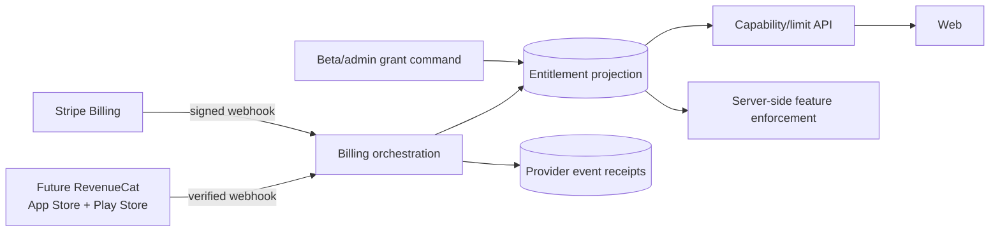

# Phase 08 — Plans, entitlements, and subscriptions

> **Status:** planned
> **Depends on:** the [Phase 03](03-campaign-core.md) entitlement projection and manual-tier baseline; [Phase 04](04-social-hub.md), [Phase 06](06-encounters.md), and [Phase 07](07-vtt.md) provide remaining enforced capabilities
> **Unlocks:** the public web plan model, [Phase 09 paid tables](09-paid-tables.md), and the web viability gate
> **Primary ADRs:** [0001](../adr/0001-package-boundaries.md), [0002](../adr/0002-kysely-writes-authored-hydration.md)

## Goal

Complete the provider-neutral entitlement model established in Phase 03 and launch Stripe Billing for web subscriptions. Keep the resulting contracts portable for Phase 10 native consumption, but do not add native billing in this phase.

## Current starting point

- Phase 03 already projects Free, Player, GM, and Pro GM limits and enforces character, owned-homebrew, storage, hosted-Campaign, and accepted-seat limits server-side using manual tier assignment.
- Billing-customer, subscription, webhook, grace-period, provider-event receipt, and customer-management domains do not yet exist.
- Supabase user identity is the current account key.
- Native clients and store billing do not exist and are not prerequisites for the web launch model.

## Launch plan matrix

| Plan   | Price                        | Characters | Owned homebrew roots | Storage | Hosted Campaigns         | Seats per Campaign | Public listings          | Saved Encounters | Paid tables                     |
| ------ | ---------------------------- | ---------- | -------------------- | ------- | ------------------------ | ------------------ | ------------------------ | ---------------- | ------------------------------- |
| Free   | $0                           | 6          | 20                   | 250 MB  | 1 active                 | 5                  | 1 free                   | 3                | No                              |
| Player | $4.99/month or $49.99/year   | Unlimited  | Unlimited            | 1 GB    | 1 active                 | 5                  | 1 free                   | 3                | No                              |
| GM     | $9.99/month or $99.99/year   | Unlimited  | Unlimited            | 5 GB    | 5 active                 | 12                 | 5                        | Unlimited        | Yes, 10% Artificer platform fee |
| Pro GM | $49.99/month or $499.99/year | Unlimited  | Unlimited            | 25 GB   | Unlimited under fair use | 12                 | Unlimited under fair use | Unlimited        | Yes, 0% Artificer platform fee  |

Every plan may join unlimited Campaigns, use Campaign-scoped content, contribute owned content when permitted, participate in party inventory, and use Encounters and VTT. Processing charges and applicable taxes are separate from the Artificer platform fee. Prices and limits are the launch-planning baseline and may be revised from evidence before public release.

## Requirements

- Define stable internal capabilities and limits independently of marketing plan names.
- Project all access into `EntitlementGrant.source = STRIPE | APP_STORE | PLAY_STORE | BETA | ADMIN`.
- Treat Artificer's database projection as the product authorization source. Clients never self-grant from a checkout redirect or local receipt.
- Enforce limits and capabilities in application services before adding plan-gated UI.
- Support beta/admin grants with creator, reason, effective interval, revocation, and audit data.
- Add Stripe customer/subscription mapping, signed idempotent webhooks, subscription status, billing period, cancellation, grace state, and customer-portal access.
- Process duplicate, delayed, missing, and out-of-order events deterministically.
- Keep immutable provider-event receipt data separate from the current entitlement projection.
- Model unlimited limits explicitly rather than with an arbitrary large number. Fair-use enforcement requires an auditable operator action and must not silently reduce ordinary Pro GM access.
- Campaign membership, Campaign content use, party inventory participation, Encounter/VTT participation, and unlimited Campaign joining are not subscription-gated.
- Keep contracts portable so Phase 10 can display and consume web-granted entitlements without adding a second authorization model.

## Design

Capabilities should answer product questions such as “may create another character,” “may create a Campaign,” or “marketplace fee waived,” without requiring domain code to know the provider or marketing tier name.

## Ordered workstreams

1. **Complete commercial policy details.** Preserve the Phase 03 entitlement projection and define trials, grace, cancellation, beta treatment, fair-use enforcement, and pre-launch price-change handling.
2. **Define entitlement contracts.** Model capability keys, numeric limits, grant source, scope, effective interval, priority/combination rules, and an explainable resolved entitlement view.
3. **Add persistence and authorization.** Create provider-neutral grant/projection records, provider-customer mappings, event receipts, and minimal operator audit access.
4. **Extend server-side enforcement.** Preserve Phase 03 checks and add owning-service checks for listings, Encounters, and paid-table capabilities; avoid one global subscription middleware.
5. **Integrate Stripe Billing on web.** Create server-owned Checkout/Portal sessions and signed webhook handling; never accept client-authored price or subscription state.
6. **Implement convergence and grace.** Recompute effective access from stored provider facts and grants so reordered events converge.
7. **Expose portable account state on web.** Return current capabilities, limits, consumption, grace/cancellation explanation, and refresh timing through contracts Phase 10 can later consume.
8. **Validate provider and enforcement behavior.** Use Stripe test clocks/fixtures where appropriate and cover signatures, retries, order changes, revocation, grace, and concurrent limit consumption.

## Acceptance gates

- Every gated operation is denied server-side when the capability or remaining limit is absent.
- Duplicate provider events create one effective transition.
- Delayed or out-of-order events converge on the provider's current subscription facts.
- A checkout redirect without a verified webhook grants nothing.
- Grace, cancellation-at-period-end, expiration, refund, and manual revocation are distinguishable and tested.
- Beta and admin grants are auditable and can be revoked without editing provider state.
- Free, Player, GM, and Pro GM receive exactly the documented creation, storage, hosted-Campaign, seat, listing, Encounter, and paid-table capabilities.
- All plans retain unlimited Campaign joining and core Campaign content, inventory, Encounter, and VTT participation.
- The entitlement response is platform-neutral and does not require Stripe concepts in product-domain consumers.

## Out of scope

- Paid-table orders and GM payouts, creator Marketplace orders and payouts, native subscription purchase, taxes beyond stored provider facts, coupons, multi-currency, Venmo, and generalized feature-flag infrastructure.
- Pro Creator, Ultimate, or other creator Marketplace packaging.

## Questions for the phase subplan

- What trial, grace, cancellation, and pre-launch price-change policy applies to the documented plans?
- Do existing beta users receive permanent, expiring, or manually revoked grants?
- What is the exact source-of-truth rule when an admin grant and provider subscription overlap?
- Does deleting an account immediately cancel provider subscriptions, or must cancellation finish before deletion?
- Which Stripe tax, invoice, trial, proration, and customer-portal behaviors are required at launch?
- What evidence and operator process justify a fair-use intervention for Pro GM without turning ordinary unlimited use into a hidden hard limit?

## New-session instruction

Do not start with Stripe UI. First produce a capability/limit matrix and identify every server operation that must enforce it. Keep paid marketplace and payout accounting out of this phase.
