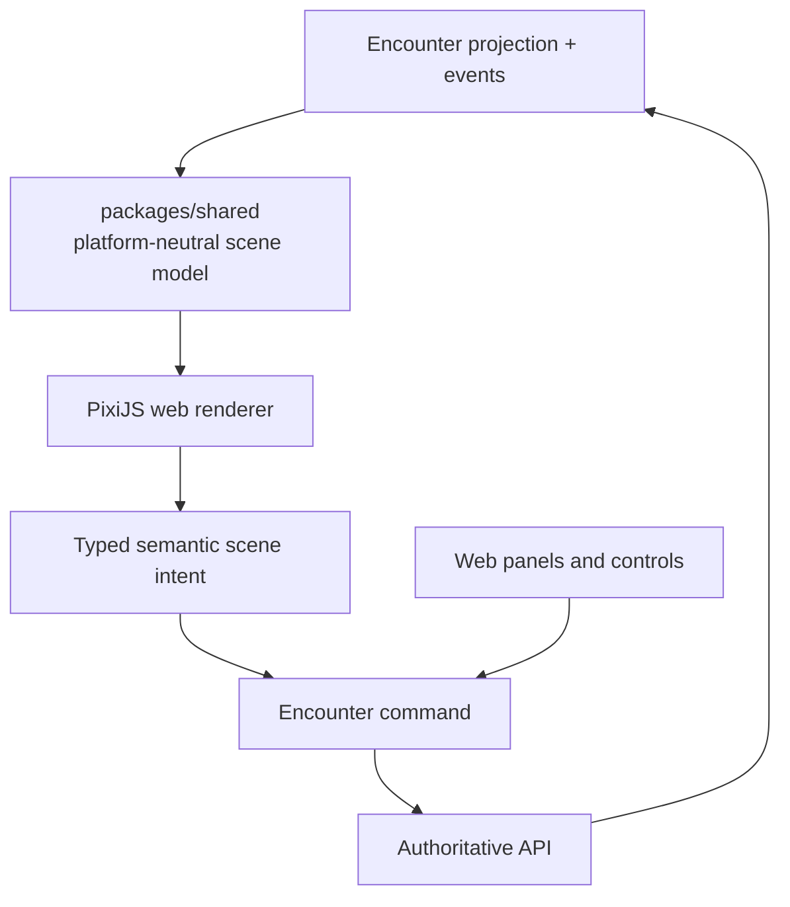

# Phase 08 — Web VTT

> **Status:** planned
> **Depends on:** [Phase 01](01-dice-and-roll-infrastructure.md), [Phase 02](02-media-and-file-pipeline.md), [Phase 06](06-live-campaign-play.md), and [Phase 07](07-encounters.md)
> **Unlocks:** the complete connected web play loop and its viability test
> **Primary ADRs:** [0005](../adr/0005-pure-rules-system-engine.md), [0009](../adr/0009-vtt-encounter-event-boundary.md), [0010](../adr/0010-platform-neutral-design-system.md)

## Goal

Add one Encounter-backed responsive web virtual tabletop. The first slice supports maps, tokens, grid, pan/zoom, measurement, manual fog, committed movement, initiative, chat, and rolls. It does not introduce another combat, actor, dice, or rules model.

## Current starting point

- Phase 07 is expected to own actor state, initiative, rolls, commands, events, projection, replay, authorization, and Realtime reconciliation.
- The Character Sheet remains a standalone play surface and does not own rounds or a combat log.
- `packages/design-system` can share semantic intent but not canvas or platform presentation components.
- No map asset, scene, token, fog, measurement, or canvas renderer exists today.

## Requirements

- Add a platform-neutral VTT scene model derived from the authoritative Encounter projection and exact scene events.
- Make hosted internet play the required topology: every authorized player connects independently to the deployed Artificer API, Storage, and private Realtime channels. Players must never need to share a LAN, Wi-Fi network, machine, browser host, or inbound port.
- Extend Encounter commands/events for durable scene actions such as token placement, committed movement, map selection, grid configuration, and fog changes.
- Keep selection, hover, open panels, camera position, drag interpolation, measurement preview, and similar transient UI state local or ephemeral.
- Use PixiJS as the first responsive web renderer. Keep navigation, chat, initiative, actor panels, menus, controls, and accessibility in ordinary web UI outside the canvas.
- Render the locally dragged token immediately without waiting for a network round trip. Broadcast bounded transient positions separately, interpolate them for remote viewers, and persist/validate only the final committed drop. A stale transient position can never replace a newer committed position.
- Maps and token assets reuse Phase 02 ready-asset identity, opaque object keys, authorized Supabase Storage paths, and API-owned metadata. A Cloudflare R2/provider move is deferred until VTT storage needs justify it; stable asset IDs keep Campaign and scene references portable.
- `VTT_MAP` has separate byte, dimension, pixel-count, quota, transfer, and processing rules from ordinary Campaign attachments and handout maps.
- Large map transfers use the resumable path selected by Phase 02. Phase 08 may add renderer-oriented optimization or tiling without creating a second upload authorization model.
- Manual fog is explicit Encounter/scene state with GM-only mutation in v1.
- Every durable action is idempotent, versioned, authorized, replayable, and reconcilable after reconnect.
- Treat connectivity as intermittent: reconnect restores the committed scene from the authoritative Encounter projection/events, then resumes private invalidation and ephemeral cues without peer-hosted state.
- Provide non-canvas alternatives for initiative, actor selection, token selection/movement, measurements, rolls, chat, and state inspection.

## Design

The shared scene model contains renderer-independent maps, grid, tokens, visibility, fog, measurement semantics, and z-order. It must not import PixiJS, DOM types, React Native, or platform gestures.

## Web renderer benchmark gate

Before public web beta, test representative desktop, tablet, and mobile-class browser hardware:

- One 4K map with 100 tokens.
- Pan, zoom, token drag, measurement, and manual fog.
- At least 45 sustained frames per second during the defined stress journey.
- No gesture stall longer than 100 ms.
- Reconnect without duplicate movement or stale projection.
- Acceptable memory and thermal behavior during a three-hour session.

If the gate fails, retain the scene model and command contracts and simplify or replace only the web renderer. Do not fork Encounter state or scene semantics.

## Ordered workstreams

1. **Lock VTT product/design behavior.** Define supported grid types, map sizing, token permissions, fog tools, measurement units, desktop/tablet/phone layouts, keyboard use, reduced motion, and screen-reader alternatives.
2. **Define scene contracts.** Add renderer-neutral scene projection, asset metadata, semantic intents, durable command/event extensions, transient broadcast envelopes, and version reconciliation.
3. **Extend the asset pipeline for VTT maps and tokens.** Lock VTT-specific limits, resumable transfer, optimization/tiling decision, Scene references, signed access, deletion, and Campaign/Encounter authorization without duplicating Phase 02 upload lifecycle.
4. **Build the pure scene reducer.** Reconstruct identical scene state from the same Encounter projection/events and cover ordering, visibility, fog, movement, and reconnect with deterministic tests.
5. **Build the web PixiJS renderer and host.** Keep UI panels outside the canvas and route durable actions through the Encounter API.
6. **Add ephemeral collaboration.** Broadcast throttled drag previews/pointers only after private-channel authorization; committed positions always come from persisted events.
7. **Run responsive, load, accessibility, memory, and recovery tests.** Execute the web benchmark before beta and preserve the non-canvas interaction path.

## Acceptance gates

- Replaying the same Encounter projection/events reconstructs byte-for-byte equivalent scene-domain values across responsive web sessions.
- A non-member cannot load map assets, subscribe to scene broadcasts, or issue scene commands.
- A remote table on unrelated home, mobile, or public networks completes the same join, scene load, action, reconnect, and asset-access journeys as a local table.
- Players cannot move or reveal tokens outside their actor-control capability.
- Duplicate/reordered movement delivery does not duplicate or regress committed position.
- Reload/reconnect restores the committed scene and discards stale local drag state.
- Fog state is GM-controlled, replayable, and does not leak hidden geometry through ordinary player DTOs or assets.
- Canvas and non-canvas controls can perform every required durable action.
- The web renderer passes the explicit benchmark or the phase records the renderer simplification/replacement before beta.
- VTT actions append Encounter events, never a second combat history or character lifecycle log.
- A VTT map cannot bypass its own profile by uploading as a Campaign attachment, and a normal handout is not treated as a scene map without an authorized VTT reference.

## Out of scope

- Automated attacks, saves, damage, conditions, reactions, authored-effect execution, dynamic lighting, 3D, physics, voice/video, AI, marketplace asset sales, offline play, LAN-only hosting, peer-authoritative state, arbitrary scripting, and premature storage-provider abstraction. An optional LAN/self-hosted mode may be evaluated later only as an alternative transport; it cannot become required for online play. Revisit R2 only when VTT map volume or egress evidence requires it.

## Concerns and expansions

The responsive browser/PWA remains the canonical VTT client and must pass the benchmark on its own. Packaging does not fix a slow synchronization protocol. A later Tauri desktop distribution may reuse the same web renderer, API, scene contracts, and Realtime protocol when offline asset libraries, filesystem integration, multi-window GM tools, or other proven native capabilities justify the additional release surface. Electron is not a planned dependency. A native mobile app should be evaluated as a focused companion experience rather than a compressed copy of the full tabletop.

## Questions for the phase subplan

- Which grid types and map calibration workflow ship first?
- Who may upload maps and tokens, and what file/size/storage limits apply?
- Are player tokens freely movable, GM-approved, turn-restricted, or capability-controlled?
- What fog representation balances replay accuracy, payload size, and web renderer performance?
- Which ephemeral remote cues are required beyond token drag previews?
- What exact browsers, devices, memory ceiling, and thermal threshold define the three-hour benchmark?

## New-session instruction

Build and test the platform-neutral scene model before the renderer. The subplan must identify which state is persisted, broadcast-only, and local-only; do not let PixiJS or DOM types cross into shared contracts.
