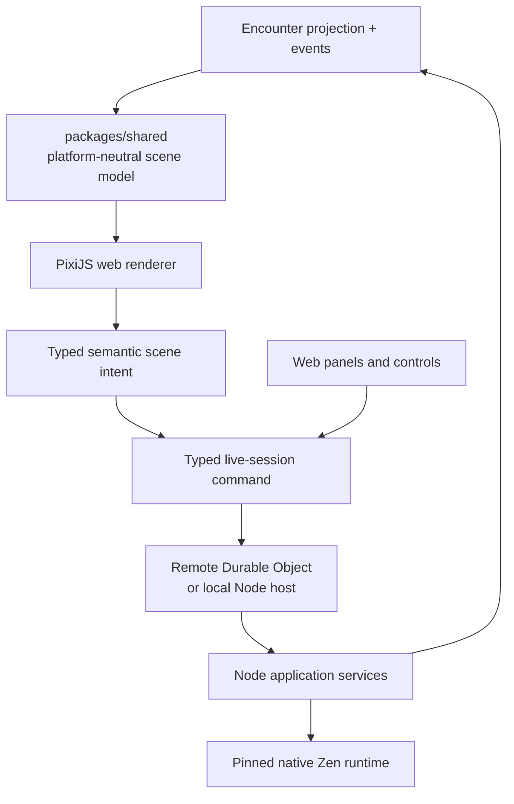
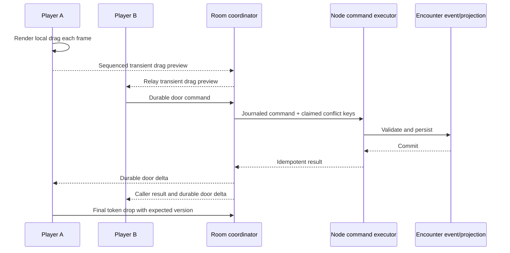

# Phase 08 — Web VTT

> **Status:** in progress — native remote/local scene backend, accessible standalone browser surface, and automated recovery/load diagnostics implemented; deployed remote and headed hardware soak pending
> **Depends on:** [Phase 01](01-dice-and-roll-infrastructure.md), [Phase 02](02-media-and-file-pipeline.md), [Phase 06](06-live-campaign-play.md), and [Phase 07](07-encounters.md)
> **Unlocks:** the complete connected web play loop and its viability test
> **Primary ADRs:** [0009](../adr/0009-vtt-encounter-event-boundary.md), [0010](../adr/0010-platform-neutral-design-system.md), [0019](../adr/0019-versioned-cross-domain-rules-runtime.md), and [0020](../adr/0020-local-and-remote-live-session-host.md)

## Goal

Add one Encounter-backed responsive web virtual tabletop. The retained production tracer supports maps, calibration, square and gridless play, walls, doors, lights, darkness, tokens, fog, measurement, player-view preview, committed movement, initiative, chat, and rolls. It does not introduce another combat, actor, dice, or rules model.

## Current starting point

- Phase 07 is expected to own actor state, initiative, rolls, commands, events, projection, replay, authorization, and Realtime reconciliation.
- The Character Sheet remains a standalone play surface and does not own rounds or a combat log.
- `packages/design-system` can share semantic intent but not canvas or platform presentation components.
- Native WebSocket transport, alarm-renewed Durable Object coordination, bounded recovery journal, local Node hosting, renderer-neutral scene contracts/reducer, scene persistence, deterministic geometry/exploration, private projection, and the `VTT_MAP` backend are implemented. The standalone tabletop window, Session and Character Sheet launch points, source-window live Sheet command route for present Characters, GM scene editor, map upload/calibration, React/Pixi boundary, and non-canvas controls are implemented. The renderer progressively loads signed tiles, keeps complete textures independent of delivery expiry, retries incomplete delivery after a network reconnect, renders exploration fog and labeled measurements, relays pointer/drag previews, and expires abandoned transient visuals. Automated six-client recovery/privacy, role-separated browser, and headless load diagnostics pass. A retained three-account managed deployment gate now binds the GM and both players to the preflighted Worker and covers real ticket issuance, private-snapshot withholding, exact signed map delivery/readiness, reversible scene commits broadcast to all three clients, full connection-cycle release, and authoritative reconnect without accumulating per-run Durable Object rooms; its deployed run and the headed hardware soak evidence remain.
- `apps/session-worker` owns managed remote rooms and transient fanout; the private Netlify executor owns native Zen/application execution. `apps/session-host` provides the same wire protocol with direct execution for local play.

## Requirements

- Add a platform-neutral VTT scene model derived from the authoritative Encounter projection and exact scene events.
- Support both managed internet play and local hosting through the same native WebSocket `/live-session/:sessionId` protocol. Managed players connect to a hibernatable Durable Object without sharing a LAN or opening an inbound port; local hosting runs a headless Node process on the host machine.
- Route live-session commands through one authoritative coordinator per active Campaign session. Derive and atomically claim a conservative conflict-key set, run disjoint work concurrently with conflict-local FIFO, evaluate mechanics through the exact pinned Zen revision in Node when needed, persist durable events/projections, then journal and publish compact private results/deltas.
- Store reusable versioned Campaign scene definitions and materialize the exact definition version when attached to an Encounter. Encounter projection/events own live tokens, door state, fog, and live geometry overrides.
- Extend Encounter commands/events for durable scene actions: scene attachment, structural edits, token placement/drop, door state, fog edits, and measurements.
- Keep selection, hover, open panels, camera position, drag interpolation, measurement preview, and similar transient UI state local or ephemeral.
- Use React plus one imperative PixiJS canvas boundary as the first responsive web renderer. Keep navigation, chat, initiative, actor panels, menus, controls, inspectors, dialogs, and accessible alternatives in ordinary React UI outside the canvas; do not flow frame-rate animation through React state.
- Launch the authenticated tabletop as a dedicated, reusable auxiliary browser window from either the Campaign Session workspace or the Character Sheet's latest open Session. Keep the originating workspace or Sheet open independently; the tabletop does not become a navigation hub back into those surfaces.
- Allow one admitted user to connect from multiple devices without one connection replacing another. Keep camera, zoom, selected tool, Play/Edit mode, and open panels local to each connection while all committed gameplay uses the same room authority. Treat tablet landscape as a first-class map surface with collapsible GM tools; make phone play Character-Sheet-first while retaining a focused player map for controlled-token movement, navigation, measurement, and authorized interactions.
- Let GMs switch between Play and Edit tools while a scene is live. Players receive only Play controls and authorized interactive scene elements. Door swing angle and other structural behavior are authored by the GM/editor, never selected by a player during play.
- Render the locally dragged token immediately without waiting for a network round trip. Broadcast bounded transient positions separately, interpolate them for remote viewers, and validate every path segment against authoritative barriers before a preview is relayed. The GM chooses `Reveal while dragging` (default) or `Reveal on drop`; on-drag vision is a private, server-derived transient projection and only the final path/fog batch is persisted. A stale or rejected transient position can never replace a newer committed position.
- Maps and token assets reuse Phase 02 ready-asset identity, opaque object keys, authorized Supabase Storage paths, and API-owned metadata. A Cloudflare R2/provider move is deferred until VTT storage needs justify it; stable asset IDs keep Campaign and scene references portable.
- `VTT_MAP` has separate byte, dimension, pixel-count, quota, transfer, and processing rules from ordinary Campaign attachments and handout maps.
- Large map transfers use the resumable Phase 02 path. `VTT_MAP` accepts JPEG, PNG, and WebP up to 25 MiB, 8192 px per side, and 64 MP; Sharp generates renderer tiles without creating a second upload authorization model.
- Manual fog is explicit Encounter/scene state with GM-only mutation in v1. Advanced lighting includes wall occlusion, point/cone lights, darkness polygons, and server/client-consistent exploration.
- Every durable action is idempotent, versioned, authorized, replayable, and reconcilable after reconnect.
- Recheck active Campaign membership roles on each 10-second authority renewal. Remove revoked or stale-role sockets without interrupting unaffected players.
- Treat connectivity as intermittent: reconnect restores the committed scene from the authoritative Encounter projection/events, then resumes private invalidation and ephemeral cues without peer-hosted state.
- Provide non-canvas alternatives for initiative, actor selection, token selection/movement, measurements, rolls, chat, and state inspection.

## Design

The shared scene model contains renderer- and transport-independent maps, calibration, square/gridless grids, diagonal policy, tokens, barriers, lights, darkness, fog, measurements, private projections, snapshots, durable deltas, and bounded transient envelopes. It must not import PixiJS, React, WebSocket, DOM types, database types, React Native, or platform gestures.

Transient previews give every admitted player concurrent visual feedback. Durable changes become globally authoritative only after persistence; the latest committed geometry validates the complete path and final drop, so a stale drag cannot overwrite a door change or cross a blocking wall. The GM can append an `Undo last token move` event that restores the prior token position and affected fog layers when no later overlapping state makes that restoration unsafe. Undo never deletes history and cannot erase knowledge a player already gained.

Scene movement and its derived fog chunks commit atomically as one versioned batch. Player broadcasts use fresh server-projected scene snapshots so newly explored entities appear together while hidden geometry remains withheld. Pinned Character vision is overlaid for the calculation only; explicit scene vision wins and authored scene data is not rewritten.

## Web renderer benchmark gate

Before public web beta, test representative desktop, tablet, and mobile-class browser hardware:

- One 8K map with 100 tokens and representative walls, lights, darkness, and fog.
- Pan, zoom, token drag, measurement, fog, and player-view preview.
- At least 45 sustained frames per second during the defined stress journey.
- No gesture stall longer than 100 ms.
- Scene-only host processing p95 below 100 ms; rule-bound host processing p95 below 250 ms.
- The managed release journey collects those limits from the private executor's origin-only timing receipts, not browser click-to-render diagnostics.
- Reconnect without duplicate movement or stale projection.
- Acceptable memory and thermal behavior during a three-hour session.

If the gate fails, retain the scene model and command contracts and simplify or replace only the web renderer. Do not fork Encounter state or scene semantics.

## Ordered workstreams

1. **Lock architecture and migrate transport.** Native remote/local WebSocket admission, hibernation-safe alarm renewal, bounded Durable Object journal, private Netlify executor, local Node host, actor-bound replay, conflict scheduling, private ready snapshots/transients, and reconnect recovery are implemented. Production deployment evidence remains. _Backend complete._
2. **Define scene contracts and reducer.** Renderer-neutral scene projection, semantic intents, atomic durable commands/events, transient envelopes, collision/visibility/lighting geometry, bounded exploration chunks, and deterministic replay are implemented. _Backend complete._
3. **Add persistence and reconstruction.** Campaign definitions, materialized Encounter instances, projections, ordered events, private snapshots/deltas, and semantic conflict rebase are implemented. _Backend complete._
4. **Extend the asset pipeline.** `VTT_MAP` limits, resumable transfer, renderer tiles, stable references, signed access, deletion protection, Campaign authorization, and browser upload/calibration are implemented.
5. **Build the retained React/Pixi tracer.** The dedicated authenticated tabletop window, Session/Sheet launch points, GM Play/Edit boundary, scene editor, map upload/calibration, layered map/tiles/grid/fog/lighting/token/measurement rendering, local drag/final committed movement, wall/door/light/darkness tools, pointer previews, transient expiry, player preview, reconnect, and player-focused narrow layout are implemented.
6. **Complete authoritative live play.** Durable scene commands, transient previews, pinned Character vision with scene override, private projections, Zen-bound mechanics, the production browser play surface, accessible non-canvas alternatives, and attended Character Sheet commands routed through the room authority are implemented.
7. **Run responsive, load, accessibility, memory, authorization, and recovery tests.** Automated workerd and real local-Supabase six-client recovery journeys pass. The retained 8K/100-token browser fixture passes headless correctness, interaction-stall, transient-retention, and sampled-heap gates; headless Chromium uses SwiftShader and is therefore diagnostic rather than valid 45 FPS evidence. A headed hardware smoke passes the same full fixture at approximately `165 FPS` with a `6.4 ms` maximum frame gap and no Long Tasks. Execute the deployed remote journey and opt-in headed hardware three-hour soak before beta while preserving non-canvas interaction.

## Acceptance gates

- Replaying the same Encounter projection/events reconstructs byte-for-byte equivalent scene-domain values across responsive web sessions.
- A non-member cannot load map assets, subscribe to scene broadcasts, or issue scene commands.
- A remote table on unrelated home, mobile, or public networks completes the same join, scene load, action, reconnect, and asset-access journeys as a local table.
- Players cannot move or reveal tokens outside their actor-control capability.
- Duplicate/reordered movement delivery does not duplicate or regress committed position.
- Historical Character receipts never replace a newer `READY`, committed broadcast, or cached Sheet version.
- Removed members and stale-role sockets are rejected within the next authority-renewal interval while unaffected members continue receiving permitted traffic.
- Durable Object eviction/hibernation reconstructs pending delivery and committed scene state without duplicate execution.
- Reload/reconnect restores the committed scene and discards stale local drag state.
- Manual fog edits are GM-controlled; automatic exploration is deterministic and replayable; neither path leaks hidden geometry through player projections or assets.
- Canvas and non-canvas controls can perform every required durable action.
- Session and Character Sheet launch points reuse a dedicated tabletop window that remains usable when tiled, moved to another display, or screen-shared; players never receive editor chrome.
- The same user can keep a tablet tabletop and a desktop workspace or phone Character Sheet connected concurrently; actions committed from either surface appear on the others without synchronizing camera or panel state. Tablet play remains map-first and touch-usable, while the phone tabletop remains a focused player fallback rather than a compressed GM editor.
- A Character Sheet left open beside the tabletop routes commands for its present Character through the room authority, acknowledges only persisted commits, and retains the ordinary HTTP path when no open Session owns that Character.
- The web renderer passes the explicit benchmark or the phase records the renderer simplification/replacement before beta.
- VTT actions append Encounter events, never a second combat history or character lifecycle log.
- A VTT map cannot bypass its own profile by uploading as a Campaign attachment, and a normal handout is not treated as a scene map without an authorized VTT reference.

## Out of scope

- Automated attacks, saves, damage, conditions, reactions, authored-effect execution, 3D, physics, voice/video, AI, marketplace asset sales, offline-first persistence, peer-authoritative state, arbitrary scripting, map-art creation, procedural generation, texture painting, public plugin APIs, Redis/multi-region orchestration, and premature storage-provider abstraction. Local hosting is supported but cannot become required for managed online play. Revisit R2 only when VTT map volume or egress evidence requires it.

## Concerns and expansions

The responsive browser/PWA remains the canonical VTT client and must pass the benchmark on its own. Packaging does not fix a slow synchronization protocol. A later desktop launcher may reuse the same web renderer and start `apps/session-host` invisibly for local hosting; it must also provide a trusted LAN browser origin and host discovery before tablet/phone connections are presented as an end-user local-play workflow. The headless host is not a reason to duplicate scene or rules code. Electron is not a planned dependency. A native mobile app should be evaluated as a focused companion experience rather than a compressed copy of the full tabletop.

## New-session instruction

Continue from the implemented native WebSocket, Durable Object/local-host, scene-persistence, VTT-map, geometry/exploration, Character-vision, private-projection backend, and accessible standalone tabletop. Run the deployed managed recovery/asset journey and three-hour headed hardware soak next. Preserve the Session/Sheet-to-tabletop launch direction, source-window live Sheet command route for present Characters, GM Play/Edit boundary, player-only Play surface, durable state, broadcast-only previews, and local-only UI state; do not let PixiJS, React, WebSocket, or DOM types cross into shared contracts.
