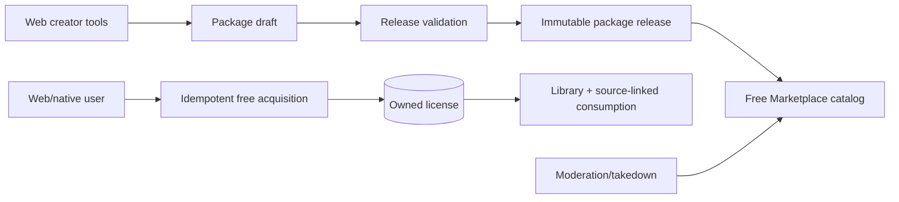

# Phase 09 — Free Marketplace

> **Status:** planned
> **Depends on:** the asset pipeline from [Phase 02](02-media-and-file-pipeline.md), revision binding from [Phase 04](04-campaign-core.md), entitlement foundations from [Phase 07](07-entitlements-and-subscriptions.md), and moderation identity from [Phase 08](08-social-hub.md)
> **Unlocks:** paid creator content
> **Primary ADRs:** [0007](../adr/0007-authored-revisions-and-active-projections.md), [0008](../adr/0008-ruleset-identity-and-content-binding.md)

## Goal

Prove creator publication, immutable releases, licensing, moderation, fulfillment, Library access, and source-linked consumption without a payment provider. Free acquisition must create a real license through the same domain path later used by paid orders.

## Current starting point

- Authored definitions have stable ownership, immutable revisions, active/draft pointers, and public route IDs.
- Existing `MASTER | OWNED` provenance is insufficient for creator attribution, licenses, acquisition, updates, takedown, or sale rights.
- Copying authored content intentionally creates an independent definition without a durable source link.
- There is no creator storefront, package, release, asset, license, acquisition, fulfillment, or takedown domain.
- Phase 02 is expected to own upload/processing lifecycle and stable asset identity; Marketplace owns rights, release references, licensing, and delivery authorization.

## Requirements

- Creator profiles expose approved public identity, attribution, links, and status separately from raw auth/profile data.
- A package draft groups app-native authored content plus optional supplemental files and preview assets.
- A release is immutable and references exact authored revisions, attribution, license terms/version, release notes, previews, and supplemental-file metadata.
- Publishing verifies ownership or explicit rights for every included item.
- Listing visibility and moderation/takedown state are separate from release immutability.
- Free acquisition is idempotent and creates an immutable license record with release, terms version, source, and timestamp.
- Acquired content is available through Library and source-linked references/imports according to the approved license model.
- Removing a listing blocks new acquisition but does not silently delete existing licenses. Legal takedown behavior is explicit and exceptional.
- Native supports browse, detail, free acquisition, owned Library, and consumption. Package authoring/release administration remains web-first.
- Preview and supplemental files must already be `READY` Phase 02 assets before publishing. Storage access uses API-authorized object paths and RLS/signed URLs; release metadata never trusts client-declared uploads.
- Published release manifests pin exact immutable asset IDs. Replacing a package draft file creates a new asset/reference and never changes a published release.

## Design

Marketplace package/release identity is not another authored-content revision root. A release references authored revisions and assets; it does not duplicate their lifecycle.

## Ordered workstreams

1. **Lock rights and license semantics.** Define supported license forms, creator attestation, attribution, supplemental-file rules, update behavior, unlisting, takedown, deletion, and import/reference rights.
2. **Define creator/package/release contracts.** Include exact revision manifests, release immutability, preview/assets, moderation state, and stable public identity.
3. **Add persistence and RLS.** Create creator profiles, package drafts, releases/manifests with Phase 02 asset references, listings, licenses, moderation cases, and provenance links. Do not duplicate upload lifecycle tables.
4. **Add release validation and publishing.** Verify ownership/rights, file metadata, ruleset compatibility, exact revisions, terms, and immutable economics placeholder without adding money.
5. **Add free acquisition and fulfillment.** Reuse entitlement concepts where appropriate but keep license terms and content provenance explicit.
6. **Add Library consumption.** Resolve licensed exact revisions for reference or approved copy/import while preserving creator/source/license attribution.
7. **Build web and native surfaces.** Web owns creator/package/release administration; both clients own catalog, detail, acquisition, Library, and consumption.
8. **Validate rights, immutability, and access.** Test draft leakage, release mutation, duplicate acquisition, unlisting, takedown, deleted accounts, file authorization, and revision stability.

## Acceptance gates

- Draft package data and unpublished revisions never appear in public or acquired responses.
- A release manifest cannot change after publication.
- A creator cannot publish another user's content without an explicit rights record.
- Acquisition retries create one license.
- Every license resolves the exact acquired release and terms version.
- Later authored revisions do not silently change a prior release.
- Copies or references preserve required attribution and source identity.
- Unlisting stops new acquisition without erasing ordinary existing licenses.
- Native and web show the same catalog and Library ownership.
- Published previews and supplemental files resolve the exact ready assets in the immutable release, and unlicensed users cannot download licensed supplements.

## Out of scope

- Prices, payments, orders, refunds, payouts, carts, bundles containing multiple sellers, subscriptions, reviews, gifting, print fulfillment, and professional page-layout authoring.

## Questions for the phase subplan

- Which license types and custom-term options are permitted at launch?
- Does a license grant exact-release reference access, editable copy rights, or both?
- Are later releases separate acquisitions, optional free updates, or automatically included?
- What file types, size limits, malware scanning, preview generation, and retention rules apply?
- What happens to existing access after creator deletion, ordinary unlisting, policy removal, or legal takedown?
- Is Marketplace browsing public or authenticated-only?

## New-session instruction

Start with the release manifest and license semantics, then trace exact revision loading through Builder/Sheet consumption. Do not call game equipment cost, the Builder catalog, or generic entitlements an order system.
