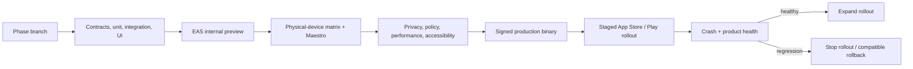

# Phase 9 — Store release and continuous validation

> **Status:** planned; validation work begins in Phase 0 and is hardened here
> **Depends on:** the native features selected for the first public release
> **Unlocks:** controlled App Store and Play Store release
> **Primary ADRs:** [0001](../adr/0001-package-boundaries.md), [0010](../adr/0010-platform-neutral-design-system.md)

## Goal

Turn the tested native client into a repeatable, observable, privacy-complete store release. Establish component, journey, device, performance, accessibility, signing, update, staged-rollout, crash, and rollback gates without adding product features.

## Current starting point

- Phase 0 creates the Expo workspace and initial EAS profiles.
- Each prior phase is responsible for its own unit, contract, integration, authorization, and client tests.
- Store accounts, final identifiers, signing ownership, privacy declarations, crash reporting, Maestro journeys, production EAS workflows, staged rollout, and rollback policy do not currently exist.

## Requirements

- Keep shared/package validation in Vitest and web end-to-end journeys in Playwright.
- Use `jest-expo` and React Native Testing Library for native component and interaction coverage.
- Use Maestro on EAS for critical sign-in, Character, Campaign, Encounter, commerce-consumption, deep-link, and VTT journeys included in the release.
- Test accessibility with platform screen readers, dynamic text, contrast, reduced motion, keyboard/switch alternatives where applicable, and non-canvas VTT controls.
- Maintain a physical-device matrix with at least one current and one oldest-supported iOS and Android device.
- Measure launch, memory, reconnect, VTT frame rate/gesture stalls, thermal behavior, battery use, and large-list/chat performance against written budgets.
- Configure EAS development, internal preview, and production builds plus EAS Submit after account/signing access is approved.
- Define `runtimeVersion` compatibility. EAS Update may change compatible JavaScript/assets only; native dependency, permission, entitlement, or runtime changes require a new binary.
- Complete Apple/Google privacy declarations, data-safety forms, permission copy, account deletion, support links, content reporting, age rating, export/compliance, and store metadata.
- Add a crash-reporting provider with environment/release identity and privacy filtering. Do not record chat bodies, secrets, access tokens, precise private content, or payment data.
- Include user-upload disclosures and validation for image metadata, supporting files, storage/egress, retention, moderation, account deletion, and native photo/document permissions.
- Use staged rollout, server compatibility checks, rollback-ready database/API changes, and documented stop/rollback ownership.

## Design

Release health is based on backend/API compatibility, authorization correctness, crashes, startup/reconnect, and completion of critical journeys—not only whether a binary builds.

## Ordered workstreams

1. **Lock release scope and ownership.** Choose the features in the first public binary, final identifiers, store/EAS owners, minimum OS versions, device matrix, support contact, and release decision owner.
2. **Define the validation matrix.** Map shared contracts, RLS/API authorization, media upload/download lifecycle, native components, Maestro journeys, web parity, deep links, push, cache, payments consumption, and VTT benchmarks to required checks.
3. **Build native automation.** Add stable fixtures/test accounts, `jest-expo`/RTL coverage, Maestro journeys, artifact capture, and retry policy that distinguishes infrastructure from product failures.
4. **Complete real-device and accessibility validation.** Run current/oldest devices, screen readers, dynamic type, reduced motion, poor-network/reconnect, long-session battery/thermal, and cold-start links.
5. **Configure production delivery.** Finalize EAS profiles, credentials, build numbers, signing access, Submit, environment separation, secrets, runtime versions, and update channels.
6. **Complete privacy, safety, and store metadata.** Align actual data flows with disclosures, deletion/export behavior, moderation/report links, age rating, permissions, and screenshots/copy.
7. **Add crash and release observability.** Select the provider, scrub sensitive data, attach app/API/runtime versions, define alert thresholds, and provide minimal operator diagnostics.
8. **Practice rollout and rollback.** Rehearse internal preview, staged rollout, API backward compatibility, EAS Update rollback where compatible, binary halt, and database rollback/forward-fix ownership.
9. **Release in stages.** Start with the smallest approved audience, observe the written soak period, expand only when gates remain green, and record exceptions.

## Acceptance gates

- All shipped API contracts parse identically on web and native release builds.
- Critical authorization and RLS matrices pass against the production-equivalent backend.
- Required Maestro journeys pass on current and oldest-supported physical iOS and Android devices.
- Cold-start invitation, Encounter, Marketplace, and Social Hub links reach the correct authorized route or fail closed.
- Sign-out, remote revocation, and account deletion clear device secrets, caches, subscriptions, and push registration.
- Accessibility review finds no required action available only through drag, color, small text, or an unlabeled canvas.
- Performance, VTT, thermal, battery, crash-free, and reconnect budgets meet written thresholds.
- Store disclosures match observed Auth, chat, notes, location/timezone, marketplace, payment, analytics, crash, and moderation data flows.
- Shipped upload surfaces reject spoofed/unsafe/oversized files, enforce profile quotas, strip private image metadata, revoke private delivery after access removal, and clean up according to tested retention rules.
- A compatible update can be rolled back, an incompatible change is blocked from OTA, and staged store rollout can be halted.
- The release has named owners for support, moderation, payment incidents, privacy requests, and rollback decisions.

## Out of scope

- New Campaign, Encounter, Marketplace, Social, or VTT features; desktop-native apps; additional regions; and broad observability infrastructure not tied to release decisions.

## Questions for the phase subplan

- Which features and commerce controls are in the first public binary?
- What crash reporter and privacy-safe product analytics, if any, are approved?
- What numeric budgets define launch time, memory, crash-free use, reconnect, VTT performance, thermal state, and battery drain?
- What soak duration and health thresholds control staged rollout expansion?
- Who owns Apple/Google accounts, signing credentials, privacy responses, moderation escalation, and emergency rollback?
- What minimum backend versions must each native runtime support during gradual rollout?

## New-session instruction

Create a release matrix from actual shipped features; do not copy every future roadmap gate into the first binary. This phase changes delivery/testing/operations only unless a failed gate produces a separately scoped product fix.
