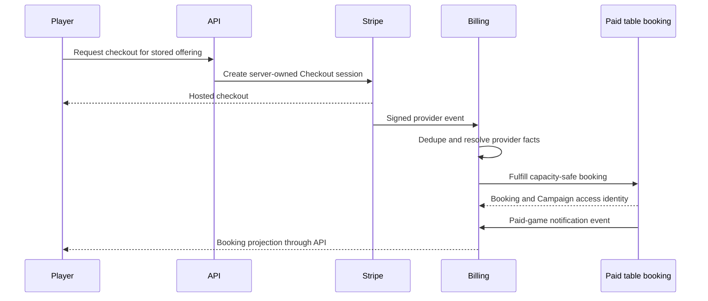

# Phase 10 — Paid tables and Pro GM economics

> **Status:** planned; commercial/legal decisions required before implementation
> **Depends on:** [Phase 03](03-campaign-core.md), [Phase 04](04-social-hub.md), [Phase 05 notifications](05-notifications-and-delivery.md), [Phase 06 live play](06-live-campaign-play.md), and [Phase 09](09-entitlements-and-subscriptions.md)
> **Unlocks:** professional-GM monetization and the public web viability gate
> **Primary ADRs:** [0001](../adr/0001-package-boundaries.md), [0002](../adr/0002-kysely-writes-authored-hydration.md), [0008](../adr/0008-ruleset-identity-and-content-binding.md)

## Goal

Add approved web payment paths for paid table listings and bookings. Preserve capacity-safe fulfillment, immutable booking economics, GM payouts, refunds, disputes, taxes, and plan-based platform fees. Creator content commerce remains deferred to Phases 12–13.

## Entry decisions

Do not write payment code until the business owner and qualified legal/tax advisors settle:

- Merchant-of-record and marketplace-facilitator responsibilities for paid tabletop services.
- Supported jurisdiction, currency, tax collection, invoicing, and GM reporting.
- GM eligibility, identity/KYC, prohibited services, payout timing, and reserves.
- Booking scope, reservation timing, cancellation, rescheduling, no-show, dispute, chargeback, and Campaign-removal policy.
- Store-policy treatment for later native discovery, booking management, and checkout.

## Requirements

- Only GM and Pro GM plans may publish paid listings. Free and Player listings remain free.
- GM bookings use a 10% Artificer platform fee. Pro GM bookings use a 0% Artificer platform fee. Payment-processing charges and applicable taxes remain separately represented.
- Resolve the platform fee from internal entitlements before checkout and snapshot the applied plan and fee into immutable booking economics. Later plan changes never rewrite an existing booking.
- Use Stripe Connect hosted onboarding for GM payout accounts unless an approved provider decision replaces it.
- Create checkout server-side from a stored table offering. Clients cannot submit authoritative price, currency, GM, fee, capacity, schedule, or fulfillment state.
- Verify signed webhooks and process duplicate, delayed, missing, and out-of-order events idempotently.
- Coordinate application approval, temporary reservation, completed payment, seat consumption, and Campaign access without overselling.
- Grant paid Campaign access only after the approved payment state is reached. A checkout redirect grants nothing.
- Model cancellations, refunds, disputes, chargebacks, rescheduling, and access removal without deleting financial or moderation history.
- Keep paid-table orders, seats, and payouts separate from future creator release licenses and Marketplace orders.
- Create notification events for paid-game application, acceptance, booking, payment, cancellation, rescheduling, refund, dispute, payout, and scheduled-session reminders. Reuse Phase 05 Novu workflows, preferences, grouping, and delivery intents; email remains required for time-sensitive paid-GM operations and payloads contain no sensitive application or Campaign text.
- Paid offerings publish the Campaign's table expectations, content guidance, attendance/cancellation policy, and selected safety practices. At least one approved safety practice is required before publication.
- A paid session correlates Phase 06's scheduled time, RSVP, and actual attendance with its immutable booking economics. The GM confirms whether the session ran before payout eligibility; correction and dispute paths retain the original record and actor audit.
- Minimum-player rules, cancellation windows, no-shows, late joins, partial attendance, GM cancellation, and technical-failure handling are explicit stored policy inputs, not ad hoc support notes.
- A GM operations view summarizes upcoming sessions, seats and RSVPs, attendance awaiting confirmation, cancellations/refunds/disputes requiring action, and gross/platform-fee/processing/net payout facts. It is a projection of booking truth, not a separate editable ledger or speculative performance-scoring system.

## Design

Payment receipt handling and table fulfillment coordinate through explicit identities and idempotency keys. A refund is a state transition, never deletion of a booking, membership, payment, or payout record.

## Ordered workstreams

1. **Record commercial decisions.** Approve the entry policies and add an ADR where they affect load-bearing accounting or provider boundaries.
2. **Define paid-table contracts.** Model GM payout identity, stored offerings, applications, reservations, bookings, immutable economics, provider receipts, refunds, disputes, payouts, and Campaign access correlation.
3. **Add Connect onboarding and eligibility.** Keep onboarding hosted and web-first; block paid publication until provider and product requirements are satisfied.
4. **Add server-owned checkout and webhook convergence.** Store provider identities and idempotency; never fulfill from client navigation.
5. **Coordinate capacity and access.** Make reservation, payment, seat consumption, and Campaign membership converge without overselling or orphaning access.
6. **Apply plan-based fees.** Snapshot the GM 10% or Pro GM 0% Artificer platform fee while keeping processing charges and taxes explicit.
7. **Add paid-game notifications.** Reuse Phase 05 Novu workflows and delivery intents; add RSVP and scheduled reminders without another inbox, preference store, or delivery abstraction.
8. **Build responsive web flows.** Cover onboarding, offering management, the GM operations view, table expectations/safety practices, application/booking/attendance status, checkout, receipts, cancellation, refund, notification state, and operator diagnostics.
9. **Validate policy and failure behavior.** Test signatures, retries, reordering, stale prices, capacity races, plan changes, refund/dispute cases, GM isolation, notification delivery, and reconciliation.

## Acceptance gates

- A client cannot alter price, fee, GM, currency, tax input, schedule, or seat scope.
- Duplicate or reordered provider events converge without duplicate bookings, access grants, refunds, or payouts.
- Failed or abandoned checkout grants no paid-table access.
- Concurrent fulfillment cannot exceed table capacity.
- A GM booking snapshots a 10% Artificer platform fee; a Pro GM booking snapshots 0%; processing charges and taxes remain separate.
- Changing or ending a subscription does not rewrite historical booking economics.
- Cancellation, rescheduling, refund, dispute, no-show, and Campaign-removal behavior matches the approved written policy.
- A payout-eligible session has one scheduled record, attendance confirmation, and auditable GM correction path; retries cannot charge or pay twice.
- The GM operations view reconciles to stored bookings, refunds, disputes, and payouts and does not invent a second balance or attendance state.
- GM A cannot inspect GM B's applicants, customers, bookings, balances, or payout state.
- Paid-game notification attempts are idempotent, retryable, and contain no protected payload without an authorized follow-up read.
- Creator content licenses, releases, and Marketplace orders are absent from this phase.

## Out of scope

- Creator Marketplace publication, licenses, orders, or payouts; native checkout; reviews; ratings; gifting; coupons; multiple processors; non-US commerce; voice/video; and background checks.
- Pro Creator, Ultimate, or other creator-focused subscription packaging.

## Questions for the phase subplan

- Is a paid table sold per seat, per session, Campaign period, or recurring schedule?
- When is a seat reserved: application acceptance, Checkout creation, payment authorization, or completed payment?
- How do GM cancellation, rescheduling, player cancellation, no-show, dispute, and Campaign removal affect access and payout?
- Which taxes, receipts, GM forms, support workflows, reconciliation reports, and payout reserves are mandatory?
- Which later native discovery, management, or checkout paths are approved in each storefront and region?

## New-session instruction

The first deliverable is an approved commercial/accounting decision record and provider-event state machine. Do not begin UI or Connect integration while merchant-of-record, tax, refund, reservation, and fulfillment rules are unresolved.
