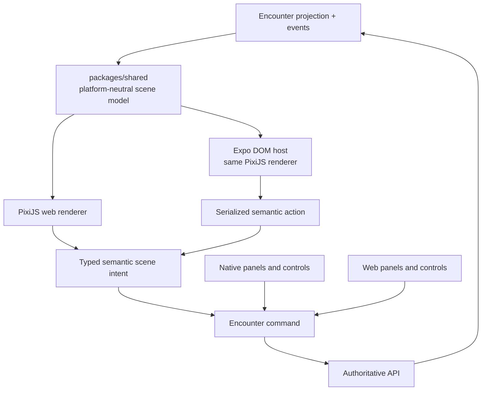

# Phase 10 — Web and native VTT

> **Status:** planned
> **Depends on:** [Phase 01](01-media-and-file-pipeline.md), [Phase 02](02-cross-platform-foundation.md), [Phase 04](04-live-campaign-play.md), and [Phase 05](05-encounters.md)
> **Unlocks:** spatial web/native Encounter play
> **Primary ADRs:** [0005](../adr/0005-pure-rules-system-engine.md), [0009](../adr/0009-vtt-encounter-event-boundary.md), [0010](../adr/0010-platform-neutral-design-system.md)

## Goal

Add one Encounter-backed virtual tabletop across web, iOS, and Android. The first slice supports maps, tokens, grid, pan/zoom, measurement, manual fog, committed movement, initiative, chat, and rolls. It does not introduce another combat, actor, dice, or rules model.

## Current starting point

- Phase 05 is expected to own actor state, initiative, rolls, commands, events, projection, replay, authorization, and Realtime reconciliation.
- The Character Sheet remains a standalone play surface and does not own rounds or a combat log.
- `packages/design-system` can share semantic intent but not canvas or platform presentation components.
- No map asset, scene, token, fog, measurement, canvas renderer, or native bridge exists today.

## Requirements

- Add a platform-neutral VTT scene model derived from the authoritative Encounter projection and exact scene events.
- Extend Encounter commands/events for durable scene actions such as token placement, committed movement, map selection, grid configuration, and fog changes.
- Keep selection, hover, open panels, camera position, drag interpolation, measurement preview, and similar transient UI state local or ephemeral.
- Use PixiJS as the first renderer. Web mounts it directly; native hosts only the canvas in an Expo DOM component.
- Native navigation, chat, initiative, actor panels, menus, controls, haptics, and accessibility remain React Native.
- Do not send every animation frame across the DOM/native bridge. Native supplies snapshots/deltas and receives committed semantic actions.
- Persist final token positions before announcing them as committed. Throttle ephemeral remote movement separately.
- Maps and token assets reuse Phase 01 ready-asset identity, authorized Supabase Storage paths, and API-owned metadata.
- `VTT_MAP` has separate byte, dimension, pixel-count, quota, transfer, and processing rules from ordinary Campaign attachments and handout maps.
- Large map transfers use the resumable path selected by Phase 01. Phase 10 may add renderer-oriented optimization or tiling without creating a second upload authorization model.
- Manual fog is explicit Encounter/scene state with GM-only mutation in v1.
- Every durable action is idempotent, versioned, authorized, replayable, and reconcilable after reconnect.
- Provide non-canvas alternatives for initiative, actor selection, token selection/movement, measurements, rolls, chat, and state inspection.

## Design

The shared scene model contains renderer-independent maps, grid, tokens, visibility, fog, measurement semantics, and z-order. It must not import PixiJS, DOM types, React Native, or platform gestures.

## Renderer benchmark gate

Before native beta commits to the Expo DOM host, test on the oldest-supported physical iOS and Android devices:

- One 4K map with 100 tokens.
- Pan, zoom, token drag, measurement, and manual fog.
- At least 45 sustained frames per second during the defined stress journey.
- No gesture stall longer than 100 ms.
- Reconnect without duplicate movement or stale projection.
- Acceptable thermal and battery behavior during a three-hour session.

If the gate fails, retain the scene model and command contracts and replace only the native renderer with React Native Skia. Do not fork Encounter state or scene semantics.

## Ordered workstreams

1. **Lock VTT product/design behavior.** Define supported grid types, map sizing, token permissions, fog tools, measurement units, desktop/tablet/phone layouts, keyboard use, reduced motion, and screen-reader alternatives.
2. **Define scene contracts.** Add renderer-neutral scene projection, asset metadata, semantic intents, durable command/event extensions, transient broadcast envelopes, and version reconciliation.
3. **Extend the asset pipeline for VTT maps and tokens.** Lock VTT-specific limits, resumable transfer, optimization/tiling decision, Scene references, signed access, deletion, and Campaign/Encounter authorization without duplicating Phase 01 upload lifecycle.
4. **Build the pure scene reducer.** Reconstruct identical scene state from the same Encounter projection/events and cover ordering, visibility, fog, movement, and reconnect with deterministic tests.
5. **Build the web PixiJS renderer and host.** Keep UI panels outside the canvas and route durable actions through the Encounter API.
6. **Build the native Expo DOM host.** Define a narrow serialized bridge, native-owned navigation/controls, gesture arbitration, lifecycle, reconnect, and accessibility fallbacks.
7. **Add ephemeral collaboration.** Broadcast throttled drag previews/pointers only after private-channel authorization; committed positions always come from persisted events.
8. **Run parity, load, accessibility, battery, and recovery tests.** Execute the benchmark before deciding whether to keep Expo DOM or implement Skia.

## Acceptance gates

- Web and native reconstruct byte-for-byte equivalent scene-domain values from the same Encounter projection/events.
- A non-member cannot load map assets, subscribe to scene broadcasts, or issue scene commands.
- Players cannot move or reveal tokens outside their actor-control capability.
- Duplicate/reordered movement delivery does not duplicate or regress committed position.
- Reload/reconnect restores the committed scene and discards stale local drag state.
- Fog state is GM-controlled, replayable, and does not leak hidden geometry through ordinary player DTOs or assets.
- Canvas and non-canvas controls can perform every required durable action.
- The native renderer passes the explicit physical-device benchmark or the phase records the Skia switch before beta.
- VTT actions append Encounter events, never a second combat history or character lifecycle log.
- A VTT map cannot bypass its own profile by uploading as a Campaign attachment, and a normal handout is not treated as a scene map without an authorized VTT reference.

## Out of scope

- Automated attacks, saves, damage, conditions, reactions, authored-effect execution, dynamic lighting, 3D, physics, voice/video, AI, marketplace asset sales, offline play, and arbitrary scripting.

## Questions for the phase subplan

- Which grid types and map calibration workflow ship first?
- Who may upload maps and tokens, and what file/size/storage limits apply?
- Are player tokens freely movable, GM-approved, turn-restricted, or capability-controlled?
- What fog representation balances replay accuracy, payload size, and native bridge performance?
- Which ephemeral remote cues are required beyond token drag previews?
- What exact devices, thermal limit, and battery-loss threshold define the three-hour benchmark?

## New-session instruction

Build and test the platform-neutral scene model before a renderer. The subplan must identify which state is persisted, broadcast-only, and local-only; do not let PixiJS or Expo DOM types cross into shared contracts.
