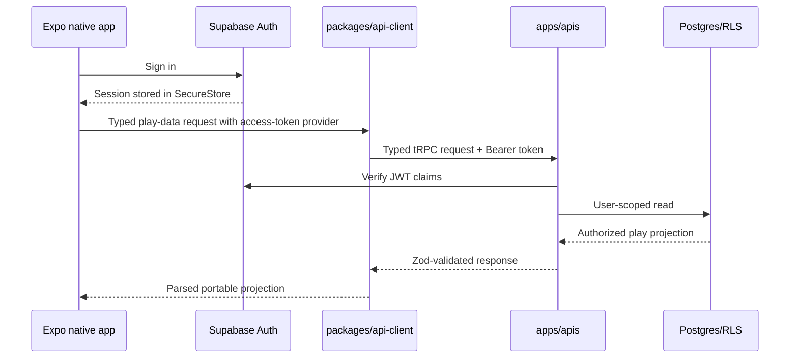

# Phase 11 — Native foundation and play parity

> **Status:** planned after the web viability gate passes
> **Depends on:** the connected web product through [Phase 10](10-paid-tables.md), an explicit passing viability decision, and the current authenticated API baseline
> **Unlocks:** first-class iOS/Android play clients and [Phase 12 store release](12-store-release-and-continuous-validation.md)
> **Primary ADRs:** [0001 package boundaries](../adr/0001-package-boundaries.md), [0010 platform-neutral design system](../adr/0010-platform-neutral-design-system.md)

## Goal

Build first-class Expo iOS and Android play clients against the proven web product. Native signs into the same account, crosses the same tRPC product-data boundary, and provides play-oriented parity for Characters and Sheets, Campaigns, Social Hub participation, live Campaign collaboration, Encounters, VTT, entitlements, and existing paid-table bookings without wrapping the website.

## Current starting point

- `apps/web` is the only product client.
- `apps/apis` is reached through the web server's `/api/trpc` handler and currently derives authentication from browser session cookies.
- `apps/web/src/lib/api.ts` manually mirrors tRPC procedures and parses shared Zod DTOs.
- `packages/design-system` already owns platform-neutral foundations and semantics; only a web adapter exists.
- Phase 00 and Phase 01 provide complete portable Sheet and roll contracts.
- Phase 02 provides the proven media contract; Phases 03–10 are expected to provide Campaign, Social Hub, live collaboration, Encounter, VTT, entitlement, and paid-table contracts.
- There is no Expo workspace, native release configuration, native cache, push registration, or mobile test harness.

Verify all of these statements on the phase branch before planning implementation.

## Requirements

- Add `apps/mobile` as an Expo/React Native TypeScript workspace using Expo Router.
- Add a small `packages/api-client` for typed tRPC construction, shared API errors, query-key factories, and bearer-token injection.
- Keep product data behind `apps/apis`. Mobile may use Supabase directly only for Auth and authorized Realtime/Storage operations.
- Persist Supabase session secrets with `expo-secure-store`, refresh only while the app is active, and clear secrets and query state on sign-out or revocation.
- Add a native semantic adapter for all existing portable design-system semantics. Do not import Mantine, Vanilla Extract, CSS, or web components.
- Build native play journeys for Characters, authoritative Sheets and dice, Campaigns, Campaign content and party inventory, sessions/notes/chat, Social Hub participation, Encounters, VTT, entitlements, and existing paid-table bookings.
- Keep complex authored-content creation, listing administration, GM payout onboarding, and payment checkout web-first.
- Reuse Phase 02 asset identities and authorized delivery without reading Storage paths directly.
- Reuse Phase 08 scene and Encounter contracts. Benchmark an Expo DOM PixiJS host first and switch only the native renderer to React Native Skia if the physical-device gate fails.
- Add private Realtime reconciliation, visibly stale read-only SQLite projection caching, push registration/revocation, and authorized deep links. Offline mutations remain disabled.
- Consume the Phase 05 feed and preferences, add Expo push tokens as another dispatcher channel, and configure the custom URL scheme plus universal links/App Links against the production origin. Do not add another inbox or notification policy model.
- Add EAS development, internal preview, and production profiles without publishing a store build.
- Use a development client once SecureStore, notifications, VTT hosting, or other required native modules exceed Expo Go.

## Design

The API handler must distinguish browser-cookie requests from explicit bearer-token requests without weakening same-origin protection for browser mutations. Invalid, expired, missing, and revoked tokens fail as unauthenticated; a client-supplied user ID is never trusted.

## Ordered workstreams

1. **Lock native identifiers and support targets.** Decide the public production origin, app scheme, bundle/package identifiers, minimum OS versions, current and oldest-supported test devices, and initial EAS ownership.
2. **Create the workspace foundation.** Scaffold `apps/mobile`, prove Yarn/Metro workspace resolution, add root build/run commands, and document environment variables without committing secrets.
3. **Create the shared client seam.** Extract only transport behavior needed by both clients. Parse existing Zod contracts and normalize authentication, network, authorization, and contract errors.
4. **Add mobile authentication.** Implement secure storage, foreground refresh, auth-state subscriptions, sign-in/sign-out, revocation handling, and cache clearing. Do not add direct product-table reads.
5. **Deliver native play slices.** Implement Characters/Sheets/dice first, then Campaign and Social participation, live collaboration, Encounters, VTT, entitlements, and booking management using platform-native composition.
6. **Add native delivery behavior.** Implement Realtime recovery, read-only cached projections, push, deep links, authorized media, and VTT lifecycle/gesture integration without offline writes.
7. **Configure links and builds.** Add scheme routing, universal-link/App-Link hosts, development-client configuration, and EAS development/preview/production profiles.
8. **Validate parity and physical devices.** Cover bearer auth and browser CSRF preservation, contract parsing, authorization, cold starts, reconnect, cache staleness, push revocation, accessibility, and VTT performance on supported iOS and Android devices.

## Acceptance gates

- A web session and native session for the same Supabase user resolve to the same user ID and Character data.
- Web and native parse the same Character, Sheet, roll, Campaign, Social Hub, live-play, Encounter, scene, entitlement, booking, and asset DTO schemas.
- Browser mutation CSRF tests still pass after bearer support is added.
- Invalid or revoked mobile tokens cannot reach an authenticated procedure.
- Mobile has no direct product-table reads or writes.
- A cold start restores the secure session and opens authorized Character, Campaign, Social Hub, Encounter, VTT, or booking deep links; unauthorized links fail closed.
- Required journeys cover loading, empty, stale, missing, forbidden, network error, retry, reconnect, and sign-out/revocation.
- Campaign, chat, Encounter, and VTT projections recover from an authoritative cursor without duplicate application.
- Cached projections are visibly stale and every mutation control is disabled offline.
- Device sign-out or remote revocation clears secrets, queries, subscriptions, cached projections, and push reachability.
- The native VTT reconstructs the same scene-domain state and passes the explicit physical-device renderer gate or records the Skia switch before beta.
- Yarn/Metro resolves workspace packages without duplicate React or hidden local build prerequisites.
- Critical journeys run on current and oldest-supported physical iOS and Android targets; any unavailable signing check remains a named Phase 12 gate.

## Out of scope

- Complex native authoring, GM listing administration, GM payout onboarding, checkout, store submission, creator Marketplace, and offline mutation.
- Rebuilding media, Campaign, Social, Encounter, entitlement, paid-table, or VTT domain models; this phase consumes the proven web contracts.
- Migrating unrelated web API calls into `packages/api-client`; move only transport seams required by native play.
- Building a general cross-platform component library. Share semantic intent, contracts, and rules—not rendered components.

## Questions for the phase subplan

- What are the final public origin, URL scheme, iOS bundle ID, Android application ID, and EAS owner?
- Which iOS and Android versions and physical devices define “oldest supported” for beta?
- Which existing sign-in methods must native alpha support: password only, magic link, Apple, Google, or a subset?
- Which authenticated journeys define the smallest useful internal native slice before expanding through the rest of play parity?
- Which paid-table discovery and booking-management actions are permitted natively before storefront-specific checkout approval?
- What physical-device VTT frame, gesture, memory, thermal, and battery thresholds select Expo DOM versus Skia?

## New-session instruction

Create a sliced implementation program before coding. Name the exact workspace manifests, transport/auth seams, proven DTOs, native routes, physical-device gates, and integration order; do not redesign the web domain contracts merely to make native composition resemble web.
