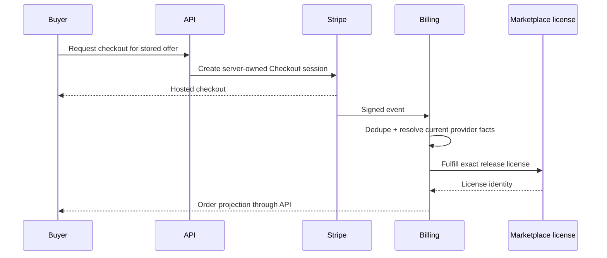

# Phase 13 — Paid creator Marketplace

> **Status:** deferred; commercial/legal decisions required before implementation
> **Depends on:** [Phase 08](08-entitlements-and-subscriptions.md) and [Phase 12](12-free-marketplace.md)
> **Unlocks:** creator content revenue
> **Primary ADRs:** [0001](../adr/0001-package-boundaries.md), [0008](../adr/0008-ruleset-identity-and-content-binding.md), [0011](../adr/0011-active-authored-content-and-json-drafts.md)

## Goal

Add approved payment paths for single-seller creator Marketplace releases. Preserve immutable order economics, idempotent license fulfillment, creator payouts, refunds, disputes, taxes, and any later approved creator-plan economics. Native paid controls remain disabled until the digital-content store-policy path is separately approved.

## Entry decisions

Do not write payment code until the business owner and qualified legal/tax advisors settle:

- Merchant-of-record and marketplace facilitator responsibilities.
- Supported jurisdiction, currency, tax collection, invoicing, and seller reporting.
- Creator eligibility, identity/KYC, prohibited content, payout timing, and reserves.
- Refund, dispute, chargeback, infringement, and takedown consequences.
- Creator Marketplace platform fee schedule and whether a future creator plan modifies it. No Pro Creator or Ultimate packaging is assumed by this roadmap.
- Apple/Google treatment of subscriptions and digital content.

## Requirements

- Use Stripe Connect hosted onboarding for creator payout accounts unless a later provider decision replaces it.
- Use server-created checkout from stored listing/offering economics. Clients cannot submit authoritative price, currency, seller, fee, or fulfillment state.
- Limit v1 Marketplace checkout to one seller and one release per order.
- Snapshot release, license, seller, gross price, tax treatment, platform fee, provider fee policy, net allocation, currency, and terms at purchase time.
- Verify signed webhooks and process duplicate, delayed, and out-of-order events idempotently.
- Grant the exact release license only after confirmed payment.
- Model refund, cancellation, dispute, and chargeback effects without deleting financial history.
- Any approved creator fee entitlement is resolved before checkout and captured in immutable order economics; this phase does not invent a creator subscription plan.
- Apple Pay and Google Pay may be exposed only through an approved payment path. Venmo remains deferred.

## Design

Paid content reuses the Phase 12 release and license path. A refund, dispute, or takedown cannot be modeled as deleting a license, order, release, or provider receipt.

## Ordered workstreams

1. **Record commercial decisions.** Convert the entry decisions into approved product policy and an ADR where they affect load-bearing accounting or provider boundaries.
2. **Define accounting contracts.** Model creator accounts, offers, checkout attempts, immutable orders/line economics, provider events, allocations, refunds, disputes, payouts, and licenses.
3. **Add Connect onboarding and eligibility.** Keep onboarding hosted and web-first; block paid publication until account requirements are satisfied.
4. **Add server-owned checkout and webhook convergence.** Store idempotency and provider object identities; never fulfill from a client redirect.
5. **Fulfill paid releases.** Reuse Phase 12 immutable release/license paths and record acquisition source as the completed order.
6. **Apply approved creator economics.** Snapshot the platform fee and any approved entitlement effect without requiring a creator subscription plan.
7. **Build creator and customer flows.** Cover onboarding, offer management, checkout, receipts, orders, refunds, and operator diagnostics.
8. **Complete policy and failure validation.** Test signatures, retries, reordering, partial failures, stale prices, refund/dispute/takedown cases, creator isolation, and reconciliation.

## Acceptance gates

- A client cannot alter price, fee, creator, currency, tax input, or release identity.
- Duplicate/reordered webhooks converge without duplicate licenses, refunds, or payouts.
- Failed or abandoned checkout grants nothing.
- A paid content order grants the exact purchased release and terms version.
- Refund, dispute, infringement, and takedown behavior matches the approved written policy.
- Creator A cannot inspect Creator B's customers, orders, balances, or payout state.
- Order economics remain immutable and auditable after plans or fees change.
- Native clients can consume existing purchases but expose no unapproved purchase link or CTA.

## Out of scope

- Paid tables, Pro Creator or Ultimate packaging, multi-seller carts, subscriptions to individual creators, bidding, gifting, coupons, multiple processors, custom payout rails, non-US commerce, native paid acquisition without approval, and Venmo.

## Questions for the phase subplan

- Who is merchant of record for creator content, and which Stripe Connect charge model is approved?
- What creator Marketplace platform fee ships, and does evidence justify a separate creator plan later?
- How do refunds, disputes, infringement reports, takedowns, and creator removal affect licenses and payouts?
- Which taxes, receipts, creator forms, support workflows, and reconciliation reports are mandatory?
- Which native purchase/link paths are approved in each storefront and region?

## New-session instruction

The first deliverable is a signed-off creator-commerce/accounting decision record and provider-event state machine. Do not begin UI or Connect integration while merchant-of-record, tax, refund, takedown, and fulfillment rules are unresolved, and do not assume Pro Creator or Ultimate packaging.
