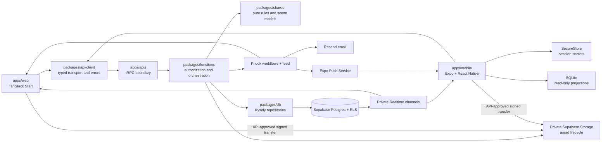
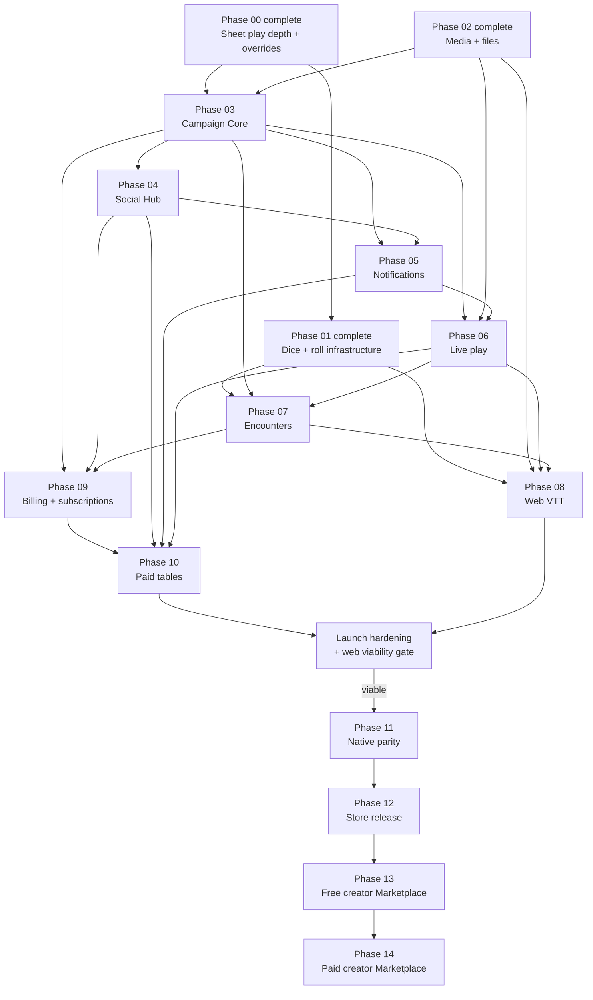

# Future platform roadmap

> **Status:** transitional plan
> **Scope:** completed Sheet and dice foundations, media/files, Campaigns and collaboration, Social Hub, notifications, live play, Encounters, web VTT, subscriptions, paid tables, web viability, native clients, deferred creator Marketplace, and release operations
> **Update when:** priorities, product assumptions, client boundaries, payment strategy, or a phase exit gate changes
> **Verification:** current workspace manifests, canonical architecture guides, accepted ADRs, and the phase documents linked below

This roadmap turns the alpha and post-alpha product direction into bounded implementation phases. It is planning guidance, not current product behavior. Current code, tests, canonical architecture guides, and accepted ADRs take precedence when a phase begins.

## Goal

Evolve Artificer Toolkit from its current web-first character and authored-content platform into a connected tabletop play platform. First complete and validate the web loop from creation and table formation through Campaign, Encounter, and VTT play. Add paid plans and professional-GM tables to test sustainable demand. Native clients follow demonstrated web viability, and creator Marketplace work remains last.

The delivery order is:

- **Phase 00:** Character Sheet play depth and overrides — complete.
- **Phase 01:** Dice and roll infrastructure — complete.
- **Phase 02:** Media and supporting-file pipeline image scope — complete.
- **Phase 03:** Campaign Core.
- **Phase 04:** Social Hub and free table formation.
- **Phase 05:** Notifications and delivery.
- **Phase 06:** Live Campaign play and announcements.
- **Phase 07:** Campaign-owned Encounters.
- **Phase 08:** Web VTT.
- **Phase 09:** Plans, entitlements, and subscriptions.
- **Phase 10:** Paid tables and Pro GM economics.
- **Web launch gate:** portability hardening, public release, and viability measurement.
- **Phase 11:** Native foundation and play parity after web viability.
- **Phase 12:** Store release and continuous validation.
- **Phase 13:** Free creator Marketplace after native delivery.
- **Phase 14:** Paid creator Marketplace.

No phase should be implemented as one repository-wide branch. Start a new session and branch for one phase, verify the current repository state, and produce a smaller implementation subplan before changing code.

## Assumptions

- Initial commerce and social availability is US-only and 18+.
- D&D 5e 2014 is the first playable ruleset. Every Campaign, Encounter, roll, and replayable event records explicit system and ruleset identity.
- Character Sheet adjustments are per-character, mechanically authoritative, and owner-editable. Campaign owners may command assigned Sheet mechanics through the Phase 03 authority rules; hidden Campaign sources never leak into player projections.
- One character may have one active Campaign initially. One-shot and ongoing Campaigns use the same Encounter model; Encounters do not create separate membership.
- Native work begins only after the connected web product passes the viability gate. Native v1 is play-first; complex authoring, seller administration, and professional layout tools remain web-first.
- Native clients may read a visibly stale cached Sheet or Campaign projection during temporary connectivity loss. Offline writes, chat, dice, and VTT are not supported initially.
- Player-only chat excludes Campaign GMs at fetch, subscription, counts, notification, and ordinary analytics boundaries; it is not end-to-end encrypted. Access by authorized staff occurs only through an audited safety or report workflow.
- Alpha and early beta may remain free while the web loop is built. Free, Player, GM, and Pro GM pricing, limits, and paid-table platform fees use the launch-planning matrix below; evidence may change them before public launch.
- Beta sizing targets ordinary tabletop use: approximately 20 connected users and 100 actors in one scope.
- Each Phase 03 Campaign chat room retains its newest 500 timeline entries, including Campaign rolls. Encounter retention starts at 2,000 rolls and changes only from observed beta usage.
- Character portraits are distinct from account avatars. Characters and user-authored content use one source image plus normalized user-selected thumbnail crop metadata; compact controls render the generated thumbnail while detail pages use the display variant.
- User uploads are private by default. Current image limits, dimensions, quotas, and retention are centrally configured; later supporting-file profiles define their own allowlists and safety limits.
- Ordinary Campaign supporting files and handout maps are size-limited separately from larger VTT maps.
- The existing modular monolith remains the deployment model. This roadmap does not introduce microservices, general queues, or speculative infrastructure.

## Delivered and paused baseline

- Phase 00 Character Sheet play depth and overrides is complete and final-validated.
- Phase 01 authoritative dice and web roll presentation is complete.
- Phase 02 private account avatars, Character portraits, authored artwork, crop-derived variants, and reusable asset identity are complete.
- Guided Authoring is delivered for newer creators alongside the full Advanced Authoring experience.
- Character and authored-content import/export is implemented behind a disabled feature flag. It is unavailable to users and is not the next implementation priority.
- Portability returns during launch hardening only after ownership and authorization checks, malformed and duplicate-file tests, provenance retention, and an approved mechanism for rejecting known official content are complete. Automated rejection is a compliance control, not proof of legal clearance.

## Product scope

### Character Sheet play depth

The Sheet owns play-state commands and per-character adjustment intent without rewriting Builder structure or reusable authored content. The backend resolves effective values, calculation breakdowns, valid actions, and semantic panels; web and future native clients own accessible platform presentation. Ability, save, skill, passive, sense, movement, defense, proficiency, HP, rest, condition, spell, feature, item, background, and companion interactions use the same authoritative engine and Sheet command seams.

### Dice and rolls

One restricted backend service owns expression validation, cryptographic randomness, and exact per-die evidence. Web may animate that known result with a lazy viewport-sized 3D presentation, but browser physics never chooses the outcome. Campaign and Encounter scopes add their own visibility, persistence, and retention by consuming the same service rather than creating another roller.

### Native applications

After web viability, native iOS and Android clients become first-class play clients for Character Sheets, Campaigns, chat, notes, Encounters, Social Hub participation, and VTT. They use Expo Router and React Native components for navigation and ordinary product surfaces. A specialized canvas such as the VTT renderer may use an Expo DOM component; the app as a whole must not become a WebView wrapper. Marketplace consumption is added only after its later phases ship.

### Media and supporting files

The completed private-by-default asset pipeline serves account avatars, Character portraits, authored-content source images, and crop-derived variants. Campaign logos/files, Marketplace assets, and larger VTT maps add purpose-specific profiles in their owning phases without replacing that asset identity or lifecycle. Character and authored-content thumbnails derive from one source plus normalized crop metadata rather than separate uploads. The API approves every object key and domain reference; clients transfer bytes directly to Storage only through short-lived permissions.

### Campaigns and live play

Phase 03 Campaigns own username/entitlement enforcement, invitations, membership, owner transfer, Character assignment, immutable content access, typed rules, party inventory/currency, GM Sheet authority, notes, durable Campaign conversations/rolls, and private Realtime hints. The Campaign management page is the GM workspace and launch point for live session controls; players use Sheet-side drawers for quick Notes/Chat/Party Inventory access while running. Phase 05 adds the Knock-backed inbox, Resend email delivery, and notification preferences. Phase 06 adds vehicles, files/handouts, session clock controls, and Campaign announcements through that notification boundary. Campaign rules modify engine assembly without rewriting character-authored intent. Campaign content references grant members read/use access to immutable Campaign content versions while relevant to the Campaign; they do not grant ownership, editing, personal export, or marketplace sale rights.

The GM workflow is split by the moment of use instead of accumulated on one screen:

| GM job                                                                                                                                   | Owning phase                                                     |
| ---------------------------------------------------------------------------------------------------------------------------------------- | ---------------------------------------------------------------- |
| Form the table, establish expectations, manage membership/content/Characters, communicate, and share custody                             | Phase 03 Campaign Core plus Phase 04 Social Hub safety/discovery |
| Receive and control actionable application, invitation, Campaign, and paid-table updates through in-app and email channels             | Phase 05 Notifications and delivery                              |
| Schedule, prepare, run, capture, and close out a session; access pinned references, handouts, clock, announcements, and attendance       | Phase 06 Live Campaign play                                      |
| Build reusable enemy templates and run authoritative combat with actionable enemy stat blocks, rolls, resources, turn order, and history | Phase 07 Encounters                                              |
| Add maps, scenes, tokens, fog, and measurement without creating another combat model                                                     | Phase 08 Web VTT                                                 |
| Operate public paid tables, attendance-linked bookings, cancellations, refunds, disputes, and payouts                                    | Phase 10 Paid tables                                             |
| Add deeper world knowledge, relationships, travel, ambience, co-GM roles, and optional automation only after the core loop is proven     | [Future enhancements](future-enhancements.md)                    |

### Encounters and VTT

Encounters are authoritative, versioned, Campaign-owned play aggregates for both one-shot and ongoing Campaigns. They reuse Campaign membership and do not own invitations or a second cohort model. The VTT renders and commands an Encounter; it does not create another combat model. Character state remains coordinated with Sheet ownership, while creature state remains Encounter-local.

### Social and commerce

Social Hub launches with private and public free tables so table formation, moderation, and Campaign conversion can be validated before payments. Plans and paid-table commerce then establish Player, GM, and Pro GM economics on web. The creator Marketplace is a separate post-viability, post-native track; it begins with free licensing before paid creator commerce.

## Design

This extends the existing dependency direction rather than replacing it. Product reads and writes still cross `apps/apis`; direct Supabase client use is limited to Auth, authorized private Realtime channels, and API-approved Storage operations.

The numbered order is the default product sequence. Hard dependencies are shown above. Phase 01 provides authoritative roll evidence; Phase 03 adds Campaign persistence and collaboration, Phase 05 adds notification delivery, and Phase 07 adds Encounter persistence. Phase 08 delivers the required web VTT without waiting for native or Marketplace work. Phase 11 begins only after the public web loop demonstrates viability.

## Architecture guardrails

- Keep the modular monolith. Add domains, contracts, services, repositories, and client surfaces inside the existing workspaces.
- Put transport DTOs and validation in `packages/schema`; pure rules, dice contracts, and platform-neutral scene state in `packages/shared`; orchestration and authorization in `packages/functions`; persistence in `packages/db`; and thin procedures in `apps/apis`.
- Add `packages/api-client` only with `apps/mobile`. It owns typed tRPC construction, shared API errors, query-key factories, and token injection. It must not own product rules or platform navigation.
- Maintain the Builder/Sheet boundary. Structural character changes use Builder preview/commit; play-state changes use Sheet commands.
- Keep Character Sheet adjustments typed, per-character, engine-resolved, and transparent. Do not persist final derived totals or encode Sheet workflows as Authoring Schema node maps.
- Share semantic Sheet panel contracts and calculation breakdowns across clients while keeping web/native overlay geometry and component choice platform-owned.
- Preserve canonical authored root identity from ADR 0011. Campaign content and Marketplace releases introduce explicit immutable version/snapshot contracts only where stable shared or licensed history is required; they do not restore general authored revision history.
- Model authorization as centralized capabilities derived from an explicit authority context. Do not scatter `role === 'GM'` checks through routes and components.
- Persist commands before broadcasting them. Realtime is delivery and invalidation infrastructure, not the source of truth.
- Commit notification delivery intent with its authoritative source, then let Knock own feed and channel presentation. Notification payloads and links never grant access, and provider secrets remain server-only.
- Use idempotency keys, expected versions, row locks, and one Postgres transaction for multi-aggregate operations that must succeed or fail together.
- Keep player-only chat operationally separate from GM-visible channels at authorization, RLS, fetch, subscription, notification, and ordinary analytics boundaries. It is not end-to-end encrypted.
- Record exact inputs and results required for replay. Never re-run an old Encounter event against newly active content.
- Keep entitlements provider-neutral. Phase 03's manual tier projection, then Stripe, App Store, Play Store, beta, and administrator grants project into one internal authorization model.
- Keep originals private and asset references stable. Store asset IDs/object keys as truth, never signed URLs; domain records own visibility and references. Revisit a Cloudflare R2/provider move only when Phase 08 VTT storage evidence requires it.
- Use purpose-specific upload profiles. Clients cannot select arbitrary buckets/paths, and ordinary attachments cannot inherit the larger limits intended for VTT maps.
- Bind authored artwork to its owned root or draft and Marketplace artwork to exact immutable releases. Builder replacement writes cannot delete Character portraits or Campaign-owned assets.

## Technology direction

| Area                 | Direction                                                                                                                                                          |
| -------------------- | ------------------------------------------------------------------------------------------------------------------------------------------------------------------ |
| Shared language      | TypeScript for clients, transport, orchestration, and pure domain logic                                                                                            |
| Persistence          | PostgreSQL, Supabase migrations/RLS, and Kysely repositories                                                                                                       |
| Web                  | Existing TanStack Start, React, Mantine, Vanilla Extract, TanStack Query                                                                                           |
| Native               | Expo, React Native, Expo Router, TanStack Query, Reanimated, Gesture Handler                                                                                       |
| Contracts            | Zod DTOs in `packages/schema`; typed tRPC through `packages/api-client`                                                                                            |
| Identity             | One Supabase user identity across web, iOS, and Android                                                                                                            |
| Native secrets/cache | `expo-secure-store` for session secrets; `expo-sqlite` for non-authoritative read-only projections                                                                 |
| Realtime             | Private Supabase Broadcast; Presence only for slow-changing connection state                                                                                       |
| Notifications        | Phase 05 Knock workflows/feed/preferences with Resend email and API-authorized deep links; Phase 06 Campaign and Phase 10 paid-table sources reuse it; Phase 11 adds Expo push |
| Media and files      | Private Supabase Storage, API-issued upload intents, signed/authenticated delivery, verified profile limits, image normalization, and quarantined supporting files |
| Dice                 | Restricted server-authoritative evaluation with injected cryptographic randomness and exact per-die evidence; lazy Three/Fiber/Rapier presentation on web          |
| VTT                  | Platform-neutral scene model; PixiJS on web and initially in an Expo DOM host; React Native Skia only if the benchmark gate fails                                  |
| Web payments         | Stripe Billing for Artificer subscriptions; Stripe Connect for creator and professional-GM money movement                                                          |
| Native subscriptions | StoreKit and Google Play Billing through RevenueCat after plan and store-policy approval                                                                           |
| Tests                | Vitest for shared/packages, existing web tests and Playwright, `jest-expo`/React Native Testing Library, Maestro on EAS                                            |

Expo's current guidance supports workspace monorepos, Router-based native navigation, SecureStore, development builds, and EAS profiles. Supabase's React Native guidance requires platform storage and foreground-aware session refresh. Re-check these external contracts when Phase 11 begins because SDK behavior changes: [Expo monorepos](https://docs.expo.dev/guides/monorepos/), [Expo Router](https://docs.expo.dev/router/introduction/), [Supabase React Native Auth](https://supabase.com/docs/guides/auth/quickstarts/react-native).

Supabase currently supports private buckets with RLS or time-limited signed delivery, per-bucket file-size and MIME restrictions, resumable transfers for larger files, and optional image transformations. Re-check limits, pricing, security guidance, and transformation behavior when a later phase adds larger or public media profiles: [Storage access control](https://supabase.com/docs/guides/storage/security/access-control), [bucket fundamentals](https://supabase.com/docs/guides/storage/buckets/fundamentals), [upload limits](https://supabase.com/docs/guides/storage/uploads/file-limits), [standard and resumable upload guidance](https://supabase.com/docs/guides/storage/uploads/standard-uploads), and [image transformations](https://supabase.com/docs/guides/storage/serving/image-transformations).

## Payment-channel strategy

| Product                | Web                              | Native initial state                              | Native paid state                                               |
| ---------------------- | -------------------------------- | ------------------------------------------------- | --------------------------------------------------------------- |
| Artificer subscription | Stripe Billing                   | Consume the existing entitlement; no purchase CTA | StoreKit/Play Billing through RevenueCat                        |
| Marketplace content    | Deferred until Phases 12–13      | Not part of the initial native release            | Enable only after free licensing and creator-payout design      |
| Paid table/session     | Stripe Connect                   | Join or manage an existing booking                | Enable checkout only after service-payment policy review        |
| GM onboarding          | Stripe Connect hosted onboarding | Open an authorized web flow                       | Remain web-hosted unless provider constraints require otherwise |

Apple Pay and Google Pay are wallet methods inside an allowed payment path; they do not override app-store billing rules. Venmo remains outside the initial design because it adds a second processor and reconciliation model. Before paid native controls are designed, re-check [Apple's review guidelines](https://developer.apple.com/app-store/review/guidelines/), [Google Play's payments policy](https://support.google.com/googleplay/android-developer/answer/9858738), [Stripe's React Native SDK](https://docs.stripe.com/sdks/react-native), and [RevenueCat's Expo integration](https://www.revenuecat.com/docs/getting-started/installation/expo).

## Initial launch plans

| Plan   | Price                        | Owned capacity and hosted scale                                                                                                                 | Paid tables                |
| ------ | ---------------------------- | ----------------------------------------------------------------------------------------------------------------------------------------------- | -------------------------- |
| Free   | $0                           | 6 personal Characters, 20 owned homebrew roots, 250 MB, 1 active hosted Campaign, 5 player seats, 1 public free listing, and 3 saved Encounters | Not available              |
| Player | $4.99/month or $49.99/year   | Unlimited personal Characters and homebrew, 1 GB, and the same Campaign-hosting limits as Free                                                  | Not available              |
| GM     | $9.99/month or $99.99/year   | Player benefits, 5 GB, 5 active Campaigns, 12 seats each, 5 public listings, and unlimited Encounters                                           | 10% Artificer platform fee |
| Pro GM | $49.99/month or $499.99/year | GM benefits, 25 GB, unlimited Campaigns and listings under fair use, and 12 seats per Campaign                                                  | 0% Artificer platform fee  |

All plans may join unlimited Campaigns, use Campaign-scoped content, contribute owned content when permitted, participate in party inventory, and use Encounters and VTT. Processing charges and applicable taxes are separate from the Artificer platform fee. These prices and limits are the planning baseline and may change from evidence before public launch. Creator and Ultimate plans are intentionally not specified while the creator Marketplace is deferred.

## Web launch and viability gate

After Phase 10, launch hardening restores portability only if its safety and policy gates pass, completes moderation and operational policy, and prepares the connected web product for public use. Marketplace investment requires evidence that:

1. Social Hub listings produce accepted tables.
2. Accepted groups create Campaigns and begin play.
3. Campaigns return for later sessions.
4. Users convert to Player or GM plans or use paid tables.
5. Moderation, payment support, and infrastructure costs remain manageable.

Exact numeric thresholds are a pre-launch business decision. The behaviors above define what must be measured; finishing Phase 10 alone does not authorize native or Marketplace investment.

## Phase documents

| Phase | Document                                                                                   | Exit result                                                                                                                      |
| ----- | ------------------------------------------------------------------------------------------ | -------------------------------------------------------------------------------------------------------------------------------- |
| 00    | [Character Sheet play depth and overrides](00-character-sheet-play-depth-and-overrides.md) | **Complete:** authoritative Sheet play, adjustments, explanations, and portable semantic panels                                  |
| 01    | [Dice and roll infrastructure](01-dice-and-roll-infrastructure.md)                         | **Complete:** authoritative rolls, private history, accessible results, and optional lazy 3D presentation                        |
| 02    | [Media and supporting-file pipeline](02-media-and-file-pipeline.md)                        | **Complete:** private avatars, Character portraits, authored artwork, crop-derived variants, and reusable asset identity         |
| 03    | [Campaign Core](03-campaign-core.md)                                                       | Entitlements, Campaign lifecycle/content/custody, GM authority, two-room chat/rolls, notes, and private Realtime work on web     |
| 04    | [Social Hub](04-social-hub.md)                                                             | Adults can privately invite or publicly discover, apply to, moderate, and form free tables                                       |
| 05    | [Notifications and delivery](05-notifications-and-delivery.md)                             | Knock-backed in-app/email delivery, preferences, secure deep links, grouping, and retryable source intents work on web            |
| 06    | [Live Campaign play](06-live-campaign-play.md)                                             | Session scheduling/prep/closeout, quick references, vehicles, Campaign files/clock, and announcements work on web                 |
| 07    | [Encounters](07-encounters.md)                                                             | Campaign-owned Encounters provide authoritative GM-run combat and enemy action rolls for one-shot and ongoing play on web         |
| 08    | [Web VTT](08-vtt.md)                                                                       | One Encounter-backed VTT provides maps, tokens, fog, measurement, initiative, and accessible controls on web                     |
| 09    | [Plans and entitlements](09-entitlements-and-subscriptions.md)                             | Phase 03 limits gain Stripe web subscriptions and remaining capability enforcement                                               |
| 10    | [Paid tables](10-paid-tables.md)                                                           | Approved paid-table checkout, capacity, payouts, refunds, and plan-based fees work on web                                        |
| 11    | [Native foundation and parity](11-cross-platform-foundation.md)                            | After web viability, iOS and Android provide first-class play journeys against the proven contracts                              |
| 12    | [Store release and continuous validation](12-store-release-and-continuous-validation.md)   | Store-ready binaries and repeatable cross-platform release gates exist                                                           |
| 13    | [Free creator Marketplace](13-free-marketplace.md)                                         | Immutable releases, licenses, free acquisition, and attributed consumption work                                                  |
| 14    | [Paid creator Marketplace](14-paid-marketplace.md)                                         | Approved creator checkout, payouts, refunds, disputes, and immutable order economics work                                        |

## Cross-phase acceptance gates

- Web and native parse the same API contracts and produce the same rules results.
- Character adjustments change the same authoritative engine results used by display, rolls, passive checks, HP/rest, spell mechanics, and command validation; clearing an adjustment restores current authored behavior.
- Roll consumers use the Phase 01 authoritative semantic evidence; browser physics never selects or alters a result, and static fallback remains fully usable.
- Effective Character values expose source and adjustment breakdowns to the owner and to future authorized GM readers without granting GM adjustment-edit actions.
- OWNER, PLAYER, removed member, one-shot Campaign member, and non-member matrices pass at API and RLS boundaries.
- Campaign content references grant immutable-version read/use access without transferring ownership, editing, personal export, or Marketplace sale rights.
- Player-only chat tests prove an owner/GM cannot subscribe, fetch, count, receive notifications for, or infer message content.
- Switching progression mode retains experience and does not rewrite character intent.
- Inventory transfers, currency conversions, and correlated Encounter/Sheet changes remain atomic under conflicts and retries.
- Realtime reconnect resumes from an authoritative cursor without duplicate application.
- Native cached data is visibly stale and cannot accept offline mutation.
- Deep links open the correct authorized destination after a cold start and fail closed when access is absent.
- Upload intent, finalize, reference, delivery, replacement, and deletion tests enforce the same asset authorization on web, native, API, and Storage RLS.
- Spoofed, oversized, unsafe, or disallowed uploads never become ready; image delivery strips private metadata; removed members cannot download private Campaign assets.
- Immutable Campaign content versions, Marketplace releases, and Encounter/VTT history retain exact asset references, while VTT map limits remain independent from ordinary Campaign files.
- Duplicate, delayed, and out-of-order provider webhooks converge on the same entitlement state.
- Free, Player, GM, and Pro GM creation, storage, hosted-Campaign, seat, listing, Encounter, and paid-table capabilities are enforced by owning server operations; Phase 03 enforces its available limits before billing ships.
- GM and Pro GM paid-table orders snapshot the applicable 10% or 0% Artificer platform fee; processing charges and taxes remain separately represented.
- Web and later native VTT clients reconstruct the same scene from the same Encounter projection.
- Mobile validation covers one current and one oldest-supported physical iOS and Android device.

## Starting a phase in a new session

Use the selected phase document as context, then require the new session to:

1. Read `AGENTS.md`, `PRODUCT.md`, `DESIGN.md`, the canonical architecture guides, and every ADR linked by that phase.
2. Verify the phase's “current starting point” against the branch. Planned documents may become stale.
3. Resolve or explicitly defer the phase's open questions. Do not convert an assumption into a decision silently.
4. Produce a smaller implementation subplan with exact contracts, migrations, modules, UI surfaces, tests, rollout, and non-goals.
5. Split the work into independently reviewable branches or issues. Do not implement the whole phase as one diff.
6. Update canonical architecture docs or ADRs when an implementation changes a load-bearing boundary.

## Concerns and expansions

- Full native authoring needs a native renderer for existing platform-neutral Authoring Schema semantics; it must not port Mantine or browser CSS.
- Expo DOM is the fastest native VTT parity route but has bridge, battery, accessibility, and binary-update constraints. Phase 11 must benchmark it against the shipped web VTT before selecting a fallback.
- Marketplace payments combine app-store collection, creator licensing, tax, refunds, fee calculation, and payouts. They are not an ordinary single-merchant checkout.
- Supporting minors requires a separate age-assurance, guardian, moderation, safety, and retention program.
- Professional page-layout/book authoring is separate from app-native content packages and supplemental files.
- Supporting-file uploads require an allowlist, scanning/quarantine, safe download behavior, quotas, retention, takedown, and cost controls; Phase 06 owns that profile instead of expanding the completed Phase 02 image scope.
- VTT maps may require resumable transfer, optimization, or tiling beyond ordinary Campaign attachments. Those expansions remain in Phase 08 behind the shared asset identity.
- Combat automation, voice/video, multi-seller carts, reviews, gifting, organizations, non-US commerce, and additional payment processors remain later expansions.

## Roadmap-level open questions

- Which legal entity and commercial model will be merchant of record for subscriptions, creator content, and paid tables?
- What public production origin and final iOS/Android application identifiers should own universal links and store records?
- What moderation access, retention, export, deletion, and appeal policy applies to chat, notes, listings, creator releases, and reported content?
- What file limits, storage/egress quotas, allowed types, and public-asset policy should apply to future Campaign, VTT, and Marketplace profiles?
- What numeric table-formation, repeat-play, conversion, cost, and moderation thresholds constitute a passing web viability decision?
- What approved policy and detection evidence is sufficient to reject known official content before portability is enabled?
