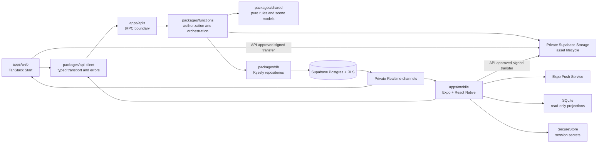
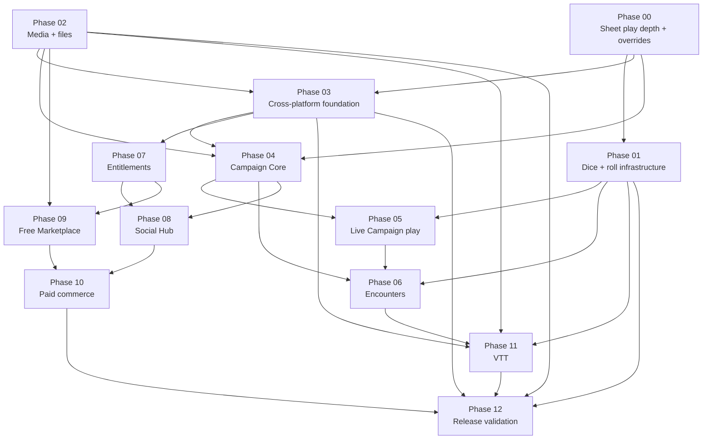

# Future platform roadmap

> **Status:** transitional plan
> **Scope:** Character Sheet play depth, authoritative dice, native clients, media/files, Campaigns, Encounters, commerce, Social Hub, Marketplace, VTT, and release operations
> **Update when:** priorities, product assumptions, client boundaries, payment strategy, or a phase exit gate changes
> **Verification:** current workspace manifests, canonical architecture guides, ADRs 0001 and 0005–0010, and the phase documents linked below

This roadmap turns the alpha and post-alpha product direction into bounded implementation phases. It is planning guidance, not current product behavior. Current code, tests, canonical architecture guides, and accepted ADRs take precedence when a phase begins.

## Goal

Evolve Artificer Toolkit from its current web-first character and authored-content platform into a complete, multi-client tabletop play platform. The Character Sheet first gains authoritative play controls, transparent per-character adjustments, and portable semantic panels. The TanStack web app and native iOS/Android apps then share contracts, authorization, rules, entitlements, Realtime channels, and backend orchestration while retaining platform-owned presentation.

The delivery order is:

- **Phase 00:** Character Sheet play depth and overrides.
- **Phase 01:** Dice and roll infrastructure.
- **Phase 02 (complete):** Media and supporting-file pipeline image scope.
- **Phase 03:** Cross-platform client foundation.
- **Phase 04:** Campaign Core.
- **Phase 05:** Live Campaign play.
- **Phase 06:** Campaign and standalone Encounters.
- **Phase 07:** Entitlements and subscriptions.
- **Phase 08:** Free Social Hub.
- **Phase 09:** Free Marketplace.
- **Phase 10:** Paid Marketplace and paid tables.
- **Phase 11:** Web and native VTT.
- **Phase 12:** Store release and continuous validation.

No phase should be implemented as one repository-wide branch. Start a new session and branch for one phase, verify the current repository state, and produce a smaller implementation subplan before changing code.

## Assumptions

- Initial commerce and social availability is US-only and 18+.
- D&D 5e 2014 is the first playable ruleset. Every Campaign, Encounter, roll, and replayable event records explicit system and ruleset identity.
- Character Sheet adjustments are per-character, mechanically authoritative, and owner-editable. Future authorized GMs may inspect adjustment provenance without receiving edit authority.
- One character may have one active Campaign initially. Standalone Encounters remain allowed.
- Native v1 is play-first. Complex authoring, seller administration, and professional layout tools remain web-first.
- Native clients may read a visibly stale cached Sheet or Campaign projection during temporary connectivity loss. Offline writes, chat, dice, and VTT are not supported initially.
- Player-only chat excludes Campaign GMs but is not end-to-end encrypted. Access by authorized staff occurs only through an audited safety or report workflow.
- Alpha and early beta remain free. Prices, plan limits, fees, and revenue shares are unresolved product decisions.
- Beta sizing targets ordinary tabletop use: approximately 20 connected users and 100 actors in one scope.
- Roll retention starts at 5,000 Campaign rolls and 2,000 Encounter rolls, then changes only from observed beta usage.
- Character portraits are distinct from account avatars. Characters and user-authored content use one source image plus normalized user-selected thumbnail crop metadata; compact controls render the generated thumbnail while detail pages use the display variant.
- User uploads are private by default. Current image limits, dimensions, quotas, and retention are centrally configured; later supporting-file profiles define their own allowlists and safety limits.
- Ordinary Campaign supporting files and handout maps are size-limited separately from larger VTT maps.
- The existing modular monolith remains the deployment model. This roadmap does not introduce microservices, general queues, or speculative infrastructure.

## Product scope

### Character Sheet play depth

The Sheet owns play-state commands and per-character adjustment intent without rewriting Builder structure or reusable authored content. The backend resolves effective values, calculation breakdowns, valid actions, and semantic panels; web and future native clients own accessible platform presentation. Ability, save, skill, passive, sense, movement, defense, proficiency, HP, rest, condition, spell, feature, item, background, and companion interactions use the same authoritative engine and Sheet command seams.

### Dice and rolls

One restricted backend service owns expression validation, cryptographic randomness, and exact per-die evidence. Web may animate that known result with a lazy viewport-sized 3D presentation, but browser physics never chooses the outcome. Campaign and Encounter scopes add their own visibility, persistence, and retention by consuming the same service rather than creating another roller.

### Native applications

Native iOS and Android clients are first-class play clients for Character Sheets, Campaigns, chat, notes, Encounters, Social Hub participation, Marketplace discovery and consumption, and VTT. They use Expo Router and React Native components for navigation and ordinary product surfaces. A specialized canvas such as the first VTT renderer may use an Expo DOM component; the app as a whole must not become a WebView wrapper.

### Media and supporting files

The completed private-by-default asset pipeline serves account avatars, Character portraits, authored-content source images, and crop-derived variants. Campaign logos/files, Marketplace assets, and larger VTT maps add purpose-specific profiles in their owning phases without replacing that asset identity or lifecycle. Character and authored-content thumbnails derive from one source plus normalized crop metadata rather than separate uploads. The API approves every object key and domain reference; clients transfer bytes directly to Storage only through short-lived permissions.

### Campaigns and live play

Campaigns own invitations, membership, roles, character assignment, content access, typed rules, shared inventories, vehicles, sessions, notes, clocks, chat, rolls, and audited GM authority. Campaign rules modify engine assembly without rewriting character-authored intent.

### Encounters and VTT

Encounters are authoritative, versioned play aggregates that may belong to a Campaign or stand alone. The VTT renders and commands an Encounter; it does not create another combat model. Character state remains coordinated with Sheet ownership, while creature state remains Encounter-local.

### Social and commerce

Social Hub and Marketplace launch free-first so moderation, licensing, fulfillment, and entitlement paths are exercised before money is added. Web owns initial seller, creator, and paid-table administration. Native initially consumes existing entitlements and free acquisitions.

## Design

This extends the existing dependency direction rather than replacing it. Product reads and writes still cross `apps/apis`; direct Supabase client use is limited to Auth, authorized private Realtime channels, and API-approved Storage operations.

The numbered order is the default product sequence. Hard technical dependencies are shown above. Phase 01 establishes authoritative roll evidence and the first web presentation; Phase 05 and Phase 06 add owning persistence. Phase 02 is web-first and prepares portable media contracts; Phase 03 consumes both the Phase 00 Sheet panel contract and Phase 02 assets in native. VTT requires dice, media, the cross-platform foundation, and the Encounter model, but not Marketplace commerce.

## Architecture guardrails

- Keep the modular monolith. Add domains, contracts, services, repositories, and client surfaces inside the existing workspaces.
- Put transport DTOs and validation in `packages/schema`; pure rules, dice contracts, and platform-neutral scene state in `packages/shared`; orchestration and authorization in `packages/functions`; persistence in `packages/db`; and thin procedures in `apps/apis`.
- Add `packages/api-client` only with `apps/mobile`. It owns typed tRPC construction, shared API errors, query-key factories, and token injection. It must not own product rules or platform navigation.
- Maintain the Builder/Sheet boundary. Structural character changes use Builder preview/commit; play-state changes use Sheet commands.
- Keep Character Sheet adjustments typed, per-character, engine-resolved, and transparent. Do not persist final derived totals or encode Sheet workflows as Authoring Schema node maps.
- Share semantic Sheet panel contracts and calculation breakdowns across clients while keeping web/native overlay geometry and component choice platform-owned.
- Preserve authored revision identity. Campaign grants and Marketplace licenses expose exact revisions. Removing future access must not silently invalidate a revision already pinned into a character or recorded event.
- Model authorization as centralized capabilities derived from an explicit authority context. Do not scatter `role === 'GM'` checks through routes and components.
- Persist commands before broadcasting them. Realtime is delivery and invalidation infrastructure, not the source of truth.
- Use idempotency keys, expected versions, row locks, and one Postgres transaction for multi-aggregate operations that must succeed or fail together.
- Keep player-only chat cryptographically and operationally separate from GM-visible channels at authorization, RLS, fetch, subscription, notification, and moderation boundaries.
- Record exact inputs and results required for replay. Never re-run an old Encounter event against newly active content.
- Keep entitlements provider-neutral. Stripe, App Store, Play Store, beta, and administrator grants project into one internal authorization model.
- Keep originals private and asset references stable. Store asset IDs/object keys as truth, never signed URLs; domain records own visibility and references.
- Use purpose-specific upload profiles. Clients cannot select arbitrary buckets/paths, and ordinary attachments cannot inherit the larger limits intended for VTT maps.
- Bind authored artwork and Marketplace release assets to exact immutable revisions/releases. Builder replacement writes cannot delete Character portraits or Campaign-owned assets.

## Technology direction

| Area                 | Direction                                                                                                                                                          |
| -------------------- | ------------------------------------------------------------------------------------------------------------------------------------------------------------------ |
| Shared language      | TypeScript for clients, transport, orchestration, and pure domain logic                                                                                            |
| Persistence          | PostgreSQL, Supabase migrations/RLS, and Kysely repositories                                                                                                       |
| Web                  | Existing TanStack Start, React, Mantine, Vanilla Extract, TanStack Query                                                                                           |
| Native               | Expo, React Native, Expo Router, TanStack Query, Reanimated, Gesture Handler                                                                                       |
| Contracts            | Zod DTOs in `packages/schema`; typed tRPC through `packages/api-client`                                                                                            |
| Identity             | One Supabase user identity across web, iOS, and Android                                                                                                            |
| Native secrets/cache | `expo-secure-store` for session secrets; `expo-sqlite` for non-authoritative read-only projections                                                                 |
| Realtime             | Private Supabase Broadcast; Presence only for slow-changing connection state                                                                                       |
| Notifications        | `expo-notifications` and Expo Push Service, with API-authorized deep links                                                                                         |
| Media and files      | Private Supabase Storage, API-issued upload intents, signed/authenticated delivery, verified profile limits, image normalization, and quarantined supporting files |
| Dice                 | Restricted server-authoritative evaluation with injected cryptographic randomness and exact per-die evidence; lazy Three/Fiber/Rapier presentation on web          |
| VTT                  | Platform-neutral scene model; PixiJS on web and initially in an Expo DOM host; React Native Skia only if the benchmark gate fails                                  |
| Web payments         | Stripe Billing for Artificer subscriptions; Stripe Connect for creator and professional-GM money movement                                                          |
| Native subscriptions | StoreKit and Google Play Billing through RevenueCat after plan and store-policy approval                                                                           |
| Tests                | Vitest for shared/packages, existing web tests and Playwright, `jest-expo`/React Native Testing Library, Maestro on EAS                                            |

Expo's current guidance supports workspace monorepos, Router-based native navigation, SecureStore, development builds, and EAS profiles. Supabase's React Native guidance requires platform storage and foreground-aware session refresh. Re-check these external contracts when Phase 03 begins because SDK behavior changes: [Expo monorepos](https://docs.expo.dev/guides/monorepos/), [Expo Router](https://docs.expo.dev/router/introduction/), [Supabase React Native Auth](https://supabase.com/docs/guides/auth/quickstarts/react-native).

Supabase currently supports private buckets with RLS or time-limited signed delivery, per-bucket file-size and MIME restrictions, resumable transfers for larger files, and optional image transformations. Re-check limits, pricing, security guidance, and transformation behavior when a later phase adds larger or public media profiles: [Storage access control](https://supabase.com/docs/guides/storage/security/access-control), [bucket fundamentals](https://supabase.com/docs/guides/storage/buckets/fundamentals), [upload limits](https://supabase.com/docs/guides/storage/uploads/file-limits), [standard and resumable upload guidance](https://supabase.com/docs/guides/storage/uploads/standard-uploads), and [image transformations](https://supabase.com/docs/guides/storage/serving/image-transformations).

## Payment-channel strategy

| Product                | Web                              | Native initial state                                     | Native paid state                                                  |
| ---------------------- | -------------------------------- | -------------------------------------------------------- | ------------------------------------------------------------------ |
| Artificer subscription | Stripe Billing                   | Consume the existing entitlement; no purchase CTA        | StoreKit/Play Billing through RevenueCat                           |
| Marketplace content    | Stripe Connect                   | Browse, acquire free releases, and consume owned content | Enable paid acquisition only after store and creator-payout design |
| Paid table/session     | Stripe Connect                   | Join or manage an existing booking                       | Enable checkout only after service-payment policy review           |
| Creator/GM onboarding  | Stripe Connect hosted onboarding | Open an authorized web flow                              | Remain web-hosted unless provider constraints require otherwise    |

Apple Pay and Google Pay are wallet methods inside an allowed payment path; they do not override app-store billing rules. Venmo remains outside the initial design because it adds a second processor and reconciliation model. Before paid native controls are designed, re-check [Apple's review guidelines](https://developer.apple.com/app-store/review/guidelines/), [Google Play's payments policy](https://support.google.com/googleplay/android-developer/answer/9858738), [Stripe's React Native SDK](https://docs.stripe.com/sdks/react-native), and [RevenueCat's Expo integration](https://www.revenuecat.com/docs/getting-started/installation/expo).

## Phase documents

| Phase | Document                                                                                   | Exit result                                                                                                                         |
| ----- | ------------------------------------------------------------------------------------------ | ----------------------------------------------------------------------------------------------------------------------------------- |
| 00    | [Character Sheet play depth and overrides](00-character-sheet-play-depth-and-overrides.md) | Web Sheet controls, authoritative per-character adjustments, transparent breakdowns, and portable semantic panels are complete      |
| 01    | [Dice and roll infrastructure](01-dice-and-roll-infrastructure.md)                         | Restricted authoritative rolls and accessible lazy web presentation share exact per-die evidence                                    |
| 02    | [Media and supporting-file pipeline](02-media-and-file-pipeline.md)                        | Complete: private avatars, Character portraits, authored artwork, crop-derived variants, and reusable asset identity                 |
| 03    | [Cross-platform foundation](03-cross-platform-foundation.md)                               | Expo shell proves authenticated, typed, read-only Sheet-panel access on iOS and Android                                             |
| 04    | [Campaign Core](04-campaign-core.md)                                                       | Campaign membership, roles, rules, content grants, audited GM authority, and read-only adjustment inspection work on web and native |
| 05    | [Live Campaign play](05-live-campaign-play.md)                                             | Shared inventory, vehicles, sessions, notes/files, clock, chat, persisted rolls, Realtime, and native distribution work             |
| 06    | [Encounters](06-encounters.md)                                                             | Campaign and standalone Encounters provide authoritative manual play on web and native                                              |
| 07    | [Entitlements and subscriptions](07-entitlements-and-subscriptions.md)                     | Provider-neutral entitlements and Stripe web subscriptions are reliable                                                             |
| 08    | [Free Social Hub](08-social-hub.md)                                                        | Adults can discover, apply to, moderate, and form free tables                                                                       |
| 09    | [Free Marketplace](09-free-marketplace.md)                                                 | Immutable releases, licenses, free acquisition, and content consumption work                                                        |
| 10    | [Paid Marketplace and paid tables](10-paid-marketplace-and-tables.md)                      | Approved web commerce, payouts, refunds, and fee entitlements work                                                                  |
| 11    | [VTT](11-vtt.md)                                                                           | One Encounter-backed VTT works across web, iOS, and Android                                                                         |
| 12    | [Store release and continuous validation](12-store-release-and-continuous-validation.md)   | Store-ready binaries and repeatable cross-platform release gates exist                                                              |

## Cross-phase acceptance gates

- Web and native parse the same API contracts and produce the same rules results.
- Character adjustments change the same authoritative engine results used by display, rolls, passive checks, HP/rest, spell mechanics, and command validation; clearing an adjustment restores current authored behavior.
- Roll consumers use the Phase 01 authoritative semantic evidence; browser physics never selects or alters a result, and static fallback remains fully usable.
- Effective Character values expose source and adjustment breakdowns to the owner and to future authorized GM readers without granting GM adjustment-edit actions.
- OWNER, GM, PLAYER, removed member, standalone invitee, and non-member matrices pass at API and RLS boundaries.
- Player-only chat tests prove a GM cannot subscribe, fetch, receive notifications for, or infer message content.
- Switching progression mode retains experience and does not rewrite character intent.
- Inventory transfers and correlated Encounter/Sheet changes remain atomic under conflicts and retries.
- Realtime reconnect resumes from an authoritative cursor without duplicate application.
- Native cached data is visibly stale and cannot accept offline mutation.
- Deep links open the correct authorized destination after a cold start and fail closed when access is absent.
- Upload intent, finalize, reference, delivery, replacement, and deletion tests enforce the same asset authorization on web, native, API, and Storage RLS.
- Spoofed, oversized, unsafe, or disallowed uploads never become ready; image delivery strips private metadata; removed members cannot download private Campaign assets.
- Authored revisions, Marketplace releases, and Encounter/VTT history retain exact asset references, while VTT map limits remain independent from ordinary Campaign files.
- Duplicate, delayed, and out-of-order provider webhooks converge on the same entitlement state.
- Web and native VTT clients reconstruct the same scene from the same Encounter projection.
- Mobile validation covers one current and one oldest-supported physical iOS and Android device.

## Starting a phase in a new session

Use the selected phase document as context, then require the new session to:

1. Read `AGENTS.md`, `PRODUCT.md`, `DESIGN.md`, the canonical architecture guides, and every ADR linked by that phase.
2. Verify the phase's “current starting point” against the branch. Planned documents may become stale.
3. Resolve or explicitly defer the phase's open questions. Do not convert an assumption into a decision silently.
4. Produce a smaller implementation subplan with exact contracts, migrations, modules, UI surfaces, tests, rollout, and non-goals.
5. Split the work into independently reviewable branches or issues. Do not implement the whole phase as one diff.
6. Update canonical architecture docs or ADRs when an implementation changes a load-bearing boundary.

## Concerns and expansions

- Full native authoring needs a native renderer for existing platform-neutral Authoring Schema semantics; it must not port Mantine or browser CSS.
- Expo DOM is the fastest shared VTT route but has bridge, battery, accessibility, and binary-update constraints. Phase 11 contains an explicit benchmark and Skia fallback gate.
- Marketplace payments combine app-store collection, creator licensing, tax, refunds, fee calculation, and payouts. They are not an ordinary single-merchant checkout.
- Supporting minors requires a separate age-assurance, guardian, moderation, safety, and retention program.
- Professional page-layout/book authoring is separate from app-native content packages and supplemental files.
- Supporting-file uploads require an allowlist, scanning/quarantine, safe download behavior, quotas, retention, takedown, and cost controls; Phase 05 owns that profile instead of expanding the completed Phase 02 image scope.
- VTT maps may require resumable transfer, optimization, or tiling beyond ordinary Campaign attachments. Those expansions remain in Phase 11 behind the shared asset identity.
- Combat automation, voice/video, multi-seller carts, reviews, gifting, organizations, non-US commerce, and additional payment processors remain later expansions.

## Roadmap-level open questions

- Which legal entity and commercial model will be merchant of record for subscriptions, creator content, and paid tables?
- What public production origin and final iOS/Android application identifiers should own universal links and store records?
- What moderation access, retention, export, deletion, and appeal policy applies to chat, notes, listings, creator releases, and reported content?
- What per-purpose file limits, storage/egress quotas, allowed Campaign attachment types, and public-asset policy should apply to free and paid tiers?
