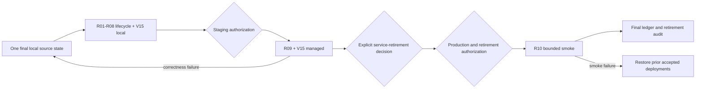

# Phase 8.2 release lifecycle

> **Status:** canonical operator procedure for the final Convex cutover
>
> **Scope:** final-source local validation, staging promotion, rollback readiness, production smoke, and retired-service shutdown
>
> **Update when:** the release lifecycle, deployment targets, proof thresholds, rollback boundary, or retirement order changes
>
> **Verification:** `scripts/validatePreStagingLocal.mjs`, the Phase 8.2 acceptance ledger, the retained release manifest, and target-environment deployment records

Current work is local-only. Staging, production, and external service retirement each require explicit
authorization against the completed evidence from the preceding stage. Never use a promotion environment
to discover an application correctness failure that the local stack can exercise.

## Final local source

1. Apply only the reviewed, explicitly approved local removal packets. Retain their before archives,
   manifests, hashes, native exit codes, and complete logs. Local deletion does not authorize deleting
   a managed service or its data.
2. Regenerate `yarn.lock` with `yarn install`, then review the workspace graph and zero scans. Do not
   preserve retired Supabase, SQL/Kysely, tRPC, GoRules, Rule Studio, product Netlify-function, or
   durable session-host compatibility.
3. Keep the existing Docker container, volume, and media helper. Do not create replacement
   infrastructure or restart Docker to clear fixtures.
4. Run `yarn validate:pre-staging:local`. It cleans runtime outputs and builds the workspaces before
   generating artifacts, because the generators import compiled workspace packages. The build uses
   committed generated files; regeneration must preserve their exact bytes or the gate fails.
   Package and native Convex typechecks follow. Convex test shards run in pairs, each in a separate
   process with one worker; every shard retains its own log and result. A failed pair waits for both
   results and stops later stages. Other package checks and all database/browser proofs remain serial.
   After these checks, the runner verifies source identity and deploys locally, reusing the verified
   generation and native typecheck. It verifies identity again before Convex reset/seed/audit, native
   transaction/replay/rollback/privacy proofs, complete browser journeys, and the frozen local workload.
   To checkpoint before the guarded reset, pass `--stop-after=convex-local-deploy`; resume with
   `--start-at=convex-reset --provenance-manifest=<checkpoint manifest>`. The final manifest must still
   pass every stage from the same source identity. `--list` prints the stages and commands without
   running anything.

   Prerequisites and evidence:
   - The `phase82-convex-local-linux` container serves instance `phase82-local-linux` at
     `http://127.0.0.1:3210`. The runner refuses any other target. It generates the admin key with
     `docker exec phase82-convex-local-linux ./generate_admin_key.sh` for each run and never writes or
     prints it. `scripts/resetLocalConvex.ps1` and `scripts/runLocalConvexProof.ps1` do the same.
   - The ignored `local-validation/local-convex/local.application.env` supplies the local URLs,
     `CONVEX_DEPLOYMENT=local:phase82-local-linux` and the local application secrets. Override it with
     `--local-env-file=<path under local-validation/>`. Yarn injects this file into every child and
     its values override the environment, so the runner rejects a file that stores
     `CONVEX_SELF_HOSTED_ADMIN_KEY` or a remote-only name with a non-loopback value.
   - Convex codegen, deploy, seed and audit pass the self-hosted URL and generated key as explicit
     `--url`/`--admin-key` arguments. They never use the CLI's `--deployment local` backend.
   - The lifecycle manifest and stage logs go to `local-validation/pre-staging/<timestamp>/`
     (`PRE_STAGING_VALIDATION_DIR` may name another folder under `local-validation/`). Reset evidence
     goes to `local-validation/convex-reset/r08-reset-<attempt>.*` and native proof evidence to
     `local-validation/local-convex-proofs/<proof>.*`. Provenance manifests must sit under
     `local-validation/`.
   - The development drivers write their own browser output under
     `local-validation/local-convex-proofs/<topic>/`, for example
     `phase82-vtt-browser/playwright.log`, which the runner copies into the manifest folder.
   - The drivers send Encounter commands through the Session room, so the proof stages need the local
     Worker. Before the first proof stage the runner starts the documented Worker once on
     `127.0.0.1:8787` (refusing a port that is already in use), with its ticket, Worker and rules
     continuation secrets read in memory from the local Convex deployment. It stops that Worker's
     process tree before the VTT browser proof, which starts its own Worker, and after a failure.
     Worker output goes to `local-session-worker.log` in the manifest folder.

5. Record the exact source identity, command order, environment identity, native exit codes, collector
   completion, thresholds, and artifact paths in one release manifest. Inspect proof artifacts only
   after both the command and collector finish.

A source, schema, generated artifact, fixture, test, or configuration change invalidates evidence from
the earliest affected stage. Repair locally and resume from that stage; do not repeat unrelated earlier
proofs merely because a later check failed.

## Staging promotion

After R08 and the local V15 portion are green, request authorization naming the exact Convex, web,
Worker, R2, and email targets plus the final local manifest. Then:

1. Confirm every target before deployment and preserve its current deployment identifier for rollback.
2. Build the Worker staging package with
   `yarn workspace @artificer-toolkit/session-worker build:staging`; deploy only through the pinned,
   official project tooling. Record the exact commands and native exits in the promotion manifest.
3. Verify managed environment variables, secrets, private R2 permissions/CORS, Resend delivery,
   Worker admission, public-network behavior, and the unchanged managed V15 workload.
4. Run one bounded R09 smoke against disposable fixtures and remove those fixtures through the product.
   Do not reset, patch, tune, or iteratively debug application behavior in staging.

A correctness failure returns to local implementation and the complete affected local lifecycle before
another promotion attempt. A managed integration/configuration failure may be corrected in the owning
managed configuration, with the correction and rerun recorded.

## Rollback

Before each managed deployment, record the prior accepted deployment identifiers and confirm that the
provider can restore them. If staging or production smoke fails:

1. Stop promotion and preserve the failed deployment, request IDs, logs, and fixture identities.
2. Restore the previous accepted web, Convex, and Worker deployments through their official deployment
   histories. Do not reset product data or delete the failed evidence.
3. Verify the prior deployment's health and access boundary with the smallest safe read-only smoke.
4. Return application fixes to local validation. A rollback does not make the failed source acceptable.

A change that cannot coexist with the prior deployment needs its own reviewed data rollback before
promotion; Phase 8.2 promotion must not improvise one in the target environment.

## Production and retirement

After R09 passes, record the explicit decision on retiring Supabase and the remaining managed legacy
services. Production and retirement require a new authorization naming the exact targets and retained
rollback state.

Deploy the exact staging-accepted source, run the bounded R10 smoke with disposable fixtures, and keep
prior deployment identifiers available until the smoke passes. Retirement then proceeds in this order:

1. Disable legacy writes, schedules, hooks, and traffic while retaining read-only recovery access.
2. Verify current production reads/writes, auth, media, email, Worker traffic, and audit records use the
   Convex boundary and that no legacy requests remain.
3. Retain the approved export/backup and required audit evidence, then remove legacy secrets,
   functions, databases, storage, and projects only within the authorized scope.
4. Repeat the zero-traffic and product smoke checks and audit the unchanged acceptance ledger.

Do not infer retirement permission from local source deletion, a passing staging smoke, or this runbook.
The Phase 8.2 goal closes only when the authoritative ledger records 75/75 accepted.
