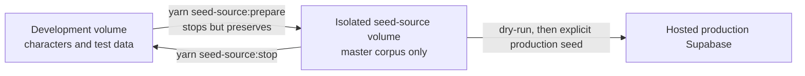

# Supabase project

`supabase/` is the schema and local-operations source for the Postgres/Auth platform. It is not the application data boundary; `apps/apis` and `packages/db` own request and persistence behavior.

## Owns and does not own

- `migrations/` is the ordered schema, constraint, RLS, and policy history. New schema behavior belongs in a migration.
- `config.toml` defines local API, database, Studio, Auth, storage, and seed settings. Local DB/API/Studio ports are 54322, 54321, and 54323.
- `seed.sql` is loaded after migrations during local reset; package seed scripts populate authored and SRD data through the DB layer.
- Does not own TypeScript repository hydration, tRPC routes, node maps, or engine rules.

## Key flow

Migration files establish the schema and RLS policies → local/remote Supabase applies them → `packages/db` connects through Kysely → `apps/apis` supplies authenticated user context → services persist or hydrate authored records.

## Invariants

- Treat migrations as append-only history; do not edit an applied migration to change live behavior.
- Preserve RLS and auth-claim assumptions used by `packages/db.withUserContext` and the API handler.
- Keep seed/bootstrap SQL and application upserts separate so application writes remain testable and transactional.

## Focused validation

Inspect the relevant migration and run the narrow DB/repository test first. For local schema work, verify with the Supabase CLI reset/diff workflow documented by the repository commands; confirm Docker/Supabase is running before diagnosing application auth or sheet failures.

## Isolated production seed source

Keep ordinary development and test records in the normal `artificer-toolkit` local Supabase project. Production SRD synchronization uses a second persistent local Docker project, `artificer-toolkit-srd-seed-source`. Both use the standard local ports, so the commands run only one at a time; stopping a project preserves its Docker volume.

Use this workflow:

1. Run `yarn seed-source:prepare`. It stages the current Supabase config/migrations into the ignored `.supabase-seed-source` worktree, stops the development stack without deleting it, resets only the isolated database, seeds it, and audits it.
2. Run `yarn seed:srd:production:dry-run` and inspect the report.
3. Run `yarn seed:srd:production` only when the dry run is correct.
4. Run `yarn audit:srd:production` for the final hosted audit.
5. Run `yarn seed-source:stop` to stop the isolated stack and restore the development stack with its original data.

`yarn seed-source:start` switches to the isolated stack without resetting or seeding it, which is useful for inspection. Never pass `--no-backup` when stopping either local project. The production commands remain separate and explicit; preparing the local source cannot write to production.

## Closed-alpha authentication

`PUBLIC_SIGN_UP_ENABLED` controls application presentation and the application-initiated sign-up action. It defaults to disabled unless its server-only environment value is exactly `true`. Change the value in the root `.env.local` for local work or in the hosted application environment for deployment, then restart or redeploy the application.

The application flag is not the security boundary: a client can call the public Supabase Auth API directly when Supabase permits sign-ups. During closed alpha and beta, configure the hosted Supabase project as follows:

1. In Authentication settings, disable **Allow new users to sign up**. Keep email/password sign-in and password recovery enabled for existing users, and keep anonymous sign-ins disabled.
2. In Authentication settings, require passwords of at least 12 characters with no composition rule and enable secure password changes. These values match `config.toml`; hosted projects must be configured separately in the Dashboard.
3. In Authentication URL Configuration, set the production Site URL and add `https://<your-domain>/auth/confirmed`, `https://<your-domain>/update-password`, and `https://<your-domain>/settings/account` to Redirect URLs.
4. The Send Email Hook accepts only redirects on the configured `SITE_URL` origin and always builds invitation links as `<SITE_URL>/auth/confirmed?token_hash=<token-hash>&type=invite`. The app verifies that token server-side, establishes the invitation session, and redirects the invitee to password setup. Supabase's configured email templates are bypassed while the hook is enabled.
5. Configure the branded Send Email Hook before inviting external testers. The default Supabase mail service is restricted and is not suitable for alpha delivery; this project deliberately uses the Resend API hook instead of SMTP.
6. Invite testers from Authentication → Users → Add user → Send invitation. The application does not provide an admin invitation interface.

The invitation callback and `/update-password` remain enabled when public registration is disabled. Invitees claim a unique username and choose their password; the pending auth-user insert has already created its private profile, and product-data procedures remain unavailable until completion. Password recovery sends a six-digit OTP, verifies the email and code on `/verify-password-reset`, and then uses the same `/update-password` form without restarting account setup. The email link carries the URL-encoded address only to prefill the code form; the form removes it from the visible URL after hydration. The link contains no recovery secret, which also prevents link-prefetch scanners from consuming the reset. Sign-in accepts either email or username, but username resolution and email lookup stay server-side. Username sign-in forwards the trusted proxy IP with `Sb-Forwarded-For`; enable IP Address Forwarding under Supabase Auth rate limits before deploying it. Keep Supabase public signup disabled until a Before User Created hook mirrors the full application username policy; only then enable both `PUBLIC_SIGN_UP_ENABLED=true` and the Supabase project signup setting. The database trigger rejects reserved usernames, but must allow a temporary null because Supabase does not expose invitation state early enough during the auth-user insert. Do not place a Supabase secret key in web environment variables or client-side code.

Username profanity and reserved-name checks run when an account claims or renames its username through the application server. The auth-user trigger provides the hard reserved-name boundary, but required-name and profanity checks must also run in the Before User Created hook before public signup is enabled. Public launch still needs username reporting and moderation.

## Branded authentication email delivery

`packages/emails` owns the portable React Email templates and signed-hook behavior. [`netlify/functions/send-auth-email.mts`](../netlify/functions/send-auth-email.mts) is the client-independent deployment entrypoint: Supabase signs the hook payload, the Netlify Function verifies it with Standard Webhooks, renders the selected template, and sends it through Resend. It supports signup confirmation/resend, password recovery, invitations, magic links/OTP, email changes, and reauthentication codes. Project-level security notifications remain disabled until matching templates are intentionally added.

The hook rejects request bodies over 64 KiB before signature verification and derives one stable Resend idempotency key per signed webhook message and recipient. This lets a retried two-address email change resume without duplicating the delivery that already succeeded.

The function uses Supabase's documented double-confirm email-change mapping: the current address receives `token` with `token_hash_new`, while the new address receives `token_new` with `token_hash`.

### Operator setup

1. Verify an Artificer Toolkit sending domain in Resend and choose an address such as `Artificer Toolkit <accounts@auth.example.com>`. Disable Resend open and click tracking for this sender; link rewriting can invalidate Supabase verification links.
2. Add `RESEND_API_KEY`, `SEND_EMAIL_HOOK_SECRET`, `AUTH_EMAIL_FROM`, and the canonical public app origin as `SITE_URL` as server-only variables in the existing Netlify project. `SUPABASE_URL` is already required by the backend. Never prefix these values with `VITE_`.
3. Deploy the Netlify project. Netlify builds and deploys the root `netlify/functions` directory alongside the web application.
4. In Supabase Dashboard -> Authentication -> Hooks, enable **Send Email** and use `https://<your-domain>/.netlify/functions/send-auth-email` as the HTTP hook URL. Use the signing secret generated there as `SEND_EMAIL_HOOK_SECRET`. Keep the Email provider enabled. Do not also configure Resend as SMTP: once the hook is enabled, it owns delivery.
5. In Authentication -> URL Configuration, retain the web callback URLs above. The current hook rejects non-`SITE_URL` origins; add an explicit trusted native-callback policy before enabling native authentication email flows.
6. Before public signup, set conservative Auth email and signup rate limits for the Resend allowance. Add CAPTCHA if bot traffic becomes a concern.

For local template work, run `yarn workspace @artificer-toolkit/emails dev`. For a controlled live smoke test, first deploy Netlify and enable the hook, then trigger one signup email to a designated recipient and verify the link, redirect, and sender. Do not use production secrets in committed files.

## Canonical references

- [Persistence and Kysely](../docs/architecture/persistence.md)
- [Data lifecycle](../docs/architecture/data-lifecycle.md)
- [Architecture overview](../docs/architecture/overview.md)
